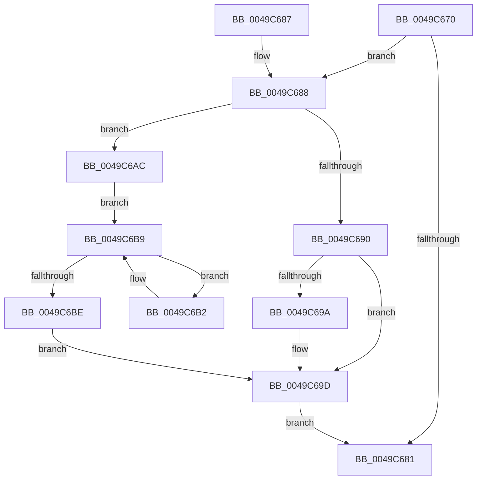

# RtlEnumerateGenericTableWithoutSplaying

- RVA: `0x0049C670`–`0x0049C6C3` (길이 `83` bytes)
- VA: `0x000000014049C670`
- 실행 섹션: `.text`
- PDB 이름 있음: `예`; PDB Function 태그: `아니요`
- unwind 정보 RVA: `0x000B4C5C`
- 디코드: `30`개 명령, `83/83` bytes 표시
- 미해석 바이트: `0` (있으면 어셈블리에 `.byte`로 보존)

> 이 문서는 커널 이미지의 기계어와 PDB 기호를 분석해 생성했습니다. 4번과 5번은 함수 원형과 자료형을 바이너리 사용 방식에서 추정한 C 해석이며 원본 소스 복구 결과는 아닙니다.

## 1. Dependencies

- 직접 호출 지점: **1**; 고유 호출 대상: **1**
- 직접 호출자로 확인된 함수: **0**
- RIP 상대 이미지 참조: **0**

### Outgoing calls
- `0x0049C690` → [RtlRealSuccessor](../38/RtlRealSuccessor_function_0038DF40.md) (function, `0x0038DF40`)

### Direct callers
- 이 함수 시작 RVA로 연결되는 직접 call은 확인되지 않았습니다. 간접 호출은 완전히 역산할 수 없습니다.

### Static image references
- 디코드된 RIP-relative 메모리 참조가 없습니다.

## 2. Other-region calls and transfers

- 다른 실행 섹션으로 향하는 call: **0**
- 별도 외부 분기/꼬리 이동을 확인하지 못했습니다.

## 3. Assembly (complete function range)

```asm
0049C670  40 53                           push rbx
0049C672  48 83 EC 20                     sub rsp, 0x20
0049C676  48 8B 01                        mov rax, qword ptr [rcx]
0049C679  48 8B DA                        mov rbx, rdx
0049C67C  48 85 C0                        test rax, rax
0049C67F  75 07                           jne 0x14049c688
0049C681  48 83 C4 20                     add rsp, 0x20
0049C685  5B                              pop rbx
0049C686  C3                              ret
0049C687  CC                              int3
0049C688  48 8B 0A                        mov rcx, qword ptr [rdx]
0049C68B  48 85 C9                        test rcx, rcx
0049C68E  74 1C                           je 0x14049c6ac
0049C690  E8 AB 18 EF FF                  call 0x14038df40
0049C695  48 85 C0                        test rax, rax
0049C698  74 03                           je 0x14049c69d
0049C69A  48 89 03                        mov qword ptr [rbx], rax
0049C69D  48 8D 48 28                     lea rcx, [rax + 0x28]
0049C6A1  48 F7 D8                        neg rax
0049C6A4  48 1B C0                        sbb rax, rax
0049C6A7  48 23 C1                        and rax, rcx
0049C6AA  EB D5                           jmp 0x14049c681
0049C6AC  48 8B 48 08                     mov rcx, qword ptr [rax + 8]
0049C6B0  EB 07                           jmp 0x14049c6b9
0049C6B2  48 8B C1                        mov rax, rcx
0049C6B5  48 8B 49 08                     mov rcx, qword ptr [rcx + 8]
0049C6B9  48 85 C9                        test rcx, rcx
0049C6BC  75 F4                           jne 0x14049c6b2
0049C6BE  48 89 02                        mov qword ptr [rdx], rax
0049C6C1  EB DA                           jmp 0x14049c69d
```

## 4. C-style interpretation (structured pseudocode)

```c
__int64 __fastcall RtlEnumerateGenericTableWithoutSplaying(__int64 a1, __int64 a2)
{
    __int64 result;
    __int64 v_rsp;

    v_rsp = (v_rsp) - (32);
    if (*(unsigned __int64 *)(a1) != 0) goto loc_0049C688;
loc_0049C681:
    v_rsp = (v_rsp) + (32);
    return *(unsigned __int64 *)(a1);
loc_0049C688:
    if (*(unsigned __int64 *)(a2) == 0) goto loc_0049C6AC;
    result = RtlRealSuccessor(*(unsigned __int64 *)(a2), a2, a3, a4);
    if (result != 0) {
        *(unsigned __int64 *)(a2) = result;
    }
    result = -(result);
    result = (result) & (result + 40);
    goto loc_0049C681;
loc_0049C6AC:
    goto loc_0049C6B9;
loc_0049C6B2:
loc_0049C6B9:
    if (*(unsigned __int64 *)(*(unsigned __int64 *)(result + 8) + 8) != 0) goto loc_0049C6B2;
    *(unsigned __int64 *)(a2) = *(unsigned __int64 *)(result + 8);
    goto loc_0049C69D;
}
```

## 5. (Beta) C Style

```c
int64_t RtlEnumerateGenericTableWithoutSplaying(void *Arg1, void *Arg2)
{
    uint8_t *arg1 = (uint8_t *)Arg1;
    uint8_t *arg2 = (uint8_t *)Arg2;

    int64_t result;
    int64_t local_rsp;

    local_rsp = (local_rsp) - (32);
    if (*(uint64_t *)(arg1) != 0) goto loc_0049C688;
loc_0049C681:
    local_rsp = (local_rsp) + (32);
    return *(uint64_t *)(arg1);
loc_0049C688:
    if (*(uint64_t *)(arg2) == 0) goto loc_0049C6AC;
    result = RtlRealSuccessor(*(uint64_t *)(arg2), Arg2, a3, a4);
    if (result != 0) {
        *(uint64_t *)(arg2) = result;
    }
    result = -(result);
    result = (result) & (result + 40);
    goto loc_0049C681;
loc_0049C6AC:
    goto loc_0049C6B9;
loc_0049C6B2:
loc_0049C6B9:
    if (*(uint64_t *)(*(uint64_t *)(result + 0x8) + 0x8) != 0) goto loc_0049C6B2;
    *(uint64_t *)(arg2) = *(uint64_t *)(result + 0x8);
    goto loc_0049C69D;
}
```

### 관측된 메모리 오프셋

구조체 형식이 확인되지 않은 접근은 인자 기준의 오프셋으로만 기록했습니다.

| 기준 인자 | 오프셋 표현 | 폭 (bit) | 접근 |
|---|---:|---:|---|
| `Arg1` | `+ 0x0` | `64` | `R` |
| `Arg2` | `+ 0x0` | `64` | `R` |
| `Arg2` | `+ 0x0` | `64` | `W` |

## 6. Execution-region graph

[열기: 2D/3D 그래프와 함수 탐색 컨트롤 패널](../../../control-panel.html?section=text&rva=0x0049C670&view=graph)

- 2D 그래프는 위에서 아래로 흐르고, 3D 그래프는 빈 공간을 드래그해 회전합니다. Shift+드래그는 이동, 휠은 확대·축소, 함수 노드 선택은 대상 보고서 이동입니다.

### Static fallback


