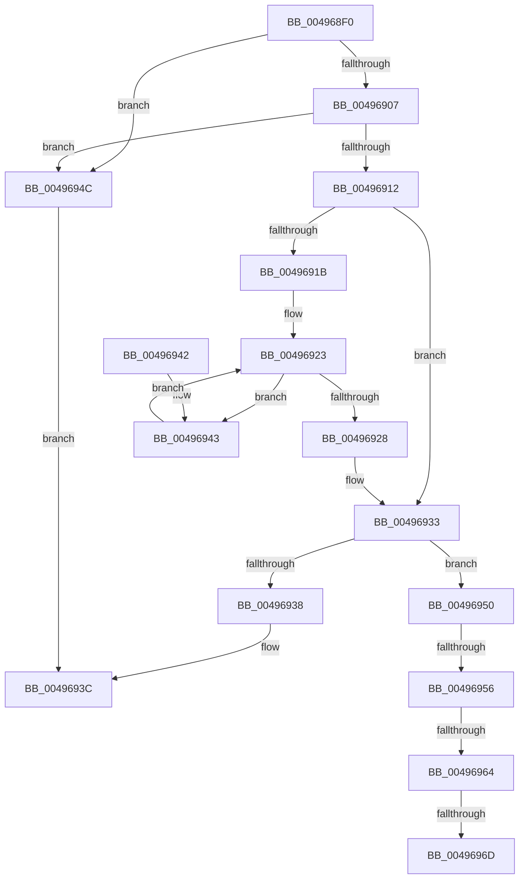

# RtlGetElementGenericTableAvl

- RVA: `0x004968F0`–`0x00496972` (길이 `130` bytes)
- VA: `0x00000001404968F0`
- 실행 섹션: `.text`
- PDB 이름 있음: `예`; PDB Function 태그: `예`
- unwind 정보 RVA: `0x0007DF94`
- 디코드: `42`개 명령, `130/130` bytes 표시
- 미해석 바이트: `0` (있으면 어셈블리에 `.byte`로 보존)

> 이 문서는 커널 이미지의 기계어와 PDB 기호를 분석해 생성했습니다. 4번과 5번은 함수 원형과 자료형을 바이너리 사용 방식에서 추정한 C 해석이며 원본 소스 복구 결과는 아닙니다.

## 1. Dependencies

- 직접 호출 지점: **0**; 고유 호출 대상: **0**
- 직접 호출자로 확인된 함수: **2**
- RIP 상대 이미지 참조: **0**

### Outgoing calls
- 직접 디코드된 call 명령이 없습니다.

### Direct callers
- [DifObjTrkQeuryInvokeDeleteRange](../61/DifObjTrkQeuryInvokeDeleteRange_function_00619EA0.md) at `0x0061A11B`
- [DifObjTrkQeuryInvokeDeleteRange](../61/DifObjTrkQeuryInvokeDeleteRange_function_00619EA0.md) at `0x0061A162`
- [DifObjTrkQeuryInvokeDeleteRange](../61/DifObjTrkQeuryInvokeDeleteRange_function_00619EA0.md) at `0x0061A17D`
- [DifObjTrkRemoveItem](../61/DifObjTrkRemoveItem_function_0061A1D0.md) at `0x0061A2CD`
- [DifObjTrkRemoveItem](../61/DifObjTrkRemoveItem_function_0061A1D0.md) at `0x0061A2F3`
- [DifObjTrkRemoveItem](../61/DifObjTrkRemoveItem_function_0061A1D0.md) at `0x0061A312`

### Static image references
- 디코드된 RIP-relative 메모리 참조가 없습니다.

## 2. Other-region calls and transfers

- 다른 실행 섹션으로 향하는 call: **0**
- call이 아닌 외부 분기/꼬리 이동: **4**
  - `0x00496950` → [sub_006F76E6 + 0x3C](../6F/Unknown_function_006F76E6.md) (`tail-transfer`)
  - `0x0049695E` → [sub_006F76E6 + 0xF](../6F/Unknown_function_006F76E6.md) (`tail-transfer`)
  - `0x00496967` → [sub_006F76E6](../6F/Unknown_function_006F76E6.md) (`tail-transfer`)
  - `0x0049696D` → [sub_006F76E6 + 0x8A](../6F/Unknown_function_006F76E6.md) (`tail-transfer`)

## 3. Assembly (complete function range)

```asm
004968F0  40 53                           push rbx
004968F2  48 83 EC 20                     sub rsp, 0x20
004968F6  44 8B 49 28                     mov r9d, dword ptr [rcx + 0x28]
004968FA  83 CB FF                        or ebx, 0xffffffff
004968FD  44 8B D2                        mov r10d, edx
00496900  4C 8B D9                        mov r11, rcx
00496903  3B D3                           cmp edx, ebx
00496905  74 45                           je 0x14049694c
00496907  8B 51 2C                        mov edx, dword ptr [rcx + 0x2c]
0049690A  41 8D 42 01                     lea eax, [r10 + 1]
0049690E  3B C2                           cmp eax, edx
00496910  77 3A                           ja 0x14049694c
00496912  48 8B 49 20                     mov rcx, qword ptr [rcx + 0x20]
00496916  48 85 C9                        test rcx, rcx
00496919  75 18                           jne 0x140496933
0049691B  49 8B 4B 10                     mov rcx, qword ptr [r11 + 0x10]
0049691F  48 8B 41 08                     mov rax, qword ptr [rcx + 8]
00496923  48 85 C0                        test rax, rax
00496926  75 1B                           jne 0x140496943
00496928  45 33 C9                        xor r9d, r9d
0049692B  49 89 4B 20                     mov qword ptr [r11 + 0x20], rcx
0049692F  45 21 4B 28                     and dword ptr [r11 + 0x28], r9d
00496933  45 3B D1                        cmp r10d, r9d
00496936  75 18                           jne 0x140496950
00496938  48 8D 41 20                     lea rax, [rcx + 0x20]
0049693C  48 83 C4 20                     add rsp, 0x20
00496940  5B                              pop rbx
00496941  C3                              ret
00496942  CC                              int3
00496943  48 8B C8                        mov rcx, rax
00496946  48 8B 40 08                     mov rax, qword ptr [rax + 8]
0049694A  EB D7                           jmp 0x140496923
0049694C  33 C0                           xor eax, eax
0049694E  EB EC                           jmp 0x14049693c
00496950  0F 83 CC 0D 26 00               jae 0x1406f7722
00496956  41 8B C1                        mov eax, r9d
00496959  D1 E8                           shr eax, 1
0049695B  44 3B D0                        cmp r10d, eax
0049695E  0F 82 91 0D 26 00               jb 0x1406f76f5
00496964  45 2B CA                        sub r9d, r10d
00496967  0F 85 79 0D 26 00               jne 0x1406f76e6
0049696D  E9 FE 0D 26 00                  jmp 0x1406f7770
```

## 4. C-style interpretation (structured pseudocode)

```c
__int64 __fastcall RtlGetElementGenericTableAvl(__int64 a1, int a2)
{
    __int64 result;
    __int64 v_rbx;
    __int64 v_rsp;

    v_rsp = (v_rsp) - (32);
    v_rbx = (unsigned int)((v_rbx) | (0xFFFFFFFFULL));
    if (a2 == ((unsigned int)(v_rbx))) goto loc_0049694C;
    if (((unsigned int)((unsigned int)(a2) + 1)) > ((unsigned int)((unsigned int)(*(unsigned int *)(a1 + 44))))) goto loc_0049694C;
    if (*(unsigned __int64 *)(a1 + 32) != 0) goto loc_00496933;
loc_00496923:
    if (*(unsigned __int64 *)(*(unsigned __int64 *)(a1 + 16) + 8) != 0) goto loc_00496943;
    a4 = 0;
    *(unsigned __int64 *)(a1 + 32) = *(unsigned __int64 *)(a1 + 16);
loc_00496933:
    if (((unsigned int)((unsigned int)(a2))) != 0) goto loc_00496950;
loc_0049693C:
    v_rsp = (v_rsp) + (32);
    return *(unsigned __int64 *)(a1 + 16) + 32;
loc_00496943:
    goto loc_00496923;
loc_0049694C:
    result = 0;
    goto loc_0049693C;
loc_00496950:
    result = (unsigned int)((0) >> (1));
    a4 = (unsigned int)((a4) - ((unsigned int)((unsigned int)(a2))));
}
```

## 5. (Beta) C Style

```c
int64_t RtlGetElementGenericTableAvl(void *Arg1, void *Arg2)
{
    uint8_t *arg1 = (uint8_t *)Arg1;
    uint8_t *arg2 = (uint8_t *)Arg2;

    int64_t result;
    int64_t local_rbx;
    int64_t local_rsp;

    local_rsp = (local_rsp) - (32);
    local_rbx = (uint32_t)((local_rbx) | (0xFFFFFFFFULL));
    if (Arg2 == ((uint32_t)(local_rbx))) goto loc_0049694C;
    if (((uint32_t)((uint32_t)(Arg2) + 1)) > ((uint32_t)((uint32_t)(*(uint32_t *)(arg1 + 0x2C))))) goto loc_0049694C;
    if (*(uint64_t *)(arg1 + 0x20) != 0) goto loc_00496933;
loc_00496923:
    if (*(uint64_t *)(*(uint64_t *)(arg1 + 0x10) + 0x8) != 0) goto loc_00496943;
    a4 = 0;
    *(uint64_t *)(arg1 + 0x20) = *(uint64_t *)(arg1 + 0x10);
loc_00496933:
    if (((uint32_t)((uint32_t)(Arg2))) != 0) goto loc_00496950;
loc_0049693C:
    local_rsp = (local_rsp) + (32);
    return *(uint64_t *)(arg1 + 0x10) + 32;
loc_00496943:
    goto loc_00496923;
loc_0049694C:
    result = 0;
    goto loc_0049693C;
loc_00496950:
    result = (uint32_t)((0) >> (1));
    a4 = (uint32_t)((a4) - ((uint32_t)((uint32_t)(Arg2))));
}
```

### 관측된 메모리 오프셋

구조체 형식이 확인되지 않은 접근은 인자 기준의 오프셋으로만 기록했습니다.

| 기준 인자 | 오프셋 표현 | 폭 (bit) | 접근 |
|---|---:|---:|---|
| `Arg1` | `+ 0x10` | `64` | `R` |
| `Arg1` | `+ 0x20` | `64` | `R` |
| `Arg1` | `+ 0x20` | `64` | `W` |
| `Arg1` | `+ 0x28` | `32` | `R` |
| `Arg1` | `+ 0x28` | `32` | `R/W` |
| `Arg1` | `+ 0x2C` | `32` | `R` |
| `Arg2` | `+ 0x1` | `32` | `R` |

## 6. Execution-region graph

[열기: 2D/3D 그래프와 함수 탐색 컨트롤 패널](../../../control-panel.html?section=text&rva=0x004968F0&view=graph)

- 2D 그래프는 위에서 아래로 흐르고, 3D 그래프는 빈 공간을 드래그해 회전합니다. Shift+드래그는 이동, 휠은 확대·축소, 함수 노드 선택은 대상 보고서 이동입니다.

### Static fallback


