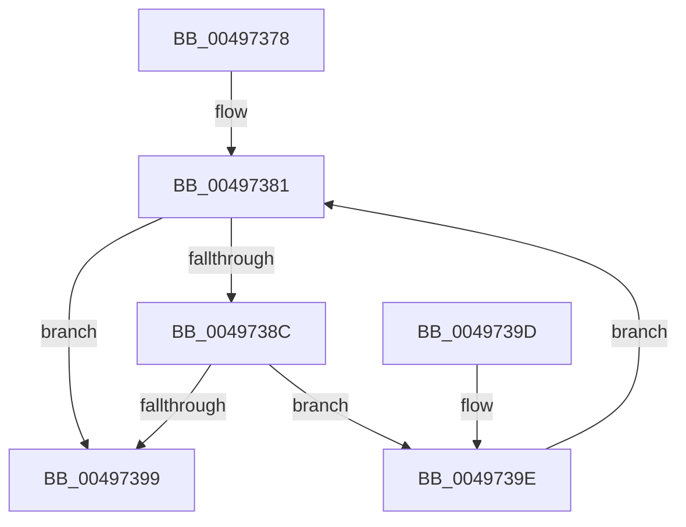

# RtlInterlockedSetClearBits

- RVA: `0x00497378`–`0x004973A3` (길이 `43` bytes)
- VA: `0x0000000140497378`
- 실행 섹션: `.text`
- PDB 이름 있음: `예`; PDB Function 태그: `아니요`
- unwind 정보 RVA: `0x000DB714`
- 디코드: `16`개 명령, `43/43` bytes 표시
- 미해석 바이트: `0` (있으면 어셈블리에 `.byte`로 보존)

> 이 문서는 커널 이미지의 기계어와 PDB 기호를 분석해 생성했습니다. 4번과 5번은 함수 원형과 자료형을 바이너리 사용 방식에서 추정한 C 해석이며 원본 소스 복구 결과는 아닙니다.

## 1. Dependencies

- 직접 호출 지점: **0**; 고유 호출 대상: **0**
- 직접 호출자로 확인된 함수: **4**
- RIP 상대 이미지 참조: **0**

### Outgoing calls
- 직접 디코드된 call 명령이 없습니다.

### Direct callers
- [PspApplyJobChainLimitsToProcess](../../page/87/PspApplyJobChainLimitsToProcess_function_0087EB5C.md) at `0x0087EC4F`
- [PspRundownSingleProcess](../../page/90/PspRundownSingleProcess_function_00906D50.md) at `0x0090702A`
- [PspAssociateCompletionPortCallback](../../page/A8/PspAssociateCompletionPortCallback_function_00A83290.md) at `0x00A832B2`
- [NtSetInformationProcess](../../page/AE/NtSetInformationProcess_function_00AE5370.md) at `0x00AE7F89`
- [NtSetInformationProcess](../../page/AE/NtSetInformationProcess_function_00AE5370.md) at `0x00AE82C6`
- [NtSetInformationProcess](../../page/AE/NtSetInformationProcess_function_00AE5370.md) at `0x00AE8342`
- [NtSetInformationProcess](../../page/AE/NtSetInformationProcess_function_00AE5370.md) at `0x00AE836C`
- [NtSetInformationProcess](../../page/AE/NtSetInformationProcess_function_00AE5370.md) at `0x00AE8494`

### Static image references
- 디코드된 RIP-relative 메모리 참조가 없습니다.

## 2. Other-region calls and transfers

- 다른 실행 섹션으로 향하는 call: **0**
- 별도 외부 분기/꼬리 이동을 확인하지 못했습니다.

## 3. Assembly (complete function range)

```asm
00497378  44 8B 11                        mov r10d, dword ptr [rcx]
0049737B  41 F7 D0                        not r8d
0049737E  45 8B CA                        mov r9d, r10d
00497381  44 0B CA                        or r9d, edx
00497384  45 23 C8                        and r9d, r8d
00497387  45 3B CA                        cmp r9d, r10d
0049738A  74 0D                           je 0x140497399
0049738C  41 8B C2                        mov eax, r10d
0049738F  F0 44 0F B1 09                  lock cmpxchg dword ptr [rcx], r9d
00497394  44 8B C8                        mov r9d, eax
00497397  75 05                           jne 0x14049739e
00497399  41 8B C2                        mov eax, r10d
0049739C  C3                              ret
0049739D  CC                              int3
0049739E  45 8B D1                        mov r10d, r9d
004973A1  EB DE                           jmp 0x140497381
```

## 4. C-style interpretation (structured pseudocode)

```c
__int64 __fastcall RtlInterlockedSetClearBits(__int64 a1, int a2, int a3)
{
    a3 = (unsigned int)(~(a3));
loc_00497381:
    a4 = (unsigned int)(((unsigned int)((unsigned int)((unsigned int)(*(unsigned int *)(a1))))) | (a2));
    a4 = (unsigned int)((a4) & (a3));
    if (((unsigned int)(a4)) == ((unsigned int)((unsigned int)(*(unsigned int *)(a1))))) goto loc_00497399;
    if (((unsigned int)(a4)) != ((unsigned int)((unsigned int)(*(unsigned int *)(a1))))) goto loc_0049739E;
loc_00497399:
    return (unsigned int)((unsigned int)((unsigned int)(*(unsigned int *)(a1))));
loc_0049739E:
    goto loc_00497381;
}
```

## 5. (Beta) C Style

```c
int64_t RtlInterlockedSetClearBits(void *Arg1, int32_t Arg2, int32_t Arg3)
{
    uint8_t *arg1 = (uint8_t *)Arg1;

    Arg3 = (uint32_t)(~(Arg3));
loc_00497381:
    a4 = (uint32_t)(((uint32_t)((uint32_t)((uint32_t)(*(uint32_t *)(arg1))))) | (Arg2));
    a4 = (uint32_t)((a4) & (Arg3));
    if (((uint32_t)(a4)) == ((uint32_t)((uint32_t)(*(uint32_t *)(arg1))))) goto loc_00497399;
    if (((uint32_t)(a4)) != ((uint32_t)((uint32_t)(*(uint32_t *)(arg1))))) goto loc_0049739E;
loc_00497399:
    return (uint32_t)((uint32_t)((uint32_t)(*(uint32_t *)(arg1))));
loc_0049739E:
    goto loc_00497381;
}
```

### 관측된 메모리 오프셋

구조체 형식이 확인되지 않은 접근은 인자 기준의 오프셋으로만 기록했습니다.

| 기준 인자 | 오프셋 표현 | 폭 (bit) | 접근 |
|---|---:|---:|---|
| `Arg1` | `+ 0x0` | `32` | `R` |

## 6. Execution-region graph

[열기: 2D/3D 그래프와 함수 탐색 컨트롤 패널](../../../control-panel.html?section=text&rva=0x00497378&view=graph)

- 2D 그래프는 위에서 아래로 흐르고, 3D 그래프는 빈 공간을 드래그해 회전합니다. Shift+드래그는 이동, 휠은 확대·축소, 함수 노드 선택은 대상 보고서 이동입니다.

### Static fallback


