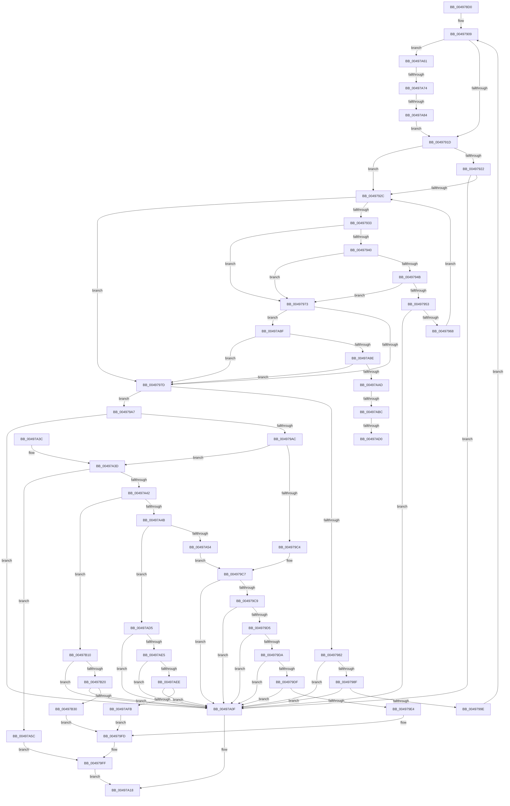

# RtlIpv4StringToAddressA

- RVA: `0x004978D0`–`0x00497B3A` (길이 `618` bytes)
- VA: `0x00000001404978D0`
- 실행 섹션: `.text`
- PDB 이름 있음: `예`; PDB Function 태그: `예`
- unwind 정보 RVA: `0x000B3EAC`
- 디코드: `183`개 명령, `618/618` bytes 표시
- 미해석 바이트: `0` (있으면 어셈블리에 `.byte`로 보존)

> 이 문서는 커널 이미지의 기계어와 PDB 기호를 분석해 생성했습니다. 4번과 5번은 함수 원형과 자료형을 바이너리 사용 방식에서 추정한 C 해석이며 원본 소스 복구 결과는 아닙니다.

## 1. Dependencies

- 직접 호출 지점: **9**; 고유 호출 대상: **5**
- 직접 호출자로 확인된 함수: **1**
- RIP 상대 이미지 참조: **1**

### Outgoing calls
- `0x00497937` → [_isascii](../50/_isascii_function_00500660.md) (function, `0x00500660`)
- `0x00497942` → [isdigit](../50/isdigit_function_00500680.md) (function, `0x00500680`)
- `0x00497A1F` → [_security_check_cookie](../6A/_security_check_cookie_function_006AC640.md) (function, `0x006AC640`)
- `0x00497A67` → [_isascii](../50/_isascii_function_00500660.md) (function, `0x00500660`)
- `0x00497A77` → [isdigit](../50/isdigit_function_00500680.md) (function, `0x00500680`)
- `0x00497A91` → [_isascii](../50/_isascii_function_00500660.md) (function, `0x00500660`)
- `0x00497AA0` → [isxdigit](../50/isxdigit_function_00500770.md) (function, `0x00500770`)
- `0x00497AAF` → [_isascii](../50/_isascii_function_00500660.md) (function, `0x00500660`)
- `0x00497ABE` → [islower](../50/islower_function_005006B0.md) (function, `0x005006B0`)

### Direct callers
- [RtlIpv4StringToAddressExA](../5E/RtlIpv4StringToAddressExA_function_005EBF80.md) at `0x005EBFC8`

### Static image references
- `0x004978E7` → RVA `0x00E0A740` (`.data`; read)

## 2. Other-region calls and transfers

- 다른 실행 섹션으로 향하는 call: **0**
- call이 아닌 외부 분기/꼬리 이동: **5**
  - `0x00497A6E` → [sub_006F7816](../6F/Unknown_function_006F7816.md) (`tail-transfer`)
  - `0x00497A7E` → [sub_006F7816](../6F/Unknown_function_006F7816.md) (`tail-transfer`)
  - `0x00497AB6` → [sub_006F7816 + 0x1E](../6F/Unknown_function_006F7816.md) (`tail-transfer`)
  - `0x00497ACA` → [sub_006F7816 + 0x1E](../6F/Unknown_function_006F7816.md) (`tail-transfer`)
  - `0x00497AD0` → [sub_006F7816 + 0x23](../6F/Unknown_function_006F7816.md) (`tail-transfer`)

## 3. Assembly (complete function range)

```asm
004978D0  48 89 5C 24 10                  mov qword ptr [rsp + 0x10], rbx
004978D5  55                              push rbp
004978D6  56                              push rsi
004978D7  57                              push rdi
004978D8  41 54                           push r12
004978DA  41 55                           push r13
004978DC  41 56                           push r14
004978DE  41 57                           push r15
004978E0  48 8B EC                        mov rbp, rsp
004978E3  48 83 EC 50                     sub rsp, 0x50
004978E7  48 8B 05 52 2E 97 00            mov rax, qword ptr [rip + 0x972e52]
004978EE  48 33 C4                        xor rax, rsp
004978F1  48 89 45 F0                     mov qword ptr [rbp - 0x10], rax
004978F5  4C 89 4D D8                     mov qword ptr [rbp - 0x28], r9
004978F9  48 8D 5D E0                     lea rbx, [rbp - 0x20]
004978FD  4D 8B E8                        mov r13, r8
00497900  88 55 D0                        mov byte ptr [rbp - 0x30], dl
00497903  40 8A F2                        mov sil, dl
00497906  48 8B F9                        mov rdi, rcx
00497909  45 33 E4                        xor r12d, r12d
0049790C  45 32 FF                        xor r15b, r15b
0049790F  80 3F 30                        cmp byte ptr [rdi], 0x30
00497912  45 8D 74 24 0A                  lea r14d, [r12 + 0xa]
00497917  0F 84 44 01 00 00               je 0x140497a61
0049791D  40 84 F6                        test sil, sil
00497920  74 0A                           je 0x14049792c
00497922  41 83 FE 0A                     cmp r14d, 0xa
00497926  0F 85 E3 00 00 00               jne 0x140497a0f
0049792C  0F BE 07                        movsx eax, byte ptr [rdi]
0049792F  84 C0                           test al, al
00497931  74 4A                           je 0x14049797d
00497933  8B C8                           mov ecx, eax
00497935  8B F0                           mov esi, eax
00497937  E8 24 8D 06 00                  call 0x140500660
0049793C  85 C0                           test eax, eax
0049793E  74 33                           je 0x140497973
00497940  8B CE                           mov ecx, esi
00497942  E8 39 8D 06 00                  call 0x140500680
00497947  85 C0                           test eax, eax
00497949  74 28                           je 0x140497973
0049794B  8D 46 D0                        lea eax, [rsi - 0x30]
0049794E  41 3B C6                        cmp eax, r14d
00497951  7D 20                           jge 0x140497973
00497953  41 8B CE                        mov ecx, r14d
00497956  41 0F AF CC                     imul ecx, r12d
0049795A  83 C1 D0                        add ecx, -0x30
0049795D  03 CE                           add ecx, esi
0049795F  41 3B CC                        cmp ecx, r12d
00497962  0F 82 A7 00 00 00               jb 0x140497a0f
00497968  48 FF C7                        inc rdi
0049796B  41 B7 01                        mov r15b, 1
0049796E  44 8B E1                        mov r12d, ecx
00497971  EB B9                           jmp 0x14049792c
00497973  41 83 FE 10                     cmp r14d, 0x10
00497977  0F 84 12 01 00 00               je 0x140497a8f
0049797D  80 3F 2E                        cmp byte ptr [rdi], 0x2e
00497980  75 25                           jne 0x1404979a7
00497982  48 8D 45 EC                     lea rax, [rbp - 0x14]
00497986  48 3B D8                        cmp rbx, rax
00497989  0F 83 80 00 00 00               jae 0x140497a0f
0049798F  44 89 23                        mov dword ptr [rbx], r12d
00497992  48 FF C7                        inc rdi
00497995  48 83 C3 04                     add rbx, 4
00497999  45 84 FF                        test r15b, r15b
0049799C  74 71                           je 0x140497a0f
0049799E  40 8A 75 D0                     mov sil, byte ptr [rbp - 0x30]
004979A2  E9 62 FF FF FF                  jmp 0x140497909
004979A7  45 84 FF                        test r15b, r15b
004979AA  74 63                           je 0x140497a0f
004979AC  44 89 23                        mov dword ptr [rbx], r12d
004979AF  48 8D 45 E0                     lea rax, [rbp - 0x20]
004979B3  48 2B D8                        sub rbx, rax
004979B6  48 83 C3 04                     add rbx, 4
004979BA  48 C1 FB 02                     sar rbx, 2
004979BE  80 7D D0 00                     cmp byte ptr [rbp - 0x30], 0
004979C2  74 79                           je 0x140497a3d
004979C4  83 FB 04                        cmp ebx, 4
004979C7  75 46                           jne 0x140497a0f
004979C9  8B 55 E0                        mov edx, dword ptr [rbp - 0x20]
004979CC  B8 FF 00 00 00                  mov eax, 0xff
004979D1  3B D0                           cmp edx, eax
004979D3  77 3A                           ja 0x140497a0f
004979D5  39 45 E4                        cmp dword ptr [rbp - 0x1c], eax
004979D8  77 35                           ja 0x140497a0f
004979DA  39 45 E8                        cmp dword ptr [rbp - 0x18], eax
004979DD  77 30                           ja 0x140497a0f
004979DF  39 45 EC                        cmp dword ptr [rbp - 0x14], eax
004979E2  77 2B                           ja 0x140497a0f
004979E4  0F B6 45 E8                     movzx eax, byte ptr [rbp - 0x18]
004979E8  0F B6 4D E4                     movzx ecx, byte ptr [rbp - 0x1c]
004979EC  C1 E2 08                        shl edx, 8
004979EF  0B CA                           or ecx, edx
004979F1  C1 E1 08                        shl ecx, 8
004979F4  0B C8                           or ecx, eax
004979F6  0F B6 45 EC                     movzx eax, byte ptr [rbp - 0x14]
004979FA  C1 E1 08                        shl ecx, 8
004979FD  0B C8                           or ecx, eax
004979FF  48 8B 45 D8                     mov rax, qword ptr [rbp - 0x28]
00497A03  0F C9                           bswap ecx
00497A05  49 89 7D 00                     mov qword ptr [r13], rdi
00497A09  89 08                           mov dword ptr [rax], ecx
00497A0B  33 C0                           xor eax, eax
00497A0D  EB 09                           jmp 0x140497a18
00497A0F  49 89 7D 00                     mov qword ptr [r13], rdi
00497A13  B8 0D 00 00 C0                  mov eax, 0xc000000d
00497A18  48 8B 4D F0                     mov rcx, qword ptr [rbp - 0x10]
00497A1C  48 33 CC                        xor rcx, rsp
00497A1F  E8 1C 4C 21 00                  call 0x1406ac640
00497A24  48 8B 9C 24 98 00 00 00         mov rbx, qword ptr [rsp + 0x98]
00497A2C  48 83 C4 50                     add rsp, 0x50
00497A30  41 5F                           pop r15
00497A32  41 5E                           pop r14
00497A34  41 5D                           pop r13
00497A36  41 5C                           pop r12
00497A38  5F                              pop rdi
00497A39  5E                              pop rsi
00497A3A  5D                              pop rbp
00497A3B  C3                              ret
00497A3C  CC                              int3
00497A3D  83 EB 01                        sub ebx, 1
00497A40  74 1A                           je 0x140497a5c
00497A42  83 EB 01                        sub ebx, 1
00497A45  0F 84 C5 00 00 00               je 0x140497b10
00497A4B  83 EB 01                        sub ebx, 1
00497A4E  0F 84 81 00 00 00               je 0x140497ad5
00497A54  83 FB 01                        cmp ebx, 1
00497A57  E9 6B FF FF FF                  jmp 0x1404979c7
00497A5C  8B 4D E0                        mov ecx, dword ptr [rbp - 0x20]
00497A5F  EB 9E                           jmp 0x1404979ff
00497A61  48 FF C7                        inc rdi
00497A64  0F BE 0F                        movsx ecx, byte ptr [rdi]
00497A67  E8 F4 8B 06 00                  call 0x140500660
00497A6C  85 C0                           test eax, eax
00497A6E  0F 84 A2 FD 25 00               je 0x1406f7816
00497A74  0F BE 0F                        movsx ecx, byte ptr [rdi]
00497A77  E8 04 8C 06 00                  call 0x140500680
00497A7C  85 C0                           test eax, eax
00497A7E  0F 84 92 FD 25 00               je 0x1406f7816
00497A84  41 BE 08 00 00 00               mov r14d, 8
00497A8A  E9 8E FE FF FF                  jmp 0x14049791d
00497A8F  8B CE                           mov ecx, esi
00497A91  E8 CA 8B 06 00                  call 0x140500660
00497A96  85 C0                           test eax, eax
00497A98  0F 84 DF FE FF FF               je 0x14049797d
00497A9E  8B CE                           mov ecx, esi
00497AA0  E8 CB 8C 06 00                  call 0x140500770
00497AA5  85 C0                           test eax, eax
00497AA7  0F 84 D0 FE FF FF               je 0x14049797d
00497AAD  8B CE                           mov ecx, esi
00497AAF  E8 AC 8B 06 00                  call 0x140500660
00497AB4  85 C0                           test eax, eax
00497AB6  0F 84 78 FD 25 00               je 0x1406f7834
00497ABC  8B CE                           mov ecx, esi
00497ABE  E8 ED 8B 06 00                  call 0x1405006b0
00497AC3  B9 61 00 00 00                  mov ecx, 0x61
00497AC8  85 C0                           test eax, eax
00497ACA  0F 84 64 FD 25 00               je 0x1406f7834
00497AD0  E9 64 FD 25 00                  jmp 0x1406f7839
00497AD5  8B 55 E0                        mov edx, dword ptr [rbp - 0x20]
00497AD8  B8 FF 00 00 00                  mov eax, 0xff
00497ADD  3B D0                           cmp edx, eax
00497ADF  0F 87 2A FF FF FF               ja 0x140497a0f
00497AE5  39 45 E4                        cmp dword ptr [rbp - 0x1c], eax
00497AE8  0F 87 21 FF FF FF               ja 0x140497a0f
00497AEE  81 7D E8 FF FF 00 00            cmp dword ptr [rbp - 0x18], 0xffff
00497AF5  0F 87 14 FF FF FF               ja 0x140497a0f
00497AFB  0F B6 4D E4                     movzx ecx, byte ptr [rbp - 0x1c]
00497AFF  0F B7 45 E8                     movzx eax, word ptr [rbp - 0x18]
00497B03  C1 E2 08                        shl edx, 8
00497B06  0B CA                           or ecx, edx
00497B08  C1 E1 10                        shl ecx, 0x10
00497B0B  E9 ED FE FF FF                  jmp 0x1404979fd
00497B10  8B 4D E0                        mov ecx, dword ptr [rbp - 0x20]
00497B13  B8 FF 00 00 00                  mov eax, 0xff
00497B18  3B C8                           cmp ecx, eax
00497B1A  0F 87 EF FE FF FF               ja 0x140497a0f
00497B20  8B 45 E4                        mov eax, dword ptr [rbp - 0x1c]
00497B23  BA FF FF FF 00                  mov edx, 0xffffff
00497B28  3B C2                           cmp eax, edx
00497B2A  0F 87 DF FE FF FF               ja 0x140497a0f
00497B30  C1 E1 18                        shl ecx, 0x18
00497B33  23 C2                           and eax, edx
00497B35  E9 C3 FE FF FF                  jmp 0x1404979fd
```

## 4. C-style interpretation (structured pseudocode)

```c
__int64 __fastcall RtlIpv4StringToAddressA(__int64 a1, unsigned __int8 a2, __int64 a3, __int64 a4)
{
    __int64 result;
    __int64 v_r12;
    __int64 v_r15;
    __int64 v_rbx;
    __int64 v_rdi;
    __int64 v_rsp;
    unsigned __int64 v_stack_m48;
    unsigned __int64 v_stack_m4C;
    unsigned int v_stack_m50;
    unsigned int v_stack_m54;
    unsigned __int64 v_stack_m58;
    unsigned __int64 v_stack_m60;
    unsigned __int8 v_stack_m68;
    unsigned __int64 v_stack_p10;

    v_stack_p10 = v_rbx;
    v_rsp = (v_rsp) - (80);
    result = (*(unsigned __int64 *)(v_rip + 9907794)) ^ (v_rsp);
    v_stack_m48 = result;
    v_stack_m60 = a4;
    v_stack_m68 = a2;
loc_00497909:
    v_r12 = 0;
    v_r15 = 0;
    if ((*(unsigned __int8 *)(a1)) == 48) goto loc_00497A61;
loc_0049791D:
    if (a2 == 0) goto loc_0049792C;
    if (((unsigned int)(v_r12 + 10)) != 10) goto loc_00497A0F;
loc_0049792C:
    if ((unsigned __int8)((__int8)(*(unsigned __int8 *)(a1))) == 0) goto loc_0049797D;
    result = _isascii((unsigned int)((unsigned int)((__int8)(*(unsigned __int8 *)(a1)))), a2, a3, a4);
    if ((unsigned int)(result) == 0) goto loc_00497973;
    result = isdigit((unsigned int)((unsigned int)((unsigned int)((unsigned int)((__int8)(*(unsigned __int8 *)(a1)))))), a2, a3, a4);
    if ((unsigned int)(result) == 0) goto loc_00497973;
    if (((unsigned int)((unsigned int)((unsigned int)((__int8)(*(unsigned __int8 *)(a1)))) - 48)) >= ((unsigned int)(v_r12 + 10))) goto loc_00497973;
    a1 = (unsigned int)(((unsigned int)((unsigned int)(v_r12 + 10))) * (0));
    a1 = (unsigned int)((a1) + (-48));
    a1 = (unsigned int)((a1) + ((unsigned int)((unsigned int)((unsigned int)((__int8)(*(unsigned __int8 *)(a1)))))));
    if (((unsigned int)(a1)) < 0) goto loc_00497A0F;
    v_rdi = (a1) + 1;
    goto loc_0049792C;
loc_00497973:
    if (((unsigned int)(v_r12 + 10)) == 16) goto loc_00497A8F;
loc_0049797D:
    if ((*(unsigned __int8 *)(v_rdi)) != 46) goto loc_004979A7;
    if (v_stack_m58 >= v_stack_m4C) goto loc_00497A0F;
    *(unsigned int *)(v_stack_m58) = (unsigned int)((unsigned int)((unsigned int)(a1)));
    v_rdi = (v_rdi) + 1;
    v_rbx = (v_stack_m58) + (4);
    if (1 == 0) goto loc_00497A0F;
    goto loc_00497909;
loc_004979A7:
    if (1 == 0) goto loc_00497A0F;
    *(unsigned int *)(v_rbx) = (unsigned int)((unsigned int)((unsigned int)(a1)));
    v_rbx = (v_rbx) - (v_stack_m58);
    v_rbx = (v_rbx) + (4);
    v_rbx = (v_rbx) >> (2);
    if (v_stack_m68 == 0) goto loc_00497A3D;
loc_004979C7:
    if (((unsigned int)(v_rbx)) != 4) goto loc_00497A0F;
    if (((unsigned int)((unsigned int)(v_stack_m58))) > 255) goto loc_00497A0F;
    if (v_stack_m54 > 255) goto loc_00497A0F;
    if (v_stack_m50 > 255) goto loc_00497A0F;
    if (v_stack_m4C > 255) goto loc_00497A0F;
    a2 = (unsigned int)(((unsigned int)(v_stack_m58)) << (8));
    a1 = (unsigned int)((v_stack_m54) | (a2));
    a1 = (unsigned int)((a1) << (8));
    a1 = (unsigned int)((a1) | ((unsigned int)(v_stack_m50)));
    a1 = (unsigned int)((a1) << (8));
loc_004979FD:
    a1 = (unsigned int)((a1) | ((unsigned int)(v_stack_m4C)));
loc_004979FF:
    *(unsigned __int64 *)(a3) = v_rdi;
    *(unsigned int *)(v_stack_m60) = (unsigned int)(a1);
    result = 0;
    goto loc_00497A18;
loc_00497A0F:
    *(unsigned __int64 *)(a3) = v_rdi;
loc_00497A18:
    a1 = (v_stack_m48) ^ (v_rsp);
    result = _security_check_cookie(a1, a2, a3, a4);
    v_rsp = (v_rsp) + (80);
    return result;
loc_00497A3D:
    v_rbx = (unsigned int)((v_stack_p10) - (1));
    if (condition_is_equal) goto loc_00497A5C;
    v_rbx = (unsigned int)((v_rbx) - (1));
    if (condition_is_equal) goto loc_00497B10;
    v_rbx = (unsigned int)((v_rbx) - (1));
    if (condition_is_equal) goto loc_00497AD5;
    goto loc_004979C7;
loc_00497A5C:
    goto loc_004979FF;
loc_00497A61:
    v_rdi = (v_rdi) + 1;
    result = _isascii((__int8)(*(unsigned __int8 *)(v_rdi)), a2, a3, a4);
    result = isdigit((__int8)(*(unsigned __int8 *)(v_rdi)), a2, a3, a4);
    goto loc_0049791D;
loc_00497A8F:
    result = _isascii((unsigned int)((unsigned int)(v_stack_m68)), a2, a3, a4);
    if ((unsigned int)(result) == 0) goto loc_0049797D;
    result = isxdigit((unsigned int)((unsigned int)(v_stack_m68)), a2, a3, a4);
    if ((unsigned int)(result) == 0) goto loc_0049797D;
    result = _isascii((unsigned int)((unsigned int)(v_stack_m68)), a2, a3, a4);
    result = islower((unsigned int)((unsigned int)(v_stack_m68)), a2, a3, a4);
loc_00497AD5:
    if (((unsigned int)((unsigned int)(v_stack_m58))) > 255) goto loc_00497A0F;
    if (v_stack_m54 > 255) goto loc_00497A0F;
    if (v_stack_m50 > 0xFFFFULL) goto loc_00497A0F;
    a2 = (unsigned int)(((unsigned int)(v_stack_m58)) << (8));
    a1 = (unsigned int)((v_stack_m54) | (a2));
    a1 = (unsigned int)((a1) << (16));
    goto loc_004979FD;
loc_00497B10:
    if (((unsigned int)((unsigned int)(v_stack_m58))) > 255) goto loc_00497A0F;
    if (((unsigned int)((unsigned int)(v_stack_m54))) > ((unsigned int)((unsigned int)(0xFFFFFFULL)))) goto loc_00497A0F;
    a1 = (unsigned int)(((unsigned int)(v_stack_m58)) << (24));
    result = (unsigned int)(((unsigned int)(v_stack_m54)) & ((unsigned int)((unsigned int)(0xFFFFFFULL))));
    goto loc_004979FD;
}
```

## 5. (Beta) C Style

```c
int64_t RtlIpv4StringToAddressA(int64_t Arg1, uint8_t Arg2, void *Arg3, int64_t Arg4)
{
    uint8_t *arg3 = (uint8_t *)Arg3;

    int64_t result;
    int64_t local_r12;
    int64_t local_r15;
    int64_t local_rbx;
    int64_t local_rdi;
    int64_t local_rsp;
    uint64_t v_stack_m48;
    uint64_t v_stack_m4C;
    uint32_t v_stack_m50;
    uint32_t v_stack_m54;
    uint64_t v_stack_m58;
    uint64_t v_stack_m60;
    uint8_t v_stack_m68;
    uint64_t v_stack_p10;

    v_stack_p10 = local_rbx;
    local_rsp = (local_rsp) - (80);
    result = (*(uint64_t *)(v_rip + 0x972E52)) ^ (local_rsp);
    v_stack_m48 = result;
    v_stack_m60 = Arg4;
    v_stack_m68 = Arg2;
loc_00497909:
    local_r12 = 0;
    local_r15 = 0;
    if ((*(uint8_t *)(Arg1)) == 48) goto loc_00497A61;
loc_0049791D:
    if (Arg2 == 0) goto loc_0049792C;
    if (((uint32_t)(local_r12 + 10)) != 10) goto loc_00497A0F;
loc_0049792C:
    if ((uint8_t)((int8_t)(*(uint8_t *)(Arg1))) == 0) goto loc_0049797D;
    result = _isascii((uint32_t)((uint32_t)((int8_t)(*(uint8_t *)(Arg1)))), Arg2, Arg3, Arg4);
    if ((uint32_t)(result) == 0) goto loc_00497973;
    result = isdigit((uint32_t)((uint32_t)((uint32_t)((uint32_t)((int8_t)(*(uint8_t *)(Arg1)))))), Arg2, Arg3, Arg4);
    if ((uint32_t)(result) == 0) goto loc_00497973;
    if (((uint32_t)((uint32_t)((uint32_t)((int8_t)(*(uint8_t *)(Arg1)))) - 48)) >= ((uint32_t)(local_r12 + 10))) goto loc_00497973;
    Arg1 = (uint32_t)(((uint32_t)((uint32_t)(local_r12 + 10))) * (0));
    Arg1 = (uint32_t)((Arg1) + (-48));
    Arg1 = (uint32_t)((Arg1) + ((uint32_t)((uint32_t)((uint32_t)((int8_t)(*(uint8_t *)(Arg1)))))));
    if (((uint32_t)(Arg1)) < 0) goto loc_00497A0F;
    local_rdi = (Arg1) + 1;
    goto loc_0049792C;
loc_00497973:
    if (((uint32_t)(local_r12 + 10)) == 16) goto loc_00497A8F;
loc_0049797D:
    if ((*(uint8_t *)(local_rdi)) != 46) goto loc_004979A7;
    if (v_stack_m58 >= v_stack_m4C) goto loc_00497A0F;
    *(uint32_t *)(v_stack_m58) = (uint32_t)((uint32_t)((uint32_t)(Arg1)));
    local_rdi = (local_rdi) + 1;
    local_rbx = (v_stack_m58) + (4);
    if (1 == 0) goto loc_00497A0F;
    goto loc_00497909;
loc_004979A7:
    if (1 == 0) goto loc_00497A0F;
    *(uint32_t *)(local_rbx) = (uint32_t)((uint32_t)((uint32_t)(Arg1)));
    local_rbx = (local_rbx) - (v_stack_m58);
    local_rbx = (local_rbx) + (4);
    local_rbx = (local_rbx) >> (2);
    if (v_stack_m68 == 0) goto loc_00497A3D;
loc_004979C7:
    if (((uint32_t)(local_rbx)) != 4) goto loc_00497A0F;
    if (((uint32_t)((uint32_t)(v_stack_m58))) > 255) goto loc_00497A0F;
    if (v_stack_m54 > 255) goto loc_00497A0F;
    if (v_stack_m50 > 255) goto loc_00497A0F;
    if (v_stack_m4C > 255) goto loc_00497A0F;
    Arg2 = (uint32_t)(((uint32_t)(v_stack_m58)) << (8));
    Arg1 = (uint32_t)((v_stack_m54) | (Arg2));
    Arg1 = (uint32_t)((Arg1) << (8));
    Arg1 = (uint32_t)((Arg1) | ((uint32_t)(v_stack_m50)));
    Arg1 = (uint32_t)((Arg1) << (8));
loc_004979FD:
    Arg1 = (uint32_t)((Arg1) | ((uint32_t)(v_stack_m4C)));
loc_004979FF:
    *(uint64_t *)(arg3) = local_rdi;
    *(uint32_t *)(v_stack_m60) = (uint32_t)(Arg1);
    result = 0;
    goto loc_00497A18;
loc_00497A0F:
    *(uint64_t *)(arg3) = local_rdi;
loc_00497A18:
    Arg1 = (v_stack_m48) ^ (local_rsp);
    result = _security_check_cookie(Arg1, Arg2, Arg3, Arg4);
    local_rsp = (local_rsp) + (80);
    return result;
loc_00497A3D:
    local_rbx = (uint32_t)((v_stack_p10) - (1));
    if (condition_is_equal) goto loc_00497A5C;
    local_rbx = (uint32_t)((local_rbx) - (1));
    if (condition_is_equal) goto loc_00497B10;
    local_rbx = (uint32_t)((local_rbx) - (1));
    if (condition_is_equal) goto loc_00497AD5;
    goto loc_004979C7;
loc_00497A5C:
    goto loc_004979FF;
loc_00497A61:
    local_rdi = (local_rdi) + 1;
    result = _isascii((int8_t)(*(uint8_t *)(local_rdi)), Arg2, Arg3, Arg4);
    result = isdigit((int8_t)(*(uint8_t *)(local_rdi)), Arg2, Arg3, Arg4);
    goto loc_0049791D;
loc_00497A8F:
    result = _isascii((uint32_t)((uint32_t)(v_stack_m68)), Arg2, Arg3, Arg4);
    if ((uint32_t)(result) == 0) goto loc_0049797D;
    result = isxdigit((uint32_t)((uint32_t)(v_stack_m68)), Arg2, Arg3, Arg4);
    if ((uint32_t)(result) == 0) goto loc_0049797D;
    result = _isascii((uint32_t)((uint32_t)(v_stack_m68)), Arg2, Arg3, Arg4);
    result = islower((uint32_t)((uint32_t)(v_stack_m68)), Arg2, Arg3, Arg4);
loc_00497AD5:
    if (((uint32_t)((uint32_t)(v_stack_m58))) > 255) goto loc_00497A0F;
    if (v_stack_m54 > 255) goto loc_00497A0F;
    if (v_stack_m50 > 0xFFFFULL) goto loc_00497A0F;
    Arg2 = (uint32_t)(((uint32_t)(v_stack_m58)) << (8));
    Arg1 = (uint32_t)((v_stack_m54) | (Arg2));
    Arg1 = (uint32_t)((Arg1) << (16));
    goto loc_004979FD;
loc_00497B10:
    if (((uint32_t)((uint32_t)(v_stack_m58))) > 255) goto loc_00497A0F;
    if (((uint32_t)((uint32_t)(v_stack_m54))) > ((uint32_t)((uint32_t)(0xFFFFFFULL)))) goto loc_00497A0F;
    Arg1 = (uint32_t)(((uint32_t)(v_stack_m58)) << (24));
    result = (uint32_t)(((uint32_t)(v_stack_m54)) & ((uint32_t)((uint32_t)(0xFFFFFFULL))));
    goto loc_004979FD;
}
```

### 관측된 메모리 오프셋

구조체 형식이 확인되지 않은 접근은 인자 기준의 오프셋으로만 기록했습니다.

| 기준 인자 | 오프셋 표현 | 폭 (bit) | 접근 |
|---|---:|---:|---|
| `Arg3` | `+ 0x0` | `64` | `W` |

## 6. Execution-region graph

[열기: 2D/3D 그래프와 함수 탐색 컨트롤 패널](../../../control-panel.html?section=text&rva=0x004978D0&view=graph)

- 2D 그래프는 위에서 아래로 흐르고, 3D 그래프는 빈 공간을 드래그해 회전합니다. Shift+드래그는 이동, 휠은 확대·축소, 함수 노드 선택은 대상 보고서 이동입니다.

### Static fallback


