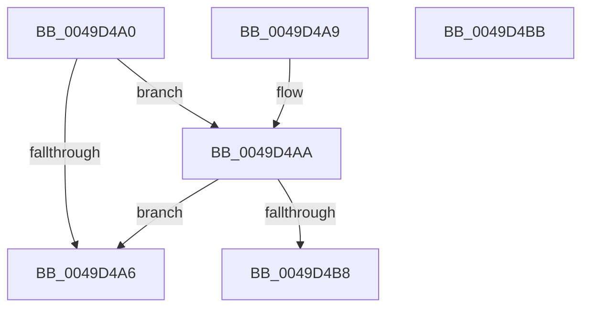

# RtlIsCloudFilesPlaceholder

- RVA: `0x0049D4A0`–`0x0049D4BC` (길이 `28` bytes)
- VA: `0x000000014049D4A0`
- 실행 섹션: `.text`
- PDB 이름 있음: `예`; PDB Function 태그: `아니요`
- unwind 정보 RVA: `0x000DB714`
- 디코드: `11`개 명령, `28/28` bytes 표시
- 미해석 바이트: `0` (있으면 어셈블리에 `.byte`로 보존)

> 이 문서는 커널 이미지의 기계어와 PDB 기호를 분석해 생성했습니다. 4번과 5번은 함수 원형과 자료형을 바이너리 사용 방식에서 추정한 C 해석이며 원본 소스 복구 결과는 아닙니다.

## 1. Dependencies

- 직접 호출 지점: **0**; 고유 호출 대상: **0**
- 직접 호출자로 확인된 함수: **1**
- RIP 상대 이미지 참조: **0**

### Outgoing calls
- 직접 디코드된 call 명령이 없습니다.

### Direct callers
- [CmpAdjustFileCFSafety](../4B/CmpAdjustFileCFSafety_function_004BCEF8.md) at `0x004BD06D`

### Static image references
- 디코드된 RIP-relative 메모리 참조가 없습니다.

## 2. Other-region calls and transfers

- 다른 실행 섹션으로 향하는 call: **0**
- 별도 외부 분기/꼬리 이동을 확인하지 못했습니다.

## 3. Assembly (complete function range)

```asm
0049D4A0  0F BA E1 0A                     bt ecx, 0xa
0049D4A4  72 04                           jb 0x14049d4aa
0049D4A6  32 C0                           xor al, al
0049D4A8  C3                              ret
0049D4A9  CC                              int3
0049D4AA  81 E2 FF 0F FF FF               and edx, 0xffff0fff
0049D4B0  81 FA 1A 00 00 90               cmp edx, 0x9000001a
0049D4B6  75 EE                           jne 0x14049d4a6
0049D4B8  B0 01                           mov al, 1
0049D4BA  C3                              ret
0049D4BB  CC                              int3
```

## 4. C-style interpretation (structured pseudocode)

```c
__int64 __fastcall RtlIsCloudFilesPlaceholder(int a1, int a2)
{
    __int64 result;

    if (condition_is_below) goto loc_0049D4AA;
loc_0049D4A6:
    result = 0;
    return result;
loc_0049D4AA:
    a2 = (unsigned int)((a2) & (0xFFFF0FFFULL));
    if (a2 != 0x9000001AULL) goto loc_0049D4A6;
    return 1;
}
```

## 5. (Beta) C Style

```c
int64_t RtlIsCloudFilesPlaceholder(int32_t Arg1, int32_t Arg2)
{
    int64_t result;

    if (condition_is_below) goto loc_0049D4AA;
loc_0049D4A6:
    result = 0;
    return result;
loc_0049D4AA:
    Arg2 = (uint32_t)((Arg2) & (0xFFFF0FFFULL));
    if (Arg2 != 0x9000001AULL) goto loc_0049D4A6;
    return 1;
}
```

## 6. Execution-region graph

[열기: 2D/3D 그래프와 함수 탐색 컨트롤 패널](../../../control-panel.html?section=text&rva=0x0049D4A0&view=graph)

- 2D 그래프는 위에서 아래로 흐르고, 3D 그래프는 빈 공간을 드래그해 회전합니다. Shift+드래그는 이동, 휠은 확대·축소, 함수 노드 선택은 대상 보고서 이동입니다.

### Static fallback


