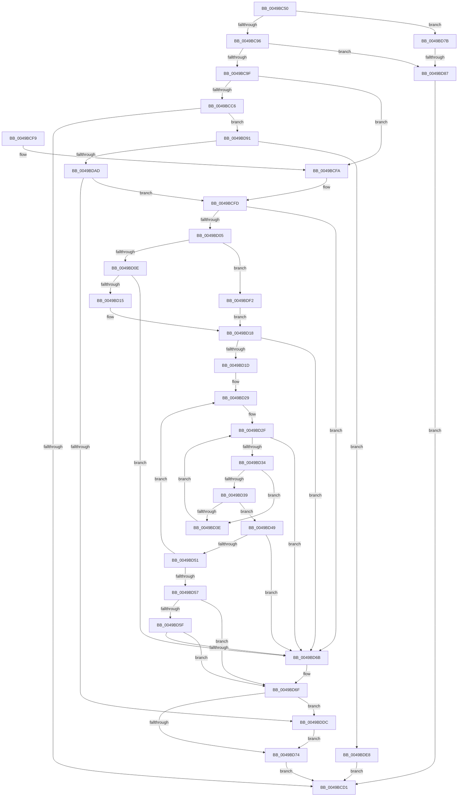

# RtlIsUntrustedObject

- RVA: `0x0049BC50`–`0x0049BDFB` (길이 `427` bytes)
- VA: `0x000000014049BC50`
- 실행 섹션: `.text`
- PDB 이름 있음: `예`; PDB Function 태그: `예`
- unwind 정보 RVA: `0x000B48F8`
- 디코드: `120`개 명령, `427/427` bytes 표시
- 미해석 바이트: `0` (있으면 어셈블리에 `.byte`로 보존)

> 이 문서는 커널 이미지의 기계어와 PDB 기호를 분석해 생성했습니다. 4번과 5번은 함수 원형과 자료형을 바이너리 사용 방식에서 추정한 C 해석이며 원본 소스 복구 결과는 아닙니다.

## 1. Dependencies

- 직접 호출 지점: **5**; 고유 호출 대상: **4**
- 직접 호출자로 확인된 함수: **1**
- RIP 상대 이미지 참조: **1**

### Outgoing calls
- `0x0049BCBB` → [ObQuerySecurityObject](../../page/9A/ObQuerySecurityObject_function_009A3564.md) (function, `0x009A3564`)
- `0x0049BCDC` → [_security_check_cookie](../6A/_security_check_cookie_function_006AC640.md) (function, `0x006AC640`)
- `0x0049BDA0` → [ExAllocatePool2](../../poolcode/B8/ExAllocatePool2_function_00B820F0.md) (function, `0x00B820F0`)
- `0x0049BDCA` → [ObQuerySecurityObject](../../page/9A/ObQuerySecurityObject_function_009A3564.md) (function, `0x009A3564`)
- `0x0049BDE1` → [ExFreePoolWithTag](../../poolcode/B8/ExFreePoolWithTag_function_00B82870.md) (function, `0x00B82870`)

### Direct callers
- [SeGetImageRequiredSigningLevel](../../page/A1/SeGetImageRequiredSigningLevel_function_00A135BC.md) at `0x00A136DE`

### Static image references
- `0x0049BC64` → RVA `0x00E0A740` (`.data`; read)

## 2. Other-region calls and transfers

- 다른 실행 섹션으로 향하는 call: **4**
  - `0x0049BCBB` → [ObQuerySecurityObject](../../page/9A/ObQuerySecurityObject_function_009A3564.md) (`.text` → `PAGE`)
  - `0x0049BDA0` → [ExAllocatePool2](../../poolcode/B8/ExAllocatePool2_function_00B820F0.md) (`.text` → `POOLCODE`)
  - `0x0049BDCA` → [ObQuerySecurityObject](../../page/9A/ObQuerySecurityObject_function_009A3564.md) (`.text` → `PAGE`)
  - `0x0049BDE1` → [ExFreePoolWithTag](../../poolcode/B8/ExFreePoolWithTag_function_00B82870.md) (`.text` → `POOLCODE`)
- call이 아닌 외부 분기/꼬리 이동: **1**
  - `0x0049BD81` → [sub_006F7D0E](../6F/Unknown_function_006F7D0E.md) (`tail-transfer`)

## 3. Assembly (complete function range)

```asm
0049BC50  48 89 5C 24 20                  mov qword ptr [rsp + 0x20], rbx
0049BC55  56                              push rsi
0049BC56  57                              push rdi
0049BC57  41 54                           push r12
0049BC59  41 55                           push r13
0049BC5B  41 56                           push r14
0049BC5D  48 81 EC D0 00 00 00            sub rsp, 0xd0
0049BC64  48 8B 05 D5 EA 96 00            mov rax, qword ptr [rip + 0x96ead5]
0049BC6B  48 33 C4                        xor rax, rsp
0049BC6E  48 89 84 24 C0 00 00 00         mov qword ptr [rsp + 0xc0], rax
0049BC76  83 64 24 30 00                  and dword ptr [rsp + 0x30], 0
0049BC7B  48 8D 7C 24 40                  lea rdi, [rsp + 0x40]
0049BC80  41 C6 00 01                     mov byte ptr [r8], 1
0049BC84  4D 8B E8                        mov r13, r8
0049BC87  4C 8B F2                        mov r14, rdx
0049BC8A  48 8B F1                        mov rsi, rcx
0049BC8D  48 85 D2                        test rdx, rdx
0049BC90  0F 84 E5 00 00 00               je 0x14049bd7b
0049BC96  48 85 C9                        test rcx, rcx
0049BC99  0F 85 E8 00 00 00               jne 0x14049bd87
0049BC9F  48 8D 44 24 30                  lea rax, [rsp + 0x30]
0049BCA4  45 32 E4                        xor r12b, r12b
0049BCA7  44 8D 49 7C                     lea r9d, [rcx + 0x7c]
0049BCAB  48 89 44 24 20                  mov qword ptr [rsp + 0x20], rax
0049BCB0  8D 51 10                        lea edx, [rcx + 0x10]
0049BCB3  49 8B CE                        mov rcx, r14
0049BCB6  4C 8D 44 24 40                  lea r8, [rsp + 0x40]
0049BCBB  E8 A4 78 50 00                  call 0x1409a3564
0049BCC0  8B D8                           mov ebx, eax
0049BCC2  85 C0                           test eax, eax
0049BCC4  79 34                           jns 0x14049bcfa
0049BCC6  3D 23 00 00 C0                  cmp eax, 0xc0000023
0049BCCB  0F 84 C0 00 00 00               je 0x14049bd91
0049BCD1  48 8B 8C 24 C0 00 00 00         mov rcx, qword ptr [rsp + 0xc0]
0049BCD9  48 33 CC                        xor rcx, rsp
0049BCDC  E8 5F 09 21 00                  call 0x1406ac640
0049BCE1  48 8B 9C 24 18 01 00 00         mov rbx, qword ptr [rsp + 0x118]
0049BCE9  48 81 C4 D0 00 00 00            add rsp, 0xd0
0049BCF0  41 5E                           pop r14
0049BCF2  41 5D                           pop r13
0049BCF4  41 5C                           pop r12
0049BCF6  5F                              pop rdi
0049BCF7  5E                              pop rsi
0049BCF8  C3                              ret
0049BCF9  CC                              int3
0049BCFA  45 33 F6                        xor r14d, r14d
0049BCFD  0F B7 47 02                     movzx eax, word ptr [rdi + 2]
0049BD01  A8 10                           test al, 0x10
0049BD03  74 66                           je 0x14049bd6b
0049BD05  66 85 C0                        test ax, ax
0049BD08  0F 89 E4 00 00 00               jns 0x14049bdf2
0049BD0E  8B 47 0C                        mov eax, dword ptr [rdi + 0xc]
0049BD11  85 C0                           test eax, eax
0049BD13  74 56                           je 0x14049bd6b
0049BD15  48 03 C7                        add rax, rdi
0049BD18  48 85 C0                        test rax, rax
0049BD1B  74 4E                           je 0x14049bd6b
0049BD1D  44 0F B7 50 04                  movzx r10d, word ptr [rax + 4]
0049BD22  4C 8D 48 08                     lea r9, [rax + 8]
0049BD26  45 8B C6                        mov r8d, r14d
0049BD29  41 8B D6                        mov edx, r14d
0049BD2C  49 8B C9                        mov rcx, r9
0049BD2F  41 3B D2                        cmp edx, r10d
0049BD32  73 37                           jae 0x14049bd6b
0049BD34  41 3B D0                        cmp edx, r8d
0049BD37  72 05                           jb 0x14049bd3e
0049BD39  80 39 11                        cmp byte ptr [rcx], 0x11
0049BD3C  74 0B                           je 0x14049bd49
0049BD3E  0F B7 41 02                     movzx eax, word ptr [rcx + 2]
0049BD42  FF C2                           inc edx
0049BD44  48 03 C8                        add rcx, rax
0049BD47  EB E6                           jmp 0x14049bd2f
0049BD49  44 8B C2                        mov r8d, edx
0049BD4C  48 85 C9                        test rcx, rcx
0049BD4F  74 1A                           je 0x14049bd6b
0049BD51  F6 41 01 08                     test byte ptr [rcx + 1], 8
0049BD55  75 D2                           jne 0x14049bd29
0049BD57  0F B6 41 09                     movzx eax, byte ptr [rcx + 9]
0049BD5B  84 C0                           test al, al
0049BD5D  74 10                           je 0x14049bd6f
0049BD5F  FF C8                           dec eax
0049BD61  81 7C 81 10 00 20 00 00         cmp dword ptr [rcx + rax*4 + 0x10], 0x2000
0049BD69  72 04                           jb 0x14049bd6f
0049BD6B  45 88 75 00                     mov byte ptr [r13], r14b
0049BD6F  45 84 E4                        test r12b, r12b
0049BD72  75 68                           jne 0x14049bddc
0049BD74  8B C3                           mov eax, ebx
0049BD76  E9 56 FF FF FF                  jmp 0x14049bcd1
0049BD7B  45 33 F6                        xor r14d, r14d
0049BD7E  48 85 F6                        test rsi, rsi
0049BD81  0F 85 87 BF 25 00               jne 0x1406f7d0e
0049BD87  B8 0D 00 00 C0                  mov eax, 0xc000000d
0049BD8C  E9 40 FF FF FF                  jmp 0x14049bcd1
0049BD91  8B 54 24 30                     mov edx, dword ptr [rsp + 0x30]
0049BD95  B9 41 00 00 00                  mov ecx, 0x41
0049BD9A  41 B8 52 74 50 62               mov r8d, 0x62507452
0049BDA0  E8 4B 63 6E 00                  call 0x140b820f0
0049BDA5  48 8B F8                        mov rdi, rax
0049BDA8  48 85 C0                        test rax, rax
0049BDAB  74 3B                           je 0x14049bde8
0049BDAD  41 B9 7C 00 00 00               mov r9d, 0x7c
0049BDB3  48 8D 44 24 30                  lea rax, [rsp + 0x30]
0049BDB8  4C 8B C7                        mov r8, rdi
0049BDBB  48 89 44 24 20                  mov qword ptr [rsp + 0x20], rax
0049BDC0  49 8B CE                        mov rcx, r14
0049BDC3  41 B4 01                        mov r12b, 1
0049BDC6  41 8D 51 94                     lea edx, [r9 - 0x6c]
0049BDCA  E8 95 77 50 00                  call 0x1409a3564
0049BDCF  45 33 F6                        xor r14d, r14d
0049BDD2  8B D8                           mov ebx, eax
0049BDD4  85 C0                           test eax, eax
0049BDD6  0F 89 21 FF FF FF               jns 0x14049bcfd
0049BDDC  33 D2                           xor edx, edx
0049BDDE  48 8B CF                        mov rcx, rdi
0049BDE1  E8 8A 6A 6E 00                  call 0x140b82870
0049BDE6  EB 8C                           jmp 0x14049bd74
0049BDE8  B8 17 00 00 C0                  mov eax, 0xc0000017
0049BDED  E9 DF FE FF FF                  jmp 0x14049bcd1
0049BDF2  48 8B 47 18                     mov rax, qword ptr [rdi + 0x18]
0049BDF6  E9 1D FF FF FF                  jmp 0x14049bd18
```

## 4. C-style interpretation (structured pseudocode)

```c
__int64 __fastcall RtlIsUntrustedObject(__int64 a1, __int64 a2, __int64 a3)
{
    __int64 result;
    __int64 v_r12;
    __int64 v_r14;
    __int64 v_rsp;
    unsigned __int64 v_stack_m38;
    unsigned __int64 v_stack_mB8;
    unsigned int v_stack_mC8;
    unsigned __int64 v_stack_mD8;
    unsigned __int64 v_stack_p20;
    unsigned int v_stack_p30;

    v_stack_p20 = v_rbx;
    v_rsp = (v_rsp) - (208);
    result = (*(unsigned __int64 *)(v_rip + 9890517)) ^ (v_rsp);
    v_stack_m38 = result;
    *(unsigned __int8 *)(a3) = 1;
    if (a2 == 0) goto loc_0049BD7B;
    if (a1 != 0) goto loc_0049BD87;
    v_r12 = 0;
    v_stack_mD8 = v_stack_mC8;
    result = ObQuerySecurityObject(a2, a1 + 16, v_stack_mB8, a1 + 124);
    if (!sign_flag) goto loc_0049BCFA;
    if (((unsigned int)(result)) == 0xC0000023ULL) goto loc_0049BD91;
loc_0049BCD1:
    a1 = (v_stack_m38) ^ (v_rsp);
    result = _security_check_cookie(a1, a1 + 16, v_stack_mB8, a1 + 124);
    v_rsp = (v_rsp) + (208);
    return result;
loc_0049BCFA:
    v_r14 = 0;
loc_0049BCFD:
    if ((((unsigned __int8)(*(unsigned __int16 *)(v_stack_mB8 + 2))) & (16)) == 0) goto loc_0049BD6B;
    if (!sign_flag) goto loc_0049BDF2;
    if ((unsigned int)((unsigned int)(*(unsigned int *)(v_stack_mB8 + 12))) == 0) goto loc_0049BD6B;
    result = ((unsigned int)(*(unsigned int *)(v_stack_mB8 + 12))) + (v_stack_mB8);
loc_0049BD18:
    if (result == 0) goto loc_0049BD6B;
loc_0049BD29:
loc_0049BD2F:
    if (0 >= ((unsigned int)(*(unsigned __int16 *)(result + 4)))) goto loc_0049BD6B;
    if (0 < 0) goto loc_0049BD3E;
    if ((*(unsigned __int8 *)(result + 8)) == 17) goto loc_0049BD49;
loc_0049BD3E:
    a2 = (unsigned int)((0) + 1);
    a1 = (result + 8) + (*(unsigned __int16 *)(result + 8 + 2));
    goto loc_0049BD2F;
loc_0049BD49:
    if (a1 == 0) goto loc_0049BD6B;
    if (((*(unsigned __int8 *)(a1 + 1)) & (8)) != 0) goto loc_0049BD29;
    if ((unsigned __int8)(*(unsigned __int8 *)(a1 + 9)) == 0) goto loc_0049BD6F;
    result = (unsigned int)((*(unsigned __int8 *)(a1 + 9)) - 1);
    if ((*(unsigned int *)(a1 + result * 4 + 16)) >= 0x2000ULL) {
        *(unsigned __int8 *)(a3) = 0;
    }
    if (0 != 0) goto loc_0049BDDC;
loc_0049BD74:
    goto loc_0049BCD1;
loc_0049BD7B:
    v_r14 = 0;
loc_0049BD87:
    goto loc_0049BCD1;
loc_0049BD91:
    result = ExAllocatePool2(65, (unsigned int)(v_stack_p30), (unsigned int)(0x62507452ULL), result + 8);
    if (result == 0) goto loc_0049BDE8;
    v_stack_p20 = v_stack_p30;
    result = ObQuerySecurityObject(0, 124 - 108, result, 124);
    v_r14 = 0;
    if (!sign_flag) goto loc_0049BCFD;
loc_0049BDDC:
    a2 = 0;
    result = ExFreePoolWithTag(result, a2, result, 124);
    goto loc_0049BD74;
loc_0049BDE8:
    goto loc_0049BCD1;
loc_0049BDF2:
    goto loc_0049BD18;
}
```

## 5. (Beta) C Style

```c
int64_t RtlIsUntrustedObject(int64_t Arg1, int64_t Arg2, void *Arg3)
{
    uint8_t *arg3 = (uint8_t *)Arg3;

    int64_t result;
    int64_t local_r12;
    int64_t local_r14;
    int64_t local_rsp;
    uint64_t v_stack_m38;
    uint64_t v_stack_mB8;
    uint32_t v_stack_mC8;
    uint64_t v_stack_mD8;
    uint64_t v_stack_p20;
    uint32_t v_stack_p30;

    v_stack_p20 = local_rbx;
    local_rsp = (local_rsp) - (208);
    result = (*(uint64_t *)(v_rip + 0x96EAD5)) ^ (local_rsp);
    v_stack_m38 = result;
    *(uint8_t *)(arg3) = 1;
    if (Arg2 == 0) goto loc_0049BD7B;
    if (Arg1 != 0) goto loc_0049BD87;
    local_r12 = 0;
    v_stack_mD8 = v_stack_mC8;
    result = ObQuerySecurityObject(Arg2, Arg1 + 16, v_stack_mB8, Arg1 + 124);
    if (!sign_flag) goto loc_0049BCFA;
    if (((uint32_t)(result)) == 0xC0000023ULL) goto loc_0049BD91;
loc_0049BCD1:
    Arg1 = (v_stack_m38) ^ (local_rsp);
    result = _security_check_cookie(Arg1, Arg1 + 16, v_stack_mB8, Arg1 + 124);
    local_rsp = (local_rsp) + (208);
    return result;
loc_0049BCFA:
    local_r14 = 0;
loc_0049BCFD:
    if ((((uint8_t)(*(uint16_t *)(v_stack_mB8 + 0x2))) & (16)) == 0) goto loc_0049BD6B;
    if (!sign_flag) goto loc_0049BDF2;
    if ((uint32_t)((uint32_t)(*(uint32_t *)(v_stack_mB8 + 0xC))) == 0) goto loc_0049BD6B;
    result = ((uint32_t)(*(uint32_t *)(v_stack_mB8 + 0xC))) + (v_stack_mB8);
loc_0049BD18:
    if (result == 0) goto loc_0049BD6B;
loc_0049BD29:
loc_0049BD2F:
    if (0 >= ((uint32_t)(*(uint16_t *)(result + 0x4)))) goto loc_0049BD6B;
    if (0 < 0) goto loc_0049BD3E;
    if ((*(uint8_t *)(result + 0x8)) == 17) goto loc_0049BD49;
loc_0049BD3E:
    Arg2 = (uint32_t)((0) + 1);
    Arg1 = (result + 8) + (*(uint16_t *)(result + 0x8 + 0x2));
    goto loc_0049BD2F;
loc_0049BD49:
    if (Arg1 == 0) goto loc_0049BD6B;
    if (((*(uint8_t *)(Arg1 + 0x1)) & (8)) != 0) goto loc_0049BD29;
    if ((uint8_t)(*(uint8_t *)(Arg1 + 0x9)) == 0) goto loc_0049BD6F;
    result = (uint32_t)((*(uint8_t *)(Arg1 + 0x9)) - 1);
    if ((*(uint32_t *)(Arg1 + result * 4 + 0x10)) >= 0x2000ULL) {
        *(uint8_t *)(arg3) = 0;
    }
    if (0 != 0) goto loc_0049BDDC;
loc_0049BD74:
    goto loc_0049BCD1;
loc_0049BD7B:
    local_r14 = 0;
loc_0049BD87:
    goto loc_0049BCD1;
loc_0049BD91:
    result = ExAllocatePool2(65, (uint32_t)(v_stack_p30), (uint32_t)(0x62507452ULL), result + 8);
    if (result == 0) goto loc_0049BDE8;
    v_stack_p20 = v_stack_p30;
    result = ObQuerySecurityObject(0, 124 - 108, result, 124);
    local_r14 = 0;
    if (!sign_flag) goto loc_0049BCFD;
loc_0049BDDC:
    Arg2 = 0;
    result = ExFreePoolWithTag(result, Arg2, result, 124);
    goto loc_0049BD74;
loc_0049BDE8:
    goto loc_0049BCD1;
loc_0049BDF2:
    goto loc_0049BD18;
}
```

### 관측된 메모리 오프셋

구조체 형식이 확인되지 않은 접근은 인자 기준의 오프셋으로만 기록했습니다.

| 기준 인자 | 오프셋 표현 | 폭 (bit) | 접근 |
|---|---:|---:|---|
| `Arg3` | `+ 0x0` | `8` | `W` |

## 6. Execution-region graph

[열기: 2D/3D 그래프와 함수 탐색 컨트롤 패널](../../../control-panel.html?section=text&rva=0x0049BC50&view=graph)

- 2D 그래프는 위에서 아래로 흐르고, 3D 그래프는 빈 공간을 드래그해 회전합니다. Shift+드래그는 이동, 휠은 확대·축소, 함수 노드 선택은 대상 보고서 이동입니다.

### Static fallback


