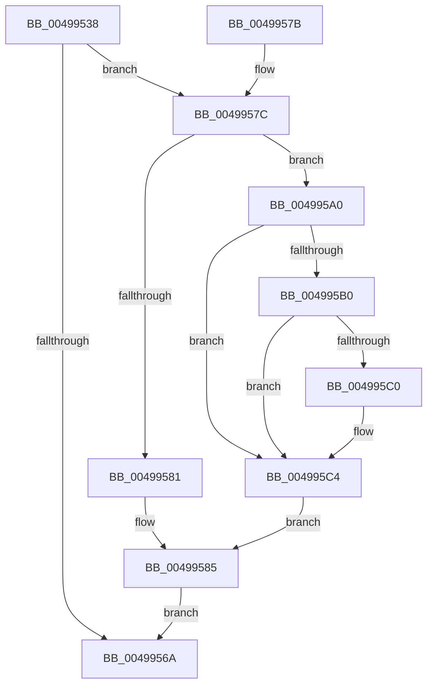

# RtlStateDurationUpdate

- RVA: `0x00499538`–`0x004995D2` (길이 `154` bytes)
- VA: `0x0000000140499538`
- 실행 섹션: `.text`
- PDB 이름 있음: `예`; PDB Function 태그: `아니요`
- unwind 정보 RVA: `0x000B448C`
- 디코드: `47`개 명령, `154/154` bytes 표시
- 미해석 바이트: `0` (있으면 어셈블리에 `.byte`로 보존)

> 이 문서는 커널 이미지의 기계어와 PDB 기호를 분석해 생성했습니다. 4번과 5번은 함수 원형과 자료형을 바이너리 사용 방식에서 추정한 C 해석이며 원본 소스 복구 결과는 아닙니다.

## 1. Dependencies

- 직접 호출 지점: **0**; 고유 호출 대상: **0**
- 직접 호출자로 확인된 함수: **2**
- RIP 상대 이미지 참조: **0**

### Outgoing calls
- 직접 디코드된 call 명령이 없습니다.

### Direct callers
- [PoEnergyContextUpdateComponentPower](../../page/98/PoEnergyContextUpdateComponentPower_function_0098CA08.md) at `0x0098CD53`
- [PoEnergyContextUpdateComponentPower](../../page/98/PoEnergyContextUpdateComponentPower_function_0098CA08.md) at `0x0098CDC5`
- [PoEnergyContextUpdateComponentPower](../../page/98/PoEnergyContextUpdateComponentPower_function_0098CA08.md) at `0x0098CE5B`
- [PoEnergyContextUpdateComponentPower](../../page/98/PoEnergyContextUpdateComponentPower_function_0098CA08.md) at `0x0098CF29`
- [PopEtEnergyContextSetState](../../page/98/PopEtEnergyContextSetState_function_0098CF94.md) at `0x0098D09F`
- [PopEtEnergyContextSetState](../../page/98/PopEtEnergyContextSetState_function_0098CF94.md) at `0x0098D0B6`

### Static image references
- 디코드된 RIP-relative 메모리 참조가 없습니다.

## 2. Other-region calls and transfers

- 다른 실행 섹션으로 향하는 call: **0**
- 별도 외부 분기/꼬리 이동을 확인하지 못했습니다.

## 3. Assembly (complete function range)

```asm
00499538  48 89 5C 24 10                  mov qword ptr [rsp + 0x10], rbx
0049953D  48 89 7C 24 18                  mov qword ptr [rsp + 0x18], rdi
00499542  48 8B 01                        mov rax, qword ptr [rcx]
00499545  41 8B D8                        mov ebx, r8d
00499548  4C 8B D0                        mov r10, rax
0049954B  44 0F B6 C2                     movzx r8d, dl
0049954F  49 C1 EA 20                     shr r10, 0x20
00499553  45 33 C9                        xor r9d, r9d
00499556  45 8B DA                        mov r11d, r10d
00499559  48 89 44 24 08                  mov qword ptr [rsp + 8], rax
0049955E  41 C1 EB 1F                     shr r11d, 0x1f
00499562  48 8B F9                        mov rdi, rcx
00499565  45 3B D8                        cmp r11d, r8d
00499568  75 12                           jne 0x14049957c
0049956A  48 8B 5C 24 10                  mov rbx, qword ptr [rsp + 0x10]
0049956F  48 89 07                        mov qword ptr [rdi], rax
00499572  41 8B C1                        mov eax, r9d
00499575  48 8B 7C 24 18                  mov rdi, qword ptr [rsp + 0x18]
0049957A  C3                              ret
0049957B  CC                              int3
0049957C  45 85 DB                        test r11d, r11d
0049957F  75 1F                           jne 0x1404995a0
00499581  8B 44 24 0C                     mov eax, dword ptr [rsp + 0xc]
00499585  0F BA F0 1F                     btr eax, 0x1f
00499589  41 C1 E0 1F                     shl r8d, 0x1f
0049958D  44 0B C0                        or r8d, eax
00499590  89 5C 24 08                     mov dword ptr [rsp + 8], ebx
00499594  44 89 44 24 0C                  mov dword ptr [rsp + 0xc], r8d
00499599  48 8B 44 24 08                  mov rax, qword ptr [rsp + 8]
0049959E  EB CA                           jmp 0x14049956a
004995A0  44 8B CB                        mov r9d, ebx
004995A3  83 CA FF                        or edx, 0xffffffff
004995A6  44 2B 4C 24 08                  sub r9d, dword ptr [rsp + 8]
004995AB  44 3B CA                        cmp r9d, edx
004995AE  73 14                           jae 0x1404995c4
004995B0  41 8B CA                        mov ecx, r10d
004995B3  41 8B C1                        mov eax, r9d
004995B6  0F BA F1 1F                     btr ecx, 0x1f
004995BA  F7 D0                           not eax
004995BC  3B C1                           cmp eax, ecx
004995BE  72 04                           jb 0x1404995c4
004995C0  42 8D 14 09                     lea edx, [rcx + r9]
004995C4  41 8B C2                        mov eax, r10d
004995C7  33 C2                           xor eax, edx
004995C9  0F BA F0 1F                     btr eax, 0x1f
004995CD  41 33 C2                        xor eax, r10d
004995D0  EB B3                           jmp 0x140499585
```

## 4. C-style interpretation (structured pseudocode)

```c
__int64 __fastcall RtlStateDurationUpdate(__int64 a1, int a2, int a3, int a4)
{
    __int64 result;
    __int64 v_r10;
    __int64 v_r11;
    unsigned __int64 v_stack_p10;
    unsigned __int64 v_stack_p18;
    unsigned __int64 v_stack_p8;
    unsigned int v_stack_pC;

    v_stack_p10 = v_rbx;
    v_stack_p18 = v_rdi;
    v_r10 = (*(unsigned __int64 *)(a1)) >> (32);
    a4 = 0;
    v_stack_p8 = *(unsigned __int64 *)(a1);
    v_r11 = (unsigned int)(((unsigned int)((unsigned int)(v_r10))) >> (31));
    if (((unsigned int)(v_r11)) != ((unsigned int)((unsigned __int8)(a2)))) goto loc_0049957C;
loc_0049956A:
    *(unsigned __int64 *)(a1) = *(unsigned __int64 *)(a1);
    return 0;
loc_0049957C:
    if ((unsigned int)(v_r11) != 0) goto loc_004995A0;
loc_00499585:
    a3 = (unsigned int)(((unsigned __int8)(a2)) << (31));
    a3 = (unsigned int)((a3) | ((unsigned int)((unsigned int)(v_stack_pC))));
    v_stack_p8 = (unsigned int)(v_stack_p10);
    v_stack_pC = a3;
    goto loc_0049956A;
loc_004995A0:
    a2 = (unsigned int)((a2) | (0xFFFFFFFFULL));
    a4 = (unsigned int)(((unsigned int)((unsigned int)(v_stack_p10))) - (v_stack_p8));
    if (a4 >= a2) goto loc_004995C4;
    result = (unsigned int)(~((unsigned int)(a4)));
    if (((unsigned int)(result)) >= ((unsigned int)((unsigned int)((unsigned int)(v_r10))))) {
        a2 = (unsigned int)((unsigned int)(v_r10)) + a4 * 1;
    }
    result = (unsigned int)(((unsigned int)((unsigned int)(v_r10))) ^ (a2));
    result = (unsigned int)((result) ^ ((unsigned int)(v_r10)));
    goto loc_00499585;
}
```

## 5. (Beta) C Style

```c
int64_t RtlStateDurationUpdate(void *Arg1, int32_t Arg2, int32_t Arg3, int32_t Arg4)
{
    uint8_t *arg1 = (uint8_t *)Arg1;

    int64_t result;
    int64_t local_r10;
    int64_t local_r11;
    uint64_t v_stack_p10;
    uint64_t v_stack_p18;
    uint64_t v_stack_p8;
    uint32_t v_stack_pC;

    v_stack_p10 = local_rbx;
    v_stack_p18 = local_rdi;
    local_r10 = (*(uint64_t *)(arg1)) >> (32);
    Arg4 = 0;
    v_stack_p8 = *(uint64_t *)(arg1);
    local_r11 = (uint32_t)(((uint32_t)((uint32_t)(local_r10))) >> (31));
    if (((uint32_t)(local_r11)) != ((uint32_t)((uint8_t)(Arg2)))) goto loc_0049957C;
loc_0049956A:
    *(uint64_t *)(arg1) = *(uint64_t *)(arg1);
    return 0;
loc_0049957C:
    if ((uint32_t)(local_r11) != 0) goto loc_004995A0;
loc_00499585:
    Arg3 = (uint32_t)(((uint8_t)(Arg2)) << (31));
    Arg3 = (uint32_t)((Arg3) | ((uint32_t)((uint32_t)(v_stack_pC))));
    v_stack_p8 = (uint32_t)(v_stack_p10);
    v_stack_pC = Arg3;
    goto loc_0049956A;
loc_004995A0:
    Arg2 = (uint32_t)((Arg2) | (0xFFFFFFFFULL));
    Arg4 = (uint32_t)(((uint32_t)((uint32_t)(v_stack_p10))) - (v_stack_p8));
    if (Arg4 >= Arg2) goto loc_004995C4;
    result = (uint32_t)(~((uint32_t)(Arg4)));
    if (((uint32_t)(result)) >= ((uint32_t)((uint32_t)((uint32_t)(local_r10))))) {
        Arg2 = (uint32_t)((uint32_t)(local_r10)) + Arg4 * 1;
    }
    result = (uint32_t)(((uint32_t)((uint32_t)(local_r10))) ^ (Arg2));
    result = (uint32_t)((result) ^ ((uint32_t)(local_r10)));
    goto loc_00499585;
}
```

### 관측된 메모리 오프셋

구조체 형식이 확인되지 않은 접근은 인자 기준의 오프셋으로만 기록했습니다.

| 기준 인자 | 오프셋 표현 | 폭 (bit) | 접근 |
|---|---:|---:|---|
| `Arg1` | `+ 0x0` | `64` | `R` |
| `Arg1` | `+ 0x0` | `64` | `W` |

## 6. Execution-region graph

[열기: 2D/3D 그래프와 함수 탐색 컨트롤 패널](../../../control-panel.html?section=text&rva=0x00499538&view=graph)

- 2D 그래프는 위에서 아래로 흐르고, 3D 그래프는 빈 공간을 드래그해 회전합니다. Shift+드래그는 이동, 휠은 확대·축소, 함수 노드 선택은 대상 보고서 이동입니다.

### Static fallback


