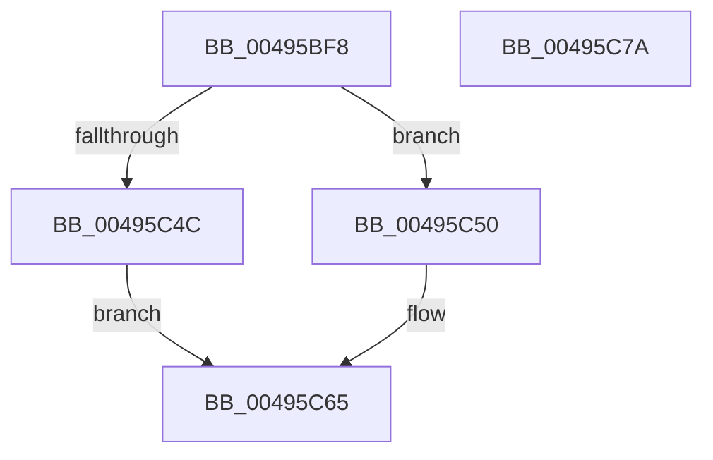

# RtlStdLogStackTrace

- RVA: `0x00495BF8`–`0x00495C7B` (길이 `131` bytes)
- VA: `0x0000000140495BF8`
- 실행 섹션: `.text`
- PDB 이름 있음: `예`; PDB Function 태그: `아니요`
- unwind 정보 RVA: `0x000B3A1C`
- 디코드: `33`개 명령, `131/131` bytes 표시
- 미해석 바이트: `0` (있으면 어셈블리에 `.byte`로 보존)

> 이 문서는 커널 이미지의 기계어와 PDB 기호를 분석해 생성했습니다. 4번과 5번은 함수 원형과 자료형을 바이너리 사용 방식에서 추정한 C 해석이며 원본 소스 복구 결과는 아닙니다.

## 1. Dependencies

- 직접 호출 지점: **3**; 고유 호출 대상: **3**
- 직접 호출자로 확인된 함수: **3**
- RIP 상대 이미지 참조: **0**

### Outgoing calls
- `0x00495C1C` → [memset](../6C/memset_function_006C6C40.md) (function, `0x006C6C40`)
- `0x00495C3D` → [RtlCaptureStackBackTrace](../2F/RtlCaptureStackBackTrace_function_002F9FF0.md) (function, `0x002F9FF0`)
- `0x00495C60` → [RtlpStdLogCapturedStackTrace](../5E/RtlpStdLogCapturedStackTrace_function_005E68F4.md) (function, `0x005E68F4`)

### Direct callers
- [ExInitializeResourceLite2](../41/ExInitializeResourceLite2_function_0041F710.md) at `0x0041F7E2`
- [ExInitializeFastResource2](ExInitializeFastResource2_function_0049AF90.md) at `0x0049B0C7`
- [sub_006ED9A2](../6E/Unknown_function_006ED9A2.md) at `0x006ED9AA`

### Static image references
- 디코드된 RIP-relative 메모리 참조가 없습니다.

## 2. Other-region calls and transfers

- 다른 실행 섹션으로 향하는 call: **0**
- 별도 외부 분기/꼬리 이동을 확인하지 못했습니다.

## 3. Assembly (complete function range)

```asm
00495BF8  48 89 5C 24 08                  mov qword ptr [rsp + 8], rbx
00495BFD  48 89 74 24 18                  mov qword ptr [rsp + 0x18], rsi
00495C02  57                              push rdi
00495C03  48 81 EC 30 01 00 00            sub rsp, 0x130
00495C0A  8B DA                           mov ebx, edx
00495C0C  48 8B F9                        mov rdi, rcx
00495C0F  33 D2                           xor edx, edx
00495C11  48 8D 4C 24 20                  lea rcx, [rsp + 0x20]
00495C16  41 B8 10 01 00 00               mov r8d, 0x110
00495C1C  E8 1F 10 23 00                  call 0x1406c6c40
00495C21  33 F6                           xor esi, esi
00495C23  8D 4B 01                        lea ecx, [rbx + 1]
00495C26  4C 8D 8C 24 48 01 00 00         lea r9, [rsp + 0x148]
00495C2E  89 B4 24 48 01 00 00            mov dword ptr [rsp + 0x148], esi
00495C35  4C 8D 44 24 30                  lea r8, [rsp + 0x30]
00495C3A  8D 56 20                        lea edx, [rsi + 0x20]
00495C3D  E8 AE 43 E6 FF                  call 0x1402f9ff0
00495C42  66 89 44 24 2E                  mov word ptr [rsp + 0x2e], ax
00495C47  66 85 C0                        test ax, ax
00495C4A  75 04                           jne 0x140495c50
00495C4C  33 C0                           xor eax, eax
00495C4E  EB 15                           jmp 0x140495c65
00495C50  44 8B 84 24 48 01 00 00         mov r8d, dword ptr [rsp + 0x148]
00495C58  48 8D 54 24 20                  lea rdx, [rsp + 0x20]
00495C5D  48 8B CF                        mov rcx, rdi
00495C60  E8 8F 0C 15 00                  call 0x1405e68f4
00495C65  4C 8D 9C 24 30 01 00 00         lea r11, [rsp + 0x130]
00495C6D  49 8B 5B 10                     mov rbx, qword ptr [r11 + 0x10]
00495C71  49 8B 73 20                     mov rsi, qword ptr [r11 + 0x20]
00495C75  49 8B E3                        mov rsp, r11
00495C78  5F                              pop rdi
00495C79  C3                              ret
00495C7A  CC                              int3
```

## 4. C-style interpretation (structured pseudocode)

```c
__int64 __fastcall RtlStdLogStackTrace(__int64 a1, int a2)
{
    __int64 result;
    __int64 v_rsi;
    __int64 v_rsp;
    unsigned __int64 v_stack_m108;
    unsigned __int16 v_stack_m10A;
    unsigned __int64 v_stack_m118;
    unsigned __int64 v_stack_m8;
    unsigned __int64 v_stack_p10;
    unsigned __int64 v_stack_p18;
    unsigned __int64 v_stack_p8;

    v_stack_p8 = v_rbx;
    v_stack_p18 = v_rsi;
    v_rsp = (v_rsp) - (304);
    a2 = 0;
    result = memset(v_stack_m118, a2, 272, a4);
    v_rsi = 0;
    v_stack_p10 = 0;
    result = RtlCaptureStackBackTrace((unsigned int)(a2) + 1, v_rsi + 32, v_stack_m108, v_stack_p10);
    v_stack_m10A = (unsigned __int16)(result);
    if ((unsigned __int16)(result) != 0) goto loc_00495C50;
    result = 0;
    goto loc_00495C65;
loc_00495C50:
    result = RtlpStdLogCapturedStackTrace(a1, v_stack_m118, (unsigned int)(v_stack_p10), v_stack_p10);
loc_00495C65:
    return result;
}
```

## 5. (Beta) C Style

```c
int64_t RtlStdLogStackTrace(int64_t Arg1, void *Arg2)
{
    uint8_t *arg2 = (uint8_t *)Arg2;

    int64_t result;
    int64_t local_rsi;
    int64_t local_rsp;
    uint64_t v_stack_m108;
    uint16_t v_stack_m10A;
    uint64_t v_stack_m118;
    uint64_t v_stack_m8;
    uint64_t v_stack_p10;
    uint64_t v_stack_p18;
    uint64_t v_stack_p8;

    v_stack_p8 = local_rbx;
    v_stack_p18 = local_rsi;
    local_rsp = (local_rsp) - (304);
    Arg2 = 0;
    result = memset(v_stack_m118, Arg2, 272, a4);
    local_rsi = 0;
    v_stack_p10 = 0;
    result = RtlCaptureStackBackTrace((uint32_t)(Arg2) + 1, local_rsi + 32, v_stack_m108, v_stack_p10);
    v_stack_m10A = (uint16_t)(result);
    if ((uint16_t)(result) != 0) goto loc_00495C50;
    result = 0;
    goto loc_00495C65;
loc_00495C50:
    result = RtlpStdLogCapturedStackTrace(Arg1, v_stack_m118, (uint32_t)(v_stack_p10), v_stack_p10);
loc_00495C65:
    return result;
}
```

### 관측된 메모리 오프셋

구조체 형식이 확인되지 않은 접근은 인자 기준의 오프셋으로만 기록했습니다.

| 기준 인자 | 오프셋 표현 | 폭 (bit) | 접근 |
|---|---:|---:|---|
| `Arg2` | `+ 0x1` | `32` | `R` |

## 6. Execution-region graph

[열기: 2D/3D 그래프와 함수 탐색 컨트롤 패널](../../../control-panel.html?section=text&rva=0x00495BF8&view=graph)

- 2D 그래프는 위에서 아래로 흐르고, 3D 그래프는 빈 공간을 드래그해 회전합니다. Shift+드래그는 이동, 휠은 확대·축소, 함수 노드 선택은 대상 보고서 이동입니다.

### Static fallback


