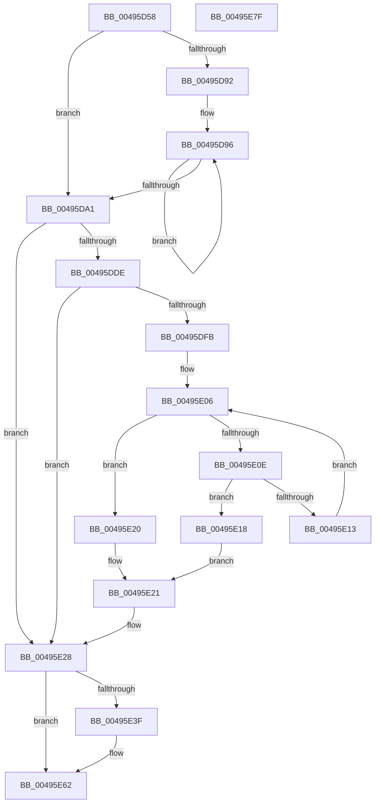

# RtlStdReleaseStackTrace

- RVA: `0x00495D58`–`0x00495E80` (길이 `296` bytes)
- VA: `0x0000000140495D58`
- 실행 섹션: `.text`
- PDB 이름 있음: `예`; PDB Function 태그: `아니요`
- unwind 정보 RVA: `0x00075C18`
- 디코드: `85`개 명령, `296/296` bytes 표시
- 미해석 바이트: `0` (있으면 어셈블리에 `.byte`로 보존)

> 이 문서는 커널 이미지의 기계어와 PDB 기호를 분석해 생성했습니다. 4번과 5번은 함수 원형과 자료형을 바이너리 사용 방식에서 추정한 C 해석이며 원본 소스 복구 결과는 아닙니다.

## 1. Dependencies

- 직접 호출 지점: **3**; 고유 호출 대상: **3**
- 직접 호출자로 확인된 함수: **3**
- RIP 상대 이미지 참조: **0**

### Outgoing calls
- `0x00495DB8` → [KeAcquireSpinLockRaiseToDpc](../20/KeAcquireSpinLockRaiseToDpc_function_00208470.md) (function, `0x00208470`)
- `0x00495E36` → [KeReleaseSpinLock](../39/KeReleaseSpinLock_function_00392BA0.md) (function, `0x00392BA0`)
- `0x00495E55` → [ExpInterlockedPushEntrySList](../6B/ExpInterlockedPushEntrySList_function_006BA5B0.md) (function, `0x006BA5B0`)

### Direct callers
- [ExInitializeResourceLite2](../41/ExInitializeResourceLite2_function_0041F710.md) at `0x0041F80E`
- [ExInitializeFastResource2](ExInitializeFastResource2_function_0049AF90.md) at `0x0049B0F4`
- [sub_006ED9A2](../6E/Unknown_function_006ED9A2.md) at `0x006ED9CE`

### Static image references
- 디코드된 RIP-relative 메모리 참조가 없습니다.

## 2. Other-region calls and transfers

- 다른 실행 섹션으로 향하는 call: **0**
- 별도 외부 분기/꼬리 이동을 확인하지 못했습니다.

## 3. Assembly (complete function range)

```asm
00495D58  48 89 5C 24 08                  mov qword ptr [rsp + 8], rbx
00495D5D  48 89 6C 24 10                  mov qword ptr [rsp + 0x10], rbp
00495D62  48 89 74 24 18                  mov qword ptr [rsp + 0x18], rsi
00495D67  57                              push rdi
00495D68  41 54                           push r12
00495D6A  41 55                           push r13
00495D6C  41 56                           push r14
00495D6E  41 57                           push r15
00495D70  48 83 EC 20                     sub rsp, 0x20
00495D74  45 33 E4                        xor r12d, r12d
00495D77  48 8B DA                        mov rbx, rdx
00495D7A  0F B7 52 0E                     movzx edx, word ptr [rdx + 0xe]
00495D7E  48 8B F9                        mov rdi, rcx
00495D81  41 8B EC                        mov ebp, r12d
00495D84  41 8B C4                        mov eax, r12d
00495D87  45 8D 6C 24 01                  lea r13d, [r12 + 1]
00495D8C  66 44 3B E2                     cmp r12w, dx
00495D90  73 0F                           jae 0x140495da1
00495D92  48 8D 4B 10                     lea rcx, [rbx + 0x10]
00495D96  03 01                           add eax, dword ptr [rcx]
00495D98  48 8D 49 08                     lea rcx, [rcx + 8]
00495D9C  49 2B D5                        sub rdx, r13
00495D9F  75 F5                           jne 0x140495d96
00495DA1  33 D2                           xor edx, edx
00495DA3  F7 B7 D0 02 00 00               div dword ptr [rdi + 0x2d0]
00495DA9  4C 8D 3C 52                     lea r15, [rdx + rdx*2]
00495DAD  4E 8D 34 FF                     lea r14, [rdi + r15*8]
00495DB1  49 8D 8E E0 02 00 00            lea rcx, [r14 + 0x2e0]
00495DB8  E8 B3 26 D7 FF                  call 0x140208470
00495DBD  41 88 86 E8 02 00 00            mov byte ptr [r14 + 0x2e8], al
00495DC4  48 8D 73 08                     lea rsi, [rbx + 8]
00495DC8  0F B7 16                        movzx edx, word ptr [rsi]
00495DCB  41 B8 FF 07 00 00               mov r8d, 0x7ff
00495DD1  0F B7 C2                        movzx eax, dx
00495DD4  66 41 23 C0                     and ax, r8w
00495DD8  66 41 3B C0                     cmp ax, r8w
00495DDC  74 4A                           je 0x140495e28
00495DDE  0F B7 CA                        movzx ecx, dx
00495DE1  66 41 2B CD                     sub cx, r13w
00495DE5  0F B7 C1                        movzx eax, cx
00495DE8  66 33 C2                        xor ax, dx
00495DEB  66 41 23 C0                     and ax, r8w
00495DEF  66 33 C2                        xor ax, dx
00495DF2  66 89 06                        mov word ptr [rsi], ax
00495DF5  66 41 85 C8                     test r8w, cx
00495DF9  75 2D                           jne 0x140495e28
00495DFB  48 8D 8F D8 02 00 00            lea rcx, [rdi + 0x2d8]
00495E02  4A 8D 0C F9                     lea rcx, [rcx + r15*8]
00495E06  48 8B 01                        mov rax, qword ptr [rcx]
00495E09  48 85 C0                        test rax, rax
00495E0C  74 12                           je 0x140495e20
00495E0E  48 3B C3                        cmp rax, rbx
00495E11  74 05                           je 0x140495e18
00495E13  48 8B C8                        mov rcx, rax
00495E16  EB EE                           jmp 0x140495e06
00495E18  48 8B 03                        mov rax, qword ptr [rbx]
00495E1B  48 89 01                        mov qword ptr [rcx], rax
00495E1E  EB 01                           jmp 0x140495e21
00495E20  CC                              int3
00495E21  41 8B ED                        mov ebp, r13d
00495E24  48 8D 73 08                     lea rsi, [rbx + 8]
00495E28  41 8A 96 E8 02 00 00            mov dl, byte ptr [r14 + 0x2e8]
00495E2F  49 8D 8E E0 02 00 00            lea rcx, [r14 + 0x2e0]
00495E36  E8 65 CD EF FF                  call 0x140392ba0
00495E3B  85 ED                           test ebp, ebp
00495E3D  74 23                           je 0x140495e62
00495E3F  0F B7 0E                        movzx ecx, word ptr [rsi]
00495E42  48 8D 53 10                     lea rdx, [rbx + 0x10]
00495E46  48 C1 E9 0B                     shr rcx, 0xb
00495E4A  48 83 C1 0D                     add rcx, 0xd
00495E4E  48 C1 E1 04                     shl rcx, 4
00495E52  48 03 CF                        add rcx, rdi
00495E55  E8 56 47 22 00                  call 0x1406ba5b0
00495E5A  F0 44 01 AF C4 00 00 00         lock add dword ptr [rdi + 0xc4], r13d
00495E62  48 8B 5C 24 50                  mov rbx, qword ptr [rsp + 0x50]
00495E67  48 8B 6C 24 58                  mov rbp, qword ptr [rsp + 0x58]
00495E6C  48 8B 74 24 60                  mov rsi, qword ptr [rsp + 0x60]
00495E71  48 83 C4 20                     add rsp, 0x20
00495E75  41 5F                           pop r15
00495E77  41 5E                           pop r14
00495E79  41 5D                           pop r13
00495E7B  41 5C                           pop r12
00495E7D  5F                              pop rdi
00495E7E  C3                              ret
00495E7F  CC                              int3
```

## 4. C-style interpretation (structured pseudocode)

```c
__int64 __fastcall RtlStdReleaseStackTrace(__int64 a1, __int64 a2)
{
    __int64 result;
    __int64 v_r12;
    __int64 v_rsp;
    unsigned __int64 v_stack_p10;
    unsigned __int64 v_stack_p18;
    unsigned __int64 v_stack_p8;

    v_stack_p8 = v_rbx;
    v_stack_p10 = v_rbp;
    v_stack_p18 = v_rsi;
    v_rsp = (v_rsp) - (32);
    v_r12 = 0;
    if (0 >= ((unsigned __int16)(*(unsigned __int16 *)(a2 + 14)))) goto loc_00495DA1;
loc_00495D96:
    result = (unsigned int)((0) + (*(unsigned int *)(a2 + 16)));
    a2 = (*(unsigned __int16 *)(a2 + 14)) - (v_r12 + 1);
    if (condition_is_not_equal) goto loc_00495D96;
loc_00495DA1:
    a2 = 0;
    result = KeAcquireSpinLockRaiseToDpc(a1 + a2 + a2 * 2 * 8 + 736, a2, a3, a4);
    *(unsigned __int8 *)(a1 + a2 + a2 * 2 * 8 + 744) = (unsigned __int8)(result);
    result = (unsigned __int16)(((unsigned __int16)(*(unsigned __int16 *)(a2 + 8))) & ((unsigned __int16)((unsigned int)(0x7FFULL))));
    if (((unsigned __int16)(result)) == ((unsigned __int16)((unsigned int)(0x7FFULL)))) goto loc_00495E28;
    a1 = (unsigned __int16)(((unsigned __int16)(*(unsigned __int16 *)(a2 + 8))) - ((unsigned __int16)(v_r12 + 1)));
    result = (unsigned __int16)(((unsigned __int16)(a1)) ^ ((unsigned __int16)(*(unsigned __int16 *)(a2 + 8))));
    result = (unsigned __int16)((result) & ((unsigned __int16)((unsigned int)(0x7FFULL))));
    result = (unsigned __int16)((result) ^ ((unsigned __int16)(*(unsigned __int16 *)(a2 + 8))));
    *(unsigned __int16 *)(a2 + 8) = (unsigned __int16)(result);
    if ((((unsigned __int16)((unsigned int)(0x7FFULL))) & ((unsigned __int16)(a1))) != 0) goto loc_00495E28;
loc_00495E06:
    if (*(unsigned __int64 *)(a1 + 728 + a2 + a2 * 2 * 8) == 0) goto loc_00495E20;
    if ((*(unsigned __int64 *)(a1 + 728 + a2 + a2 * 2 * 8)) == 0) goto loc_00495E18;
    goto loc_00495E06;
loc_00495E18:
    *(unsigned __int64 *)(*(unsigned __int64 *)(a1 + 728 + a2 + a2 * 2 * 8)) = *(unsigned __int64 *)(a2);
    goto loc_00495E21;
loc_00495E20:
loc_00495E21:
loc_00495E28:
    result = KeReleaseSpinLock(a1 + a2 + a2 * 2 * 8 + 736, *(unsigned __int8 *)(a1 + a2 + a2 * 2 * 8 + 744), (unsigned int)(0x7FFULL), a4);
    if ((unsigned int)((unsigned int)((unsigned int)(v_r12 + 1))) != 0) {
        a1 = *(unsigned __int16 *)(a2 + 8);
        a2 = a2 + 16;
        a1 = (a1) >> (11);
        a1 = (a1) + (13);
        a1 = (a1) << (4);
        a1 = (a1) + (a1);
        result = ExpInterlockedPushEntrySList(a1, a2, (unsigned int)(0x7FFULL), a4);
    }
    v_rsp = (v_rsp) + (32);
    return result;
}
```

## 5. (Beta) C Style

```c
int64_t RtlStdReleaseStackTrace(void *Arg1, void *Arg2)
{
    uint8_t *arg1 = (uint8_t *)Arg1;
    uint8_t *arg2 = (uint8_t *)Arg2;

    int64_t result;
    int64_t local_r12;
    int64_t local_rsp;
    uint64_t v_stack_p10;
    uint64_t v_stack_p18;
    uint64_t v_stack_p8;

    v_stack_p8 = local_rbx;
    v_stack_p10 = local_rbp;
    v_stack_p18 = local_rsi;
    local_rsp = (local_rsp) - (32);
    local_r12 = 0;
    if (0 >= ((uint16_t)(*(uint16_t *)(arg2 + 0xE)))) goto loc_00495DA1;
loc_00495D96:
    result = (uint32_t)((0) + (*(uint32_t *)(arg2 + 0x10)));
    Arg2 = (*(uint16_t *)(arg2 + 0xE)) - (local_r12 + 1);
    if (condition_is_not_equal) goto loc_00495D96;
loc_00495DA1:
    Arg2 = 0;
    result = KeAcquireSpinLockRaiseToDpc(Arg1 + Arg2 + Arg2 * 2 * 8 + 736, Arg2, a3, a4);
    *(uint8_t *)(arg1 + arg2 + arg2 * 2 * 8 + 0x2E8) = (uint8_t)(result);
    result = (uint16_t)(((uint16_t)(*(uint16_t *)(arg2 + 0x8))) & ((uint16_t)((uint32_t)(0x7FFULL))));
    if (((uint16_t)(result)) == ((uint16_t)((uint32_t)(0x7FFULL)))) goto loc_00495E28;
    Arg1 = (uint16_t)(((uint16_t)(*(uint16_t *)(arg2 + 0x8))) - ((uint16_t)(local_r12 + 1)));
    result = (uint16_t)(((uint16_t)(Arg1)) ^ ((uint16_t)(*(uint16_t *)(arg2 + 0x8))));
    result = (uint16_t)((result) & ((uint16_t)((uint32_t)(0x7FFULL))));
    result = (uint16_t)((result) ^ ((uint16_t)(*(uint16_t *)(arg2 + 0x8))));
    *(uint16_t *)(arg2 + 0x8) = (uint16_t)(result);
    if ((((uint16_t)((uint32_t)(0x7FFULL))) & ((uint16_t)(Arg1))) != 0) goto loc_00495E28;
loc_00495E06:
    if (*(uint64_t *)(arg1 + 0x2D8 + arg2 + arg2 * 2 * 8) == 0) goto loc_00495E20;
    if ((*(uint64_t *)(arg1 + 0x2D8 + arg2 + arg2 * 2 * 8)) == 0) goto loc_00495E18;
    goto loc_00495E06;
loc_00495E18:
    *(uint64_t *)(*(uint64_t *)(arg1 + 0x2D8 + arg2 + arg2 * 2 * 8)) = *(uint64_t *)(arg2);
    goto loc_00495E21;
loc_00495E20:
loc_00495E21:
loc_00495E28:
    result = KeReleaseSpinLock(Arg1 + Arg2 + Arg2 * 2 * 8 + 736, *(uint8_t *)(arg1 + arg2 + arg2 * 2 * 8 + 0x2E8), (uint32_t)(0x7FFULL), a4);
    if ((uint32_t)((uint32_t)((uint32_t)(local_r12 + 1))) != 0) {
        Arg1 = *(uint16_t *)(arg2 + 0x8);
        Arg2 = Arg2 + 16;
        Arg1 = (Arg1) >> (11);
        Arg1 = (Arg1) + (13);
        Arg1 = (Arg1) << (4);
        Arg1 = (Arg1) + (Arg1);
        result = ExpInterlockedPushEntrySList(Arg1, Arg2, (uint32_t)(0x7FFULL), a4);
    }
    local_rsp = (local_rsp) + (32);
    return result;
}
```

### 관측된 메모리 오프셋

구조체 형식이 확인되지 않은 접근은 인자 기준의 오프셋으로만 기록했습니다.

| 기준 인자 | 오프셋 표현 | 폭 (bit) | 접근 |
|---|---:|---:|---|
| `Arg1` | `+ 0x0 + r15*8` | `64` | `R` |
| `Arg1` | `+ 0xC4` | `32` | `R/W` |
| `Arg1` | `+ 0x2D0` | `32` | `R` |
| `Arg1` | `+ 0x2D8` | `64` | `R` |
| `Arg1` | `+ 0x2E0` | `64` | `R` |
| `Arg1` | `+ 0x2E8` | `8` | `R` |
| `Arg1` | `+ 0x2E8` | `8` | `W` |
| `Arg2` | `+ 0x0` | `16` | `R` |
| `Arg2` | `+ 0x0` | `16` | `W` |
| `Arg2` | `+ 0x0` | `32` | `R` |
| `Arg2` | `+ 0x0` | `64` | `R` |
| `Arg2` | `+ 0x8` | `64` | `R` |
| `Arg2` | `+ 0xE` | `16` | `R` |
| `Arg2` | `+ 0x10` | `64` | `R` |

## 6. Execution-region graph

[열기: 2D/3D 그래프와 함수 탐색 컨트롤 패널](../../../control-panel.html?section=text&rva=0x00495D58&view=graph)

- 2D 그래프는 위에서 아래로 흐르고, 3D 그래프는 빈 공간을 드래그해 회전합니다. Shift+드래그는 이동, 휠은 확대·축소, 함수 노드 선택은 대상 보고서 이동입니다.

### Static fallback


