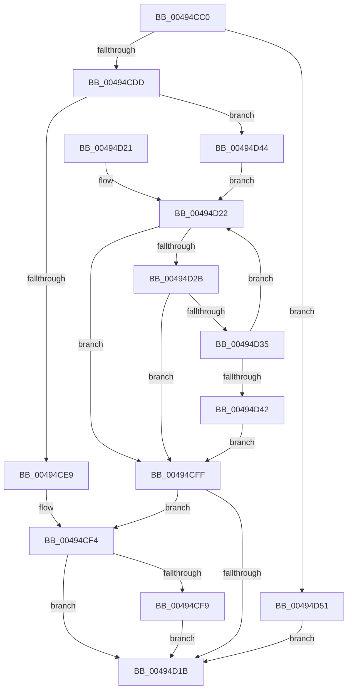

# RtlStringCbCopyNExW

- RVA: `0x00494CC0`–`0x00494D58` (길이 `152` bytes)
- VA: `0x0000000140494CC0`
- 실행 섹션: `.text`
- PDB 이름 있음: `예`; PDB Function 태그: `아니요`
- unwind 정보 RVA: `0x000B34F0`
- 디코드: `48`개 명령, `152/152` bytes 표시
- 미해석 바이트: `0` (있으면 어셈블리에 `.byte`로 보존)

> 이 문서는 커널 이미지의 기계어와 PDB 기호를 분석해 생성했습니다. 4번과 5번은 함수 원형과 자료형을 바이너리 사용 방식에서 추정한 C 해석이며 원본 소스 복구 결과는 아닙니다.

## 1. Dependencies

- 직접 호출 지점: **0**; 고유 호출 대상: **0**
- 직접 호출자로 확인된 함수: **1**
- RIP 상대 이미지 참조: **0**

### Outgoing calls
- 직접 디코드된 call 명령이 없습니다.

### Direct callers
- [sub_008EDC5D](../../page/8E/Unknown_function_008EDC5D.md) at `0x008EDECC`

### Static image references
- 디코드된 RIP-relative 메모리 참조가 없습니다.

## 2. Other-region calls and transfers

- 다른 실행 섹션으로 향하는 call: **0**
- 별도 외부 분기/꼬리 이동을 확인하지 못했습니다.

## 3. Assembly (complete function range)

```asm
00494CC0  48 89 5C 24 08                  mov qword ptr [rsp + 8], rbx
00494CC5  4C 8B D2                        mov r10, rdx
00494CC8  48 8B DA                        mov rbx, rdx
00494CCB  49 D1 EA                        shr r10, 1
00494CCE  4C 8B D9                        mov r11, rcx
00494CD1  49 8D 42 FF                     lea rax, [r10 - 1]
00494CD5  48 3D FE FF FF 7F               cmp rax, 0x7ffffffe
00494CDB  77 74                           ja 0x140494d51
00494CDD  49 D1 E9                        shr r9, 1
00494CE0  49 81 F9 FF FF FF 7F            cmp r9, 0x7fffffff
00494CE7  72 5B                           jb 0x140494d44
00494CE9  33 C9                           xor ecx, ecx
00494CEB  B8 0D 00 00 C0                  mov eax, 0xc000000d
00494CF0  66 41 89 0B                     mov word ptr [r11], cx
00494CF4  48 85 DB                        test rbx, rbx
00494CF7  74 22                           je 0x140494d1b
00494CF9  66 41 89 0B                     mov word ptr [r11], cx
00494CFD  EB 1C                           jmp 0x140494d1b
00494CFF  4D 85 D2                        test r10, r10
00494D02  48 8D 42 FE                     lea rax, [rdx - 2]
00494D06  48 0F 45 C2                     cmovne rax, rdx
00494D0A  49 F7 DA                        neg r10
00494D0D  66 89 08                        mov word ptr [rax], cx
00494D10  1B C0                           sbb eax, eax
00494D12  F7 D0                           not eax
00494D14  25 05 00 00 80                  and eax, 0x80000005
00494D19  78 D9                           js 0x140494cf4
00494D1B  48 8B 5C 24 08                  mov rbx, qword ptr [rsp + 8]
00494D20  C3                              ret
00494D21  CC                              int3
00494D22  4B 8D 04 11                     lea rax, [r9 + r10]
00494D26  48 85 C0                        test rax, rax
00494D29  74 D4                           je 0x140494cff
00494D2B  41 0F B7 04 10                  movzx eax, word ptr [r8 + rdx]
00494D30  66 85 C0                        test ax, ax
00494D33  74 CA                           je 0x140494cff
00494D35  66 89 02                        mov word ptr [rdx], ax
00494D38  48 83 C2 02                     add rdx, 2
00494D3C  49 83 EA 01                     sub r10, 1
00494D40  75 E0                           jne 0x140494d22
00494D42  EB BB                           jmp 0x140494cff
00494D44  4D 2B CA                        sub r9, r10
00494D47  4D 2B C3                        sub r8, r11
00494D4A  33 C9                           xor ecx, ecx
00494D4C  49 8B D3                        mov rdx, r11
00494D4F  EB D1                           jmp 0x140494d22
00494D51  B8 0D 00 00 C0                  mov eax, 0xc000000d
00494D56  EB C3                           jmp 0x140494d1b
```

## 4. C-style interpretation (structured pseudocode)

```c
__int64 __fastcall RtlStringCbCopyNExW(__int64 a1, __int64 a2, __int64 a3, __int64 a4)
{
    __int64 result;
    __int64 v_r10;
    unsigned __int64 v_stack_p8;

    v_stack_p8 = v_rbx;
    v_r10 = (a2) >> (1);
    if ((v_r10 - 1) > 0x7FFFFFFEULL) goto loc_00494D51;
    a4 = (a4) >> (1);
    if (a4 < 0x7FFFFFFFULL) goto loc_00494D44;
    a1 = 0;
    *(unsigned __int16 *)(a1) = 0;
loc_00494CF4:
    if (a2 == 0) goto loc_00494D1B;
    *(unsigned __int16 *)(a1) = 0;
    goto loc_00494D1B;
loc_00494CFF:
    result = a2 - 2;
    if (v_r10 != 0) { result = a2; }
    v_r10 = -(v_r10);
    *(unsigned __int16 *)(result) = 0;
    result = (unsigned int)(~(result));
    result = (unsigned int)((result) & (0x80000005ULL));
    if (sign_flag) goto loc_00494CF4;
loc_00494D1B:
    return result;
loc_00494D22:
    if (a4 + v_r10 * 1 == 0) goto loc_00494CFF;
    if ((unsigned __int16)(*(unsigned __int16 *)(a3 + a2 * 1)) == 0) goto loc_00494CFF;
    *(unsigned __int16 *)(a2) = (unsigned __int16)(*(unsigned __int16 *)(a3 + a2 * 1));
    a2 = (a2) + (2);
    v_r10 = (v_r10) - (1);
    if (condition_is_not_equal) goto loc_00494D22;
    goto loc_00494CFF;
loc_00494D44:
    a4 = (a4) - (v_r10);
    a3 = (a3) - (0);
    a1 = 0;
    goto loc_00494D22;
loc_00494D51:
    goto loc_00494D1B;
}
```

## 5. (Beta) C Style

```c
int64_t RtlStringCbCopyNExW(void *Arg1, int64_t Arg2, void *Arg3, int64_t Arg4)
{
    uint8_t *arg1 = (uint8_t *)Arg1;
    uint8_t *arg3 = (uint8_t *)Arg3;

    int64_t result;
    int64_t local_r10;
    uint64_t v_stack_p8;

    v_stack_p8 = local_rbx;
    local_r10 = (Arg2) >> (1);
    if ((local_r10 - 1) > 0x7FFFFFFEULL) goto loc_00494D51;
    Arg4 = (Arg4) >> (1);
    if (Arg4 < 0x7FFFFFFFULL) goto loc_00494D44;
    Arg1 = 0;
    *(uint16_t *)(arg1) = 0;
loc_00494CF4:
    if (Arg2 == 0) goto loc_00494D1B;
    *(uint16_t *)(arg1) = 0;
    goto loc_00494D1B;
loc_00494CFF:
    result = Arg2 - 2;
    if (local_r10 != 0) { result = Arg2; }
    local_r10 = -(local_r10);
    *(uint16_t *)(result) = 0;
    result = (uint32_t)(~(result));
    result = (uint32_t)((result) & (0x80000005ULL));
    if (sign_flag) goto loc_00494CF4;
loc_00494D1B:
    return result;
loc_00494D22:
    if (Arg4 + local_r10 * 1 == 0) goto loc_00494CFF;
    if ((uint16_t)(*(uint16_t *)(arg3 + Arg2 * 1)) == 0) goto loc_00494CFF;
    *(uint16_t *)(Arg2) = (uint16_t)(*(uint16_t *)(arg3 + Arg2 * 1));
    Arg2 = (Arg2) + (2);
    local_r10 = (local_r10) - (1);
    if (condition_is_not_equal) goto loc_00494D22;
    goto loc_00494CFF;
loc_00494D44:
    Arg4 = (Arg4) - (local_r10);
    Arg3 = (Arg3) - (0);
    Arg1 = 0;
    goto loc_00494D22;
loc_00494D51:
    goto loc_00494D1B;
}
```

### 관측된 메모리 오프셋

구조체 형식이 확인되지 않은 접근은 인자 기준의 오프셋으로만 기록했습니다.

| 기준 인자 | 오프셋 표현 | 폭 (bit) | 접근 |
|---|---:|---:|---|
| `Arg1` | `- 0x2` | `64` | `R` |
| `Arg1` | `+ 0x0` | `16` | `W` |
| `Arg3` | `+ 0x0 + rdx*1` | `16` | `R` |

## 6. Execution-region graph

[열기: 2D/3D 그래프와 함수 탐색 컨트롤 패널](../../../control-panel.html?section=text&rva=0x00494CC0&view=graph)

- 2D 그래프는 위에서 아래로 흐르고, 3D 그래프는 빈 공간을 드래그해 회전합니다. Shift+드래그는 이동, 휠은 확대·축소, 함수 노드 선택은 대상 보고서 이동입니다.

### Static fallback


