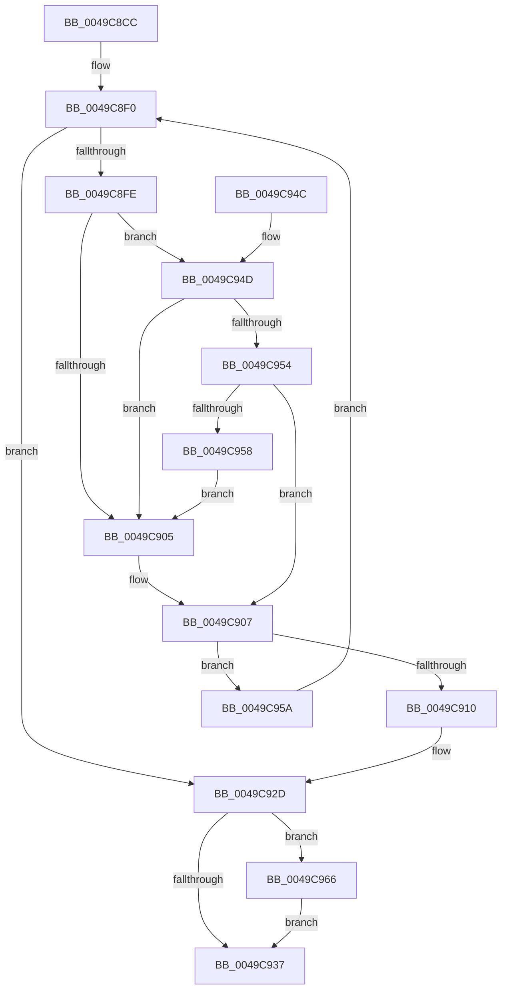

# RtlpFcAddFeatureUsageDataToBuffer

- RVA: `0x0049C8CC`–`0x0049C971` (길이 `165` bytes)
- VA: `0x000000014049C8CC`
- 실행 섹션: `.text`
- PDB 이름 있음: `예`; PDB Function 태그: `아니요`
- unwind 정보 RVA: `0x000B4C94`
- 디코드: `59`개 명령, `165/165` bytes 표시
- 미해석 바이트: `0` (있으면 어셈블리에 `.byte`로 보존)

> 이 문서는 커널 이미지의 기계어와 PDB 기호를 분석해 생성했습니다. 4번과 5번은 함수 원형과 자료형을 바이너리 사용 방식에서 추정한 C 해석이며 원본 소스 복구 결과는 아닙니다.

## 1. Dependencies

- 직접 호출 지점: **2**; 고유 호출 대상: **2**
- 직접 호출자로 확인된 함수: **1**
- RIP 상대 이미지 참조: **0**

### Outgoing calls
- `0x0049C928` → [memcpy](../6C/memcpy_function_006C6840.md) (function, `0x006C6840`)
- `0x0049C95F` → [RtlBackoff](../20/RtlBackoff_function_00208620.md) (function, `0x00208620`)

### Direct callers
- [CmFcManagerRecordFeatureUsage](CmFcManagerRecordFeatureUsage_function_0049C7B4.md) at `0x0049C833`

### Static image references
- 디코드된 RIP-relative 메모리 참조가 없습니다.

## 2. Other-region calls and transfers

- 다른 실행 섹션으로 향하는 call: **0**
- 별도 외부 분기/꼬리 이동을 확인하지 못했습니다.

## 3. Assembly (complete function range)

```asm
0049C8CC  48 89 5C 24 10                  mov qword ptr [rsp + 0x10], rbx
0049C8D1  48 89 6C 24 18                  mov qword ptr [rsp + 0x18], rbp
0049C8D6  56                              push rsi
0049C8D7  57                              push rdi
0049C8D8  41 56                           push r14
0049C8DA  48 83 EC 20                     sub rsp, 0x20
0049C8DE  49 8B 28                        mov rbp, qword ptr [r8]
0049C8E1  33 FF                           xor edi, edi
0049C8E3  89 7C 24 40                     mov dword ptr [rsp + 0x40], edi
0049C8E7  4D 8B F0                        mov r14, r8
0049C8EA  4C 8B CA                        mov r9, rdx
0049C8ED  48 8B D9                        mov rbx, rcx
0049C8F0  0F 0D 4B 10                     prefetchw byte ptr [rbx + 0x10]
0049C8F4  8B 73 10                        mov esi, dword ptr [rbx + 0x10]
0049C8F7  8B 53 1C                        mov edx, dword ptr [rbx + 0x1c]
0049C8FA  3B F2                           cmp esi, edx
0049C8FC  74 2F                           je 0x14049c92d
0049C8FE  8D 0C 2E                        lea ecx, [rsi + rbp]
0049C901  3B CE                           cmp ecx, esi
0049C903  73 48                           jae 0x14049c94d
0049C905  8B CA                           mov ecx, edx
0049C907  8B C6                           mov eax, esi
0049C909  F0 0F B1 4B 10                  lock cmpxchg dword ptr [rbx + 0x10], ecx
0049C90E  75 4A                           jne 0x14049c95a
0049C910  8B F9                           mov edi, ecx
0049C912  49 8B D1                        mov rdx, r9
0049C915  2B F8                           sub edi, eax
0049C917  8B C0                           mov eax, eax
0049C919  48 83 C0 04                     add rax, 4
0049C91D  44 8B C7                        mov r8d, edi
0049C920  49 C1 E0 03                     shl r8, 3
0049C924  48 8D 0C C3                     lea rcx, [rbx + rax*8]
0049C928  E8 13 9F 22 00                  call 0x1406c6840
0049C92D  48 8B C5                        mov rax, rbp
0049C930  8B CF                           mov ecx, edi
0049C932  48 3B CD                        cmp rcx, rbp
0049C935  75 2F                           jne 0x14049c966
0049C937  48 8B 5C 24 48                  mov rbx, qword ptr [rsp + 0x48]
0049C93C  8B C6                           mov eax, esi
0049C93E  48 8B 6C 24 50                  mov rbp, qword ptr [rsp + 0x50]
0049C943  48 83 C4 20                     add rsp, 0x20
0049C947  41 5E                           pop r14
0049C949  5F                              pop rdi
0049C94A  5E                              pop rsi
0049C94B  C3                              ret
0049C94C  CC                              int3
0049C94D  8B C1                           mov eax, ecx
0049C94F  48 3B C5                        cmp rax, rbp
0049C952  72 B1                           jb 0x14049c905
0049C954  3B CA                           cmp ecx, edx
0049C956  76 AF                           jbe 0x14049c907
0049C958  EB AB                           jmp 0x14049c905
0049C95A  48 8D 4C 24 40                  lea rcx, [rsp + 0x40]
0049C95F  E8 BC BC D6 FF                  call 0x140208620
0049C964  EB 8A                           jmp 0x14049c8f0
0049C966  2B C7                           sub eax, edi
0049C968  F0 01 43 14                     lock add dword ptr [rbx + 0x14], eax
0049C96C  49 89 0E                        mov qword ptr [r14], rcx
0049C96F  EB C6                           jmp 0x14049c937
```

## 4. C-style interpretation (structured pseudocode)

```c
__int64 __fastcall RtlpFcAddFeatureUsageDataToBuffer(__int64 a1, __int64 a2, __int64 a3)
{
    __int64 result;
    __int64 v_rdi;
    __int64 v_rsp;
    unsigned __int64 v_stack_p10;
    unsigned __int64 v_stack_p18;
    unsigned __int64 v_stack_p40;
    unsigned int v_stack_p8;

    v_stack_p10 = v_rbx;
    v_stack_p18 = v_rbp;
    v_rsp = (v_rsp) - (32);
    v_rdi = 0;
    v_stack_p8 = 0;
loc_0049C8F0:
    if (((unsigned int)((unsigned int)(*(unsigned int *)(a1 + 16)))) == ((unsigned int)((unsigned int)(*(unsigned int *)(a1 + 28))))) goto loc_0049C92D;
    if (((unsigned int)((unsigned int)(*(unsigned int *)(a1 + 16)) + *(unsigned __int64 *)(a3) * 1)) >= ((unsigned int)((unsigned int)(*(unsigned int *)(a1 + 16))))) goto loc_0049C94D;
loc_0049C905:
loc_0049C907:
    if (((unsigned int)((unsigned int)(*(unsigned int *)(a1 + 16)) + *(unsigned __int64 *)(a3) * 1)) != ((unsigned int)((unsigned int)(*(unsigned int *)(a1 + 16))))) goto loc_0049C95A;
    v_rdi = (unsigned int)(((unsigned int)((unsigned int)((unsigned int)((unsigned int)((unsigned int)(*(unsigned int *)(a1 + 28))))))) - ((unsigned int)((unsigned int)((unsigned int)((unsigned int)(*(unsigned int *)(a1 + 16)))))));
    result = ((unsigned int)((unsigned int)((unsigned int)((unsigned int)((unsigned int)(*(unsigned int *)(a1 + 16))))))) + (4);
    a3 = ((unsigned int)((unsigned int)(v_rdi))) << (3);
    result = memcpy(a1 + result * 8, a2, a3, a2);
loc_0049C92D:
    if (((unsigned int)((unsigned int)(v_rdi))) != (*(unsigned __int64 *)(a3))) goto loc_0049C966;
loc_0049C937:
    v_rsp = (v_rsp) + (32);
    return (unsigned int)((unsigned int)((unsigned int)(*(unsigned int *)(a1 + 16))));
loc_0049C94D:
    if (((unsigned int)((unsigned int)((unsigned int)((unsigned int)(v_rdi))))) < v_stack_p18) goto loc_0049C905;
    if (((unsigned int)((unsigned int)((unsigned int)(v_rdi)))) <= ((unsigned int)(a2))) goto loc_0049C907;
    goto loc_0049C905;
loc_0049C95A:
    result = RtlBackoff(v_stack_p40, a2, a3, a2);
    goto loc_0049C8F0;
loc_0049C966:
    result = (unsigned int)((result) - ((unsigned int)(v_rdi)));
    *(unsigned __int64 *)(a3) = v_stack_p40;
    goto loc_0049C937;
}
```

## 5. (Beta) C Style

```c
int64_t RtlpFcAddFeatureUsageDataToBuffer(void *Arg1, int64_t Arg2, void *Arg3)
{
    uint8_t *arg1 = (uint8_t *)Arg1;
    uint8_t *arg3 = (uint8_t *)Arg3;

    int64_t result;
    int64_t local_rdi;
    int64_t local_rsp;
    uint64_t v_stack_p10;
    uint64_t v_stack_p18;
    uint64_t v_stack_p40;
    uint32_t v_stack_p8;

    v_stack_p10 = local_rbx;
    v_stack_p18 = local_rbp;
    local_rsp = (local_rsp) - (32);
    local_rdi = 0;
    v_stack_p8 = 0;
loc_0049C8F0:
    if (((uint32_t)((uint32_t)(*(uint32_t *)(arg1 + 0x10)))) == ((uint32_t)((uint32_t)(*(uint32_t *)(arg1 + 0x1C))))) goto loc_0049C92D;
    if (((uint32_t)((uint32_t)(*(uint32_t *)(arg1 + 0x10)) + *(uint64_t *)(arg3) * 1)) >= ((uint32_t)((uint32_t)(*(uint32_t *)(arg1 + 0x10))))) goto loc_0049C94D;
loc_0049C905:
loc_0049C907:
    if (((uint32_t)((uint32_t)(*(uint32_t *)(arg1 + 0x10)) + *(uint64_t *)(arg3) * 1)) != ((uint32_t)((uint32_t)(*(uint32_t *)(arg1 + 0x10))))) goto loc_0049C95A;
    local_rdi = (uint32_t)(((uint32_t)((uint32_t)((uint32_t)((uint32_t)((uint32_t)(*(uint32_t *)(arg1 + 0x1C))))))) - ((uint32_t)((uint32_t)((uint32_t)((uint32_t)(*(uint32_t *)(arg1 + 0x10)))))));
    result = ((uint32_t)((uint32_t)((uint32_t)((uint32_t)((uint32_t)(*(uint32_t *)(arg1 + 0x10))))))) + (4);
    Arg3 = ((uint32_t)((uint32_t)(local_rdi))) << (3);
    result = memcpy(Arg1 + result * 8, Arg2, Arg3, Arg2);
loc_0049C92D:
    if (((uint32_t)((uint32_t)(local_rdi))) != (*(uint64_t *)(arg3))) goto loc_0049C966;
loc_0049C937:
    local_rsp = (local_rsp) + (32);
    return (uint32_t)((uint32_t)((uint32_t)(*(uint32_t *)(arg1 + 0x10))));
loc_0049C94D:
    if (((uint32_t)((uint32_t)((uint32_t)((uint32_t)(local_rdi))))) < v_stack_p18) goto loc_0049C905;
    if (((uint32_t)((uint32_t)((uint32_t)(local_rdi)))) <= ((uint32_t)(Arg2))) goto loc_0049C907;
    goto loc_0049C905;
loc_0049C95A:
    result = RtlBackoff(v_stack_p40, Arg2, Arg3, Arg2);
    goto loc_0049C8F0;
loc_0049C966:
    result = (uint32_t)((result) - ((uint32_t)(local_rdi)));
    *(uint64_t *)(arg3) = v_stack_p40;
    goto loc_0049C937;
}
```

### 관측된 메모리 오프셋

구조체 형식이 확인되지 않은 접근은 인자 기준의 오프셋으로만 기록했습니다.

| 기준 인자 | 오프셋 표현 | 폭 (bit) | 접근 |
|---|---:|---:|---|
| `Arg1` | `+ 0x0 + rax*8` | `64` | `R` |
| `Arg1` | `+ 0x10` | `8` | `R` |
| `Arg1` | `+ 0x10` | `32` | `R` |
| `Arg1` | `+ 0x14` | `32` | `R/W` |
| `Arg1` | `+ 0x1C` | `32` | `R` |
| `Arg3` | `+ 0x0` | `64` | `R` |
| `Arg3` | `+ 0x0` | `64` | `W` |

## 6. Execution-region graph

[열기: 2D/3D 그래프와 함수 탐색 컨트롤 패널](../../../control-panel.html?section=text&rva=0x0049C8CC&view=graph)

- 2D 그래프는 위에서 아래로 흐르고, 3D 그래프는 빈 공간을 드래그해 회전합니다. Shift+드래그는 이동, 휠은 확대·축소, 함수 노드 선택은 대상 보고서 이동입니다.

### Static fallback


