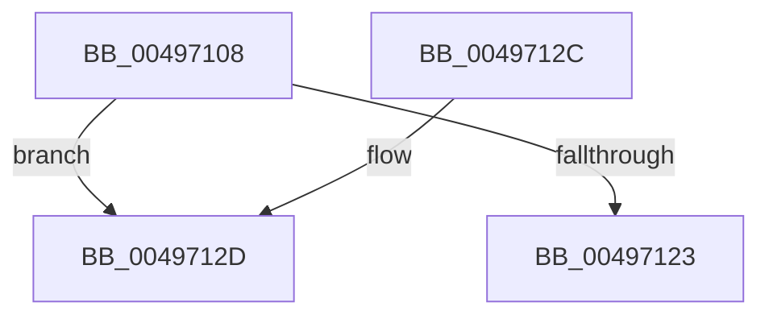

# RtlpFlsSlotDataValidateEmpty

- RVA: `0x00497108`–`0x0049713E` (길이 `54` bytes)
- VA: `0x0000000140497108`
- 실행 섹션: `.text`
- PDB 이름 있음: `예`; PDB Function 태그: `예`
- unwind 정보 RVA: `0x000B3CCC`
- 디코드: `14`개 명령, `54/54` bytes 표시
- 미해석 바이트: `0` (있으면 어셈블리에 `.byte`로 보존)

> 이 문서는 커널 이미지의 기계어와 PDB 기호를 분석해 생성했습니다. 4번과 5번은 함수 원형과 자료형을 바이너리 사용 방식에서 추정한 C 해석이며 원본 소스 복구 결과는 아닙니다.

## 1. Dependencies

- 직접 호출 지점: **0**; 고유 호출 대상: **0**
- 직접 호출자로 확인된 함수: **1**
- RIP 상대 이미지 참조: **1**

### Outgoing calls
- 직접 디코드된 call 명령이 없습니다.

### Direct callers
- [PspExitThread](../../page/90/PspExitThread_function_00905F60.md) at `0x00906542`

### Static image references
- `0x0049712D` → RVA `0x00E281F0` (`.data`; read)

## 2. Other-region calls and transfers

- 다른 실행 섹션으로 향하는 call: **0**
- call이 아닌 외부 분기/꼬리 이동: **1**
  - `0x00497139` → [sub_006F777E](../6F/Unknown_function_006F777E.md) (`tail-transfer`)

## 3. Assembly (complete function range)

```asm
00497108  48 89 5C 24 10                  mov qword ptr [rsp + 0x10], rbx
0049710D  8B 42 20                        mov eax, dword ptr [rdx + 0x20]
00497110  41 B8 01 00 00 00               mov r8d, 1
00497116  48 89 4C 24 08                  mov qword ptr [rsp + 8], rcx
0049711B  4C 8B D2                        mov r10, rdx
0049711E  41 84 C0                        test r8b, al
00497121  75 0A                           jne 0x14049712d
00497123  48 8B 5C 24 10                  mov rbx, qword ptr [rsp + 0x10]
00497128  41 8A C0                        mov al, r8b
0049712B  C3                              ret
0049712C  CC                              int3
0049712D  44 8B 1D BC 10 99 00            mov r11d, dword ptr [rip + 0x9910bc]
00497134  BA 11 00 00 00                  mov edx, 0x11
00497139  E9 40 06 26 00                  jmp 0x1406f777e
```

## 4. C-style interpretation (structured pseudocode)

```c
__int64 __fastcall RtlpFlsSlotDataValidateEmpty(__int64 a1, __int64 a2)
{
    unsigned __int64 v_stack_p10;
    unsigned __int64 v_stack_p8;

    v_stack_p10 = v_rbx;
    v_stack_p8 = a1;
    if (((1) & ((unsigned __int8)((unsigned int)(*(unsigned int *)(a2 + 32))))) != 0) goto loc_0049712D;
    return 1;
loc_0049712D:
}
```

## 5. (Beta) C Style

```c
int64_t RtlpFlsSlotDataValidateEmpty(int64_t Arg1, void *Arg2)
{
    uint8_t *arg2 = (uint8_t *)Arg2;

    uint64_t v_stack_p10;
    uint64_t v_stack_p8;

    v_stack_p10 = local_rbx;
    v_stack_p8 = Arg1;
    if (((1) & ((uint8_t)((uint32_t)(*(uint32_t *)(arg2 + 0x20))))) != 0) goto loc_0049712D;
    return 1;
loc_0049712D:
}
```

### 관측된 메모리 오프셋

구조체 형식이 확인되지 않은 접근은 인자 기준의 오프셋으로만 기록했습니다.

| 기준 인자 | 오프셋 표현 | 폭 (bit) | 접근 |
|---|---:|---:|---|
| `Arg2` | `+ 0x20` | `32` | `R` |

## 6. Execution-region graph

[열기: 2D/3D 그래프와 함수 탐색 컨트롤 패널](../../../control-panel.html?section=text&rva=0x00497108&view=graph)

- 2D 그래프는 위에서 아래로 흐르고, 3D 그래프는 빈 공간을 드래그해 회전합니다. Shift+드래그는 이동, 휠은 확대·축소, 함수 노드 선택은 대상 보고서 이동입니다.

### Static fallback


