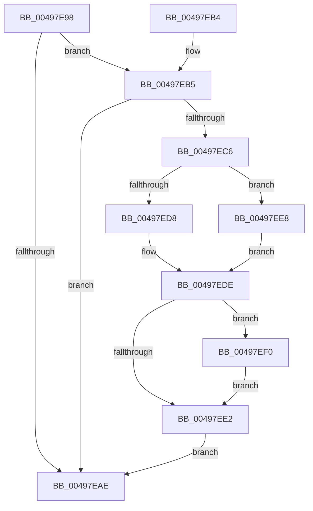

# RtlpHpLfhContextUpdateFreeCommitCount

- RVA: `0x00497E98`–`0x00497EFB` (길이 `99` bytes)
- VA: `0x0000000140497E98`
- 실행 섹션: `.text`
- PDB 이름 있음: `예`; PDB Function 태그: `아니요`
- unwind 정보 RVA: `0x000B4068`
- 디코드: `31`개 명령, `99/99` bytes 표시
- 미해석 바이트: `0` (있으면 어셈블리에 `.byte`로 보존)

> 이 문서는 커널 이미지의 기계어와 PDB 기호를 분석해 생성했습니다. 4번과 5번은 함수 원형과 자료형을 바이너리 사용 방식에서 추정한 C 해석이며 원본 소스 복구 결과는 아닙니다.

## 1. Dependencies

- 직접 호출 지점: **1**; 고유 호출 대상: **1**
- 직접 호출자로 확인된 함수: **5**
- RIP 상대 이미지 참조: **2**

### Outgoing calls
- `0x00497EF4` → [RtlpHpEnvCompactionSchedule](../32/RtlpHpEnvCompactionSchedule_function_003264A0.md) (function, `0x003264A0`)

### Direct callers
- [RtlpHpLfhSubsegmentFree](../2E/RtlpHpLfhSubsegmentFree_function_002E7CA0.md) at `0x002E7CEC`
- [RtlpHpLfhSubsegmentReformatAsMulti](../2E/RtlpHpLfhSubsegmentReformatAsMulti_function_002E8814.md) at `0x002E8905`
- [RtlpHpLfhSubsegmentDelayFreeListProcess](../32/RtlpHpLfhSubsegmentDelayFreeListProcess_function_00323CE0.md) at `0x00324063`
- [RtlpHpLfhSubsegmentDecBlockCounts](../32/RtlpHpLfhSubsegmentDecBlockCounts_function_003244D0.md) at `0x00324592`
- [RtlpHpLfhSubsegmentReformatAsSingle](../46/RtlpHpLfhSubsegmentReformatAsSingle_function_00461D88.md) at `0x00461E93`

### Static image references
- `0x00497ED8` → RVA `0x00EFA7BC` (`.data`; read)
- `0x00497EE8` → RVA `0x00EFA7C0` (`.data`; read)

## 2. Other-region calls and transfers

- 다른 실행 섹션으로 향하는 call: **0**
- 별도 외부 분기/꼬리 이동을 확인하지 못했습니다.

## 3. Assembly (complete function range)

```asm
00497E98  40 53                           push rbx
00497E9A  48 83 EC 20                     sub rsp, 0x20
00497E9E  48 0F BF 41 42                  movsx rax, word ptr [rcx + 0x42]
00497EA3  F0 4C 01 44 08 18               lock add qword ptr [rax + rcx + 0x18], r8
00497EA9  4D 85 C0                        test r8, r8
00497EAC  7F 07                           jg 0x140497eb5
00497EAE  48 83 C4 20                     add rsp, 0x20
00497EB2  5B                              pop rbx
00497EB3  C3                              ret
00497EB4  CC                              int3
00497EB5  0F B7 5A 2C                     movzx ebx, word ptr [rdx + 0x2c]
00497EB9  48 C1 E3 06                     shl rbx, 6
00497EBD  48 03 D9                        add rbx, rcx
00497EC0  80 7B 5C 00                     cmp byte ptr [rbx + 0x5c], 0
00497EC4  75 E8                           jne 0x140497eae
00497EC6  48 8B 09                        mov rcx, qword ptr [rcx]
00497EC9  48 8B 41 38                     mov rax, qword ptr [rcx + 0x38]
00497ECD  48 8B 00                        mov rax, qword ptr [rax]
00497ED0  48 C1 E8 08                     shr rax, 8
00497ED4  3C 01                           cmp al, 1
00497ED6  75 10                           jne 0x140497ee8
00497ED8  8B 05 DE 28 A6 00               mov eax, dword ptr [rip + 0xa628de]
00497EDE  85 C0                           test eax, eax
00497EE0  74 0E                           je 0x140497ef0
00497EE2  C6 43 5C 01                     mov byte ptr [rbx + 0x5c], 1
00497EE6  EB C6                           jmp 0x140497eae
00497EE8  8B 05 D2 28 A6 00               mov eax, dword ptr [rip + 0xa628d2]
00497EEE  EB EE                           jmp 0x140497ede
00497EF0  48 8B 49 38                     mov rcx, qword ptr [rcx + 0x38]
00497EF4  E8 A7 E5 E8 FF                  call 0x1403264a0
00497EF9  EB E7                           jmp 0x140497ee2
```

## 4. C-style interpretation (structured pseudocode)

```c
__int64 __fastcall RtlpHpLfhContextUpdateFreeCommitCount(__int64 a1, __int64 a2, __int64 a3)
{
    __int64 result;
    __int64 v_rbx;
    __int64 v_rsp;

    v_rsp = (v_rsp) - (32);
    if (condition_is_greater) goto loc_00497EB5;
loc_00497EAE:
    v_rsp = (v_rsp) + (32);
    return (__int16)(*(unsigned __int16 *)(a1 + 66));
loc_00497EB5:
    v_rbx = (*(unsigned __int16 *)(a2 + 44)) << (6);
    v_rbx = (v_rbx) + (a1);
    if ((*(unsigned __int8 *)(v_rbx + 92)) != 0) goto loc_00497EAE;
    result = (*(unsigned __int64 *)(*(unsigned __int64 *)(*(unsigned __int64 *)(a1) + 56))) >> (8);
    if (((unsigned __int8)(result)) != 1) goto loc_00497EE8;
loc_00497EDE:
    if ((unsigned int)((unsigned int)(*(unsigned int *)(v_rip + 10889438))) == 0) goto loc_00497EF0;
loc_00497EE2:
    *(unsigned __int8 *)(v_rbx + 92) = 1;
    goto loc_00497EAE;
loc_00497EE8:
    goto loc_00497EDE;
loc_00497EF0:
    result = RtlpHpEnvCompactionSchedule(*(unsigned __int64 *)(*(unsigned __int64 *)(a1) + 56), a2, a3, a4);
    goto loc_00497EE2;
}
```

## 5. (Beta) C Style

```c
int64_t RtlpHpLfhContextUpdateFreeCommitCount(void *Arg1, void *Arg2, int64_t Arg3)
{
    uint8_t *arg1 = (uint8_t *)Arg1;
    uint8_t *arg2 = (uint8_t *)Arg2;

    int64_t result;
    int64_t local_rbx;
    int64_t local_rsp;

    local_rsp = (local_rsp) - (32);
    if (condition_is_greater) goto loc_00497EB5;
loc_00497EAE:
    local_rsp = (local_rsp) + (32);
    return (int16_t)(*(uint16_t *)(arg1 + 0x42));
loc_00497EB5:
    local_rbx = (*(uint16_t *)(arg2 + 0x2C)) << (6);
    local_rbx = (local_rbx) + (Arg1);
    if ((*(uint8_t *)(local_rbx + 0x5C)) != 0) goto loc_00497EAE;
    result = (*(uint64_t *)(*(uint64_t *)(*(uint64_t *)(arg1) + 0x38))) >> (8);
    if (((uint8_t)(result)) != 1) goto loc_00497EE8;
loc_00497EDE:
    if ((uint32_t)((uint32_t)(*(uint32_t *)(v_rip + 0xA628DE))) == 0) goto loc_00497EF0;
loc_00497EE2:
    *(uint8_t *)(local_rbx + 0x5C) = 1;
    goto loc_00497EAE;
loc_00497EE8:
    goto loc_00497EDE;
loc_00497EF0:
    result = RtlpHpEnvCompactionSchedule(*(uint64_t *)(*(uint64_t *)(arg1) + 0x38), Arg2, Arg3, a4);
    goto loc_00497EE2;
}
```

### 관측된 메모리 오프셋

구조체 형식이 확인되지 않은 접근은 인자 기준의 오프셋으로만 기록했습니다.

| 기준 인자 | 오프셋 표현 | 폭 (bit) | 접근 |
|---|---:|---:|---|
| `Arg1` | `+ 0x0` | `64` | `R` |
| `Arg1` | `+ 0x42` | `16` | `R` |
| `Arg2` | `+ 0x2C` | `16` | `R` |

## 6. Execution-region graph

[열기: 2D/3D 그래프와 함수 탐색 컨트롤 패널](../../../control-panel.html?section=text&rva=0x00497E98&view=graph)

- 2D 그래프는 위에서 아래로 흐르고, 3D 그래프는 빈 공간을 드래그해 회전합니다. Shift+드래그는 이동, 휠은 확대·축소, 함수 노드 선택은 대상 보고서 이동입니다.

### Static fallback


