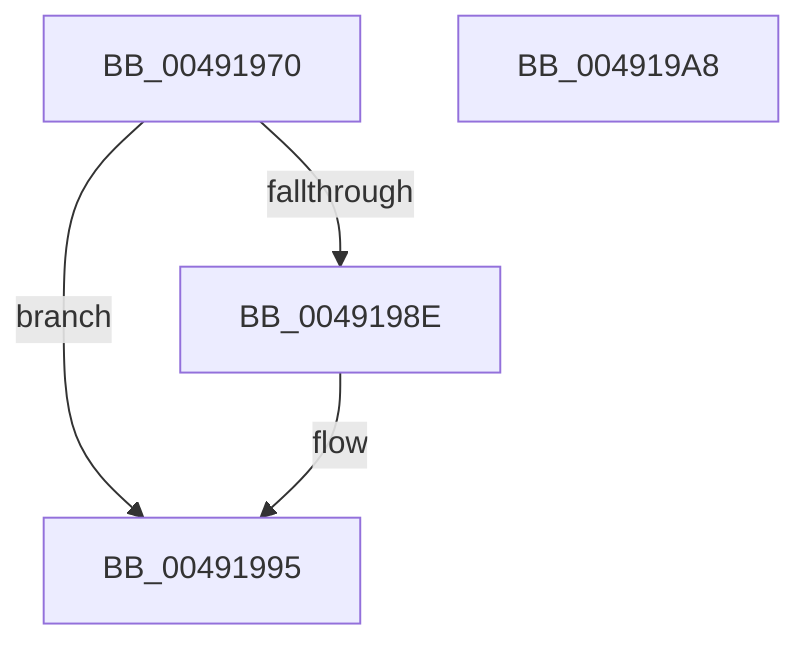

# RtlpHpSegHeapAddSegment

- RVA: `0x00491970`–`0x004919A9` (길이 `57` bytes)
- VA: `0x0000000140491970`
- 실행 섹션: `.text`
- PDB 이름 있음: `예`; PDB Function 태그: `아니요`
- unwind 정보 RVA: `0x000DB714`
- 디코드: `17`개 명령, `57/57` bytes 표시
- 미해석 바이트: `0` (있으면 어셈블리에 `.byte`로 보존)

> 이 문서는 커널 이미지의 기계어와 PDB 기호를 분석해 생성했습니다. 4번과 5번은 함수 원형과 자료형을 바이너리 사용 방식에서 추정한 C 해석이며 원본 소스 복구 결과는 아닙니다.

## 1. Dependencies

- 직접 호출 지점: **0**; 고유 호출 대상: **0**
- 직접 호출자로 확인된 함수: **2**
- RIP 상대 이미지 참조: **1**

### Outgoing calls
- 직접 디코드된 call 명령이 없습니다.

### Direct callers
- [sub_003267E9](../32/Unknown_function_003267E9.md) at `0x003268F6`
- [RtlpHpSegContextReserve](../60/RtlpHpSegContextReserve_function_00604338.md) at `0x006043F1`

### Static image references
- `0x00491973` → RVA `0x00E28300` (`.data`; read)

## 2. Other-region calls and transfers

- 다른 실행 섹션으로 향하는 call: **0**
- 별도 외부 분기/꼬리 이동을 확인하지 못했습니다.

## 3. Assembly (complete function range)

```asm
00491970  48 8B C1                        mov rax, rcx
00491973  48 33 05 86 69 99 00            xor rax, qword ptr [rip + 0x996986]
0049197A  48 33 C2                        xor rax, rdx
0049197D  48 89 42 10                     mov qword ptr [rdx + 0x10], rax
00491981  48 8D 41 48                     lea rax, [rcx + 0x48]
00491985  4C 8B 40 08                     mov r8, qword ptr [rax + 8]
00491989  49 39 00                        cmp qword ptr [r8], rax
0049198C  74 07                           je 0x140491995
0049198E  B9 03 00 00 00                  mov ecx, 3
00491993  CD 29                           int 0x29
00491995  48 89 02                        mov qword ptr [rdx], rax
00491998  4C 89 42 08                     mov qword ptr [rdx + 8], r8
0049199C  49 89 10                        mov qword ptr [r8], rdx
0049199F  48 89 50 08                     mov qword ptr [rax + 8], rdx
004919A3  48 FF 41 58                     inc qword ptr [rcx + 0x58]
004919A7  C3                              ret
004919A8  CC                              int3
```

## 4. C-style interpretation (structured pseudocode)

```c
__int64 __fastcall RtlpHpSegHeapAddSegment(__int64 a1, __int64 a2)
{
    __int64 result;

    result = (a1) ^ (*(unsigned __int64 *)(v_rip + 10054022));
    result = (result) ^ (a2);
    *(unsigned __int64 *)(a2 + 16) = result;
    if ((*(unsigned __int64 *)(*(unsigned __int64 *)(a1 + 72 + 8))) != (a1 + 72)) {
        a1 = 3;
    }
    *(unsigned __int64 *)(a2) = a1 + 72;
    *(unsigned __int64 *)(a2 + 8) = *(unsigned __int64 *)(a1 + 72 + 8);
    *(unsigned __int64 *)(*(unsigned __int64 *)(a1 + 72 + 8)) = a2;
    *(unsigned __int64 *)(a1 + 72 + 8) = a2;
    return a1 + 72;
}
```

## 5. (Beta) C Style

```c
void *RtlpHpSegHeapAddSegment(void *Arg1, void *Arg2)
{
    uint8_t *arg1 = (uint8_t *)Arg1;
    uint8_t *arg2 = (uint8_t *)Arg2;

    int64_t result;

    result = (Arg1) ^ (*(uint64_t *)(v_rip + 0x996986));
    result = (result) ^ (Arg2);
    *(uint64_t *)(arg2 + 0x10) = result;
    if ((*(uint64_t *)(*(uint64_t *)(arg1 + 0x48 + 0x8))) != (Arg1 + 72)) {
        Arg1 = 3;
    }
    *(void **)(arg2) = Arg1 + 72;
    *(uint64_t *)(arg2 + 0x8) = *(uint64_t *)(arg1 + 0x48 + 0x8);
    *(void **)(*(uint64_t *)(arg1 + 0x48 + 0x8)) = Arg2;
    *(void **)(arg1 + 0x48 + 0x8) = Arg2;
    return Arg1 + 72;
}
```

### 관측된 메모리 오프셋

구조체 형식이 확인되지 않은 접근은 인자 기준의 오프셋으로만 기록했습니다.

| 기준 인자 | 오프셋 표현 | 폭 (bit) | 접근 |
|---|---:|---:|---|
| `Arg1` | `+ 0x8` | `64` | `R` |
| `Arg1` | `+ 0x8` | `64` | `W` |
| `Arg1` | `+ 0x48` | `64` | `R` |
| `Arg2` | `+ 0x0` | `64` | `W` |
| `Arg2` | `+ 0x8` | `64` | `W` |
| `Arg2` | `+ 0x10` | `64` | `W` |

## 6. Execution-region graph

[열기: 2D/3D 그래프와 함수 탐색 컨트롤 패널](../../../control-panel.html?section=text&rva=0x00491970&view=graph)

- 2D 그래프는 위에서 아래로 흐르고, 3D 그래프는 빈 공간을 드래그해 회전합니다. Shift+드래그는 이동, 휠은 확대·축소, 함수 노드 선택은 대상 보고서 이동입니다.

### Static fallback


