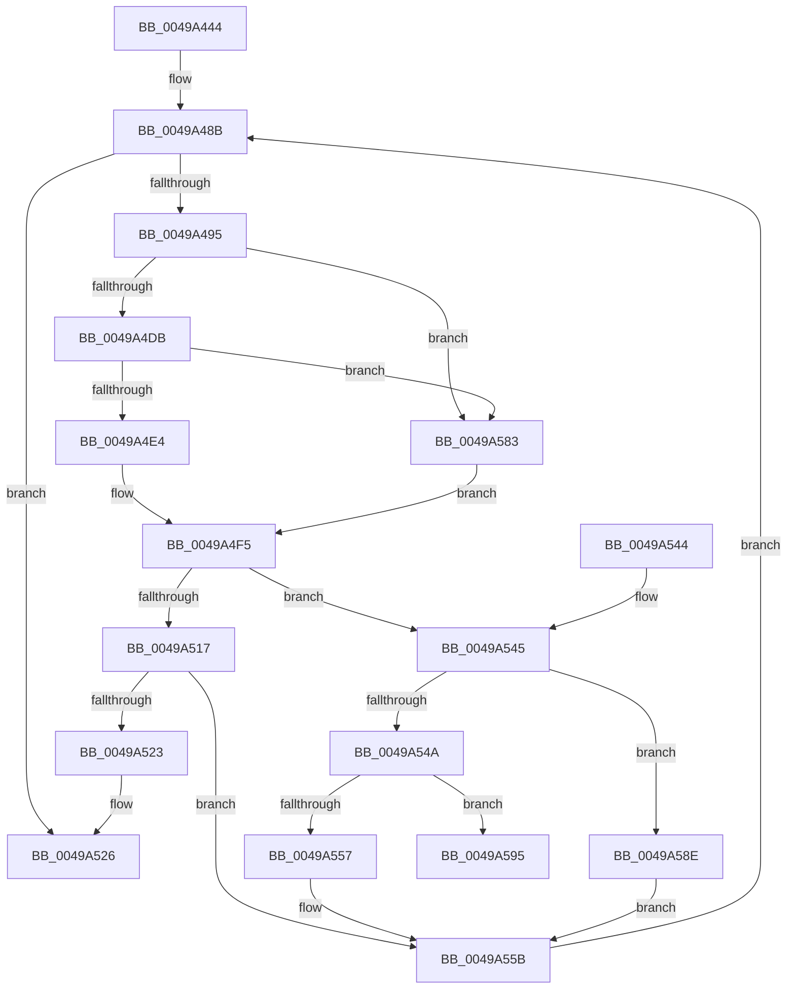

# RtlpHpVaMgrRangeCommitProcess

- RVA: `0x0049A444`–`0x0049A5A2` (길이 `350` bytes)
- VA: `0x000000014049A444`
- 실행 섹션: `.text`
- PDB 이름 있음: `예`; PDB Function 태그: `예`
- unwind 정보 RVA: `0x000B4788`
- 디코드: `96`개 명령, `350/350` bytes 표시
- 미해석 바이트: `0` (있으면 어셈블리에 `.byte`로 보존)

> 이 문서는 커널 이미지의 기계어와 PDB 기호를 분석해 생성했습니다. 4번과 5번은 함수 원형과 자료형을 바이너리 사용 방식에서 추정한 C 해석이며 원본 소스 복구 결과는 아닙니다.

## 1. Dependencies

- 직접 호출 지점: **1**; 고유 호출 대상: **1**
- 직접 호출자로 확인된 함수: **2**
- RIP 상대 이미지 참조: **0**

### Outgoing calls
- `0x0049A479` → [RtlSparseArrayElementAllocated](../32/RtlSparseArrayElementAllocated_function_00327364.md) (function, `0x00327364`)

### Direct callers
- [RtlpHpVaMgrRangeCommit](../60/RtlpHpVaMgrRangeCommit_function_00603EF8.md) at `0x00603FAE`
- [RtlpHpVaMgrRangeCommit](../60/RtlpHpVaMgrRangeCommit_function_00603EF8.md) at `0x00604015`
- [RtlpHpVaMgrRangeDecommit](../60/RtlpHpVaMgrRangeDecommit_function_00604040.md) at `0x006040ED`

### Static image references
- 디코드된 RIP-relative 메모리 참조가 없습니다.

## 2. Other-region calls and transfers

- 다른 실행 섹션으로 향하는 call: **0**
- call이 아닌 외부 분기/꼬리 이동: **1**
  - `0x0049A59D` → [sub_006F7986](../6F/Unknown_function_006F7986.md) (`tail-transfer`)

## 3. Assembly (complete function range)

```asm
0049A444  48 8B C4                        mov rax, rsp
0049A447  48 89 58 08                     mov qword ptr [rax + 8], rbx
0049A44B  48 89 68 10                     mov qword ptr [rax + 0x10], rbp
0049A44F  48 89 70 18                     mov qword ptr [rax + 0x18], rsi
0049A453  48 89 78 20                     mov qword ptr [rax + 0x20], rdi
0049A457  41 56                           push r14
0049A459  48 83 EC 20                     sub rsp, 0x20
0049A45D  48 8B DA                        mov rbx, rdx
0049A460  48 8B F1                        mov rsi, rcx
0049A463  48 8B 49 18                     mov rcx, qword ptr [rcx + 0x18]
0049A467  41 8B F8                        mov edi, r8d
0049A46A  48 8B 12                        mov rdx, qword ptr [rdx]
0049A46D  48 2B 51 08                     sub rdx, qword ptr [rcx + 8]
0049A471  48 83 C1 10                     add rcx, 0x10
0049A475  48 C1 EA 14                     shr rdx, 0x14
0049A479  E8 E6 CE E8 FF                  call 0x140327364
0049A47E  33 ED                           xor ebp, ebp
0049A480  44 8B DD                        mov r11d, ebp
0049A483  4C 8D 40 02                     lea r8, [rax + 2]
0049A487  44 8D 75 01                     lea r14d, [rbp + 1]
0049A48B  48 39 6B 08                     cmp qword ptr [rbx + 8], rbp
0049A48F  0F 86 91 00 00 00               jbe 0x14049a526
0049A495  48 8B 46 18                     mov rax, qword ptr [rsi + 0x18]
0049A499  4D 8B D0                        mov r10, r8
0049A49C  0F 28 0B                        movaps xmm1, xmmword ptr [rbx]
0049A49F  66 0F 6F C1                     movdqa xmm0, xmm1
0049A4A3  66 0F 73 D8 08                  psrldq xmm0, 8
0049A4A8  4C 2B 50 28                     sub r10, qword ptr [rax + 0x28]
0049A4AC  66 48 0F 7E C2                  movq rdx, xmm0
0049A4B1  8B 48 18                        mov ecx, dword ptr [rax + 0x18]
0049A4B4  49 83 EA 02                     sub r10, 2
0049A4B8  49 D3 EA                        shr r10, cl
0049A4BB  66 48 0F 7E C9                  movq rcx, xmm1
0049A4C0  49 C1 E2 14                     shl r10, 0x14
0049A4C4  48 03 D1                        add rdx, rcx
0049A4C7  4C 03 50 08                     add r10, qword ptr [rax + 8]
0049A4CB  4D 8D 8A 00 00 10 00            lea r9, [r10 + 0x100000]
0049A4D2  49 3B D2                        cmp rdx, r10
0049A4D5  0F 86 A8 00 00 00               jbe 0x14049a583
0049A4DB  4C 3B C9                        cmp r9, rcx
0049A4DE  0F 86 9F 00 00 00               jbe 0x14049a583
0049A4E4  49 3B CA                        cmp rcx, r10
0049A4E7  4C 0F 47 D1                     cmova r10, rcx
0049A4EB  49 3B D1                        cmp rdx, r9
0049A4EE  4C 0F 42 CA                     cmovb r9, rdx
0049A4F2  4D 2B CA                        sub r9, r10
0049A4F5  49 C1 EA 10                     shr r10, 0x10
0049A4F9  49 8B C9                        mov rcx, r9
0049A4FC  48 C1 E9 10                     shr rcx, 0x10
0049A500  41 8B D6                        mov edx, r14d
0049A503  66 D3 E2                        shl dx, cl
0049A506  41 8A CA                        mov cl, r10b
0049A509  80 E1 0F                        and cl, 0xf
0049A50C  66 41 2B D6                     sub dx, r14w
0049A510  66 D3 E2                        shl dx, cl
0049A513  85 FF                           test edi, edi
0049A515  75 2E                           jne 0x14049a545
0049A517  41 0F B7 00                     movzx eax, word ptr [r8]
0049A51B  66 23 C2                        and ax, dx
0049A51E  66 3B C2                        cmp ax, dx
0049A521  74 38                           je 0x14049a55b
0049A523  45 8B DE                        mov r11d, r14d
0049A526  48 8B 5C 24 30                  mov rbx, qword ptr [rsp + 0x30]
0049A52B  41 8B C3                        mov eax, r11d
0049A52E  48 8B 6C 24 38                  mov rbp, qword ptr [rsp + 0x38]
0049A533  48 8B 74 24 40                  mov rsi, qword ptr [rsp + 0x40]
0049A538  48 8B 7C 24 48                  mov rdi, qword ptr [rsp + 0x48]
0049A53D  48 83 C4 20                     add rsp, 0x20
0049A541  41 5E                           pop r14
0049A543  C3                              ret
0049A544  CC                              int3
0049A545  41 3B FE                        cmp edi, r14d
0049A548  74 44                           je 0x14049a58e
0049A54A  44 0F B7 D2                     movzx r10d, dx
0049A54E  66 41 F7 D2                     not r10w
0049A552  83 FF 02                        cmp edi, 2
0049A555  74 3E                           je 0x14049a595
0049A557  66 45 21 10                     and word ptr [r8], r10w
0049A55B  0F 28 03                        movaps xmm0, xmmword ptr [rbx]
0049A55E  66 48 0F 7E C1                  movq rcx, xmm0
0049A563  66 0F 73 D8 08                  psrldq xmm0, 8
0049A568  49 03 C9                        add rcx, r9
0049A56B  66 48 0F 7E C0                  movq rax, xmm0
0049A570  49 2B C1                        sub rax, r9
0049A573  48 89 0B                        mov qword ptr [rbx], rcx
0049A576  48 89 43 08                     mov qword ptr [rbx + 8], rax
0049A57A  49 83 C0 20                     add r8, 0x20
0049A57E  E9 08 FF FF FF                  jmp 0x14049a48b
0049A583  4C 8B D5                        mov r10, rbp
0049A586  4C 8B CD                        mov r9, rbp
0049A589  E9 67 FF FF FF                  jmp 0x14049a4f5
0049A58E  66 F0 41 09 10                  lock or word ptr [r8], dx
0049A593  EB C6                           jmp 0x14049a55b
0049A595  41 0F 0D 08                     prefetchw byte ptr [r8]
0049A599  41 0F B7 00                     movzx eax, word ptr [r8]
0049A59D  E9 E4 D3 25 00                  jmp 0x1406f7986
```

## 4. C-style interpretation (structured pseudocode)

```c
__int64 __fastcall RtlpHpVaMgrRangeCommitProcess(__int64 a1, __int64 a2, int a3)
{
    __int64 result;
    __int64 v_r10;
    __int64 v_rbp;
    __int64 v_rsp;
    unsigned __int64 v_stack_p10;
    unsigned __int64 v_stack_p18;
    unsigned __int64 v_stack_p20;
    unsigned __int64 v_stack_p8;

    *(unsigned __int64 *)(v_rsp + 8) = v_rbx;
    *(unsigned __int64 *)(v_rsp + 16) = v_rbp;
    *(unsigned __int64 *)(v_rsp + 24) = v_rsi;
    *(unsigned __int64 *)(v_rsp + 32) = v_rdi;
    v_rsp = (v_rsp) - (32);
    a2 = (*(unsigned __int64 *)(a2)) - (*(unsigned __int64 *)(*(unsigned __int64 *)(a1 + 24) + 8));
    a1 = (*(unsigned __int64 *)(a1 + 24)) + (16);
    a2 = (a2) >> (20);
    result = RtlSparseArrayElementAllocated(a1, a2, a3, a4);
    v_rbp = 0;
loc_0049A48B:
    if ((*(unsigned __int64 *)(a2 + 8)) <= 0) goto loc_0049A526;
    v_r10 = (result + 2) - (*(unsigned __int64 *)(*(unsigned __int64 *)(a1 + 24) + 40));
    v_r10 = (v_r10) - (2);
    v_r10 = (v_r10) >> ((unsigned __int8)((unsigned int)(*(unsigned int *)(*(unsigned __int64 *)(a1 + 24) + 24))));
    v_r10 = (v_r10) << (20);
    a2 = (a2) + ((unsigned int)(*(unsigned int *)(*(unsigned __int64 *)(a1 + 24) + 24)));
    v_r10 = (v_r10) + (*(unsigned __int64 *)(*(unsigned __int64 *)(a1 + 24) + 8));
    if (a2 <= v_r10) goto loc_0049A583;
    if ((v_r10 + 1048576) <= ((unsigned int)(*(unsigned int *)(*(unsigned __int64 *)(a1 + 24) + 24)))) goto loc_0049A583;
    if (((unsigned int)(*(unsigned int *)(*(unsigned __int64 *)(a1 + 24) + 24))) > v_r10) { v_r10 = (unsigned int)(*(unsigned int *)(*(unsigned __int64 *)(a1 + 24) + 24)); }
    a4 = v_r10 + 1048576;
    if (a2 < (v_r10 + 1048576)) { a4 = a2; }
    a4 = (a4) - (v_r10);
loc_0049A4F5:
    v_r10 = (v_r10) >> (16);
    a1 = (a4) >> (16);
    a2 = (unsigned __int16)(((unsigned int)((unsigned int)(v_rbp + 1))) << ((unsigned __int8)(a1)));
    a1 = (unsigned __int8)(((unsigned __int8)(v_r10)) & (15));
    a2 = (unsigned __int16)((a2) - ((unsigned __int16)(v_rbp + 1)));
    a2 = (unsigned __int16)((a2) << ((unsigned __int8)(a1)));
    if ((unsigned int)((unsigned int)(a3)) != 0) goto loc_0049A545;
    result = (unsigned __int16)((*(unsigned __int16 *)(result + 2)) & ((unsigned __int16)(a2)));
    if (((unsigned __int16)(result)) == ((unsigned __int16)(a2))) goto loc_0049A55B;
loc_0049A526:
    v_rsp = (v_rsp) + (32);
    return (unsigned int)((unsigned int)((unsigned int)((unsigned int)(v_rbp + 1))));
loc_0049A545:
    if (((unsigned int)(v_stack_p20)) == ((unsigned int)(v_rbp + 1))) goto loc_0049A58E;
    v_r10 = (unsigned __int16)(~((unsigned __int16)(a2)));
    if (((unsigned int)(v_stack_p20)) == 2) goto loc_0049A595;
loc_0049A55B:
    a1 = (a1) + (a4);
    result = ((unsigned int)((unsigned int)((unsigned int)((unsigned int)(v_rbp + 1))))) - (a4);
    *(unsigned __int64 *)(v_stack_p8) = a1;
    *(unsigned __int64 *)(v_stack_p8 + 8) = result;
    a3 = (result + 2) + (32);
    goto loc_0049A48B;
loc_0049A583:
    goto loc_0049A4F5;
loc_0049A58E:
    goto loc_0049A55B;
loc_0049A595:
}
```

## 5. (Beta) C Style

```c
int64_t RtlpHpVaMgrRangeCommitProcess(void *Arg1, void *Arg2, int32_t Arg3)
{
    uint8_t *arg1 = (uint8_t *)Arg1;
    uint8_t *arg2 = (uint8_t *)Arg2;

    int64_t result;
    int64_t local_r10;
    int64_t local_rbp;
    int64_t local_rsp;
    uint64_t v_stack_p10;
    uint64_t v_stack_p18;
    uint64_t v_stack_p20;
    uint64_t v_stack_p8;

    *(uint64_t *)(local_rsp + 0x8) = local_rbx;
    *(uint64_t *)(local_rsp + 0x10) = local_rbp;
    *(uint64_t *)(local_rsp + 0x18) = local_rsi;
    *(uint64_t *)(local_rsp + 0x20) = local_rdi;
    local_rsp = (local_rsp) - (32);
    Arg2 = (*(uint64_t *)(arg2)) - (*(uint64_t *)(*(uint64_t *)(arg1 + 0x18) + 0x8));
    Arg1 = (*(uint64_t *)(arg1 + 0x18)) + (16);
    Arg2 = (Arg2) >> (20);
    result = RtlSparseArrayElementAllocated(Arg1, Arg2, Arg3, a4);
    local_rbp = 0;
loc_0049A48B:
    if ((*(uint64_t *)(arg2 + 0x8)) <= 0) goto loc_0049A526;
    local_r10 = (result + 2) - (*(uint64_t *)(*(uint64_t *)(arg1 + 0x18) + 0x28));
    local_r10 = (local_r10) - (2);
    local_r10 = (local_r10) >> ((uint8_t)((uint32_t)(*(uint32_t *)(*(uint64_t *)(arg1 + 0x18) + 0x18))));
    local_r10 = (local_r10) << (20);
    Arg2 = (Arg2) + ((uint32_t)(*(uint32_t *)(*(uint64_t *)(arg1 + 0x18) + 0x18)));
    local_r10 = (local_r10) + (*(uint64_t *)(*(uint64_t *)(arg1 + 0x18) + 0x8));
    if (Arg2 <= local_r10) goto loc_0049A583;
    if ((local_r10 + 1048576) <= ((uint32_t)(*(uint32_t *)(*(uint64_t *)(arg1 + 0x18) + 0x18)))) goto loc_0049A583;
    if (((uint32_t)(*(uint32_t *)(*(uint64_t *)(arg1 + 0x18) + 0x18))) > local_r10) { local_r10 = (uint32_t)(*(uint32_t *)(*(uint64_t *)(arg1 + 0x18) + 0x18)); }
    a4 = local_r10 + 1048576;
    if (Arg2 < (local_r10 + 1048576)) { a4 = Arg2; }
    a4 = (a4) - (local_r10);
loc_0049A4F5:
    local_r10 = (local_r10) >> (16);
    Arg1 = (a4) >> (16);
    Arg2 = (uint16_t)(((uint32_t)((uint32_t)(local_rbp + 1))) << ((uint8_t)(Arg1)));
    Arg1 = (uint8_t)(((uint8_t)(local_r10)) & (15));
    Arg2 = (uint16_t)((Arg2) - ((uint16_t)(local_rbp + 1)));
    Arg2 = (uint16_t)((Arg2) << ((uint8_t)(Arg1)));
    if ((uint32_t)((uint32_t)(Arg3)) != 0) goto loc_0049A545;
    result = (uint16_t)((*(uint16_t *)(result + 0x2)) & ((uint16_t)(Arg2)));
    if (((uint16_t)(result)) == ((uint16_t)(Arg2))) goto loc_0049A55B;
loc_0049A526:
    local_rsp = (local_rsp) + (32);
    return (uint32_t)((uint32_t)((uint32_t)((uint32_t)(local_rbp + 1))));
loc_0049A545:
    if (((uint32_t)(v_stack_p20)) == ((uint32_t)(local_rbp + 1))) goto loc_0049A58E;
    local_r10 = (uint16_t)(~((uint16_t)(Arg2)));
    if (((uint32_t)(v_stack_p20)) == 2) goto loc_0049A595;
loc_0049A55B:
    Arg1 = (Arg1) + (a4);
    result = ((uint32_t)((uint32_t)((uint32_t)((uint32_t)(local_rbp + 1))))) - (a4);
    *(void **)(v_stack_p8) = Arg1;
    *(uint64_t *)(v_stack_p8 + 0x8) = result;
    Arg3 = (result + 2) + (32);
    goto loc_0049A48B;
loc_0049A583:
    goto loc_0049A4F5;
loc_0049A58E:
    goto loc_0049A55B;
loc_0049A595:
}
```

### 관측된 메모리 오프셋

구조체 형식이 확인되지 않은 접근은 인자 기준의 오프셋으로만 기록했습니다.

| 기준 인자 | 오프셋 표현 | 폭 (bit) | 접근 |
|---|---:|---:|---|
| `Arg1` | `+ 0x18` | `64` | `R` |
| `Arg2` | `+ 0x0` | `64` | `R` |
| `Arg2` | `+ 0x0` | `64` | `W` |
| `Arg2` | `+ 0x0` | `128` | `R` |
| `Arg2` | `+ 0x8` | `64` | `R` |
| `Arg2` | `+ 0x8` | `64` | `W` |

## 6. Execution-region graph

[열기: 2D/3D 그래프와 함수 탐색 컨트롤 패널](../../../control-panel.html?section=text&rva=0x0049A444&view=graph)

- 2D 그래프는 위에서 아래로 흐르고, 3D 그래프는 빈 공간을 드래그해 회전합니다. Shift+드래그는 이동, 휠은 확대·축소, 함수 노드 선택은 대상 보고서 이동입니다.

### Static fallback


