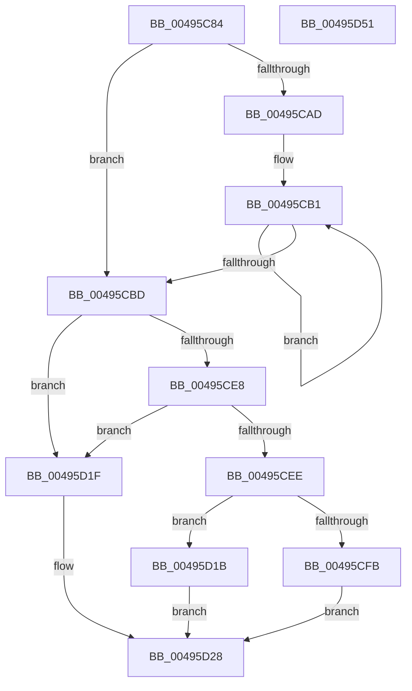

# RtlpStdGetRecordedStackTraceIndex

- RVA: `0x00495C84`–`0x00495D52` (길이 `206` bytes)
- VA: `0x0000000140495C84`
- 실행 섹션: `.text`
- PDB 이름 있음: `예`; PDB Function 태그: `아니요`
- unwind 정보 RVA: `0x0005C954`
- 디코드: `58`개 명령, `206/206` bytes 표시
- 미해석 바이트: `0` (있으면 어셈블리에 `.byte`로 보존)

> 이 문서는 커널 이미지의 기계어와 PDB 기호를 분석해 생성했습니다. 4번과 5번은 함수 원형과 자료형을 바이너리 사용 방식에서 추정한 C 해석이며 원본 소스 복구 결과는 아닙니다.

## 1. Dependencies

- 직접 호출 지점: **3**; 고유 호출 대상: **3**
- 직접 호출자로 확인된 함수: **3**
- RIP 상대 이미지 참조: **0**

### Outgoing calls
- `0x00495CD4` → [KeAcquireSpinLockRaiseToDpc](../20/KeAcquireSpinLockRaiseToDpc_function_00208470.md) (function, `0x00208470`)
- `0x00495CF1` → [RtlpStdExtendUpperWatermark](../5E/RtlpStdExtendUpperWatermark_function_005E674C.md) (function, `0x005E674C`)
- `0x00495D35` → [KeReleaseSpinLock](../39/KeReleaseSpinLock_function_00392BA0.md) (function, `0x00392BA0`)

### Direct callers
- [ExInitializeResourceLite2](../41/ExInitializeResourceLite2_function_0041F710.md) at `0x0041F7F9`
- [ExInitializeFastResource2](ExInitializeFastResource2_function_0049AF90.md) at `0x0049B0DE`
- [sub_006ED9A2](../6E/Unknown_function_006ED9A2.md) at `0x006ED9BD`

### Static image references
- 디코드된 RIP-relative 메모리 참조가 없습니다.

## 2. Other-region calls and transfers

- 다른 실행 섹션으로 향하는 call: **0**
- 별도 외부 분기/꼬리 이동을 확인하지 못했습니다.

## 3. Assembly (complete function range)

```asm
00495C84  48 89 5C 24 08                  mov qword ptr [rsp + 8], rbx
00495C89  48 89 6C 24 10                  mov qword ptr [rsp + 0x10], rbp
00495C8E  48 89 74 24 18                  mov qword ptr [rsp + 0x18], rsi
00495C93  57                              push rdi
00495C94  48 83 EC 20                     sub rsp, 0x20
00495C98  44 0F B7 42 0E                  movzx r8d, word ptr [rdx + 0xe]
00495C9D  33 ED                           xor ebp, ebp
00495C9F  48 8B FA                        mov rdi, rdx
00495CA2  48 8B D9                        mov rbx, rcx
00495CA5  8B C5                           mov eax, ebp
00495CA7  66 41 3B E8                     cmp bp, r8w
00495CAB  73 10                           jae 0x140495cbd
00495CAD  48 83 C2 10                     add rdx, 0x10
00495CB1  03 02                           add eax, dword ptr [rdx]
00495CB3  48 8D 52 08                     lea rdx, [rdx + 8]
00495CB7  49 83 E8 01                     sub r8, 1
00495CBB  75 F4                           jne 0x140495cb1
00495CBD  33 D2                           xor edx, edx
00495CBF  F7 B1 D0 02 00 00               div dword ptr [rcx + 0x2d0]
00495CC5  48 8D 04 52                     lea rax, [rdx + rdx*2]
00495CC9  48 8D 34 C1                     lea rsi, [rcx + rax*8]
00495CCD  48 8D 8E E0 02 00 00            lea rcx, [rsi + 0x2e0]
00495CD4  E8 97 27 D7 FF                  call 0x140208470
00495CD9  88 86 E8 02 00 00               mov byte ptr [rsi + 0x2e8], al
00495CDF  0F B7 47 0C                     movzx eax, word ptr [rdi + 0xc]
00495CE3  66 85 C0                        test ax, ax
00495CE6  75 37                           jne 0x140495d1f
00495CE8  66 39 6F 0A                     cmp word ptr [rdi + 0xa], bp
00495CEC  75 31                           jne 0x140495d1f
00495CEE  48 8B CB                        mov rcx, rbx
00495CF1  E8 56 0A 15 00                  call 0x1405e674c
00495CF6  48 85 C0                        test rax, rax
00495CF9  74 20                           je 0x140495d1b
00495CFB  48 89 38                        mov qword ptr [rax], rdi
00495CFE  48 8B 9B B8 00 00 00            mov rbx, qword ptr [rbx + 0xb8]
00495D05  48 2B D8                        sub rbx, rax
00495D08  48 C1 FB 03                     sar rbx, 3
00495D0C  8B C3                           mov eax, ebx
00495D0E  66 89 5F 0C                     mov word ptr [rdi + 0xc], bx
00495D12  C1 F8 10                        sar eax, 0x10
00495D15  66 89 47 0A                     mov word ptr [rdi + 0xa], ax
00495D19  EB 0D                           jmp 0x140495d28
00495D1B  8B DD                           mov ebx, ebp
00495D1D  EB 09                           jmp 0x140495d28
00495D1F  0F B7 5F 0A                     movzx ebx, word ptr [rdi + 0xa]
00495D23  C1 E3 10                        shl ebx, 0x10
00495D26  03 D8                           add ebx, eax
00495D28  8A 96 E8 02 00 00               mov dl, byte ptr [rsi + 0x2e8]
00495D2E  48 8D 8E E0 02 00 00            lea rcx, [rsi + 0x2e0]
00495D35  E8 66 CE EF FF                  call 0x140392ba0
00495D3A  48 8B 6C 24 38                  mov rbp, qword ptr [rsp + 0x38]
00495D3F  8B C3                           mov eax, ebx
00495D41  48 8B 5C 24 30                  mov rbx, qword ptr [rsp + 0x30]
00495D46  48 8B 74 24 40                  mov rsi, qword ptr [rsp + 0x40]
00495D4B  48 83 C4 20                     add rsp, 0x20
00495D4F  5F                              pop rdi
00495D50  C3                              ret
00495D51  CC                              int3
```

## 4. C-style interpretation (structured pseudocode)

```c
__int64 __fastcall RtlpStdGetRecordedStackTraceIndex(__int64 a1, __int64 a2)
{
    __int64 result;
    __int64 v_rbp;
    __int64 v_rbx;
    __int64 v_rsp;
    unsigned __int64 v_stack_p10;
    unsigned __int64 v_stack_p18;
    unsigned __int64 v_stack_p8;

    v_stack_p8 = v_rbx;
    v_stack_p10 = v_rbp;
    v_stack_p18 = v_rsi;
    v_rsp = (v_rsp) - (32);
    v_rbp = 0;
    if (0 >= ((unsigned __int16)(*(unsigned __int16 *)(a2 + 14)))) goto loc_00495CBD;
    a2 = (a2) + (16);
loc_00495CB1:
    result = (unsigned int)((0) + (*(unsigned int *)(a2)));
    a3 = (*(unsigned __int16 *)(a2 + 14)) - (1);
    if (condition_is_not_equal) goto loc_00495CB1;
loc_00495CBD:
    a2 = 0;
    result = KeAcquireSpinLockRaiseToDpc(a1 + a2 + a2 * 2 * 8 + 736, a2, a3, a4);
    *(unsigned __int8 *)(a1 + a2 + a2 * 2 * 8 + 744) = (unsigned __int8)(result);
    if ((unsigned __int16)(*(unsigned __int16 *)(a2 + 12)) != 0) goto loc_00495D1F;
    if ((*(unsigned __int16 *)(a2 + 10)) != 0) goto loc_00495D1F;
    result = RtlpStdExtendUpperWatermark(a1, a2, a3, a4);
    if (result == 0) goto loc_00495D1B;
    *(unsigned __int64 *)(result) = 0;
    v_rbx = (*(unsigned __int64 *)(a1 + 184)) - (result);
    v_rbx = (v_rbx) >> (3);
    *(unsigned __int16 *)(a2 + 12) = (unsigned __int16)(v_rbx);
    result = (unsigned int)(((unsigned int)((unsigned int)(v_rbx))) >> (16));
    *(unsigned __int16 *)(a2 + 10) = (unsigned __int16)(result);
    goto loc_00495D28;
loc_00495D1B:
    goto loc_00495D28;
loc_00495D1F:
    v_rbx = (unsigned int)((*(unsigned __int16 *)(a2 + 10)) << (16));
    v_rbx = (unsigned int)((v_rbx) + ((unsigned int)(result)));
loc_00495D28:
    result = KeReleaseSpinLock(a1 + a2 + a2 * 2 * 8 + 736, *(unsigned __int8 *)(a1 + a2 + a2 * 2 * 8 + 744), a3, a4);
    v_rsp = (v_rsp) + (32);
    return (unsigned int)((unsigned int)(v_rbx));
}
```

## 5. (Beta) C Style

```c
int64_t RtlpStdGetRecordedStackTraceIndex(void *Arg1, void *Arg2)
{
    uint8_t *arg1 = (uint8_t *)Arg1;
    uint8_t *arg2 = (uint8_t *)Arg2;

    int64_t result;
    int64_t local_rbp;
    int64_t local_rbx;
    int64_t local_rsp;
    uint64_t v_stack_p10;
    uint64_t v_stack_p18;
    uint64_t v_stack_p8;

    v_stack_p8 = local_rbx;
    v_stack_p10 = local_rbp;
    v_stack_p18 = local_rsi;
    local_rsp = (local_rsp) - (32);
    local_rbp = 0;
    if (0 >= ((uint16_t)(*(uint16_t *)(arg2 + 0xE)))) goto loc_00495CBD;
    Arg2 = (Arg2) + (16);
loc_00495CB1:
    result = (uint32_t)((0) + (*(uint32_t *)(arg2)));
    a3 = (*(uint16_t *)(arg2 + 0xE)) - (1);
    if (condition_is_not_equal) goto loc_00495CB1;
loc_00495CBD:
    Arg2 = 0;
    result = KeAcquireSpinLockRaiseToDpc(Arg1 + Arg2 + Arg2 * 2 * 8 + 736, Arg2, a3, a4);
    *(uint8_t *)(arg1 + arg2 + arg2 * 2 * 8 + 0x2E8) = (uint8_t)(result);
    if ((uint16_t)(*(uint16_t *)(arg2 + 0xC)) != 0) goto loc_00495D1F;
    if ((*(uint16_t *)(arg2 + 0xA)) != 0) goto loc_00495D1F;
    result = RtlpStdExtendUpperWatermark(Arg1, Arg2, a3, a4);
    if (result == 0) goto loc_00495D1B;
    *(uint64_t *)(result) = 0;
    local_rbx = (*(uint64_t *)(arg1 + 0xB8)) - (result);
    local_rbx = (local_rbx) >> (3);
    *(uint16_t *)(arg2 + 0xC) = (uint16_t)(local_rbx);
    result = (uint32_t)(((uint32_t)((uint32_t)(local_rbx))) >> (16));
    *(uint16_t *)(arg2 + 0xA) = (uint16_t)(result);
    goto loc_00495D28;
loc_00495D1B:
    goto loc_00495D28;
loc_00495D1F:
    local_rbx = (uint32_t)((*(uint16_t *)(arg2 + 0xA)) << (16));
    local_rbx = (uint32_t)((local_rbx) + ((uint32_t)(result)));
loc_00495D28:
    result = KeReleaseSpinLock(Arg1 + Arg2 + Arg2 * 2 * 8 + 736, *(uint8_t *)(arg1 + arg2 + arg2 * 2 * 8 + 0x2E8), a3, a4);
    local_rsp = (local_rsp) + (32);
    return (uint32_t)((uint32_t)(local_rbx));
}
```

### 관측된 메모리 오프셋

구조체 형식이 확인되지 않은 접근은 인자 기준의 오프셋으로만 기록했습니다.

| 기준 인자 | 오프셋 표현 | 폭 (bit) | 접근 |
|---|---:|---:|---|
| `Arg1` | `+ 0x0 + rax*8` | `64` | `R` |
| `Arg1` | `+ 0xB8` | `64` | `R` |
| `Arg1` | `+ 0x2D0` | `32` | `R` |
| `Arg1` | `+ 0x2E0` | `64` | `R` |
| `Arg1` | `+ 0x2E8` | `8` | `R` |
| `Arg1` | `+ 0x2E8` | `8` | `W` |
| `Arg2` | `+ 0x0` | `32` | `R` |
| `Arg2` | `+ 0x8` | `64` | `R` |
| `Arg2` | `+ 0xA` | `16` | `R` |
| `Arg2` | `+ 0xA` | `16` | `W` |
| `Arg2` | `+ 0xC` | `16` | `R` |
| `Arg2` | `+ 0xC` | `16` | `W` |
| `Arg2` | `+ 0xE` | `16` | `R` |

## 6. Execution-region graph

[열기: 2D/3D 그래프와 함수 탐색 컨트롤 패널](../../../control-panel.html?section=text&rva=0x00495C84&view=graph)

- 2D 그래프는 위에서 아래로 흐르고, 3D 그래프는 빈 공간을 드래그해 회전합니다. Shift+드래그는 이동, 휠은 확대·축소, 함수 노드 선택은 대상 보고서 이동입니다.

### Static fallback


