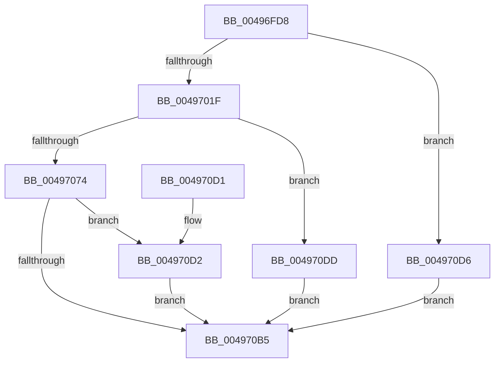

# SMKM_STORE_MGR&lt;SM_TRAITS&gt;::SmPerformStoreMaintenance

- RVA: `0x00496FD8`–`0x004970EE` (길이 `278` bytes)
- VA: `0x0000000140496FD8`
- 실행 섹션: `.text`
- PDB 이름 있음: `예`; PDB Function 태그: `아니요`
- unwind 정보 RVA: `0x000B3BF4`
- 디코드: `80`개 명령, `278/278` bytes 표시
- 미해석 바이트: `0` (있으면 어셈블리에 `.byte`로 보존)

> 이 문서는 커널 이미지의 기계어와 PDB 기호를 분석해 생성했습니다. 4번과 5번은 함수 원형과 자료형을 바이너리 사용 방식에서 추정한 C 해석이며 원본 소스 복구 결과는 아닙니다.

## 1. Dependencies

- 직접 호출 지점: **5**; 고유 호출 대상: **5**
- 직접 호출자로 확인된 함수: **1**
- RIP 상대 이미지 참조: **0**

### Outgoing calls
- `0x0049700E` → [ExAllocatePool2](../../poolcode/B8/ExAllocatePool2_function_00B820F0.md) (function, `0x00B820F0`)
- `0x0049706A` → [SmKmStoreReference](../34/SmKmStoreReference_function_0034BFB0.md) (function, `0x0034BFB0`)
- `0x00497092` → [SMKM_STORE<SM_TRAITS>::SmStWorkItemQueue](../31/SMKM_STORE_SM_TRAITS_SmStWorkItemQueue_function_00317A34.md) (function, `0x00317A34`)
- `0x004970A9` → [KeWaitForSingleObject](../20/KeWaitForSingleObject_function_0020E6B0.md) (function, `0x0020E6B0`)
- `0x004970E7` → [ExFreePoolWithTag](../../poolcode/B8/ExFreePoolWithTag_function_00B82870.md) (function, `0x00B82870`)

### Direct callers
- [SMKM_STORE_MGR&lt;SM_TRAITS&gt;::SmSwapStore](SMKM_STORE_MGR_SM_TRAITS_SmSwapStore_function_004969D4.md) at `0x004969FF`
- [SMKM_STORE_MGR&lt;SM_TRAITS&gt;::SmSwapStore](SMKM_STORE_MGR_SM_TRAITS_SmSwapStore_function_004969D4.md) at `0x00496A27`
- [SMKM_STORE_MGR&lt;SM_TRAITS&gt;::SmSwapStore](SMKM_STORE_MGR_SM_TRAITS_SmSwapStore_function_004969D4.md) at `0x00496A5A`

### Static image references
- 디코드된 RIP-relative 메모리 참조가 없습니다.

## 2. Other-region calls and transfers

- 다른 실행 섹션으로 향하는 call: **2**
  - `0x0049700E` → [ExAllocatePool2](../../poolcode/B8/ExAllocatePool2_function_00B820F0.md) (`.text` → `POOLCODE`)
  - `0x004970E7` → [ExFreePoolWithTag](../../poolcode/B8/ExFreePoolWithTag_function_00B82870.md) (`.text` → `POOLCODE`)
- 별도 외부 분기/꼬리 이동을 확인하지 못했습니다.

## 3. Assembly (complete function range)

```asm
00496FD8  48 8B C4                        mov rax, rsp
00496FDB  48 89 58 08                     mov qword ptr [rax + 8], rbx
00496FDF  48 89 70 10                     mov qword ptr [rax + 0x10], rsi
00496FE3  48 89 78 18                     mov qword ptr [rax + 0x18], rdi
00496FE7  4C 89 70 20                     mov qword ptr [rax + 0x20], r14
00496FEB  55                              push rbp
00496FEC  48 8B EC                        mov rbp, rsp
00496FEF  48 83 EC 60                     sub rsp, 0x60
00496FF3  48 8B F2                        mov rsi, rdx
00496FF6  C6 45 E3 00                     mov byte ptr [rbp - 0x1d], 0
00496FFA  BA 28 00 00 00                  mov edx, 0x28
00496FFF  41 8B D8                        mov ebx, r8d
00497002  4C 8B F1                        mov r14, rcx
00497005  41 B8 73 6D 57 64               mov r8d, 0x64576d73
0049700B  8D 4A 18                        lea ecx, [rdx + 0x18]
0049700E  E8 DD B0 6E 00                  call 0x140b820f0
00497013  48 8B F8                        mov rdi, rax
00497016  48 85 C0                        test rax, rax
00497019  0F 84 B7 00 00 00               je 0x1404970d6
0049701F  33 C0                           xor eax, eax
00497021  0F 57 C0                        xorps xmm0, xmm0
00497024  0F 11 07                        movups xmmword ptr [rdi], xmm0
00497027  0F 11 47 10                     movups xmmword ptr [rdi + 0x10], xmm0
0049702B  48 89 47 20                     mov qword ptr [rdi + 0x20], rax
0049702F  8B 47 08                        mov eax, dword ptr [rdi + 8]
00497032  8B C8                           mov ecx, eax
00497034  C7 07 05 00 00 00               mov dword ptr [rdi], 5
0049703A  33 CB                           xor ecx, ebx
0049703C  83 E1 07                        and ecx, 7
0049703F  33 C8                           xor ecx, eax
00497041  48 8D 45 E8                     lea rax, [rbp - 0x18]
00497045  89 4F 08                        mov dword ptr [rdi + 8], ecx
00497048  49 8B CE                        mov rcx, r14
0049704B  8B 96 90 1A 00 00               mov edx, dword ptr [rsi + 0x1a90]
00497051  66 83 65 E0 00                  and word ptr [rbp - 0x20], 0
00497056  83 65 E4 00                     and dword ptr [rbp - 0x1c], 0
0049705A  48 89 45 F0                     mov qword ptr [rbp - 0x10], rax
0049705E  48 8D 45 E8                     lea rax, [rbp - 0x18]
00497062  48 89 45 E8                     mov qword ptr [rbp - 0x18], rax
00497066  C6 45 E2 06                     mov byte ptr [rbp - 0x1e], 6
0049706A  E8 41 4F EB FF                  call 0x14034bfb0
0049706F  48 85 C0                        test rax, rax
00497072  74 69                           je 0x1404970dd
00497074  48 83 65 D8 00                  and qword ptr [rbp - 0x28], 0
00497079  48 8D 4D E0                     lea rcx, [rbp - 0x20]
0049707D  48 89 4D D0                     mov qword ptr [rbp - 0x30], rcx
00497081  45 33 C0                        xor r8d, r8d
00497084  48 8D 4D D0                     lea rcx, [rbp - 0x30]
00497088  48 8B D7                        mov rdx, rdi
0049708B  48 89 4F 20                     mov qword ptr [rdi + 0x20], rcx
0049708F  48 8B C8                        mov rcx, rax
00497092  E8 9D 09 E8 FF                  call 0x140317a34
00497097  48 83 64 24 20 00               and qword ptr [rsp + 0x20], 0
0049709D  48 8D 4D E0                     lea rcx, [rbp - 0x20]
004970A1  45 33 C9                        xor r9d, r9d
004970A4  45 33 C0                        xor r8d, r8d
004970A7  33 D2                           xor edx, edx
004970A9  E8 02 76 D7 FF                  call 0x14020e6b0
004970AE  8B 5D D0                        mov ebx, dword ptr [rbp - 0x30]
004970B1  85 DB                           test ebx, ebx
004970B3  79 1D                           jns 0x1404970d2
004970B5  4C 8D 5C 24 60                  lea r11, [rsp + 0x60]
004970BA  8B C3                           mov eax, ebx
004970BC  49 8B 5B 10                     mov rbx, qword ptr [r11 + 0x10]
004970C0  49 8B 73 18                     mov rsi, qword ptr [r11 + 0x18]
004970C4  49 8B 7B 20                     mov rdi, qword ptr [r11 + 0x20]
004970C8  4D 8B 73 28                     mov r14, qword ptr [r11 + 0x28]
004970CC  49 8B E3                        mov rsp, r11
004970CF  5D                              pop rbp
004970D0  C3                              ret
004970D1  CC                              int3
004970D2  33 DB                           xor ebx, ebx
004970D4  EB DF                           jmp 0x1404970b5
004970D6  BB 9A 00 00 C0                  mov ebx, 0xc000009a
004970DB  EB D8                           jmp 0x1404970b5
004970DD  33 D2                           xor edx, edx
004970DF  48 8B CF                        mov rcx, rdi
004970E2  BB 0D 00 00 C0                  mov ebx, 0xc000000d
004970E7  E8 84 B7 6E 00                  call 0x140b82870
004970EC  EB C7                           jmp 0x1404970b5
```

## 4. C-style interpretation (structured pseudocode)

```c
__int64 __fastcall SMKM_STORE_MGR_SM_TRAITS___SmPerformStoreMaintenance(__int64 a1, __int64 a2, int a3, int a4)
{
    __int64 result;
    __int64 v_rbx;
    __int64 v_rsp;
    unsigned __int64 v_stack_m18;
    unsigned __int64 v_stack_m20;
    unsigned int v_stack_m24;
    unsigned __int8 v_stack_m25;
    unsigned __int8 v_stack_m26;
    unsigned __int16 v_stack_m28;
    unsigned __int64 v_stack_m30;
    unsigned __int64 v_stack_m38;
    unsigned __int64 v_stack_m48;
    unsigned __int64 v_stack_m8;

    *(unsigned __int64 *)(v_rsp + 8) = v_rbx;
    *(unsigned __int64 *)(v_rsp + 16) = v_rsi;
    *(unsigned __int64 *)(v_rsp + 24) = v_rdi;
    *(unsigned __int64 *)(v_rsp + 32) = v_r14;
    v_rsp = (v_rsp) - (96);
    v_stack_m25 = 0;
    result = ExAllocatePool2(40 + 24, 40, (unsigned int)(0x64576D73ULL), a4);
    if (result == 0) goto loc_004970D6;
    result = 0;
    *(unsigned __int64 *)(result) = v_xmm0;
    *(unsigned __int64 *)(result + 16) = v_xmm0;
    *(unsigned __int64 *)(result + 32) = 0;
    *(unsigned int *)(result) = 5;
    a1 = (unsigned int)(((unsigned int)((unsigned int)((unsigned int)(*(unsigned int *)(result + 8))))) ^ ((unsigned int)((unsigned int)(a3))));
    a1 = (unsigned int)((a1) & (7));
    a1 = (unsigned int)((a1) ^ ((unsigned int)((unsigned int)(*(unsigned int *)(result + 8)))));
    *(unsigned int *)(result + 8) = (unsigned int)(a1);
    v_stack_m18 = v_stack_m20;
    v_stack_m20 = v_stack_m20;
    v_stack_m26 = 6;
    result = SmKmStoreReference(a1, (unsigned int)(*(unsigned int *)(a2 + 6800)), (unsigned int)(0x64576D73ULL), a4);
    if (result == 0) goto loc_004970DD;
    v_stack_m38 = v_stack_m28;
    a3 = 0;
    *(unsigned __int64 *)(result + 32) = v_stack_m38;
    result = SMKM_STORE_SM_TRAITS___SmStWorkItemQueue(result, result, a3, a4);
    a4 = 0;
    a3 = 0;
    a2 = 0;
    result = KeWaitForSingleObject(v_stack_m28, a2, a3, a4);
    if (!sign_flag) goto loc_004970D2;
loc_004970B5:
    return (unsigned int)((unsigned int)((unsigned int)(v_stack_m38)));
loc_004970D2:
    v_rbx = 0;
    goto loc_004970B5;
loc_004970D6:
    goto loc_004970B5;
loc_004970DD:
    a2 = 0;
    result = ExFreePoolWithTag(*(unsigned __int64 *)(v_stack_m8 + 32), a2, a3, a4);
    goto loc_004970B5;
}
```

## 5. (Beta) C Style

```c
int64_t SMKM_STORE_MGR_SM_TRAITS___SmPerformStoreMaintenance(int64_t Arg1, void *Arg2, int32_t Arg3, int32_t Arg4)
{
    uint8_t *arg2 = (uint8_t *)Arg2;

    int64_t result;
    int64_t local_rbx;
    int64_t local_rsp;
    uint64_t v_stack_m18;
    uint64_t v_stack_m20;
    uint32_t v_stack_m24;
    uint8_t v_stack_m25;
    uint8_t v_stack_m26;
    uint16_t v_stack_m28;
    uint64_t v_stack_m30;
    uint64_t v_stack_m38;
    uint64_t v_stack_m48;
    uint64_t v_stack_m8;

    *(uint64_t *)(local_rsp + 0x8) = local_rbx;
    *(uint64_t *)(local_rsp + 0x10) = local_rsi;
    *(uint64_t *)(local_rsp + 0x18) = local_rdi;
    *(uint64_t *)(local_rsp + 0x20) = local_r14;
    local_rsp = (local_rsp) - (96);
    v_stack_m25 = 0;
    result = ExAllocatePool2(40 + 24, 40, (uint32_t)(0x64576D73ULL), Arg4);
    if (result == 0) goto loc_004970D6;
    result = 0;
    *(uint64_t *)(result) = v_xmm0;
    *(uint64_t *)(result + 0x10) = v_xmm0;
    *(uint64_t *)(result + 0x20) = 0;
    *(uint32_t *)(result) = 5;
    Arg1 = (uint32_t)(((uint32_t)((uint32_t)((uint32_t)(*(uint32_t *)(result + 0x8))))) ^ ((uint32_t)((uint32_t)(Arg3))));
    Arg1 = (uint32_t)((Arg1) & (7));
    Arg1 = (uint32_t)((Arg1) ^ ((uint32_t)((uint32_t)(*(uint32_t *)(result + 0x8)))));
    *(uint32_t *)(result + 0x8) = (uint32_t)(Arg1);
    v_stack_m18 = v_stack_m20;
    v_stack_m20 = v_stack_m20;
    v_stack_m26 = 6;
    result = SmKmStoreReference(Arg1, (uint32_t)(*(uint32_t *)(arg2 + 0x1A90)), (uint32_t)(0x64576D73ULL), Arg4);
    if (result == 0) goto loc_004970DD;
    v_stack_m38 = v_stack_m28;
    Arg3 = 0;
    *(uint64_t *)(result + 0x20) = v_stack_m38;
    result = SMKM_STORE_SM_TRAITS___SmStWorkItemQueue(result, result, Arg3, Arg4);
    Arg4 = 0;
    Arg3 = 0;
    Arg2 = 0;
    result = KeWaitForSingleObject(v_stack_m28, Arg2, Arg3, Arg4);
    if (!sign_flag) goto loc_004970D2;
loc_004970B5:
    return (uint32_t)((uint32_t)((uint32_t)(v_stack_m38)));
loc_004970D2:
    local_rbx = 0;
    goto loc_004970B5;
loc_004970D6:
    goto loc_004970B5;
loc_004970DD:
    Arg2 = 0;
    result = ExFreePoolWithTag(*(uint64_t *)(v_stack_m8 + 0x20), Arg2, Arg3, Arg4);
    goto loc_004970B5;
}
```

### 관측된 메모리 오프셋

구조체 형식이 확인되지 않은 접근은 인자 기준의 오프셋으로만 기록했습니다.

| 기준 인자 | 오프셋 표현 | 폭 (bit) | 접근 |
|---|---:|---:|---|
| `Arg2` | `+ 0x1A90` | `32` | `R` |

## 6. Execution-region graph

[열기: 2D/3D 그래프와 함수 탐색 컨트롤 패널](../../../control-panel.html?section=text&rva=0x00496FD8&view=graph)

- 2D 그래프는 위에서 아래로 흐르고, 3D 그래프는 빈 공간을 드래그해 회전합니다. Shift+드래그는 이동, 휠은 확대·축소, 함수 노드 선택은 대상 보고서 이동입니다.

### Static fallback


