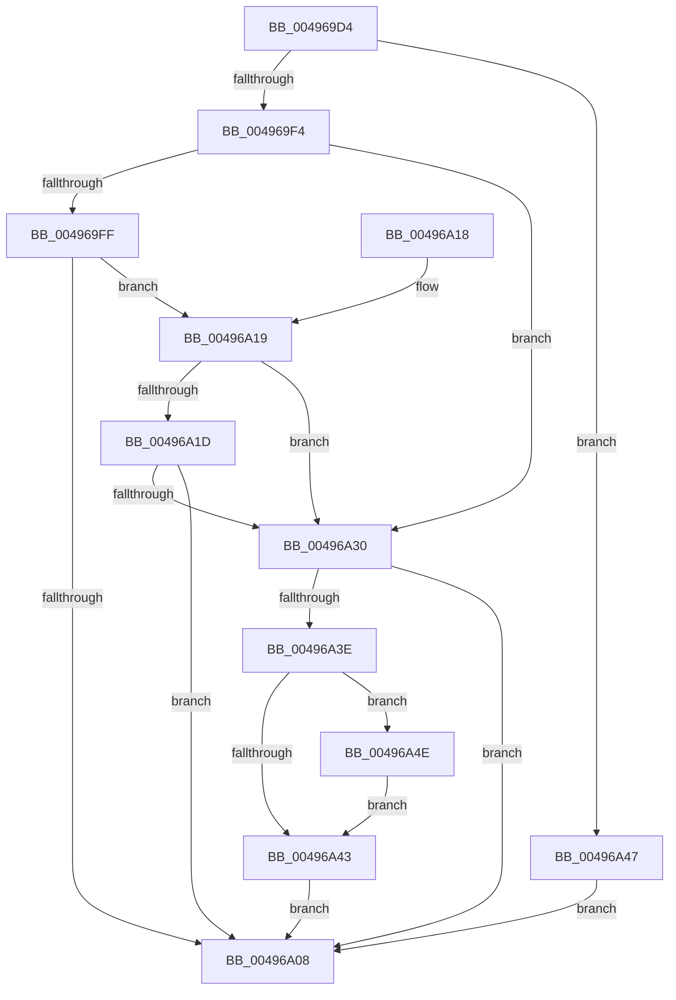

# SMKM_STORE_MGR&lt;SM_TRAITS&gt;::SmSwapStore

- RVA: `0x004969D4`–`0x00496A61` (길이 `141` bytes)
- VA: `0x00000001404969D4`
- 실행 섹션: `.text`
- PDB 이름 있음: `예`; PDB Function 태그: `아니요`
- unwind 정보 RVA: `0x000B3B94`
- 디코드: `45`개 명령, `141/141` bytes 표시
- 미해석 바이트: `0` (있으면 어셈블리에 `.byte`로 보존)

> 이 문서는 커널 이미지의 기계어와 PDB 기호를 분석해 생성했습니다. 4번과 5번은 함수 원형과 자료형을 바이너리 사용 방식에서 추정한 C 해석이며 원본 소스 복구 결과는 아닙니다.

## 1. Dependencies

- 직접 호출 지점: **4**; 고유 호출 대상: **2**
- 직접 호출자로 확인된 함수: **1**
- RIP 상대 이미지 참조: **0**

### Outgoing calls
- `0x004969FF` → [SMKM_STORE_MGR<SM_TRAITS>::SmPerformStoreMaintenance](SMKM_STORE_MGR_SM_TRAITS_SmPerformStoreMaintenance_function_00496FD8.md) (function, `0x00496FD8`)
- `0x00496A27` → [SMKM_STORE_MGR<SM_TRAITS>::SmPerformStoreMaintenance](SMKM_STORE_MGR_SM_TRAITS_SmPerformStoreMaintenance_function_00496FD8.md) (function, `0x00496FD8`)
- `0x00496A35` → [SMKM_STORE<SM_TRAITS>::SmStSwapStore](SMKM_STORE_SM_TRAITS_SmStSwapStore_function_00496A68.md) (function, `0x00496A68`)
- `0x00496A5A` → [SMKM_STORE_MGR<SM_TRAITS>::SmPerformStoreMaintenance](SMKM_STORE_MGR_SM_TRAITS_SmPerformStoreMaintenance_function_00496FD8.md) (function, `0x00496FD8`)

### Direct callers
- [SmSwapStore](../../page/A6/SmSwapStore_function_00A61D14.md) at `0x00A61D78`

### Static image references
- 디코드된 RIP-relative 메모리 참조가 없습니다.

## 2. Other-region calls and transfers

- 다른 실행 섹션으로 향하는 call: **0**
- 별도 외부 분기/꼬리 이동을 확인하지 못했습니다.

## 3. Assembly (complete function range)

```asm
004969D4  48 89 5C 24 08                  mov qword ptr [rsp + 8], rbx
004969D9  48 89 74 24 10                  mov qword ptr [rsp + 0x10], rsi
004969DE  57                              push rdi
004969DF  48 83 EC 20                     sub rsp, 0x20
004969E3  F7 02 00 00 02 00               test dword ptr [rdx], 0x20000
004969E9  41 8B D8                        mov ebx, r8d
004969EC  48 8B FA                        mov rdi, rdx
004969EF  48 8B F1                        mov rsi, rcx
004969F2  74 53                           je 0x140496a47
004969F4  41 B8 01 00 00 00               mov r8d, 1
004969FA  41 3B D8                        cmp ebx, r8d
004969FD  77 31                           ja 0x140496a30
004969FF  E8 D4 05 00 00                  call 0x140496fd8
00496A04  85 C0                           test eax, eax
00496A06  79 11                           jns 0x140496a19
00496A08  48 8B 5C 24 30                  mov rbx, qword ptr [rsp + 0x30]
00496A0D  48 8B 74 24 38                  mov rsi, qword ptr [rsp + 0x38]
00496A12  48 83 C4 20                     add rsp, 0x20
00496A16  5F                              pop rdi
00496A17  C3                              ret
00496A18  CC                              int3
00496A19  85 DB                           test ebx, ebx
00496A1B  75 13                           jne 0x140496a30
00496A1D  44 8D 43 02                     lea r8d, [rbx + 2]
00496A21  48 8B D7                        mov rdx, rdi
00496A24  48 8B CE                        mov rcx, rsi
00496A27  E8 AC 05 00 00                  call 0x140496fd8
00496A2C  85 C0                           test eax, eax
00496A2E  78 D8                           js 0x140496a08
00496A30  8B D3                           mov edx, ebx
00496A32  48 8B CF                        mov rcx, rdi
00496A35  E8 2E 00 00 00                  call 0x140496a68
00496A3A  85 C0                           test eax, eax
00496A3C  78 CA                           js 0x140496a08
00496A3E  83 FB 02                        cmp ebx, 2
00496A41  74 0B                           je 0x140496a4e
00496A43  33 C0                           xor eax, eax
00496A45  EB C1                           jmp 0x140496a08
00496A47  B8 BB 00 00 C0                  mov eax, 0xc00000bb
00496A4C  EB BA                           jmp 0x140496a08
00496A4E  41 B8 03 00 00 00               mov r8d, 3
00496A54  48 8B D7                        mov rdx, rdi
00496A57  48 8B CE                        mov rcx, rsi
00496A5A  E8 79 05 00 00                  call 0x140496fd8
00496A5F  EB E2                           jmp 0x140496a43
```

## 4. C-style interpretation (structured pseudocode)

```c
__int64 __fastcall SMKM_STORE_MGR_SM_TRAITS___SmSwapStore(__int64 a1, __int64 a2, int a3)
{
    __int64 result;
    __int64 v_rsp;
    unsigned __int64 v_stack_p10;
    unsigned __int64 v_stack_p8;

    v_stack_p8 = v_rbx;
    v_stack_p10 = v_rsi;
    v_rsp = (v_rsp) - (32);
    if (((*(unsigned int *)(a2)) & (0x20000ULL)) == 0) goto loc_00496A47;
    if (((unsigned int)((unsigned int)(a3))) > 1) goto loc_00496A30;
    result = SMKM_STORE_MGR_SM_TRAITS___SmPerformStoreMaintenance(a1, a2, 1, a4);
    if (!sign_flag) goto loc_00496A19;
loc_00496A08:
    v_rsp = (v_rsp) + (32);
    return result;
loc_00496A19:
    if ((unsigned int)(v_stack_p8) != 0) goto loc_00496A30;
    result = SMKM_STORE_MGR_SM_TRAITS___SmPerformStoreMaintenance(v_stack_p10, a2, v_stack_p8 + 2, a4);
    if (sign_flag) goto loc_00496A08;
loc_00496A30:
    result = SMKM_STORE_SM_TRAITS___SmStSwapStore(a2, (unsigned int)((unsigned int)(v_stack_p8)), v_stack_p8 + 2, a4);
    if (sign_flag) goto loc_00496A08;
    if (((unsigned int)(v_stack_p8)) == 2) goto loc_00496A4E;
loc_00496A43:
    result = 0;
    goto loc_00496A08;
loc_00496A47:
    goto loc_00496A08;
loc_00496A4E:
    result = SMKM_STORE_MGR_SM_TRAITS___SmPerformStoreMaintenance(v_stack_p10, a2, 3, a4);
    goto loc_00496A43;
}
```

## 5. (Beta) C Style

```c
int64_t SMKM_STORE_MGR_SM_TRAITS___SmSwapStore(int64_t Arg1, void *Arg2, int32_t Arg3)
{
    uint8_t *arg2 = (uint8_t *)Arg2;

    int64_t result;
    int64_t local_rsp;
    uint64_t v_stack_p10;
    uint64_t v_stack_p8;

    v_stack_p8 = local_rbx;
    v_stack_p10 = local_rsi;
    local_rsp = (local_rsp) - (32);
    if (((*(uint32_t *)(arg2)) & (0x20000ULL)) == 0) goto loc_00496A47;
    if (((uint32_t)((uint32_t)(Arg3))) > 1) goto loc_00496A30;
    result = SMKM_STORE_MGR_SM_TRAITS___SmPerformStoreMaintenance(Arg1, Arg2, 1, a4);
    if (!sign_flag) goto loc_00496A19;
loc_00496A08:
    local_rsp = (local_rsp) + (32);
    return result;
loc_00496A19:
    if ((uint32_t)(v_stack_p8) != 0) goto loc_00496A30;
    result = SMKM_STORE_MGR_SM_TRAITS___SmPerformStoreMaintenance(v_stack_p10, Arg2, v_stack_p8 + 2, a4);
    if (sign_flag) goto loc_00496A08;
loc_00496A30:
    result = SMKM_STORE_SM_TRAITS___SmStSwapStore(Arg2, (uint32_t)((uint32_t)(v_stack_p8)), v_stack_p8 + 2, a4);
    if (sign_flag) goto loc_00496A08;
    if (((uint32_t)(v_stack_p8)) == 2) goto loc_00496A4E;
loc_00496A43:
    result = 0;
    goto loc_00496A08;
loc_00496A47:
    goto loc_00496A08;
loc_00496A4E:
    result = SMKM_STORE_MGR_SM_TRAITS___SmPerformStoreMaintenance(v_stack_p10, Arg2, 3, a4);
    goto loc_00496A43;
}
```

### 관측된 메모리 오프셋

구조체 형식이 확인되지 않은 접근은 인자 기준의 오프셋으로만 기록했습니다.

| 기준 인자 | 오프셋 표현 | 폭 (bit) | 접근 |
|---|---:|---:|---|
| `Arg2` | `+ 0x0` | `32` | `R` |

## 6. Execution-region graph

[열기: 2D/3D 그래프와 함수 탐색 컨트롤 패널](../../../control-panel.html?section=text&rva=0x004969D4&view=graph)

- 2D 그래프는 위에서 아래로 흐르고, 3D 그래프는 빈 공간을 드래그해 회전합니다. Shift+드래그는 이동, 휠은 확대·축소, 함수 노드 선택은 대상 보고서 이동입니다.

### Static fallback


