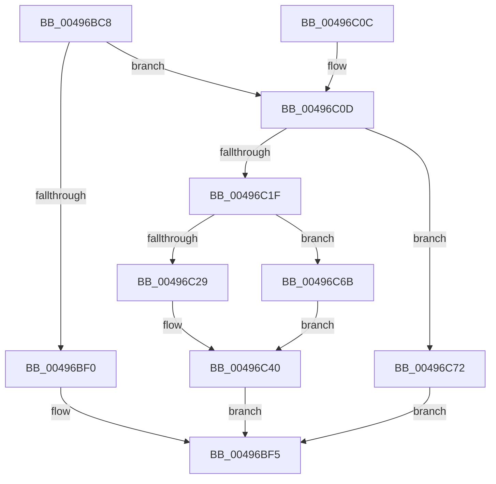

# SMKM_STORE&lt;SM_TRAITS&gt;::SmStInSwapStore

- RVA: `0x00496BC8`–`0x00496C7C` (길이 `180` bytes)
- VA: `0x0000000140496BC8`
- 실행 섹션: `.text`
- PDB 이름 있음: `예`; PDB Function 태그: `아니요`
- unwind 정보 RVA: `0x000B3BC0`
- 디코드: `44`개 명령, `180/180` bytes 표시
- 미해석 바이트: `0` (있으면 어셈블리에 `.byte`로 보존)

> 이 문서는 커널 이미지의 기계어와 PDB 기호를 분석해 생성했습니다. 4번과 5번은 함수 원형과 자료형을 바이너리 사용 방식에서 추정한 C 해석이며 원본 소스 복구 결과는 아닙니다.

## 1. Dependencies

- 직접 호출 지점: **4**; 고유 호출 대상: **4**
- 직접 호출자로 확인된 함수: **1**
- RIP 상대 이미지 참조: **0**

### Outgoing calls
- `0x00496C39` → [MmInSwapVirtualAddresses](../../page/A1/MmInSwapVirtualAddresses_function_00A17CCC.md) (function, `0x00A17CCC`)
- `0x00496C4E` → [StLockAcquireShared](../34/StLockAcquireShared_function_0034C728.md) (function, `0x0034C728`)
- `0x00496C5A` → [StLockReleaseShared](../2E/StLockReleaseShared_function_002E0320.md) (function, `0x002E0320`)
- `0x00496C64` → [ExFreePoolWithTag](../../poolcode/B8/ExFreePoolWithTag_function_00B82870.md) (function, `0x00B82870`)

### Direct callers
- [SMKM_STORE&lt;SM_TRAITS&gt;::SmStSwapStore](SMKM_STORE_SM_TRAITS_SmStSwapStore_function_00496A68.md) at `0x00496AEB`

### Static image references
- 디코드된 RIP-relative 메모리 참조가 없습니다.

## 2. Other-region calls and transfers

- 다른 실행 섹션으로 향하는 call: **2**
  - `0x00496C39` → [MmInSwapVirtualAddresses](../../page/A1/MmInSwapVirtualAddresses_function_00A17CCC.md) (`.text` → `PAGE`)
  - `0x00496C64` → [ExFreePoolWithTag](../../poolcode/B8/ExFreePoolWithTag_function_00B82870.md) (`.text` → `POOLCODE`)
- 별도 외부 분기/꼬리 이동을 확인하지 못했습니다.

## 3. Assembly (complete function range)

```asm
00496BC8  48 89 5C 24 10                  mov qword ptr [rsp + 0x10], rbx
00496BCD  48 89 6C 24 18                  mov qword ptr [rsp + 0x18], rbp
00496BD2  48 89 74 24 20                  mov qword ptr [rsp + 0x20], rsi
00496BD7  57                              push rdi
00496BD8  48 83 EC 20                     sub rsp, 0x20
00496BDC  48 8B B1 F0 1C 00 00            mov rsi, qword ptr [rcx + 0x1cf0]
00496BE3  48 8B D9                        mov rbx, rcx
00496BE6  48 8D 46 FF                     lea rax, [rsi - 1]
00496BEA  48 83 F8 FD                     cmp rax, -3
00496BEE  76 1D                           jbe 0x140496c0d
00496BF0  BF A3 00 00 C0                  mov edi, 0xc00000a3
00496BF5  48 8B 5C 24 38                  mov rbx, qword ptr [rsp + 0x38]
00496BFA  8B C7                           mov eax, edi
00496BFC  48 8B 6C 24 40                  mov rbp, qword ptr [rsp + 0x40]
00496C01  48 8B 74 24 48                  mov rsi, qword ptr [rsp + 0x48]
00496C06  48 83 C4 20                     add rsp, 0x20
00496C0A  5F                              pop rdi
00496C0B  C3                              ret
00496C0C  CC                              int3
00496C0D  48 83 C9 FF                     or rcx, 0xffffffffffffffff
00496C11  48 8B C6                        mov rax, rsi
00496C14  F0 48 0F B1 8B F0 1C 00 00      lock cmpxchg qword ptr [rbx + 0x1cf0], rcx
00496C1D  75 53                           jne 0x140496c72
00496C1F  48 8B 16                        mov rdx, qword ptr [rsi]
00496C22  33 ED                           xor ebp, ebp
00496C24  48 85 D2                        test rdx, rdx
00496C27  74 42                           je 0x140496c6b
00496C29  65 48 8B 04 25 88 01 00 00      mov rax, qword ptr gs:[0x188]
00496C32  48 8B 88 B8 00 00 00            mov rcx, qword ptr [rax + 0xb8]
00496C39  E8 8E 10 58 00                  call 0x140a17ccc
00496C3E  8B F8                           mov edi, eax
00496C40  48 87 AB F0 1C 00 00            xchg qword ptr [rbx + 0x1cf0], rbp
00496C47  48 8D 8B 98 1A 00 00            lea rcx, [rbx + 0x1a98]
00496C4E  E8 D5 5A EB FF                  call 0x14034c728
00496C53  48 8D 8B 98 1A 00 00            lea rcx, [rbx + 0x1a98]
00496C5A  E8 C1 96 E4 FF                  call 0x1402e0320
00496C5F  33 D2                           xor edx, edx
00496C61  48 8B CE                        mov rcx, rsi
00496C64  E8 07 BC 6E 00                  call 0x140b82870
00496C69  EB 8A                           jmp 0x140496bf5
00496C6B  BF A3 00 00 C0                  mov edi, 0xc00000a3
00496C70  EB CE                           jmp 0x140496c40
00496C72  BF 76 04 00 C0                  mov edi, 0xc0000476
00496C77  E9 79 FF FF FF                  jmp 0x140496bf5
```

## 4. C-style interpretation (structured pseudocode)

```c
__int64 __fastcall SMKM_STORE_SM_TRAITS___SmStInSwapStore(__int64 a1)
{
    __int64 result;
    __int64 v_rbp;
    __int64 v_rsp;
    unsigned __int64 v_stack_p10;
    unsigned __int64 v_stack_p18;
    unsigned __int64 v_stack_p20;

    v_stack_p10 = v_rbx;
    v_stack_p18 = v_rbp;
    v_stack_p20 = v_rsi;
    v_rsp = (v_rsp) - (32);
    if ((*(unsigned __int64 *)(a1 + 7408) - 1) <= -3) goto loc_00496C0D;
loc_00496BF5:
    v_rsp = (v_rsp) + (32);
    return (unsigned int)((unsigned int)((unsigned int)(0xC00000A3ULL)));
loc_00496C0D:
    a1 = (a1) | (-1);
    if (condition_is_not_equal) goto loc_00496C72;
    v_rbp = 0;
    if (*(unsigned __int64 *)(v_stack_p20) == 0) goto loc_00496C6B;
    result = MmInSwapVirtualAddresses(*(unsigned __int64 *)(*(unsigned __int64 *)(gs_base + (0 + 392)) + 184), *(unsigned __int64 *)(v_stack_p20), a3, a4);
loc_00496C40:
    result = StLockAcquireShared(v_stack_p10 + 6808, *(unsigned __int64 *)(v_stack_p20), a3, a4);
    result = StLockReleaseShared(v_stack_p10 + 6808, *(unsigned __int64 *)(v_stack_p20), a3, a4);
    a2 = 0;
    result = ExFreePoolWithTag(v_stack_p20, a2, a3, a4);
    goto loc_00496BF5;
loc_00496C6B:
    goto loc_00496C40;
loc_00496C72:
    goto loc_00496BF5;
}
```

## 5. (Beta) C Style

```c
int64_t SMKM_STORE_SM_TRAITS___SmStInSwapStore(void *Arg1)
{
    uint8_t *arg1 = (uint8_t *)Arg1;

    int64_t result;
    int64_t local_rbp;
    int64_t local_rsp;
    uint64_t v_stack_p10;
    uint64_t v_stack_p18;
    uint64_t v_stack_p20;

    v_stack_p10 = local_rbx;
    v_stack_p18 = local_rbp;
    v_stack_p20 = local_rsi;
    local_rsp = (local_rsp) - (32);
    if ((*(uint64_t *)(arg1 + 0x1CF0) - 1) <= -3) goto loc_00496C0D;
loc_00496BF5:
    local_rsp = (local_rsp) + (32);
    return (uint32_t)((uint32_t)((uint32_t)(0xC00000A3ULL)));
loc_00496C0D:
    Arg1 = (Arg1) | (-1);
    if (condition_is_not_equal) goto loc_00496C72;
    local_rbp = 0;
    if (*(uint64_t *)(v_stack_p20) == 0) goto loc_00496C6B;
    result = MmInSwapVirtualAddresses(*(uint64_t *)(*(uint64_t *)(gs_base + (0 + 0x188)) + 0xB8), *(uint64_t *)(v_stack_p20), a3, a4);
loc_00496C40:
    result = StLockAcquireShared(v_stack_p10 + 6808, *(uint64_t *)(v_stack_p20), a3, a4);
    result = StLockReleaseShared(v_stack_p10 + 6808, *(uint64_t *)(v_stack_p20), a3, a4);
    a2 = 0;
    result = ExFreePoolWithTag(v_stack_p20, a2, a3, a4);
    goto loc_00496BF5;
loc_00496C6B:
    goto loc_00496C40;
loc_00496C72:
    goto loc_00496BF5;
}
```

### 관측된 메모리 오프셋

구조체 형식이 확인되지 않은 접근은 인자 기준의 오프셋으로만 기록했습니다.

| 기준 인자 | 오프셋 표현 | 폭 (bit) | 접근 |
|---|---:|---:|---|
| `Arg1` | `+ 0x1A98` | `64` | `R` |
| `Arg1` | `+ 0x1CF0` | `64` | `R` |
| `Arg1` | `+ 0x1CF0` | `64` | `R/W` |

## 6. Execution-region graph

[열기: 2D/3D 그래프와 함수 탐색 컨트롤 패널](../../../control-panel.html?section=text&rva=0x00496BC8&view=graph)

- 2D 그래프는 위에서 아래로 흐르고, 3D 그래프는 빈 공간을 드래그해 회전합니다. Shift+드래그는 이동, 휠은 확대·축소, 함수 노드 선택은 대상 보고서 이동입니다.

### Static fallback


