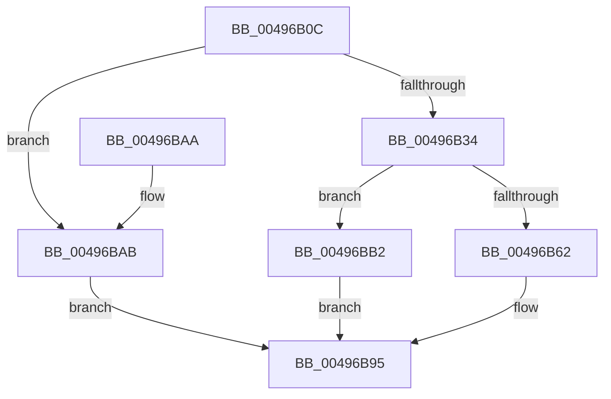

# SMKM_STORE&lt;SM_TRAITS&gt;::SmStOutSwapPrepareStore

- RVA: `0x00496B0C`–`0x00496BC0` (길이 `180` bytes)
- VA: `0x0000000140496B0C`
- 실행 섹션: `.text`
- PDB 이름 있음: `예`; PDB Function 태그: `아니요`
- unwind 정보 RVA: `0x0008C6A8`
- 디코드: `46`개 명령, `180/180` bytes 표시
- 미해석 바이트: `0` (있으면 어셈블리에 `.byte`로 보존)

> 이 문서는 커널 이미지의 기계어와 PDB 기호를 분석해 생성했습니다. 4번과 5번은 함수 원형과 자료형을 바이너리 사용 방식에서 추정한 C 해석이며 원본 소스 복구 결과는 아닙니다.

## 1. Dependencies

- 직접 호출 지점: **2**; 고유 호출 대상: **2**
- 직접 호출자로 확인된 함수: **1**
- RIP 상대 이미지 참조: **0**

### Outgoing calls
- `0x00496B53` → [ExAllocatePool2](../../poolcode/B8/ExAllocatePool2_function_00B820F0.md) (function, `0x00B820F0`)
- `0x00496B82` → [RtlSetAllBits](../36/RtlSetAllBits_function_00362490.md) (function, `0x00362490`)

### Direct callers
- [SMKM_STORE&lt;SM_TRAITS&gt;::SmStSwapStore](SMKM_STORE_SM_TRAITS_SmStSwapStore_function_00496A68.md) at `0x00496AB0`

### Static image references
- 디코드된 RIP-relative 메모리 참조가 없습니다.

## 2. Other-region calls and transfers

- 다른 실행 섹션으로 향하는 call: **1**
  - `0x00496B53` → [ExAllocatePool2](../../poolcode/B8/ExAllocatePool2_function_00B820F0.md) (`.text` → `POOLCODE`)
- 별도 외부 분기/꼬리 이동을 확인하지 못했습니다.

## 3. Assembly (complete function range)

```asm
00496B0C  48 89 5C 24 10                  mov qword ptr [rsp + 0x10], rbx
00496B11  48 89 6C 24 18                  mov qword ptr [rsp + 0x18], rbp
00496B16  48 89 74 24 20                  mov qword ptr [rsp + 0x20], rsi
00496B1B  57                              push rdi
00496B1C  48 83 EC 20                     sub rsp, 0x20
00496B20  48 83 CD FF                     or rbp, 0xffffffffffffffff
00496B24  48 8B D9                        mov rbx, rcx
00496B27  33 C0                           xor eax, eax
00496B29  F0 48 0F B1 A9 F0 1C 00 00      lock cmpxchg qword ptr [rcx + 0x1cf0], rbp
00496B32  75 77                           jne 0x140496bab
00496B34  8B 91 64 1B 00 00               mov edx, dword ptr [rcx + 0x1b64]
00496B3A  41 B8 73 6D 53 77               mov r8d, 0x77536d73
00496B40  48 83 C2 1F                     add rdx, 0x1f
00496B44  8D 4D 41                        lea ecx, [rbp + 0x41]
00496B47  48 C1 EA 05                     shr rdx, 5
00496B4B  48 8D 14 95 18 00 00 00         lea rdx, [rdx*4 + 0x18]
00496B53  E8 98 B5 6E 00                  call 0x140b820f0
00496B58  33 FF                           xor edi, edi
00496B5A  48 8B F0                        mov rsi, rax
00496B5D  48 85 C0                        test rax, rax
00496B60  74 50                           je 0x140496bb2
00496B62  33 C9                           xor ecx, ecx
00496B64  0F 57 C0                        xorps xmm0, xmm0
00496B67  0F 11 00                        movups xmmword ptr [rax], xmm0
00496B6A  48 89 48 10                     mov qword ptr [rax + 0x10], rcx
00496B6E  48 8D 48 08                     lea rcx, [rax + 8]
00496B72  8B 93 64 1B 00 00               mov edx, dword ptr [rbx + 0x1b64]
00496B78  89 11                           mov dword ptr [rcx], edx
00496B7A  48 8D 50 18                     lea rdx, [rax + 0x18]
00496B7E  48 89 51 08                     mov qword ptr [rcx + 8], rdx
00496B82  E8 09 B9 EC FF                  call 0x140362490
00496B87  48 8B C5                        mov rax, rbp
00496B8A  F0 48 0F B1 B3 F0 1C 00 00      lock cmpxchg qword ptr [rbx + 0x1cf0], rsi
00496B93  8B C7                           mov eax, edi
00496B95  48 8B 5C 24 38                  mov rbx, qword ptr [rsp + 0x38]
00496B9A  48 8B 6C 24 40                  mov rbp, qword ptr [rsp + 0x40]
00496B9F  48 8B 74 24 48                  mov rsi, qword ptr [rsp + 0x48]
00496BA4  48 83 C4 20                     add rsp, 0x20
00496BA8  5F                              pop rdi
00496BA9  C3                              ret
00496BAA  CC                              int3
00496BAB  B8 76 04 00 C0                  mov eax, 0xc0000476
00496BB0  EB E3                           jmp 0x140496b95
00496BB2  48 87 BB F0 1C 00 00            xchg qword ptr [rbx + 0x1cf0], rdi
00496BB9  B8 9A 00 00 C0                  mov eax, 0xc000009a
00496BBE  EB D5                           jmp 0x140496b95
```

## 4. C-style interpretation (structured pseudocode)

```c
__int64 __fastcall SMKM_STORE_SM_TRAITS___SmStOutSwapPrepareStore(__int64 a1)
{
    __int64 result;
    __int64 v_rbp;
    __int64 v_rdi;
    __int64 v_rsp;
    unsigned __int64 v_stack_p10;
    unsigned __int64 v_stack_p18;
    unsigned __int64 v_stack_p20;

    v_stack_p10 = v_rbx;
    v_stack_p18 = v_rbp;
    v_stack_p20 = v_rsi;
    v_rsp = (v_rsp) - (32);
    v_rbp = (v_rbp) | (-1);
    result = 0;
    if (condition_is_not_equal) goto loc_00496BAB;
    a2 = ((unsigned int)(*(unsigned int *)(a1 + 7012))) + (31);
    a2 = (a2) >> (5);
    result = ExAllocatePool2(v_rbp + 65, a2 * 4 + 24, (unsigned int)(0x77536D73ULL), a4);
    v_rdi = 0;
    if (result == 0) goto loc_00496BB2;
    a1 = 0;
    *(unsigned __int64 *)(result) = v_xmm0;
    *(unsigned __int64 *)(result + 16) = 0;
    *(unsigned int *)(result + 8) = (unsigned int)((unsigned int)(*(unsigned int *)(a1 + 7012)));
    *(unsigned __int64 *)(result + 8 + 8) = result + 24;
    result = RtlSetAllBits(result + 8, result + 24, (unsigned int)(0x77536D73ULL), a4);
loc_00496B95:
    v_rsp = (v_rsp) + (32);
    return 0;
loc_00496BAB:
    goto loc_00496B95;
loc_00496BB2:
    goto loc_00496B95;
}
```

## 5. (Beta) C Style

```c
int64_t SMKM_STORE_SM_TRAITS___SmStOutSwapPrepareStore(void *Arg1)
{
    uint8_t *arg1 = (uint8_t *)Arg1;

    int64_t result;
    int64_t local_rbp;
    int64_t local_rdi;
    int64_t local_rsp;
    uint64_t v_stack_p10;
    uint64_t v_stack_p18;
    uint64_t v_stack_p20;

    v_stack_p10 = local_rbx;
    v_stack_p18 = local_rbp;
    v_stack_p20 = local_rsi;
    local_rsp = (local_rsp) - (32);
    local_rbp = (local_rbp) | (-1);
    result = 0;
    if (condition_is_not_equal) goto loc_00496BAB;
    a2 = ((uint32_t)(*(uint32_t *)(arg1 + 0x1B64))) + (31);
    a2 = (a2) >> (5);
    result = ExAllocatePool2(local_rbp + 65, a2 * 4 + 24, (uint32_t)(0x77536D73ULL), a4);
    local_rdi = 0;
    if (result == 0) goto loc_00496BB2;
    Arg1 = 0;
    *(uint64_t *)(result) = v_xmm0;
    *(uint64_t *)(result + 0x10) = 0;
    *(uint32_t *)(result + 0x8) = (uint32_t)((uint32_t)(*(uint32_t *)(arg1 + 0x1B64)));
    *(uint64_t *)(result + 0x8 + 0x8) = result + 24;
    result = RtlSetAllBits(result + 8, result + 24, (uint32_t)(0x77536D73ULL), a4);
loc_00496B95:
    local_rsp = (local_rsp) + (32);
    return 0;
loc_00496BAB:
    goto loc_00496B95;
loc_00496BB2:
    goto loc_00496B95;
}
```

### 관측된 메모리 오프셋

구조체 형식이 확인되지 않은 접근은 인자 기준의 오프셋으로만 기록했습니다.

| 기준 인자 | 오프셋 표현 | 폭 (bit) | 접근 |
|---|---:|---:|---|
| `Arg1` | `+ 0x1B64` | `32` | `R` |
| `Arg1` | `+ 0x1CF0` | `64` | `R` |
| `Arg1` | `+ 0x1CF0` | `64` | `R/W` |

## 6. Execution-region graph

[열기: 2D/3D 그래프와 함수 탐색 컨트롤 패널](../../../control-panel.html?section=text&rva=0x00496B0C&view=graph)

- 2D 그래프는 위에서 아래로 흐르고, 3D 그래프는 빈 공간을 드래그해 회전합니다. Shift+드래그는 이동, 휠은 확대·축소, 함수 노드 선택은 대상 보고서 이동입니다.

### Static fallback


