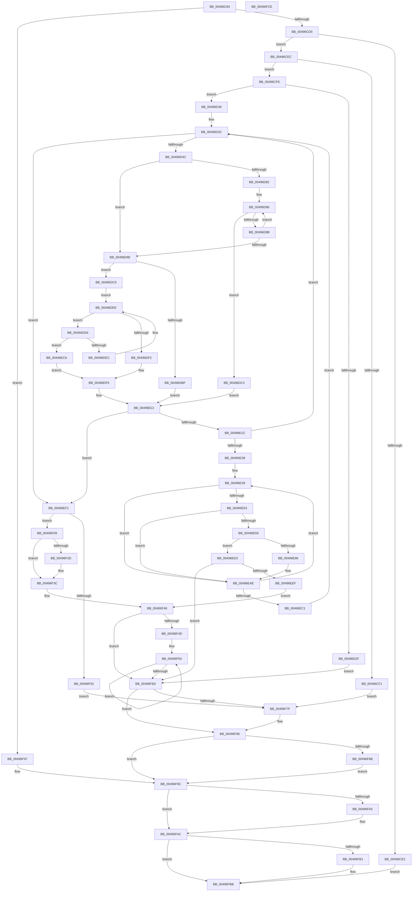

# SMKM_STORE&lt;SM_TRAITS&gt;::SmStOutSwapStore

- RVA: `0x00496C84`–`0x00496FCF` (길이 `843` bytes)
- VA: `0x0000000140496C84`
- 실행 섹션: `.text`
- PDB 이름 있음: `예`; PDB Function 태그: `아니요`
- unwind 정보 RVA: `0x000B3BD8`
- 디코드: `242`개 명령, `843/843` bytes 표시
- 미해석 바이트: `0` (있으면 어셈블리에 `.byte`로 보존)

> 이 문서는 커널 이미지의 기계어와 PDB 기호를 분석해 생성했습니다. 4번과 5번은 함수 원형과 자료형을 바이너리 사용 방식에서 추정한 C 해석이며 원본 소스 복구 결과는 아닙니다.

## 1. Dependencies

- 직접 호출 지점: **14**; 고유 호출 대상: **9**
- 직접 호출자로 확인된 함수: **1**
- RIP 상대 이미지 참조: **0**

### Outgoing calls
- `0x00496CB6` → [ST_STORE<SM_TRAITS>::StDrainReadContextList](../3B/ST_STORE_SM_TRAITS_StDrainReadContextList_function_003B08B0.md) (function, `0x003B08B0`)
- `0x00496D0B` → [StLockAcquireShared](../34/StLockAcquireShared_function_0034C728.md) (function, `0x0034C728`)
- `0x00496D22` → [SmAllocEx](../34/SmAllocEx_function_0034C794.md) (function, `0x0034C794`)
- `0x00496E69` → [SMKM_STORE<SM_TRAITS>::SmStMapVirtualRegion](../34/SMKM_STORE_SM_TRAITS_SmStMapVirtualRegion_function_0034D770.md) (function, `0x0034D770`)
- `0x00496E7D` → [SmArrayGrow](../3A/SmArrayGrow_function_003AC6C8.md) (function, `0x003AC6C8`)
- `0x00496EE0` → [SMKM_STORE<SM_TRAITS>::SmStUnmapVirtualRegion](../34/SMKM_STORE_SM_TRAITS_SmStUnmapVirtualRegion_function_0034CCA0.md) (function, `0x0034CCA0`)
- `0x00496EF8` → [StLockReleaseShared](../2E/StLockReleaseShared_function_002E0320.md) (function, `0x002E0320`)
- `0x00496F22` → [SmPerformStoreSwapOperation](../2A/SmPerformStoreSwapOperation_function_002A8BE0.md) (function, `0x002A8BE0`)
- `0x00496F43` → [StLockAcquireShared](../34/StLockAcquireShared_function_0034C728.md) (function, `0x0034C728`)
- `0x00496F5E` → [SMKM_STORE<SM_TRAITS>::SmStUnmapVirtualRegion](../34/SMKM_STORE_SM_TRAITS_SmStUnmapVirtualRegion_function_0034CCA0.md) (function, `0x0034CCA0`)
- `0x00496F74` → [StLockReleaseShared](../2E/StLockReleaseShared_function_002E0320.md) (function, `0x002E0320`)
- `0x00496F90` → [ExFreePoolWithTag](../../poolcode/B8/ExFreePoolWithTag_function_00B82870.md) (function, `0x00B82870`)
- `0x00496FA7` → [ExFreePoolWithTag](../../poolcode/B8/ExFreePoolWithTag_function_00B82870.md) (function, `0x00B82870`)
- `0x00496FB6` → [ExFreePoolWithTag](../../poolcode/B8/ExFreePoolWithTag_function_00B82870.md) (function, `0x00B82870`)

### Direct callers
- [SMKM_STORE&lt;SM_TRAITS&gt;::SmStSwapStore](SMKM_STORE_SM_TRAITS_SmStSwapStore_function_00496A68.md) at `0x00496AF5`

### Static image references
- 디코드된 RIP-relative 메모리 참조가 없습니다.

## 2. Other-region calls and transfers

- 다른 실행 섹션으로 향하는 call: **3**
  - `0x00496F90` → [ExFreePoolWithTag](../../poolcode/B8/ExFreePoolWithTag_function_00B82870.md) (`.text` → `POOLCODE`)
  - `0x00496FA7` → [ExFreePoolWithTag](../../poolcode/B8/ExFreePoolWithTag_function_00B82870.md) (`.text` → `POOLCODE`)
  - `0x00496FB6` → [ExFreePoolWithTag](../../poolcode/B8/ExFreePoolWithTag_function_00B82870.md) (`.text` → `POOLCODE`)
- 별도 외부 분기/꼬리 이동을 확인하지 못했습니다.

## 3. Assembly (complete function range)

```asm
00496C84  40 55                           push rbp
00496C86  53                              push rbx
00496C87  56                              push rsi
00496C88  57                              push rdi
00496C89  41 54                           push r12
00496C8B  41 55                           push r13
00496C8D  41 56                           push r14
00496C8F  41 57                           push r15
00496C91  48 8B EC                        mov rbp, rsp
00496C94  48 83 EC 68                     sub rsp, 0x68
00496C98  33 DB                           xor ebx, ebx
00496C9A  0F 57 C0                        xorps xmm0, xmm0
00496C9D  33 C0                           xor eax, eax
00496C9F  48 89 5D C8                     mov qword ptr [rbp - 0x38], rbx
00496CA3  0F 11 45 E0                     movups xmmword ptr [rbp - 0x20], xmm0
00496CA7  48 89 45 F0                     mov qword ptr [rbp - 0x10], rax
00496CAB  44 8B FB                        mov r15d, ebx
00496CAE  8B F3                           mov esi, ebx
00496CB0  44 8B EB                        mov r13d, ebx
00496CB3  48 8B F9                        mov rdi, rcx
00496CB6  E8 F5 9B F1 FF                  call 0x1403b08b0
00496CBB  4C 8B B7 F0 1C 00 00            mov r14, qword ptr [rdi + 0x1cf0]
00496CC2  49 8D 46 FF                     lea rax, [r14 - 1]
00496CC6  48 83 F8 FD                     cmp rax, -3
00496CCA  0F 87 C7 02 00 00               ja 0x140496f97
00496CD0  48 83 C9 FF                     or rcx, 0xffffffffffffffff
00496CD4  49 8B C6                        mov rax, r14
00496CD7  F0 48 0F B1 8F F0 1C 00 00      lock cmpxchg qword ptr [rdi + 0x1cf0], rcx
00496CE0  74 0A                           je 0x140496cec
00496CE2  BB 03 A0 00 C0                  mov ebx, 0xc000a003
00496CE7  E9 CF 02 00 00                  jmp 0x140496fbb
00496CEC  49 39 1E                        cmp qword ptr [r14], rbx
00496CEF  74 0D                           je 0x140496cfe
00496CF1  4D 8B E6                        mov r12, r14
00496CF4  BB 21 00 00 C0                  mov ebx, 0xc0000021
00496CF9  E9 81 02 00 00                  jmp 0x140496f7f
00496CFE  48 8D 8F 98 1A 00 00            lea rcx, [rdi + 0x1a98]
00496D05  4C 8B E3                        mov r12, rbx
00496D08  4D 8B FE                        mov r15, r14
00496D0B  E8 18 5A EB FF                  call 0x14034c728
00496D10  8B 8F 64 1B 00 00               mov ecx, dword ptr [rdi + 0x1b64]
00496D16  41 83 C8 FF                     or r8d, 0xffffffff
00496D1A  C1 E1 02                        shl ecx, 2
00496D1D  BA 73 6D 53 77                  mov edx, 0x77536d73
00496D22  E8 6D 5A EB FF                  call 0x14034c794
00496D27  48 8B F0                        mov rsi, rax
00496D2A  48 85 C0                        test rax, rax
00496D2D  75 0A                           jne 0x140496d39
00496D2F  BB 9A 00 00 C0                  mov ebx, 0xc000009a
00496D34  E9 34 02 00 00                  jmp 0x140496f6d
00496D39  89 5D 50                        mov dword ptr [rbp + 0x50], ebx
00496D3C  44 21 65 48                     and dword ptr [rbp + 0x48], r12d
00496D40  41 8B 46 08                     mov eax, dword ptr [r14 + 8]
00496D44  3B C3                           cmp eax, ebx
00496D46  0F 86 A5 01 00 00               jbe 0x140496ef1
00496D4C  4D 8B 5E 10                     mov r11, qword ptr [r14 + 0x10]
00496D50  8D 48 FF                        lea ecx, [rax - 1]
00496D53  48 C1 E9 05                     shr rcx, 5
00496D57  45 33 C9                        xor r9d, r9d
00496D5A  8B C3                           mov eax, ebx
00496D5C  83 E3 1F                        and ebx, 0x1f
00496D5F  48 C1 E8 05                     shr rax, 5
00496D63  4D 8D 14 8B                     lea r10, [r11 + rcx*4]
00496D67  8A CB                           mov cl, bl
00496D69  45 8D 41 01                     lea r8d, [r9 + 1]
00496D6D  41 D3 E0                        shl r8d, cl
00496D70  49 8D 14 83                     lea rdx, [r11 + rax*4]
00496D74  41 FF C8                        dec r8d
00496D77  44 0B 02                        or r8d, dword ptr [rdx]
00496D7A  41 F7 D0                        not r8d
00496D7D  45 85 C0                        test r8d, r8d
00496D80  75 1C                           jne 0x140496d9e
00496D82  48 8D 42 04                     lea rax, [rdx + 4]
00496D86  49 3B C2                        cmp rax, r10
00496D89  77 38                           ja 0x140496dc3
00496D8B  48 83 C2 04                     add rdx, 4
00496D8F  48 83 C0 04                     add rax, 4
00496D93  44 8B 02                        mov r8d, dword ptr [rdx]
00496D96  41 F7 D0                        not r8d
00496D99  45 85 C0                        test r8d, r8d
00496D9C  74 E8                           je 0x140496d86
00496D9E  41 8B C0                        mov eax, r8d
00496DA1  48 8B DA                        mov rbx, rdx
00496DA4  48 0F BC C8                     bsf rcx, rax
00496DA8  41 8B 46 08                     mov eax, dword ptr [r14 + 8]
00496DAC  49 2B DB                        sub rbx, r11
00496DAF  48 C1 FB 02                     sar rbx, 2
00496DB3  C1 E3 05                        shl ebx, 5
00496DB6  03 D9                           add ebx, ecx
00496DB8  89 4D 48                        mov dword ptr [rbp + 0x48], ecx
00496DBB  3B D8                           cmp ebx, eax
00496DBD  76 0A                           jbe 0x140496dc9
00496DBF  8B D8                           mov ebx, eax
00496DC1  EB 50                           jmp 0x140496e13
00496DC3  41 8B 5E 08                     mov ebx, dword ptr [r14 + 8]
00496DC7  EB 4A                           jmp 0x140496e13
00496DC9  B8 01 00 00 00                  mov eax, 1
00496DCE  D3 E0                           shl eax, cl
00496DD0  FF C8                           dec eax
00496DD2  41 0B C0                        or eax, r8d
00496DD5  F7 D0                           not eax
00496DD7  EB 15                           jmp 0x140496dee
00496DD9  48 8D 42 04                     lea rax, [rdx + 4]
00496DDD  48 8B CA                        mov rcx, rdx
00496DE0  48 8B D0                        mov rdx, rax
00496DE3  49 3B C2                        cmp rax, r10
00496DE6  0F 87 DA 00 00 00               ja 0x140496ec6
00496DEC  8B 00                           mov eax, dword ptr [rax]
00496DEE  85 C0                           test eax, eax
00496DF0  74 E7                           je 0x140496dd9
00496DF2  48 0F BC C0                     bsf rax, rax
00496DF6  45 8B 4E 08                     mov r9d, dword ptr [r14 + 8]
00496DFA  49 2B D3                        sub rdx, r11
00496DFD  48 C1 FA 02                     sar rdx, 2
00496E01  C1 E2 05                        shl edx, 5
00496E04  89 45 48                        mov dword ptr [rbp + 0x48], eax
00496E07  03 C2                           add eax, edx
00496E09  41 3B C1                        cmp eax, r9d
00496E0C  44 0F 46 C8                     cmovbe r9d, eax
00496E10  44 2B CB                        sub r9d, ebx
00496E13  45 85 C9                        test r9d, r9d
00496E16  0F 84 D5 00 00 00               je 0x140496ef1
00496E1C  41 8D 04 19                     lea eax, [r9 + rbx]
00496E20  89 45 58                        mov dword ptr [rbp + 0x58], eax
00496E23  3B D8                           cmp ebx, eax
00496E25  0F 83 11 FF FF FF               jae 0x140496d3c
00496E2B  8B C3                           mov eax, ebx
00496E2D  48 8D 0C C5 00 00 00 00         lea rcx, [rax*8]
00496E35  48 89 4D D0                     mov qword ptr [rbp - 0x30], rcx
00496E39  48 8B 97 68 1B 00 00            mov rdx, qword ptr [rdi + 0x1b68]
00496E40  49 B8 00 00 FF FF FF FF FF 7F   movabs r8, 0x7fffffffffff0000
00496E4A  48 8B 04 11                     mov rax, qword ptr [rcx + rdx]
00496E4E  49 85 C0                        test r8, rax
00496E51  74 5B                           je 0x140496eae
00496E53  4C 39 24 11                     cmp qword ptr [rcx + rdx], r12
00496E57  7C 55                           jl 0x140496eae
00496E59  45 33 C0                        xor r8d, r8d
00496E5C  C7 44 24 20 04 00 00 00         mov dword ptr [rsp + 0x20], 4
00496E64  8B D3                           mov edx, ebx
00496E66  48 8B CF                        mov rcx, rdi
00496E69  E8 02 69 EB FF                  call 0x14034d770
00496E6E  4C 8D 4D C8                     lea r9, [rbp - 0x38]
00496E72  48 89 45 D8                     mov qword ptr [rbp - 0x28], rax
00496E76  4C 8D 45 50                     lea r8, [rbp + 0x50]
00496E7A  41 8B CD                        mov ecx, r13d
00496E7D  E8 46 58 F1 FF                  call 0x1403ac6c8
00496E82  85 C0                           test eax, eax
00496E84  74 4D                           je 0x140496ed3
00496E86  48 8B 4D C8                     mov rcx, qword ptr [rbp - 0x38]
00496E8A  48 8B 45 D8                     mov rax, qword ptr [rbp - 0x28]
00496E8E  42 89 1C AE                     mov dword ptr [rsi + r13*4], ebx
00496E92  41 8B D5                        mov edx, r13d
00496E95  48 03 D2                        add rdx, rdx
00496E98  41 FF C5                        inc r13d
00496E9B  48 89 04 D1                     mov qword ptr [rcx + rdx*8], rax
00496E9F  8B 87 60 1B 00 00               mov eax, dword ptr [rdi + 0x1b60]
00496EA5  48 89 44 D1 08                  mov qword ptr [rcx + rdx*8 + 8], rax
00496EAA  48 8B 4D D0                     mov rcx, qword ptr [rbp - 0x30]
00496EAE  48 83 C1 08                     add rcx, 8
00496EB2  FF C3                           inc ebx
00496EB4  48 89 4D D0                     mov qword ptr [rbp - 0x30], rcx
00496EB8  3B 5D 58                        cmp ebx, dword ptr [rbp + 0x58]
00496EBB  0F 82 78 FF FF FF               jb 0x140496e39
00496EC1  E9 76 FE FF FF                  jmp 0x140496d3c
00496EC6  B8 20 00 00 00                  mov eax, 0x20
00496ECB  48 8B D1                        mov rdx, rcx
00496ECE  E9 23 FF FF FF                  jmp 0x140496df6
00496ED3  8B D3                           mov edx, ebx
00496ED5  C7 44 24 28 02 00 00 00         mov dword ptr [rsp + 0x28], 2
00496EDD  48 8B CF                        mov rcx, rdi
00496EE0  E8 BB 5D EB FF                  call 0x14034cca0
00496EE5  BB 9A 00 00 C0                  mov ebx, 0xc000009a
00496EEA  45 85 ED                        test r13d, r13d
00496EED  74 7E                           je 0x140496f6d
00496EEF  EB 57                           jmp 0x140496f48
00496EF1  48 8D 8F 98 1A 00 00            lea rcx, [rdi + 0x1a98]
00496EF8  E8 23 94 E4 FF                  call 0x1402e0320
00496EFD  45 85 ED                        test r13d, r13d
00496F00  75 07                           jne 0x140496f09
00496F02  BB D9 00 00 C0                  mov ebx, 0xc00000d9
00496F07  EB 76                           jmp 0x140496f7f
00496F09  48 8B 45 C8                     mov rax, qword ptr [rbp - 0x38]
00496F0D  48 8D 55 E0                     lea rdx, [rbp - 0x20]
00496F11  44 21 65 F4                     and dword ptr [rbp - 0xc], r12d
00496F15  B9 01 00 00 00                  mov ecx, 1
00496F1A  48 89 45 E8                     mov qword ptr [rbp - 0x18], rax
00496F1E  44 89 6D F0                     mov dword ptr [rbp - 0x10], r13d
00496F22  E8 B9 1C E1 FF                  call 0x1402a8be0
00496F27  8B D8                           mov ebx, eax
00496F29  85 C0                           test eax, eax
00496F2B  78 0F                           js 0x140496f3c
00496F2D  48 8B 45 E0                     mov rax, qword ptr [rbp - 0x20]
00496F31  45 33 FF                        xor r15d, r15d
00496F34  49 89 06                        mov qword ptr [r14], rax
00496F37  33 DB                           xor ebx, ebx
00496F39  4D 8B E6                        mov r12, r14
00496F3C  48 8D 8F 98 1A 00 00            lea rcx, [rdi + 0x1a98]
00496F43  E8 E0 57 EB FF                  call 0x14034c728
00496F48  45 85 ED                        test r13d, r13d
00496F4B  74 20                           je 0x140496f6d
00496F4D  4C 8B F6                        mov r14, rsi
00496F50  41 8B 16                        mov edx, dword ptr [r14]
00496F53  48 8B CF                        mov rcx, rdi
00496F56  C7 44 24 28 02 00 00 00         mov dword ptr [rsp + 0x28], 2
00496F5E  E8 3D 5D EB FF                  call 0x14034cca0
00496F63  4D 8D 76 04                     lea r14, [r14 + 4]
00496F67  49 83 ED 01                     sub r13, 1
00496F6B  75 E3                           jne 0x140496f50
00496F6D  48 8D 8F 98 1A 00 00            lea rcx, [rdi + 0x1a98]
00496F74  E8 A7 93 E4 FF                  call 0x1402e0320
00496F79  49 83 FC FF                     cmp r12, -1
00496F7D  74 07                           je 0x140496f86
00496F7F  4C 87 A7 F0 1C 00 00            xchg qword ptr [rdi + 0x1cf0], r12
00496F86  4D 85 FF                        test r15, r15
00496F89  74 11                           je 0x140496f9c
00496F8B  33 D2                           xor edx, edx
00496F8D  49 8B CF                        mov rcx, r15
00496F90  E8 DB B8 6E 00                  call 0x140b82870
00496F95  EB 05                           jmp 0x140496f9c
00496F97  BB 03 A0 00 C0                  mov ebx, 0xc000a003
00496F9C  48 8B 4D C8                     mov rcx, qword ptr [rbp - 0x38]
00496FA0  48 85 C9                        test rcx, rcx
00496FA3  74 07                           je 0x140496fac
00496FA5  33 D2                           xor edx, edx
00496FA7  E8 C4 B8 6E 00                  call 0x140b82870
00496FAC  48 85 F6                        test rsi, rsi
00496FAF  74 0A                           je 0x140496fbb
00496FB1  33 D2                           xor edx, edx
00496FB3  48 8B CE                        mov rcx, rsi
00496FB6  E8 B5 B8 6E 00                  call 0x140b82870
00496FBB  8B C3                           mov eax, ebx
00496FBD  48 83 C4 68                     add rsp, 0x68
00496FC1  41 5F                           pop r15
00496FC3  41 5E                           pop r14
00496FC5  41 5D                           pop r13
00496FC7  41 5C                           pop r12
00496FC9  5F                              pop rdi
00496FCA  5E                              pop rsi
00496FCB  5B                              pop rbx
00496FCC  5D                              pop rbp
00496FCD  C3                              ret
00496FCE  CC                              int3
```

## 4. C-style interpretation (structured pseudocode)

```c
__int64 __fastcall SMKM_STORE_SM_TRAITS___SmStOutSwapStore(__int64 a1, __int64 a2, int a3, int a4)
{
    __int64 result;
    __int64 v_r12;
    __int64 v_r13;
    __int64 v_r15;
    __int64 v_rbx;
    __int64 v_rsp;
    unsigned int v_stack_m4C;
    unsigned __int64 v_stack_m50;
    unsigned __int64 v_stack_m58;
    unsigned __int64 v_stack_m60;
    unsigned __int64 v_stack_m68;
    unsigned __int64 v_stack_m70;
    unsigned __int64 v_stack_m78;
    unsigned int v_stack_m80;
    unsigned int v_stack_m88;
    unsigned int v_stack_p10;
    unsigned int v_stack_p18;
    unsigned int v_stack_p8;

    v_rsp = (v_rsp) - (104);
    v_rbx = 0;
    result = 0;
    v_stack_m78 = 0;
    v_stack_m60 = v_xmm0;
    v_stack_m50 = 0;
    result = ST_STORE_SM_TRAITS___StDrainReadContextList(a1, a2, a3, a4);
    if ((*(unsigned __int64 *)(a1 + 7408) - 1) > -3) goto loc_00496F97;
    a1 = (a1) | (-1);
    if (condition_is_equal) goto loc_00496CEC;
    goto loc_00496FBB;
loc_00496CEC:
    if ((*(unsigned __int64 *)(*(unsigned __int64 *)(a1 + 7408))) == ((unsigned int)(0xC000A003ULL))) goto loc_00496CFE;
    goto loc_00496F7F;
loc_00496CFE:
    result = StLockAcquireShared(a1 + 6808, a2, a3, a4);
    a3 = (unsigned int)((a3) | (0xFFFFFFFFULL));
    a1 = (unsigned int)(((unsigned int)(*(unsigned int *)(a1 + 7012))) << (2));
    result = SmAllocEx(a1, (unsigned int)(0x77536D73ULL), a3, a4);
    if (result != 0) goto loc_00496D39;
    goto loc_00496F6D;
loc_00496D39:
    v_stack_p10 = (unsigned int)((unsigned int)(0xC000009AULL));
loc_00496D3C:
    if (((unsigned int)((unsigned int)(*(unsigned int *)(*(unsigned __int64 *)(a1 + 7408) + 8)))) <= ((unsigned int)((unsigned int)(0xC000009AULL)))) goto loc_00496EF1;
    a1 = ((unsigned int)(*(unsigned int *)(*(unsigned __int64 *)(a1 + 7408) + 8)) - 1) >> (5);
    a4 = 0;
    v_rbx = (unsigned int)(((unsigned int)(0xC000009AULL)) & (31));
    result = ((unsigned int)((unsigned int)((unsigned int)(0xC000009AULL)))) >> (5);
    a3 = (unsigned int)((a4 + 1) << ((unsigned __int8)((unsigned __int8)(v_rbx))));
    a3 = (unsigned int)((a3) - 1);
    a3 = (unsigned int)((a3) | (*(unsigned int *)(*(unsigned __int64 *)(*(unsigned __int64 *)(a1 + 7408) + 16) + result * 4)));
    a3 = (unsigned int)(~(a3));
    if (a3 != 0) goto loc_00496D9E;
loc_00496D86:
    if ((*(unsigned __int64 *)(*(unsigned __int64 *)(a1 + 7408) + 16) + result * 4 + 4) > (*(unsigned __int64 *)(*(unsigned __int64 *)(a1 + 7408) + 16) + a1 * 4)) goto loc_00496DC3;
    a2 = (*(unsigned __int64 *)(*(unsigned __int64 *)(a1 + 7408) + 16) + result * 4) + (4);
    result = (*(unsigned __int64 *)(*(unsigned __int64 *)(a1 + 7408) + 16) + result * 4 + 4) + (4);
    a3 = (unsigned int)(~((unsigned int)(*(unsigned int *)(a2))));
    if (a3 == 0) goto loc_00496D86;
loc_00496D9E:
    v_rbx = (a2) - (*(unsigned __int64 *)(*(unsigned __int64 *)(a1 + 7408) + 16));
    v_rbx = (v_rbx) >> (2);
    v_rbx = (unsigned int)((v_rbx) << (5));
    v_rbx = (unsigned int)((v_rbx) + ((unsigned int)((unsigned __int8)(v_rbx))));
    v_stack_p8 = (unsigned int)((unsigned __int8)(v_rbx));
    if (((unsigned int)(v_rbx)) <= ((unsigned int)((unsigned int)(*(unsigned int *)(*(unsigned __int64 *)(a1 + 7408) + 8))))) goto loc_00496DC9;
    goto loc_00496E13;
loc_00496DC3:
    goto loc_00496E13;
loc_00496DC9:
    result = (unsigned int)((1) << ((unsigned __int8)((unsigned __int8)(v_rbx))));
    result = (unsigned int)((result) - 1);
    result = (unsigned int)((result) | (a3));
    result = (unsigned int)(~(result));
    goto loc_00496DEE;
loc_00496DD9:
    if ((a2 + 4) > (*(unsigned __int64 *)(*(unsigned __int64 *)(a1 + 7408) + 16) + a1 * 4)) goto loc_00496EC6;
loc_00496DEE:
    if ((unsigned int)((unsigned int)(*(unsigned int *)(a2 + 4))) == 0) goto loc_00496DD9;
loc_00496DF6:
    a2 = (a2 + 4) - (*(unsigned __int64 *)(*(unsigned __int64 *)(a1 + 7408) + 16));
    a2 = (a2) >> (2);
    a2 = (unsigned int)((a2) << (5));
    v_stack_p8 = (unsigned int)((unsigned int)(*(unsigned int *)(a2 + 4)));
    result = (unsigned int)(((unsigned int)(*(unsigned int *)(a2 + 4))) + ((unsigned int)(a2)));
    a4 = (unsigned int)(*(unsigned int *)(*(unsigned __int64 *)(a1 + 7408) + 8));
    if (((unsigned int)(result)) <= ((unsigned int)((unsigned int)(*(unsigned int *)(*(unsigned __int64 *)(a1 + 7408) + 8))))) { a4 = (unsigned int)(result); }
    a4 = (unsigned int)((a4) - ((unsigned int)((unsigned int)(*(unsigned int *)(*(unsigned __int64 *)(a1 + 7408) + 8)))));
loc_00496E13:
    if (a4 == 0) goto loc_00496EF1;
    v_stack_p18 = (unsigned int)(a4 + (unsigned int)(*(unsigned int *)(*(unsigned __int64 *)(a1 + 7408) + 8)) * 1);
    if (((unsigned int)((unsigned int)(*(unsigned int *)(*(unsigned __int64 *)(a1 + 7408) + 8)))) >= ((unsigned int)(a4 + (unsigned int)(*(unsigned int *)(*(unsigned __int64 *)(a1 + 7408) + 8)) * 1))) goto loc_00496D3C;
    v_stack_m70 = (unsigned int)((unsigned int)((unsigned int)(*(unsigned int *)(*(unsigned __int64 *)(a1 + 7408) + 8)))) * 8;
loc_00496E39:
    if (((a3) & (*(unsigned __int64 *)((unsigned int)((unsigned int)((unsigned int)(*(unsigned int *)(*(unsigned __int64 *)(a1 + 7408) + 8)))) * 8 + *(unsigned __int64 *)(a1 + 7016) * 1))) == 0) goto loc_00496EAE;
    if ((*(unsigned __int64 *)((unsigned int)((unsigned int)((unsigned int)(*(unsigned int *)(*(unsigned __int64 *)(a1 + 7408) + 8)))) * 8 + *(unsigned __int64 *)(a1 + 7016) * 1)) < ((unsigned int)(0xC0000021ULL))) goto loc_00496EAE;
    a3 = 0;
    v_stack_m88 = 4;
    result = SMKM_STORE_SM_TRAITS___SmStMapVirtualRegion(a1, (unsigned int)((unsigned int)((unsigned int)(*(unsigned int *)(*(unsigned __int64 *)(a1 + 7408) + 8)))), a3, a4);
    v_stack_m68 = result;
    result = SmArrayGrow(0, (unsigned int)((unsigned int)((unsigned int)(*(unsigned int *)(*(unsigned __int64 *)(a1 + 7408) + 8)))), v_stack_p10, v_stack_m78);
    if ((unsigned int)(result) == 0) goto loc_00496ED3;
    *(unsigned int *)(result + 0 * 4) = (unsigned int)((unsigned int)(*(unsigned int *)(*(unsigned __int64 *)(a1 + 7408) + 8)));
    a2 = (0) + (0);
    v_r13 = (unsigned int)((0) + 1);
    *(unsigned __int64 *)(v_stack_m78 + a2 * 8) = v_stack_m68;
    *(unsigned __int64 *)(v_stack_m78 + a2 * 8 + 8) = (unsigned int)(*(unsigned int *)(a1 + 7008));
loc_00496EAE:
    a1 = (v_stack_m70) + (8);
    v_rbx = (unsigned int)(((unsigned int)(*(unsigned int *)(*(unsigned __int64 *)(a1 + 7408) + 8))) + 1);
    v_stack_m70 = a1;
    if (((unsigned int)(v_rbx)) < v_stack_p18) goto loc_00496E39;
    goto loc_00496D3C;
loc_00496EC6:
    goto loc_00496DF6;
loc_00496ED3:
    v_stack_m80 = 2;
    result = SMKM_STORE_SM_TRAITS___SmStUnmapVirtualRegion(a1, (unsigned int)((unsigned int)(v_rbx)), v_stack_p10, v_stack_m78);
    if ((unsigned int)(v_r13) == 0) goto loc_00496F6D;
    goto loc_00496F48;
loc_00496EF1:
    result = StLockReleaseShared(a1 + 6808, (unsigned int)((unsigned int)(v_rbx)), v_stack_p10, v_stack_m78);
    if ((unsigned int)(v_r13) != 0) goto loc_00496F09;
    goto loc_00496F7F;
loc_00496F09:
    v_stack_m58 = v_stack_m78;
    v_stack_m50 = (unsigned int)(v_r13);
    result = SmPerformStoreSwapOperation(1, v_stack_m60, v_stack_p10, v_stack_m78);
    v_rbx = (unsigned int)((unsigned int)(result));
    v_r12 = (unsigned int)(0xC0000021ULL);
    v_r15 = *(unsigned __int64 *)(a1 + 7408);
    if (!(sign_flag)) {
        result = v_stack_m60;
        v_r15 = 0;
        *(unsigned __int64 *)(*(unsigned __int64 *)(a1 + 7408)) = result;
        v_rbx = 0;
        v_r12 = *(unsigned __int64 *)(a1 + 7408);
    }
    result = StLockAcquireShared(a1 + 6808, v_stack_m60, v_stack_p10, v_stack_m78);
loc_00496F48:
    if ((unsigned int)(v_r13) == 0) goto loc_00496F6D;
loc_00496F50:
    v_stack_m80 = 2;
    result = SMKM_STORE_SM_TRAITS___SmStUnmapVirtualRegion(a1, (unsigned int)(*(unsigned int *)(result)), v_stack_p10, v_stack_m78);
    v_r13 = (v_r13) - (1);
    if (condition_is_not_equal) goto loc_00496F50;
loc_00496F6D:
    result = StLockReleaseShared(a1 + 6808, (unsigned int)(*(unsigned int *)(result)), v_stack_p10, v_stack_m78);
    if (v_r12 != -1) {
    }
    if (0 == 0) goto loc_00496F9C;
    a2 = 0;
    result = ExFreePoolWithTag(0, a2, v_stack_p10, v_stack_m78);
    goto loc_00496F9C;
loc_00496F97:
loc_00496F9C:
    if (v_stack_m78 != 0) {
        a2 = 0;
        result = ExFreePoolWithTag(v_stack_m78, a2, v_stack_p10, v_stack_m78);
    }
    if (result != 0) {
        a2 = 0;
        a1 = result;
        result = ExFreePoolWithTag(a1, a2, v_stack_p10, v_stack_m78);
    }
    v_rsp = (v_rsp) + (104);
    return (unsigned int)((unsigned int)((unsigned int)(0xC000A003ULL)));
}
```

## 5. (Beta) C Style

```c
int64_t SMKM_STORE_SM_TRAITS___SmStOutSwapStore(void *Arg1, int64_t Arg2, int32_t Arg3, int32_t Arg4)
{
    uint8_t *arg1 = (uint8_t *)Arg1;

    int64_t result;
    int64_t local_r12;
    int64_t local_r13;
    int64_t local_r15;
    int64_t local_rbx;
    int64_t local_rsp;
    uint32_t v_stack_m4C;
    uint64_t v_stack_m50;
    uint64_t v_stack_m58;
    uint64_t v_stack_m60;
    uint64_t v_stack_m68;
    uint64_t v_stack_m70;
    uint64_t v_stack_m78;
    uint32_t v_stack_m80;
    uint32_t v_stack_m88;
    uint32_t v_stack_p10;
    uint32_t v_stack_p18;
    uint32_t v_stack_p8;

    local_rsp = (local_rsp) - (104);
    local_rbx = 0;
    result = 0;
    v_stack_m78 = 0;
    v_stack_m60 = v_xmm0;
    v_stack_m50 = 0;
    result = ST_STORE_SM_TRAITS___StDrainReadContextList(Arg1, Arg2, Arg3, Arg4);
    if ((*(uint64_t *)(arg1 + 0x1CF0) - 1) > -3) goto loc_00496F97;
    Arg1 = (Arg1) | (-1);
    if (condition_is_equal) goto loc_00496CEC;
    goto loc_00496FBB;
loc_00496CEC:
    if ((*(uint64_t *)(*(uint64_t *)(arg1 + 0x1CF0))) == ((uint32_t)(0xC000A003ULL))) goto loc_00496CFE;
    goto loc_00496F7F;
loc_00496CFE:
    result = StLockAcquireShared(Arg1 + 6808, Arg2, Arg3, Arg4);
    Arg3 = (uint32_t)((Arg3) | (0xFFFFFFFFULL));
    Arg1 = (uint32_t)(((uint32_t)(*(uint32_t *)(arg1 + 0x1B64))) << (2));
    result = SmAllocEx(Arg1, (uint32_t)(0x77536D73ULL), Arg3, Arg4);
    if (result != 0) goto loc_00496D39;
    goto loc_00496F6D;
loc_00496D39:
    v_stack_p10 = (uint32_t)((uint32_t)(0xC000009AULL));
loc_00496D3C:
    if (((uint32_t)((uint32_t)(*(uint32_t *)(*(uint64_t *)(arg1 + 0x1CF0) + 0x8)))) <= ((uint32_t)((uint32_t)(0xC000009AULL)))) goto loc_00496EF1;
    Arg1 = ((uint32_t)(*(uint32_t *)(*(uint64_t *)(arg1 + 0x1CF0) + 0x8)) - 1) >> (5);
    Arg4 = 0;
    local_rbx = (uint32_t)(((uint32_t)(0xC000009AULL)) & (31));
    result = ((uint32_t)((uint32_t)((uint32_t)(0xC000009AULL)))) >> (5);
    Arg3 = (uint32_t)((Arg4 + 1) << ((uint8_t)((uint8_t)(local_rbx))));
    Arg3 = (uint32_t)((Arg3) - 1);
    Arg3 = (uint32_t)((Arg3) | (*(uint32_t *)(*(uint64_t *)(*(uint64_t *)(arg1 + 0x1CF0) + 0x10) + result * 4)));
    Arg3 = (uint32_t)(~(Arg3));
    if (Arg3 != 0) goto loc_00496D9E;
loc_00496D86:
    if ((*(uint64_t *)(*(uint64_t *)(arg1 + 0x1CF0) + 0x10) + result * 4 + 4) > (*(uint64_t *)(*(uint64_t *)(arg1 + 0x1CF0) + 0x10) + Arg1 * 4)) goto loc_00496DC3;
    Arg2 = (*(uint64_t *)(*(uint64_t *)(arg1 + 0x1CF0) + 0x10) + result * 4) + (4);
    result = (*(uint64_t *)(*(uint64_t *)(arg1 + 0x1CF0) + 0x10) + result * 4 + 4) + (4);
    Arg3 = (uint32_t)(~((uint32_t)(*(uint32_t *)(Arg2))));
    if (Arg3 == 0) goto loc_00496D86;
loc_00496D9E:
    local_rbx = (Arg2) - (*(uint64_t *)(*(uint64_t *)(arg1 + 0x1CF0) + 0x10));
    local_rbx = (local_rbx) >> (2);
    local_rbx = (uint32_t)((local_rbx) << (5));
    local_rbx = (uint32_t)((local_rbx) + ((uint32_t)((uint8_t)(local_rbx))));
    v_stack_p8 = (uint32_t)((uint8_t)(local_rbx));
    if (((uint32_t)(local_rbx)) <= ((uint32_t)((uint32_t)(*(uint32_t *)(*(uint64_t *)(arg1 + 0x1CF0) + 0x8))))) goto loc_00496DC9;
    goto loc_00496E13;
loc_00496DC3:
    goto loc_00496E13;
loc_00496DC9:
    result = (uint32_t)((1) << ((uint8_t)((uint8_t)(local_rbx))));
    result = (uint32_t)((result) - 1);
    result = (uint32_t)((result) | (Arg3));
    result = (uint32_t)(~(result));
    goto loc_00496DEE;
loc_00496DD9:
    if ((Arg2 + 4) > (*(uint64_t *)(*(uint64_t *)(arg1 + 0x1CF0) + 0x10) + Arg1 * 4)) goto loc_00496EC6;
loc_00496DEE:
    if ((uint32_t)((uint32_t)(*(uint32_t *)(Arg2 + 0x4))) == 0) goto loc_00496DD9;
loc_00496DF6:
    Arg2 = (Arg2 + 4) - (*(uint64_t *)(*(uint64_t *)(arg1 + 0x1CF0) + 0x10));
    Arg2 = (Arg2) >> (2);
    Arg2 = (uint32_t)((Arg2) << (5));
    v_stack_p8 = (uint32_t)((uint32_t)(*(uint32_t *)(Arg2 + 0x4)));
    result = (uint32_t)(((uint32_t)(*(uint32_t *)(Arg2 + 0x4))) + ((uint32_t)(Arg2)));
    Arg4 = (uint32_t)(*(uint32_t *)(*(uint64_t *)(arg1 + 0x1CF0) + 0x8));
    if (((uint32_t)(result)) <= ((uint32_t)((uint32_t)(*(uint32_t *)(*(uint64_t *)(arg1 + 0x1CF0) + 0x8))))) { Arg4 = (uint32_t)(result); }
    Arg4 = (uint32_t)((Arg4) - ((uint32_t)((uint32_t)(*(uint32_t *)(*(uint64_t *)(arg1 + 0x1CF0) + 0x8)))));
loc_00496E13:
    if (Arg4 == 0) goto loc_00496EF1;
    v_stack_p18 = (uint32_t)(Arg4 + (uint32_t)(*(uint32_t *)(*(uint64_t *)(arg1 + 0x1CF0) + 0x8)) * 1);
    if (((uint32_t)((uint32_t)(*(uint32_t *)(*(uint64_t *)(arg1 + 0x1CF0) + 0x8)))) >= ((uint32_t)(Arg4 + (uint32_t)(*(uint32_t *)(*(uint64_t *)(arg1 + 0x1CF0) + 0x8)) * 1))) goto loc_00496D3C;
    v_stack_m70 = (uint32_t)((uint32_t)((uint32_t)(*(uint32_t *)(*(uint64_t *)(arg1 + 0x1CF0) + 0x8)))) * 8;
loc_00496E39:
    if (((Arg3) & (*(uint64_t *)((uint32_t)((uint32_t)((uint32_t)(*(uint32_t *)(*(uint64_t *)(arg1 + 0x1CF0) + 0x8)))) * 8 + *(uint64_t *)(arg1 + 0x1B68) * 1))) == 0) goto loc_00496EAE;
    if ((*(uint64_t *)((uint32_t)((uint32_t)((uint32_t)(*(uint32_t *)(*(uint64_t *)(arg1 + 0x1CF0) + 0x8)))) * 8 + *(uint64_t *)(arg1 + 0x1B68) * 1)) < ((uint32_t)(0xC0000021ULL))) goto loc_00496EAE;
    Arg3 = 0;
    v_stack_m88 = 4;
    result = SMKM_STORE_SM_TRAITS___SmStMapVirtualRegion(Arg1, (uint32_t)((uint32_t)((uint32_t)(*(uint32_t *)(*(uint64_t *)(arg1 + 0x1CF0) + 0x8)))), Arg3, Arg4);
    v_stack_m68 = result;
    result = SmArrayGrow(0, (uint32_t)((uint32_t)((uint32_t)(*(uint32_t *)(*(uint64_t *)(arg1 + 0x1CF0) + 0x8)))), v_stack_p10, v_stack_m78);
    if ((uint32_t)(result) == 0) goto loc_00496ED3;
    *(uint32_t *)(result + 0x0 * 4) = (uint32_t)((uint32_t)(*(uint32_t *)(*(uint64_t *)(arg1 + 0x1CF0) + 0x8)));
    Arg2 = (0) + (0);
    local_r13 = (uint32_t)((0) + 1);
    *(uint64_t *)(v_stack_m78 + Arg2 * 8) = v_stack_m68;
    *(uint64_t *)(v_stack_m78 + Arg2 * 8 + 0x8) = (uint32_t)(*(uint32_t *)(arg1 + 0x1B60));
loc_00496EAE:
    Arg1 = (v_stack_m70) + (8);
    local_rbx = (uint32_t)(((uint32_t)(*(uint32_t *)(*(uint64_t *)(arg1 + 0x1CF0) + 0x8))) + 1);
    v_stack_m70 = Arg1;
    if (((uint32_t)(local_rbx)) < v_stack_p18) goto loc_00496E39;
    goto loc_00496D3C;
loc_00496EC6:
    goto loc_00496DF6;
loc_00496ED3:
    v_stack_m80 = 2;
    result = SMKM_STORE_SM_TRAITS___SmStUnmapVirtualRegion(Arg1, (uint32_t)((uint32_t)(local_rbx)), v_stack_p10, v_stack_m78);
    if ((uint32_t)(local_r13) == 0) goto loc_00496F6D;
    goto loc_00496F48;
loc_00496EF1:
    result = StLockReleaseShared(Arg1 + 6808, (uint32_t)((uint32_t)(local_rbx)), v_stack_p10, v_stack_m78);
    if ((uint32_t)(local_r13) != 0) goto loc_00496F09;
    goto loc_00496F7F;
loc_00496F09:
    v_stack_m58 = v_stack_m78;
    v_stack_m50 = (uint32_t)(local_r13);
    result = SmPerformStoreSwapOperation(1, v_stack_m60, v_stack_p10, v_stack_m78);
    local_rbx = (uint32_t)((uint32_t)(result));
    local_r12 = (uint32_t)(0xC0000021ULL);
    local_r15 = *(uint64_t *)(arg1 + 0x1CF0);
    if (!(sign_flag)) {
        result = v_stack_m60;
        local_r15 = 0;
        *(uint64_t *)(*(uint64_t *)(arg1 + 0x1CF0)) = result;
        local_rbx = 0;
        local_r12 = *(uint64_t *)(arg1 + 0x1CF0);
    }
    result = StLockAcquireShared(Arg1 + 6808, v_stack_m60, v_stack_p10, v_stack_m78);
loc_00496F48:
    if ((uint32_t)(local_r13) == 0) goto loc_00496F6D;
loc_00496F50:
    v_stack_m80 = 2;
    result = SMKM_STORE_SM_TRAITS___SmStUnmapVirtualRegion(Arg1, (uint32_t)(*(uint32_t *)(result)), v_stack_p10, v_stack_m78);
    local_r13 = (local_r13) - (1);
    if (condition_is_not_equal) goto loc_00496F50;
loc_00496F6D:
    result = StLockReleaseShared(Arg1 + 6808, (uint32_t)(*(uint32_t *)(result)), v_stack_p10, v_stack_m78);
    if (local_r12 != -1) {
    }
    if (0 == 0) goto loc_00496F9C;
    Arg2 = 0;
    result = ExFreePoolWithTag(0, Arg2, v_stack_p10, v_stack_m78);
    goto loc_00496F9C;
loc_00496F97:
loc_00496F9C:
    if (v_stack_m78 != 0) {
        Arg2 = 0;
        result = ExFreePoolWithTag(v_stack_m78, Arg2, v_stack_p10, v_stack_m78);
    }
    if (result != 0) {
        Arg2 = 0;
        Arg1 = result;
        result = ExFreePoolWithTag(Arg1, Arg2, v_stack_p10, v_stack_m78);
    }
    local_rsp = (local_rsp) + (104);
    return (uint32_t)((uint32_t)((uint32_t)(0xC000A003ULL)));
}
```

### 관측된 메모리 오프셋

구조체 형식이 확인되지 않은 접근은 인자 기준의 오프셋으로만 기록했습니다.

| 기준 인자 | 오프셋 표현 | 폭 (bit) | 접근 |
|---|---:|---:|---|
| `Arg1` | `+ 0x1A98` | `64` | `R` |
| `Arg1` | `+ 0x1B60` | `32` | `R` |
| `Arg1` | `+ 0x1B64` | `32` | `R` |
| `Arg1` | `+ 0x1B68` | `64` | `R` |
| `Arg1` | `+ 0x1CF0` | `64` | `R` |
| `Arg1` | `+ 0x1CF0` | `64` | `R/W` |

## 6. Execution-region graph

[열기: 2D/3D 그래프와 함수 탐색 컨트롤 패널](../../../control-panel.html?section=text&rva=0x00496C84&view=graph)

- 2D 그래프는 위에서 아래로 흐르고, 3D 그래프는 빈 공간을 드래그해 회전합니다. Shift+드래그는 이동, 휠은 확대·축소, 함수 노드 선택은 대상 보고서 이동입니다.

### Static fallback


