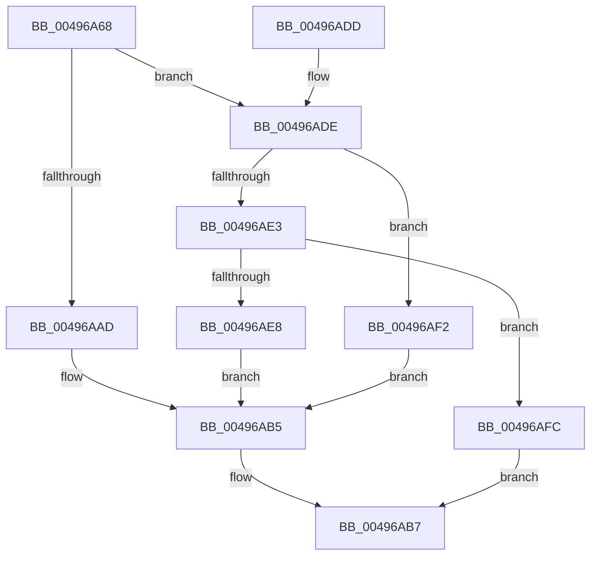

# SMKM_STORE&lt;SM_TRAITS&gt;::SmStSwapStore

- RVA: `0x00496A68`–`0x00496B03` (길이 `155` bytes)
- VA: `0x0000000140496A68`
- 실행 섹션: `.text`
- PDB 이름 있음: `예`; PDB Function 태그: `아니요`
- unwind 정보 RVA: `0x000B3BA8`
- 디코드: `44`개 명령, `155/155` bytes 표시
- 미해석 바이트: `0` (있으면 어셈블리에 `.byte`로 보존)

> 이 문서는 커널 이미지의 기계어와 PDB 기호를 분석해 생성했습니다. 4번과 5번은 함수 원형과 자료형을 바이너리 사용 방식에서 추정한 C 해석이며 원본 소스 복구 결과는 아닙니다.

## 1. Dependencies

- 직접 호출 지점: **6**; 고유 호출 대상: **6**
- 직접 호출자로 확인된 함수: **1**
- RIP 상대 이미지 참조: **1**

### Outgoing calls
- `0x00496AA4` → [KeStackAttachProcess](../21/KeStackAttachProcess_function_00216800.md) (function, `0x00216800`)
- `0x00496AB0` → [SMKM_STORE<SM_TRAITS>::SmStOutSwapPrepareStore](SMKM_STORE_SM_TRAITS_SmStOutSwapPrepareStore_function_00496B0C.md) (function, `0x00496B0C`)
- `0x00496ABE` → [KiUnstackDetachProcess](../21/KiUnstackDetachProcess_function_00217D30.md) (function, `0x00217D30`)
- `0x00496ACD` → [_security_check_cookie](../6A/_security_check_cookie_function_006AC640.md) (function, `0x006AC640`)
- `0x00496AEB` → [SMKM_STORE<SM_TRAITS>::SmStInSwapStore](SMKM_STORE_SM_TRAITS_SmStInSwapStore_function_00496BC8.md) (function, `0x00496BC8`)
- `0x00496AF5` → [SMKM_STORE<SM_TRAITS>::SmStOutSwapStore](SMKM_STORE_SM_TRAITS_SmStOutSwapStore_function_00496C84.md) (function, `0x00496C84`)

### Direct callers
- [SMKM_STORE_MGR&lt;SM_TRAITS&gt;::SmSwapStore](SMKM_STORE_MGR_SM_TRAITS_SmSwapStore_function_004969D4.md) at `0x00496A35`

### Static image references
- `0x00496A72` → RVA `0x00E0A740` (`.data`; read)

## 2. Other-region calls and transfers

- 다른 실행 섹션으로 향하는 call: **0**
- 별도 외부 분기/꼬리 이동을 확인하지 못했습니다.

## 3. Assembly (complete function range)

```asm
00496A68  48 89 5C 24 10                  mov qword ptr [rsp + 0x10], rbx
00496A6D  57                              push rdi
00496A6E  48 83 EC 60                     sub rsp, 0x60
00496A72  48 8B 05 C7 3C 97 00            mov rax, qword ptr [rip + 0x973cc7]
00496A79  48 33 C4                        xor rax, rsp
00496A7C  48 89 44 24 50                  mov qword ptr [rsp + 0x50], rax
00496A81  0F 57 C0                        xorps xmm0, xmm0
00496A84  8B DA                           mov ebx, edx
00496A86  48 8B F9                        mov rdi, rcx
00496A89  48 8D 54 24 20                  lea rdx, [rsp + 0x20]
00496A8E  48 8B 89 00 1D 00 00            mov rcx, qword ptr [rcx + 0x1d00]
00496A95  0F 11 44 24 20                  movups xmmword ptr [rsp + 0x20], xmm0
00496A9A  0F 11 44 24 30                  movups xmmword ptr [rsp + 0x30], xmm0
00496A9F  0F 11 44 24 40                  movups xmmword ptr [rsp + 0x40], xmm0
00496AA4  E8 57 FD D7 FF                  call 0x140216800
00496AA9  85 DB                           test ebx, ebx
00496AAB  75 31                           jne 0x140496ade
00496AAD  48 8B CF                        mov rcx, rdi
00496AB0  E8 57 00 00 00                  call 0x140496b0c
00496AB5  8B D8                           mov ebx, eax
00496AB7  33 D2                           xor edx, edx
00496AB9  48 8D 4C 24 20                  lea rcx, [rsp + 0x20]
00496ABE  E8 6D 12 D8 FF                  call 0x140217d30
00496AC3  8B C3                           mov eax, ebx
00496AC5  48 8B 4C 24 50                  mov rcx, qword ptr [rsp + 0x50]
00496ACA  48 33 CC                        xor rcx, rsp
00496ACD  E8 6E 5B 21 00                  call 0x1406ac640
00496AD2  48 8B 5C 24 78                  mov rbx, qword ptr [rsp + 0x78]
00496AD7  48 83 C4 60                     add rsp, 0x60
00496ADB  5F                              pop rdi
00496ADC  C3                              ret
00496ADD  CC                              int3
00496ADE  83 EB 01                        sub ebx, 1
00496AE1  74 0F                           je 0x140496af2
00496AE3  83 FB 01                        cmp ebx, 1
00496AE6  75 14                           jne 0x140496afc
00496AE8  48 8B CF                        mov rcx, rdi
00496AEB  E8 D8 00 00 00                  call 0x140496bc8
00496AF0  EB C3                           jmp 0x140496ab5
00496AF2  48 8B CF                        mov rcx, rdi
00496AF5  E8 8A 01 00 00                  call 0x140496c84
00496AFA  EB B9                           jmp 0x140496ab5
00496AFC  BB 0D 00 00 C0                  mov ebx, 0xc000000d
00496B01  EB B4                           jmp 0x140496ab7
```

## 4. C-style interpretation (structured pseudocode)

```c
__int64 __fastcall SMKM_STORE_SM_TRAITS___SmStSwapStore(__int64 a1, int a2)
{
    __int64 result;
    __int64 v_rbx;
    __int64 v_rsp;
    unsigned __int64 v_stack_m18;
    unsigned __int64 v_stack_m28;
    unsigned __int64 v_stack_m38;
    unsigned __int64 v_stack_m48;
    unsigned __int64 v_stack_p10;

    v_stack_p10 = v_rbx;
    v_rsp = (v_rsp) - (96);
    result = (*(unsigned __int64 *)(v_rip + 9911495)) ^ (v_rsp);
    v_stack_m18 = result;
    v_stack_m48 = v_xmm0;
    v_stack_m38 = v_xmm0;
    v_stack_m28 = v_xmm0;
    result = KeStackAttachProcess(*(unsigned __int64 *)(a1 + 7424), v_stack_m48, a3, a4);
    if ((unsigned int)((unsigned int)(a2)) != 0) goto loc_00496ADE;
    result = SMKM_STORE_SM_TRAITS___SmStOutSwapPrepareStore(a1, v_stack_m48, a3, a4);
loc_00496AB5:
loc_00496AB7:
    a2 = 0;
    result = KiUnstackDetachProcess(v_stack_m48, a2, a3, a4);
    a1 = (v_stack_m18) ^ (v_rsp);
    result = _security_check_cookie(a1, a2, a3, a4);
    v_rsp = (v_rsp) + (96);
    return result;
loc_00496ADE:
    v_rbx = (unsigned int)((v_stack_p10) - (1));
    if (condition_is_equal) goto loc_00496AF2;
    if (((unsigned int)(v_rbx)) != 1) goto loc_00496AFC;
    result = SMKM_STORE_SM_TRAITS___SmStInSwapStore(a1, a2, a3, a4);
    goto loc_00496AB5;
loc_00496AF2:
    result = SMKM_STORE_SM_TRAITS___SmStOutSwapStore(a1, a2, a3, a4);
    goto loc_00496AB5;
loc_00496AFC:
    goto loc_00496AB7;
}
```

## 5. (Beta) C Style

```c
int64_t SMKM_STORE_SM_TRAITS___SmStSwapStore(void *Arg1, int32_t Arg2)
{
    uint8_t *arg1 = (uint8_t *)Arg1;

    int64_t result;
    int64_t local_rbx;
    int64_t local_rsp;
    uint64_t v_stack_m18;
    uint64_t v_stack_m28;
    uint64_t v_stack_m38;
    uint64_t v_stack_m48;
    uint64_t v_stack_p10;

    v_stack_p10 = local_rbx;
    local_rsp = (local_rsp) - (96);
    result = (*(uint64_t *)(v_rip + 0x973CC7)) ^ (local_rsp);
    v_stack_m18 = result;
    v_stack_m48 = v_xmm0;
    v_stack_m38 = v_xmm0;
    v_stack_m28 = v_xmm0;
    result = KeStackAttachProcess(*(uint64_t *)(arg1 + 0x1D00), v_stack_m48, a3, a4);
    if ((uint32_t)((uint32_t)(Arg2)) != 0) goto loc_00496ADE;
    result = SMKM_STORE_SM_TRAITS___SmStOutSwapPrepareStore(Arg1, v_stack_m48, a3, a4);
loc_00496AB5:
loc_00496AB7:
    Arg2 = 0;
    result = KiUnstackDetachProcess(v_stack_m48, Arg2, a3, a4);
    Arg1 = (v_stack_m18) ^ (local_rsp);
    result = _security_check_cookie(Arg1, Arg2, a3, a4);
    local_rsp = (local_rsp) + (96);
    return result;
loc_00496ADE:
    local_rbx = (uint32_t)((v_stack_p10) - (1));
    if (condition_is_equal) goto loc_00496AF2;
    if (((uint32_t)(local_rbx)) != 1) goto loc_00496AFC;
    result = SMKM_STORE_SM_TRAITS___SmStInSwapStore(Arg1, Arg2, a3, a4);
    goto loc_00496AB5;
loc_00496AF2:
    result = SMKM_STORE_SM_TRAITS___SmStOutSwapStore(Arg1, Arg2, a3, a4);
    goto loc_00496AB5;
loc_00496AFC:
    goto loc_00496AB7;
}
```

### 관측된 메모리 오프셋

구조체 형식이 확인되지 않은 접근은 인자 기준의 오프셋으로만 기록했습니다.

| 기준 인자 | 오프셋 표현 | 폭 (bit) | 접근 |
|---|---:|---:|---|
| `Arg1` | `+ 0x1D00` | `64` | `R` |

## 6. Execution-region graph

[열기: 2D/3D 그래프와 함수 탐색 컨트롤 패널](../../../control-panel.html?section=text&rva=0x00496A68&view=graph)

- 2D 그래프는 위에서 아래로 흐르고, 3D 그래프는 빈 공간을 드래그해 회전합니다. Shift+드래그는 이동, 휠은 확대·축소, 함수 노드 선택은 대상 보고서 이동입니다.

### Static fallback


