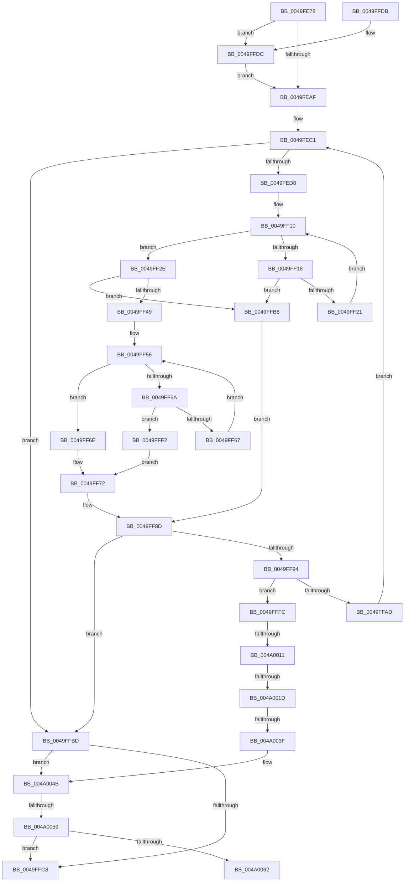

# ST_STORE&lt;SM_TRAITS&gt;::StDmLazyRegionsWorker

- RVA: `0x0049FE78`–`0x004A0067` (길이 `495` bytes)
- VA: `0x000000014049FE78`
- 실행 섹션: `.text`
- PDB 이름 있음: `예`; PDB Function 태그: `예`
- unwind 정보 RVA: `0x000B56F8`
- 디코드: `141`개 명령, `495/495` bytes 표시
- 미해석 바이트: `0` (있으면 어셈블리에 `.byte`로 보존)

> 이 문서는 커널 이미지의 기계어와 PDB 기호를 분석해 생성했습니다. 4번과 5번은 함수 원형과 자료형을 바이너리 사용 방식에서 추정한 C 해석이며 원본 소스 복구 결과는 아닙니다.

## 1. Dependencies

- 직접 호출 지점: **1**; 고유 호출 대상: **1**
- 직접 호출자로 확인된 함수: **3**
- RIP 상대 이미지 참조: **0**

### Outgoing calls
- `0x004A0032` → [SmWorkQueueGetDepth](../44/SmWorkQueueGetDepth_function_0044F42C.md) (function, `0x0044F42C`)

### Direct callers
- [sub_0020634E](../20/Unknown_function_0020634E.md) at `0x002064F6`
- [ST_STORE&lt;SM_TRAITS&gt;::StDmCleanup](../3A/ST_STORE_SM_TRAITS_StDmCleanup_function_003AF8D4.md) at `0x003AFB37`
- [ST_STORE&lt;SM_TRAITS&gt;::StCompactionPerformEmergency](../4E/ST_STORE_SM_TRAITS_StCompactionPerformEmergency_function_004EB170.md) at `0x004EB1A0`

### Static image references
- 디코드된 RIP-relative 메모리 참조가 없습니다.

## 2. Other-region calls and transfers

- 다른 실행 섹션으로 향하는 call: **0**
- call이 아닌 외부 분기/꼬리 이동: **5**
  - `0x004A000B` → [sub_006F84D2](../6F/Unknown_function_006F84D2.md) (`tail-transfer`)
  - `0x004A0017` → [sub_006F84D2](../6F/Unknown_function_006F84D2.md) (`tail-transfer`)
  - `0x004A0039` → [sub_006F84D2](../6F/Unknown_function_006F84D2.md) (`tail-transfer`)
  - `0x004A0053` → [sub_006F84D2 + 0xF8](../6F/Unknown_function_006F84D2.md) (`tail-transfer`)
  - `0x004A0062` → [sub_006F84D2 + 0xF8](../6F/Unknown_function_006F84D2.md) (`tail-transfer`)

## 3. Assembly (complete function range)

```asm
0049FE78  40 53                           push rbx
0049FE7A  55                              push rbp
0049FE7B  56                              push rsi
0049FE7C  57                              push rdi
0049FE7D  41 54                           push r12
0049FE7F  41 55                           push r13
0049FE81  41 56                           push r14
0049FE83  41 57                           push r15
0049FE85  48 83 EC 38                     sub rsp, 0x38
0049FE89  8B 81 10 03 00 00               mov eax, dword ptr [rcx + 0x310]
0049FE8F  33 DB                           xor ebx, ebx
0049FE91  89 84 24 90 00 00 00            mov dword ptr [rsp + 0x90], eax
0049FE98  49 8B E8                        mov rbp, r8
0049FE9B  8B FA                           mov edi, edx
0049FE9D  4C 8B F9                        mov r15, rcx
0049FEA0  44 8B EB                        mov r13d, ebx
0049FEA3  44 8B E3                        mov r12d, ebx
0049FEA6  4D 85 C0                        test r8, r8
0049FEA9  0F 85 2D 01 00 00               jne 0x14049ffdc
0049FEAF  41 BE 01 00 00 00               mov r14d, 1
0049FEB5  8B F3                           mov esi, ebx
0049FEB7  41 23 FE                        and edi, r14d
0049FEBA  89 BC 24 88 00 00 00            mov dword ptr [rsp + 0x88], edi
0049FEC1  45 8B 97 48 03 00 00            mov r10d, dword ptr [r15 + 0x348]
0049FEC8  89 9C 24 80 00 00 00            mov dword ptr [rsp + 0x80], ebx
0049FECF  44 3B D6                        cmp r10d, esi
0049FED2  0F 86 E5 00 00 00               jbe 0x14049ffbd
0049FED8  8B C6                           mov eax, esi
0049FEDA  41 8D 52 FF                     lea edx, [r10 - 1]
0049FEDE  48 C1 E8 05                     shr rax, 5
0049FEE2  83 E6 1F                        and esi, 0x1f
0049FEE5  48 C1 EA 05                     shr rdx, 5
0049FEE9  44 8B C3                        mov r8d, ebx
0049FEEC  49 8B 9F 50 03 00 00            mov rbx, qword ptr [r15 + 0x350]
0049FEF3  40 8A CE                        mov cl, sil
0049FEF6  4C 8D 1C 93                     lea r11, [rbx + rdx*4]
0049FEFA  48 8D 14 83                     lea rdx, [rbx + rax*4]
0049FEFE  41 8B C6                        mov eax, r14d
0049FF01  44 8B 0A                        mov r9d, dword ptr [rdx]
0049FF04  D3 E0                           shl eax, cl
0049FF06  41 2B C6                        sub eax, r14d
0049FF09  44 0B C8                        or r9d, eax
0049FF0C  48 8D 42 04                     lea rax, [rdx + 4]
0049FF10  41 F7 D1                        not r9d
0049FF13  45 85 C9                        test r9d, r9d
0049FF16  75 16                           jne 0x14049ff2e
0049FF18  49 3B C3                        cmp rax, r11
0049FF1B  0F 87 97 00 00 00               ja 0x14049ffb8
0049FF21  48 83 C2 04                     add rdx, 4
0049FF25  48 83 C0 04                     add rax, 4
0049FF29  44 8B 0A                        mov r9d, dword ptr [rdx]
0049FF2C  EB E2                           jmp 0x14049ff10
0049FF2E  41 8B C1                        mov eax, r9d
0049FF31  48 8B F2                        mov rsi, rdx
0049FF34  48 2B F3                        sub rsi, rbx
0049FF37  48 C1 FE 02                     sar rsi, 2
0049FF3B  48 0F BC C8                     bsf rcx, rax
0049FF3F  C1 E6 05                        shl esi, 5
0049FF42  03 F1                           add esi, ecx
0049FF44  41 3B F2                        cmp esi, r10d
0049FF47  77 6F                           ja 0x14049ffb8
0049FF49  41 8B C6                        mov eax, r14d
0049FF4C  D3 E0                           shl eax, cl
0049FF4E  41 2B C6                        sub eax, r14d
0049FF51  41 0B C1                        or eax, r9d
0049FF54  F7 D0                           not eax
0049FF56  85 C0                           test eax, eax
0049FF58  75 14                           jne 0x14049ff6e
0049FF5A  48 8D 42 04                     lea rax, [rdx + 4]
0049FF5E  49 3B C3                        cmp rax, r11
0049FF61  0F 87 8B 00 00 00               ja 0x14049fff2
0049FF67  48 8B D0                        mov rdx, rax
0049FF6A  8B 00                           mov eax, dword ptr [rax]
0049FF6C  EB E8                           jmp 0x14049ff56
0049FF6E  48 0F BC C0                     bsf rax, rax
0049FF72  48 2B D3                        sub rdx, rbx
0049FF75  4C 8B C2                        mov r8, rdx
0049FF78  49 C1 F8 02                     sar r8, 2
0049FF7C  41 C1 E0 05                     shl r8d, 5
0049FF80  44 03 C0                        add r8d, eax
0049FF83  45 3B C2                        cmp r8d, r10d
0049FF86  45 0F 47 C2                     cmova r8d, r10d
0049FF8A  44 2B C6                        sub r8d, esi
0049FF8D  33 DB                           xor ebx, ebx
0049FF8F  45 85 C0                        test r8d, r8d
0049FF92  74 29                           je 0x14049ffbd
0049FF94  42 8D 0C 06                     lea ecx, [rsi + r8]
0049FF98  49 8D 87 20 03 00 00            lea rax, [r15 + 0x320]
0049FF9F  89 8C 24 98 00 00 00            mov dword ptr [rsp + 0x98], ecx
0049FFA6  4C 8B F0                        mov r14, rax
0049FFA9  3B F1                           cmp esi, ecx
0049FFAB  72 4F                           jb 0x14049fffc
0049FFAD  41 BE 01 00 00 00               mov r14d, 1
0049FFB3  E9 09 FF FF FF                  jmp 0x14049fec1
0049FFB8  41 8B F2                        mov esi, r10d
0049FFBB  EB D0                           jmp 0x14049ff8d
0049FFBD  8B CB                           mov ecx, ebx
0049FFBF  48 85 ED                        test rbp, rbp
0049FFC2  0F 85 83 00 00 00               jne 0x1404a004b
0049FFC8  33 C0                           xor eax, eax
0049FFCA  48 83 C4 38                     add rsp, 0x38
0049FFCE  41 5F                           pop r15
0049FFD0  41 5E                           pop r14
0049FFD2  41 5D                           pop r13
0049FFD4  41 5C                           pop r12
0049FFD6  5F                              pop rdi
0049FFD7  5E                              pop rsi
0049FFD8  5D                              pop rbp
0049FFD9  5B                              pop rbx
0049FFDA  C3                              ret
0049FFDB  CC                              int3
0049FFDC  66 F0 41 83 60 0C FE            lock and word ptr [r8 + 0xc], 0xfffe
0049FFE3  B8 FE FF 00 00                  mov eax, 0xfffe
0049FFE8  66 41 21 40 0E                  and word ptr [r8 + 0xe], ax
0049FFED  E9 BD FE FF FF                  jmp 0x14049feaf
0049FFF2  B8 20 00 00 00                  mov eax, 0x20
0049FFF7  E9 76 FF FF FF                  jmp 0x14049ff72
0049FFFC  41 FF C4                        inc r12d
0049FFFF  44 89 A4 24 80 00 00 00         mov dword ptr [rsp + 0x80], r12d
004A0007  41 F6 C4 0F                     test r12b, 0xf
004A000B  0F 85 C1 84 25 00               jne 0x1406f84d2
004A0011  4C 8B F0                        mov r14, rax
004A0014  48 85 ED                        test rbp, rbp
004A0017  0F 84 B5 84 25 00               je 0x1406f84d2
004A001D  8B D3                           mov edx, ebx
004A001F  4D 8D B7 20 03 00 00            lea r14, [r15 + 0x320]
004A0026  49 8B 0E                        mov rcx, qword ptr [r14]
004A0029  38 99 96 1A 00 00               cmp byte ptr [rcx + 0x1a96], bl
004A002F  0F 96 C2                        setbe dl
004A0032  E8 F5 F3 FA FF                  call 0x14044f42c
004A0037  85 C0                           test eax, eax
004A0039  0F 84 93 84 25 00               je 0x1406f84d2
004A003F  41 BE 01 00 00 00               mov r14d, 1
004A0045  41 8B CE                        mov ecx, r14d
004A0048  45 8B EE                        mov r13d, r14d
004A004B  0F B7 45 0C                     movzx eax, word ptr [rbp + 0xc]
004A004F  66 41 23 C6                     and ax, r14w
004A0053  0F 85 71 85 25 00               jne 0x1406f85ca
004A0059  45 85 ED                        test r13d, r13d
004A005C  0F 84 66 FF FF FF               je 0x14049ffc8
004A0062  E9 63 85 25 00                  jmp 0x1406f85ca
```

## 4. C-style interpretation (structured pseudocode)

```c
__int64 __fastcall ST_STORE_SM_TRAITS___StDmLazyRegionsWorker(__int64 a1, int a2, __int64 a3)
{
    __int64 result;
    __int64 v_r12;
    __int64 v_rbx;
    __int64 v_rdi;
    __int64 v_rsi;
    __int64 v_rsp;
    unsigned int v_stack_p10;
    unsigned int v_stack_p18;
    unsigned int v_stack_p20;
    unsigned int v_stack_p8;
    unsigned int v_stack_p80;

    v_rsp = (v_rsp) - (56);
    v_rbx = 0;
    v_stack_p18 = (unsigned int)((unsigned int)(*(unsigned int *)(a1 + 784)));
    if (a3 != 0) goto loc_0049FFDC;
loc_0049FEAF:
    v_rdi = (unsigned int)(((unsigned int)(a2)) & (1));
    v_stack_p10 = (unsigned int)(v_rdi);
loc_0049FEC1:
    v_stack_p8 = 0;
    if (((unsigned int)((unsigned int)(*(unsigned int *)(a1 + 840)))) <= 0) goto loc_0049FFBD;
    result = (0) >> (5);
    v_rsi = (unsigned int)((0) & (31));
    a2 = ((unsigned int)(*(unsigned int *)(a1 + 840)) - 1) >> (5);
    result = (unsigned int)((1) << ((unsigned __int8)((unsigned __int8)(v_rsi))));
    result = (unsigned int)((result) - (1));
    a4 = (unsigned int)(((unsigned int)(*(unsigned int *)(*(unsigned __int64 *)(a1 + 848) + result * 4))) | ((unsigned int)(result)));
loc_0049FF10:
    a4 = (unsigned int)(~(a4));
    if ((unsigned int)(a4) != 0) goto loc_0049FF2E;
    if ((*(unsigned __int64 *)(a1 + 848) + result * 4 + 4) > (*(unsigned __int64 *)(a1 + 848) + a2 * 4)) goto loc_0049FFB8;
    a2 = (*(unsigned __int64 *)(a1 + 848) + result * 4) + (4);
    result = (*(unsigned __int64 *)(a1 + 848) + result * 4 + 4) + (4);
    goto loc_0049FF10;
loc_0049FF2E:
    v_rsi = (a2) - (*(unsigned __int64 *)(a1 + 848));
    v_rsi = (v_rsi) >> (2);
    v_rsi = (unsigned int)((v_rsi) << (5));
    v_rsi = (unsigned int)((v_rsi) + ((unsigned int)((unsigned __int8)(v_rsi))));
    if (((unsigned int)(v_rsi)) > ((unsigned int)((unsigned int)(*(unsigned int *)(a1 + 840))))) goto loc_0049FFB8;
    result = (unsigned int)((1) << ((unsigned __int8)((unsigned __int8)(v_rsi))));
    result = (unsigned int)((result) - (1));
    result = (unsigned int)((result) | ((unsigned int)((unsigned int)(*(unsigned int *)(a2)))));
    result = (unsigned int)(~(result));
loc_0049FF56:
    if ((unsigned int)(result) != 0) goto loc_0049FF6E;
    if ((a2 + 4) > (*(unsigned __int64 *)(a1 + 848) + a2 * 4)) goto loc_0049FFF2;
    goto loc_0049FF56;
loc_0049FF6E:
loc_0049FF72:
    a2 = (a2 + 4) - (*(unsigned __int64 *)(a1 + 848));
    a3 = (a2) >> (2);
    a3 = (unsigned int)((a3) << (5));
    a3 = (unsigned int)((a3) + ((unsigned int)((unsigned int)(*(unsigned int *)(a2 + 4)))));
    if (((unsigned int)(a3)) > ((unsigned int)((unsigned int)(*(unsigned int *)(a1 + 840))))) { a3 = (unsigned int)((unsigned int)(*(unsigned int *)(a1 + 840))); }
    a3 = (unsigned int)((a3) - ((unsigned int)(v_rsi)));
loc_0049FF8D:
    v_rbx = 0;
    if ((unsigned int)(a3) == 0) goto loc_0049FFBD;
    v_stack_p20 = (unsigned int)(v_rsi + a3 * 1);
    if (((unsigned int)(v_rsi)) < ((unsigned int)(v_rsi + a3 * 1))) goto loc_0049FFFC;
    goto loc_0049FEC1;
loc_0049FFB8:
    goto loc_0049FF8D;
loc_0049FFBD:
    if (a3 != 0) goto loc_004A004B;
loc_0049FFC8:
    result = 0;
    v_rsp = (v_rsp) + (56);
    return result;
loc_0049FFDC:
    goto loc_0049FEAF;
loc_0049FFF2:
    goto loc_0049FF72;
loc_0049FFFC:
    v_r12 = (unsigned int)((0) + 1);
    v_stack_p80 = (unsigned int)(v_r12);
    a2 = ((*(unsigned __int8 *)(*(unsigned __int64 *)(a1 + 800) + 6806)) <= 0) ? 1 : 0;
    result = SmWorkQueueGetDepth(*(unsigned __int64 *)(a1 + 800), a2, a3, (unsigned int)(*(unsigned int *)(a2)));
loc_004A004B:
    result = (unsigned __int16)((*(unsigned __int16 *)(a3 + 12)) & (1));
    if (1 == 0) goto loc_0049FFC8;
}
```

## 5. (Beta) C Style

```c
int64_t ST_STORE_SM_TRAITS___StDmLazyRegionsWorker(void *Arg1, int32_t Arg2, int64_t Arg3)
{
    uint8_t *arg1 = (uint8_t *)Arg1;

    int64_t result;
    int64_t local_r12;
    int64_t local_rbx;
    int64_t local_rdi;
    int64_t local_rsi;
    int64_t local_rsp;
    uint32_t v_stack_p10;
    uint32_t v_stack_p18;
    uint32_t v_stack_p20;
    uint32_t v_stack_p8;
    uint32_t v_stack_p80;

    local_rsp = (local_rsp) - (56);
    local_rbx = 0;
    v_stack_p18 = (uint32_t)((uint32_t)(*(uint32_t *)(arg1 + 0x310)));
    if (Arg3 != 0) goto loc_0049FFDC;
loc_0049FEAF:
    local_rdi = (uint32_t)(((uint32_t)(Arg2)) & (1));
    v_stack_p10 = (uint32_t)(local_rdi);
loc_0049FEC1:
    v_stack_p8 = 0;
    if (((uint32_t)((uint32_t)(*(uint32_t *)(arg1 + 0x348)))) <= 0) goto loc_0049FFBD;
    result = (0) >> (5);
    local_rsi = (uint32_t)((0) & (31));
    Arg2 = ((uint32_t)(*(uint32_t *)(arg1 + 0x348)) - 1) >> (5);
    result = (uint32_t)((1) << ((uint8_t)((uint8_t)(local_rsi))));
    result = (uint32_t)((result) - (1));
    a4 = (uint32_t)(((uint32_t)(*(uint32_t *)(*(uint64_t *)(arg1 + 0x350) + result * 4))) | ((uint32_t)(result)));
loc_0049FF10:
    a4 = (uint32_t)(~(a4));
    if ((uint32_t)(a4) != 0) goto loc_0049FF2E;
    if ((*(uint64_t *)(arg1 + 0x350) + result * 4 + 4) > (*(uint64_t *)(arg1 + 0x350) + Arg2 * 4)) goto loc_0049FFB8;
    Arg2 = (*(uint64_t *)(arg1 + 0x350) + result * 4) + (4);
    result = (*(uint64_t *)(arg1 + 0x350) + result * 4 + 4) + (4);
    goto loc_0049FF10;
loc_0049FF2E:
    local_rsi = (Arg2) - (*(uint64_t *)(arg1 + 0x350));
    local_rsi = (local_rsi) >> (2);
    local_rsi = (uint32_t)((local_rsi) << (5));
    local_rsi = (uint32_t)((local_rsi) + ((uint32_t)((uint8_t)(local_rsi))));
    if (((uint32_t)(local_rsi)) > ((uint32_t)((uint32_t)(*(uint32_t *)(arg1 + 0x348))))) goto loc_0049FFB8;
    result = (uint32_t)((1) << ((uint8_t)((uint8_t)(local_rsi))));
    result = (uint32_t)((result) - (1));
    result = (uint32_t)((result) | ((uint32_t)((uint32_t)(*(uint32_t *)(Arg2)))));
    result = (uint32_t)(~(result));
loc_0049FF56:
    if ((uint32_t)(result) != 0) goto loc_0049FF6E;
    if ((Arg2 + 4) > (*(uint64_t *)(arg1 + 0x350) + Arg2 * 4)) goto loc_0049FFF2;
    goto loc_0049FF56;
loc_0049FF6E:
loc_0049FF72:
    Arg2 = (Arg2 + 4) - (*(uint64_t *)(arg1 + 0x350));
    Arg3 = (Arg2) >> (2);
    Arg3 = (uint32_t)((Arg3) << (5));
    Arg3 = (uint32_t)((Arg3) + ((uint32_t)((uint32_t)(*(uint32_t *)(Arg2 + 0x4)))));
    if (((uint32_t)(Arg3)) > ((uint32_t)((uint32_t)(*(uint32_t *)(arg1 + 0x348))))) { Arg3 = (uint32_t)((uint32_t)(*(uint32_t *)(arg1 + 0x348))); }
    Arg3 = (uint32_t)((Arg3) - ((uint32_t)(local_rsi)));
loc_0049FF8D:
    local_rbx = 0;
    if ((uint32_t)(Arg3) == 0) goto loc_0049FFBD;
    v_stack_p20 = (uint32_t)(local_rsi + Arg3 * 1);
    if (((uint32_t)(local_rsi)) < ((uint32_t)(local_rsi + Arg3 * 1))) goto loc_0049FFFC;
    goto loc_0049FEC1;
loc_0049FFB8:
    goto loc_0049FF8D;
loc_0049FFBD:
    if (Arg3 != 0) goto loc_004A004B;
loc_0049FFC8:
    result = 0;
    local_rsp = (local_rsp) + (56);
    return result;
loc_0049FFDC:
    goto loc_0049FEAF;
loc_0049FFF2:
    goto loc_0049FF72;
loc_0049FFFC:
    local_r12 = (uint32_t)((0) + 1);
    v_stack_p80 = (uint32_t)(local_r12);
    Arg2 = ((*(uint8_t *)(*(uint64_t *)(arg1 + 0x320) + 0x1A96)) <= 0) ? 1 : 0;
    result = SmWorkQueueGetDepth(*(uint64_t *)(arg1 + 0x320), Arg2, Arg3, (uint32_t)(*(uint32_t *)(Arg2)));
loc_004A004B:
    result = (uint16_t)((*(uint16_t *)(Arg3 + 0xC)) & (1));
    if (1 == 0) goto loc_0049FFC8;
}
```

### 관측된 메모리 오프셋

구조체 형식이 확인되지 않은 접근은 인자 기준의 오프셋으로만 기록했습니다.

| 기준 인자 | 오프셋 표현 | 폭 (bit) | 접근 |
|---|---:|---:|---|
| `Arg1` | `+ 0x0` | `64` | `R` |
| `Arg1` | `+ 0x310` | `32` | `R` |
| `Arg1` | `+ 0x320` | `64` | `R` |
| `Arg1` | `+ 0x348` | `32` | `R` |
| `Arg1` | `+ 0x350` | `64` | `R` |

## 6. Execution-region graph

[열기: 2D/3D 그래프와 함수 탐색 컨트롤 패널](../../../control-panel.html?section=text&rva=0x0049FE78&view=graph)

- 2D 그래프는 위에서 아래로 흐르고, 3D 그래프는 빈 공간을 드래그해 회전합니다. Shift+드래그는 이동, 휠은 확대·축소, 함수 노드 선택은 대상 보고서 이동입니다.

### Static fallback


