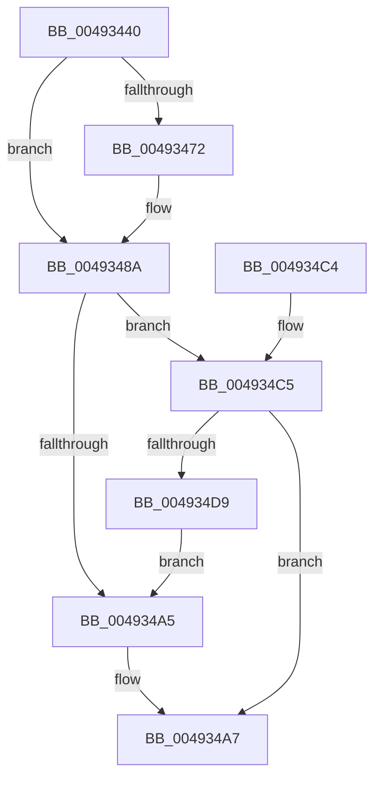

# SeAuditingFileEventsWithContextEx

- RVA: `0x00493440`–`0x004934DB` (길이 `155` bytes)
- VA: `0x0000000140493440`
- 실행 섹션: `.text`
- PDB 이름 있음: `예`; PDB Function 태그: `아니요`
- unwind 정보 RVA: `0x00083650`
- 디코드: `49`개 명령, `155/155` bytes 표시
- 미해석 바이트: `0` (있으면 어셈블리에 `.byte`로 보존)

> 이 문서는 커널 이미지의 기계어와 PDB 기호를 분석해 생성했습니다. 4번과 5번은 함수 원형과 자료형을 바이너리 사용 방식에서 추정한 C 해석이며 원본 소스 복구 결과는 아닙니다.

## 1. Dependencies

- 직접 호출 지점: **3**; 고유 호출 대상: **2**
- 직접 호출자로 확인된 함수: **1**
- RIP 상대 이미지 참조: **0**

### Outgoing calls
- `0x00493482` → [SepAdtAuditThisEventWithContext](../../page/87/SepAdtAuditThisEventWithContext_function_00870AC0.md) (function, `0x00870AC0`)
- `0x0049349C` → [SepAdtAuditThisEventWithContext](../../page/87/SepAdtAuditThisEventWithContext_function_00870AC0.md) (function, `0x00870AC0`)
- `0x004934D0` → [SepAdtAuditThisEventByCategoryWithContext](../../page/9A/SepAdtAuditThisEventByCategoryWithContext_function_009A2910.md) (function, `0x009A2910`)

### Direct callers
- [SeAuditingFileEventsWithContext](../../page/79/SeAuditingFileEventsWithContext_function_0079FAB0.md) at `0x0079FAB7`

### Static image references
- 디코드된 RIP-relative 메모리 참조가 없습니다.

## 2. Other-region calls and transfers

- 다른 실행 섹션으로 향하는 call: **3**
  - `0x00493482` → [SepAdtAuditThisEventWithContext](../../page/87/SepAdtAuditThisEventWithContext_function_00870AC0.md) (`.text` → `PAGE`)
  - `0x0049349C` → [SepAdtAuditThisEventWithContext](../../page/87/SepAdtAuditThisEventWithContext_function_00870AC0.md) (`.text` → `PAGE`)
  - `0x004934D0` → [SepAdtAuditThisEventByCategoryWithContext](../../page/9A/SepAdtAuditThisEventByCategoryWithContext_function_009A2910.md) (`.text` → `PAGE`)
- 별도 외부 분기/꼬리 이동을 확인하지 못했습니다.

## 3. Assembly (complete function range)

```asm
00493440  48 8B C4                        mov rax, rsp
00493443  48 89 58 08                     mov qword ptr [rax + 8], rbx
00493447  48 89 68 10                     mov qword ptr [rax + 0x10], rbp
0049344B  48 89 70 18                     mov qword ptr [rax + 0x18], rsi
0049344F  48 89 78 20                     mov qword ptr [rax + 0x20], rdi
00493453  41 56                           push r14
00493455  48 83 EC 20                     sub rsp, 0x20
00493459  8A C1                           mov al, cl
0049345B  4D 8B F1                        mov r14, r9
0049345E  F6 D8                           neg al
00493460  49 8B E8                        mov rbp, r8
00493463  40 8A F1                        mov sil, cl
00493466  1B FF                           sbb edi, edi
00493468  33 DB                           xor ebx, ebx
0049346A  83 E7 D3                        and edi, 0xffffffd3
0049346D  4D 85 C9                        test r9, r9
00493470  74 18                           je 0x14049348a
00493472  84 C9                           test cl, cl
00493474  8A D1                           mov dl, cl
00493476  4C 8B CD                        mov r9, rbp
00493479  B9 82 00 00 00                  mov ecx, 0x82
0049347E  41 0F 94 C0                     sete r8b
00493482  E8 39 D6 3D 00                  call 0x140870ac0
00493487  41 88 06                        mov byte ptr [r14], al
0049348A  40 84 F6                        test sil, sil
0049348D  4C 8B CD                        mov r9, rbp
00493490  40 8A D6                        mov dl, sil
00493493  B9 75 00 00 00                  mov ecx, 0x75
00493498  41 0F 94 C0                     sete r8b
0049349C  E8 1F D6 3D 00                  call 0x140870ac0
004934A1  84 C0                           test al, al
004934A3  74 20                           je 0x1404934c5
004934A5  B3 01                           mov bl, 1
004934A7  48 8B 6C 24 38                  mov rbp, qword ptr [rsp + 0x38]
004934AC  8A C3                           mov al, bl
004934AE  48 8B 5C 24 30                  mov rbx, qword ptr [rsp + 0x30]
004934B3  48 8B 74 24 40                  mov rsi, qword ptr [rsp + 0x40]
004934B8  48 8B 7C 24 48                  mov rdi, qword ptr [rsp + 0x48]
004934BD  48 83 C4 20                     add rsp, 0x20
004934C1  41 5E                           pop r14
004934C3  C3                              ret
004934C4  CC                              int3
004934C5  4C 8B C5                        mov r8, rbp
004934C8  8D 57 30                        lea edx, [rdi + 0x30]
004934CB  B9 03 00 00 00                  mov ecx, 3
004934D0  E8 3B F4 50 00                  call 0x1409a2910
004934D5  84 C0                           test al, al
004934D7  74 CE                           je 0x1404934a7
004934D9  EB CA                           jmp 0x1404934a5
```

## 4. C-style interpretation (structured pseudocode)

```c
__int64 __fastcall SeAuditingFileEventsWithContextEx(unsigned __int8 a1, __int64 a2, __int64 a3, __int64 a4)
{
    __int64 result;
    __int64 v_rbx;
    __int64 v_rdi;
    __int64 v_rsp;
    unsigned __int64 v_stack_p10;
    unsigned __int64 v_stack_p18;
    unsigned __int64 v_stack_p20;
    unsigned __int64 v_stack_p8;

    *(unsigned __int64 *)(v_rsp + 8) = v_rbx;
    *(unsigned __int64 *)(v_rsp + 16) = v_rbp;
    *(unsigned __int64 *)(v_rsp + 24) = v_rsi;
    *(unsigned __int64 *)(v_rsp + 32) = v_rdi;
    v_rsp = (v_rsp) - (32);
    result = (unsigned __int8)(-(a1));
    v_rbx = 0;
    v_rdi = (unsigned int)((v_rdi) & (0xFFFFFFD3ULL));
    if (a4 != 0) {
        a2 = a1;
        a4 = a3;
        a1 = 130;
        a3 = (a1 == 0) ? 1 : 0;
        result = SepAdtAuditThisEventWithContext(a1, a2, a3, a4);
        *(unsigned __int8 *)(a4) = (unsigned __int8)(result);
    }
    a3 = (a1 == 0) ? 1 : 0;
    result = SepAdtAuditThisEventWithContext(117, a1, a3, a3);
    if ((unsigned __int8)(result) == 0) goto loc_004934C5;
loc_004934A5:
loc_004934A7:
    v_rsp = (v_rsp) + (32);
    return 1;
loc_004934C5:
    result = SepAdtAuditThisEventByCategoryWithContext(3, v_stack_p20 + 48, v_stack_p10, a3);
    if ((unsigned __int8)(result) == 0) goto loc_004934A7;
    goto loc_004934A5;
}
```

## 5. (Beta) C Style

```c
int64_t SeAuditingFileEventsWithContextEx(uint8_t Arg1, int64_t Arg2, int64_t Arg3, void *Arg4)
{
    uint8_t *arg4 = (uint8_t *)Arg4;

    int64_t result;
    int64_t local_rbx;
    int64_t local_rdi;
    int64_t local_rsp;
    uint64_t v_stack_p10;
    uint64_t v_stack_p18;
    uint64_t v_stack_p20;
    uint64_t v_stack_p8;

    *(uint64_t *)(local_rsp + 0x8) = local_rbx;
    *(uint64_t *)(local_rsp + 0x10) = local_rbp;
    *(uint64_t *)(local_rsp + 0x18) = local_rsi;
    *(uint64_t *)(local_rsp + 0x20) = local_rdi;
    local_rsp = (local_rsp) - (32);
    result = (uint8_t)(-(Arg1));
    local_rbx = 0;
    local_rdi = (uint32_t)((local_rdi) & (0xFFFFFFD3ULL));
    if (Arg4 != NULL) {
        Arg2 = Arg1;
        Arg4 = Arg3;
        Arg1 = 130;
        Arg3 = (Arg1 == 0) ? 1 : 0;
        result = SepAdtAuditThisEventWithContext(Arg1, Arg2, Arg3, Arg4);
        *(uint8_t *)(arg4) = (uint8_t)(result);
    }
    Arg3 = (Arg1 == 0) ? 1 : 0;
    result = SepAdtAuditThisEventWithContext(117, Arg1, Arg3, Arg3);
    if ((uint8_t)(result) == 0) goto loc_004934C5;
loc_004934A5:
loc_004934A7:
    local_rsp = (local_rsp) + (32);
    return 1;
loc_004934C5:
    result = SepAdtAuditThisEventByCategoryWithContext(3, v_stack_p20 + 48, v_stack_p10, Arg3);
    if ((uint8_t)(result) == 0) goto loc_004934A7;
    goto loc_004934A5;
}
```

### 관측된 메모리 오프셋

구조체 형식이 확인되지 않은 접근은 인자 기준의 오프셋으로만 기록했습니다.

| 기준 인자 | 오프셋 표현 | 폭 (bit) | 접근 |
|---|---:|---:|---|
| `Arg4` | `+ 0x0` | `8` | `W` |

## 6. Execution-region graph

[열기: 2D/3D 그래프와 함수 탐색 컨트롤 패널](../../../control-panel.html?section=text&rva=0x00493440&view=graph)

- 2D 그래프는 위에서 아래로 흐르고, 3D 그래프는 빈 공간을 드래그해 회전합니다. Shift+드래그는 이동, 휠은 확대·축소, 함수 노드 선택은 대상 보고서 이동입니다.

### Static fallback


