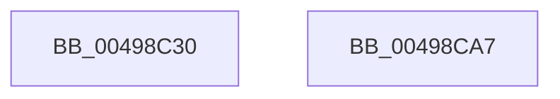

# SeTokenGetRedirectionTrustPolicy

- RVA: `0x00498C30`–`0x00498CA8` (길이 `120` bytes)
- VA: `0x0000000140498C30`
- 실행 섹션: `.text`
- PDB 이름 있음: `예`; PDB Function 태그: `아니요`
- unwind 정보 RVA: `0x0006F978`
- 디코드: `32`개 명령, `120/120` bytes 표시
- 미해석 바이트: `0` (있으면 어셈블리에 `.byte`로 보존)

> 이 문서는 커널 이미지의 기계어와 PDB 기호를 분석해 생성했습니다. 4번과 5번은 함수 원형과 자료형을 바이너리 사용 방식에서 추정한 C 해석이며 원본 소스 복구 결과는 아닙니다.

## 1. Dependencies

- 직접 호출 지점: **3**; 고유 호출 대상: **3**
- 직접 호출자로 확인된 함수: **2**
- RIP 상대 이미지 참조: **0**

### Outgoing calls
- `0x00498C65` → [ExAcquireResourceSharedLite](../21/ExAcquireResourceSharedLite_function_00211BC0.md) (function, `0x00211BC0`)
- `0x00498C74` → [ExReleaseResourceLite](../25/ExReleaseResourceLite_function_0025FA10.md) (function, `0x0025FA10`)
- `0x00498C79` → [KeLeaveCriticalRegion](../25/KeLeaveCriticalRegion_function_0025D8B0.md) (function, `0x0025D8B0`)

### Direct callers
- [IoCheckRedirectionTrustLevel](../48/IoCheckRedirectionTrustLevel_function_00485BB0.md) at `0x00485D00`
- [PspGetRedirectionTrustPolicy](../../page/A7/PspGetRedirectionTrustPolicy_function_00A769A8.md) at `0x00A769D9`

### Static image references
- 디코드된 RIP-relative 메모리 참조가 없습니다.

## 2. Other-region calls and transfers

- 다른 실행 섹션으로 향하는 call: **0**
- 별도 외부 분기/꼬리 이동을 확인하지 못했습니다.

## 3. Assembly (complete function range)

```asm
00498C30  48 89 5C 24 08                  mov qword ptr [rsp + 8], rbx
00498C35  48 89 74 24 10                  mov qword ptr [rsp + 0x10], rsi
00498C3A  48 89 7C 24 18                  mov qword ptr [rsp + 0x18], rdi
00498C3F  41 56                           push r14
00498C41  48 83 EC 20                     sub rsp, 0x20
00498C45  65 48 8B 04 25 88 01 00 00      mov rax, qword ptr gs:[0x188]
00498C4E  48 8B F2                        mov rsi, rdx
00498C51  48 8B D9                        mov rbx, rcx
00498C54  B2 01                           mov dl, 1
00498C56  4D 8B F0                        mov r14, r8
00498C59  66 FF 88 E4 01 00 00            dec word ptr [rax + 0x1e4]
00498C60  90                              nop
00498C61  48 8B 49 30                     mov rcx, qword ptr [rcx + 0x30]
00498C65  E8 56 8F D7 FF                  call 0x140211bc0
00498C6A  48 8B 4B 30                     mov rcx, qword ptr [rbx + 0x30]
00498C6E  8B BB C8 00 00 00               mov edi, dword ptr [rbx + 0xc8]
00498C74  E8 97 6D DC FF                  call 0x14025fa10
00498C79  E8 32 4C DC FF                  call 0x14025d8b0
00498C7E  48 8B 5C 24 30                  mov rbx, qword ptr [rsp + 0x30]
00498C83  8B C7                           mov eax, edi
00498C85  C1 E8 16                        shr eax, 0x16
00498C88  24 01                           and al, 1
00498C8A  C1 EF 17                        shr edi, 0x17
00498C8D  40 80 E7 01                     and dil, 1
00498C91  88 06                           mov byte ptr [rsi], al
00498C93  48 8B 74 24 38                  mov rsi, qword ptr [rsp + 0x38]
00498C98  41 88 3E                        mov byte ptr [r14], dil
00498C9B  48 8B 7C 24 40                  mov rdi, qword ptr [rsp + 0x40]
00498CA0  48 83 C4 20                     add rsp, 0x20
00498CA4  41 5E                           pop r14
00498CA6  C3                              ret
00498CA7  CC                              int3
```

## 4. C-style interpretation (structured pseudocode)

```c
__int64 __fastcall SeTokenGetRedirectionTrustPolicy(__int64 a1, __int64 a2, __int64 a3)
{
    __int64 result;
    __int64 v_rdi;
    __int64 v_rsp;
    unsigned __int64 v_stack_p10;
    unsigned __int64 v_stack_p18;
    unsigned __int64 v_stack_p8;

    v_stack_p8 = v_rbx;
    v_stack_p10 = v_rsi;
    v_stack_p18 = v_rdi;
    v_rsp = (v_rsp) - (32);
    result = ExAcquireResourceSharedLite(*(unsigned __int64 *)(a1 + 48), 1, a3, a4);
    result = ExReleaseResourceLite(*(unsigned __int64 *)(a1 + 48), 1, a3, a4);
    result = KeLeaveCriticalRegion(*(unsigned __int64 *)(a1 + 48), 1, a3, a4);
    result = (unsigned int)(((unsigned int)((unsigned int)((unsigned int)(*(unsigned int *)(a1 + 200))))) >> (22));
    result = (unsigned __int8)((result) & (1));
    v_rdi = (unsigned int)(((unsigned int)(*(unsigned int *)(a1 + 200))) >> (23));
    v_rdi = (unsigned __int8)((v_rdi) & (1));
    *(unsigned __int8 *)(a2) = (unsigned __int8)(result);
    *(unsigned __int8 *)(a3) = (unsigned __int8)(v_rdi);
    v_rsp = (v_rsp) + (32);
    return result;
}
```

## 5. (Beta) C Style

```c
int64_t SeTokenGetRedirectionTrustPolicy(void *Arg1, void *Arg2, void *Arg3)
{
    uint8_t *arg1 = (uint8_t *)Arg1;
    uint8_t *arg2 = (uint8_t *)Arg2;
    uint8_t *arg3 = (uint8_t *)Arg3;

    int64_t result;
    int64_t local_rdi;
    int64_t local_rsp;
    uint64_t v_stack_p10;
    uint64_t v_stack_p18;
    uint64_t v_stack_p8;

    v_stack_p8 = local_rbx;
    v_stack_p10 = local_rsi;
    v_stack_p18 = local_rdi;
    local_rsp = (local_rsp) - (32);
    result = ExAcquireResourceSharedLite(*(uint64_t *)(arg1 + 0x30), 1, Arg3, a4);
    result = ExReleaseResourceLite(*(uint64_t *)(arg1 + 0x30), 1, Arg3, a4);
    result = KeLeaveCriticalRegion(*(uint64_t *)(arg1 + 0x30), 1, Arg3, a4);
    result = (uint32_t)(((uint32_t)((uint32_t)((uint32_t)(*(uint32_t *)(arg1 + 0xC8))))) >> (22));
    result = (uint8_t)((result) & (1));
    local_rdi = (uint32_t)(((uint32_t)(*(uint32_t *)(arg1 + 0xC8))) >> (23));
    local_rdi = (uint8_t)((local_rdi) & (1));
    *(uint8_t *)(arg2) = (uint8_t)(result);
    *(uint8_t *)(arg3) = (uint8_t)(local_rdi);
    local_rsp = (local_rsp) + (32);
    return result;
}
```

### 관측된 메모리 오프셋

구조체 형식이 확인되지 않은 접근은 인자 기준의 오프셋으로만 기록했습니다.

| 기준 인자 | 오프셋 표현 | 폭 (bit) | 접근 |
|---|---:|---:|---|
| `Arg1` | `+ 0x30` | `64` | `R` |
| `Arg1` | `+ 0xC8` | `32` | `R` |
| `Arg2` | `+ 0x0` | `8` | `W` |
| `Arg3` | `+ 0x0` | `8` | `W` |

## 6. Execution-region graph

[열기: 2D/3D 그래프와 함수 탐색 컨트롤 패널](../../../control-panel.html?section=text&rva=0x00498C30&view=graph)

- 2D 그래프는 위에서 아래로 흐르고, 3D 그래프는 빈 공간을 드래그해 회전합니다. Shift+드래그는 이동, 휠은 확대·축소, 함수 노드 선택은 대상 보고서 이동입니다.

### Static fallback


