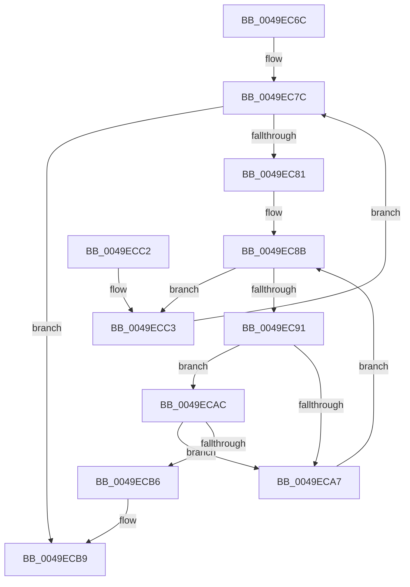

# SepAdtAuditablePrivilege

- RVA: `0x0049EC6C`–`0x0049ECC8` (길이 `92` bytes)
- VA: `0x000000014049EC6C`
- 실행 섹션: `.text`
- PDB 이름 있음: `예`; PDB Function 태그: `아니요`
- unwind 정보 RVA: `0x000AE424`
- 디코드: `30`개 명령, `92/92` bytes 표시
- 미해석 바이트: `0` (있으면 어셈블리에 `.byte`로 보존)

> 이 문서는 커널 이미지의 기계어와 PDB 기호를 분석해 생성했습니다. 4번과 5번은 함수 원형과 자료형을 바이너리 사용 방식에서 추정한 C 해석이며 원본 소스 복구 결과는 아닙니다.

## 1. Dependencies

- 직접 호출 지점: **0**; 고유 호출 대상: **0**
- 직접 호출자로 확인된 함수: **1**
- RIP 상대 이미지 참조: **1**

### Outgoing calls
- 직접 디코드된 call 명령이 없습니다.

### Direct callers
- [SepAdtTokenRightAdjusted](../../page/90/SepAdtTokenRightAdjusted_function_0090445C.md) at `0x0090454C`
- [SepAdtTokenRightAdjusted](../../page/90/SepAdtTokenRightAdjusted_function_0090445C.md) at `0x00904562`

### Static image references
- `0x0049EC94` → RVA `0x000030E0` (`.rdata`; read)

## 2. Other-region calls and transfers

- 다른 실행 섹션으로 향하는 call: **0**
- 별도 외부 분기/꼬리 이동을 확인하지 못했습니다.

## 3. Assembly (complete function range)

```asm
0049EC6C  48 89 5C 24 08                  mov qword ptr [rsp + 8], rbx
0049EC71  45 33 C0                        xor r8d, r8d
0049EC74  8B DA                           mov ebx, edx
0049EC76  45 8B C8                        mov r9d, r8d
0049EC79  4C 8B D9                        mov r11, rcx
0049EC7C  44 3B CB                        cmp r9d, ebx
0049EC7F  73 38                           jae 0x14049ecb9
0049EC81  41 8B C1                        mov eax, r9d
0049EC84  45 8B D0                        mov r10d, r8d
0049EC87  48 8D 14 40                     lea rdx, [rax + rax*2]
0049EC8B  41 83 FA 0E                     cmp r10d, 0xe
0049EC8F  73 32                           jae 0x14049ecc3
0049EC91  41 8B C2                        mov eax, r10d
0049EC94  48 8D 0D 45 44 B6 FF            lea rcx, [rip - 0x49bbbb]
0049EC9B  48 8B 0C C1                     mov rcx, qword ptr [rcx + rax*8]
0049EC9F  8B 01                           mov eax, dword ptr [rcx]
0049ECA1  41 39 04 93                     cmp dword ptr [r11 + rdx*4], eax
0049ECA5  74 05                           je 0x14049ecac
0049ECA7  41 FF C2                        inc r10d
0049ECAA  EB DF                           jmp 0x14049ec8b
0049ECAC  8B 41 04                        mov eax, dword ptr [rcx + 4]
0049ECAF  41 39 44 93 04                  cmp dword ptr [r11 + rdx*4 + 4], eax
0049ECB4  75 F1                           jne 0x14049eca7
0049ECB6  41 B0 01                        mov r8b, 1
0049ECB9  48 8B 5C 24 08                  mov rbx, qword ptr [rsp + 8]
0049ECBE  41 8A C0                        mov al, r8b
0049ECC1  C3                              ret
0049ECC2  CC                              int3
0049ECC3  41 FF C1                        inc r9d
0049ECC6  EB B4                           jmp 0x14049ec7c
```

## 4. C-style interpretation (structured pseudocode)

```c
__int64 __fastcall SepAdtAuditablePrivilege(__int64 a1, int a2, int a3)
{
    __int64 v_r10;
    unsigned __int64 v_stack_p8;

    v_stack_p8 = v_rbx;
    a3 = 0;
loc_0049EC7C:
    if (0 >= ((unsigned int)((unsigned int)(a2)))) goto loc_0049ECB9;
loc_0049EC8B:
    if (0 >= 14) goto loc_0049ECC3;
    if ((*(unsigned int *)(a1 + 0 + 0 * 2 * 4)) == ((unsigned int)((unsigned int)(*(unsigned int *)(*(unsigned __int64 *)(v_rip - 4832187 + 0 * 8)))))) goto loc_0049ECAC;
loc_0049ECA7:
    v_r10 = (unsigned int)((0) + 1);
    goto loc_0049EC8B;
loc_0049ECAC:
    if ((*(unsigned int *)(a1 + 0 + 0 * 2 * 4 + 4)) != ((unsigned int)((unsigned int)(*(unsigned int *)(*(unsigned __int64 *)(v_rip - 4832187 + 0 * 8) + 4))))) goto loc_0049ECA7;
loc_0049ECB9:
    return 1;
loc_0049ECC3:
    a4 = (unsigned int)((0) + 1);
    goto loc_0049EC7C;
}
```

## 5. (Beta) C Style

```c
int64_t SepAdtAuditablePrivilege(void *Arg1, int32_t Arg2, int32_t Arg3)
{
    uint8_t *arg1 = (uint8_t *)Arg1;

    int64_t local_r10;
    uint64_t v_stack_p8;

    v_stack_p8 = local_rbx;
    Arg3 = 0;
loc_0049EC7C:
    if (0 >= ((uint32_t)((uint32_t)(Arg2)))) goto loc_0049ECB9;
loc_0049EC8B:
    if (0 >= 14) goto loc_0049ECC3;
    if ((*(uint32_t *)(arg1 + 0x0 + 0x0 * 2 * 4)) == ((uint32_t)((uint32_t)(*(uint32_t *)(*(uint64_t *)(v_rip - 0x49BBBB + 0x0 * 8)))))) goto loc_0049ECAC;
loc_0049ECA7:
    local_r10 = (uint32_t)((0) + 1);
    goto loc_0049EC8B;
loc_0049ECAC:
    if ((*(uint32_t *)(arg1 + 0x0 + 0x0 * 2 * 4 + 0x4)) != ((uint32_t)((uint32_t)(*(uint32_t *)(*(uint64_t *)(v_rip - 0x49BBBB + 0x0 * 8) + 0x4))))) goto loc_0049ECA7;
loc_0049ECB9:
    return 1;
loc_0049ECC3:
    a4 = (uint32_t)((0) + 1);
    goto loc_0049EC7C;
}
```

### 관측된 메모리 오프셋

구조체 형식이 확인되지 않은 접근은 인자 기준의 오프셋으로만 기록했습니다.

| 기준 인자 | 오프셋 표현 | 폭 (bit) | 접근 |
|---|---:|---:|---|
| `Arg1` | `+ 0x0 + rdx*4` | `32` | `R` |
| `Arg1` | `+ 0x4 + rdx*4` | `32` | `R` |

## 6. Execution-region graph

[열기: 2D/3D 그래프와 함수 탐색 컨트롤 패널](../../../control-panel.html?section=text&rva=0x0049EC6C&view=graph)

- 2D 그래프는 위에서 아래로 흐르고, 3D 그래프는 빈 공간을 드래그해 회전합니다. Shift+드래그는 이동, 휠은 확대·축소, 함수 노드 선택은 대상 보고서 이동입니다.

### Static fallback


