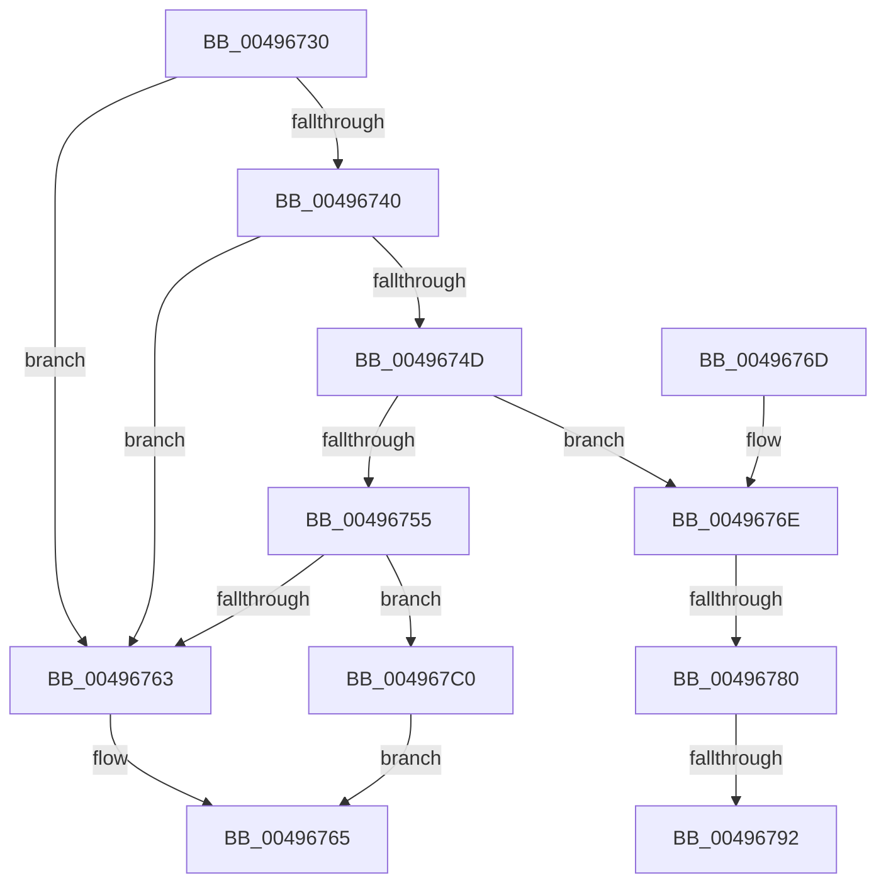

# SepAdtDetermineInsertQueue

- RVA: `0x00496730`–`0x004967D3` (길이 `163` bytes)
- VA: `0x0000000140496730`
- 실행 섹션: `.text`
- PDB 이름 있음: `예`; PDB Function 태그: `예`
- unwind 정보 RVA: `0x000B3B08`
- 디코드: `40`개 명령, `163/163` bytes 표시
- 미해석 바이트: `0` (있으면 어셈블리에 `.byte`로 보존)

> 이 문서는 커널 이미지의 기계어와 PDB 기호를 분석해 생성했습니다. 4번과 5번은 함수 원형과 자료형을 바이너리 사용 방식에서 추정한 C 해석이며 원본 소스 복구 결과는 아닙니다.

## 1. Dependencies

- 직접 호출 지점: **1**; 고유 호출 대상: **1**
- 직접 호출자로 확인된 함수: **0**
- RIP 상대 이미지 참조: **8**

### Outgoing calls
- `0x004967B5` → [SepAdtGenerateDiscardAudit](../../page/79/SepAdtGenerateDiscardAudit_function_0079EF90.md) (function, `0x0079EF90`)

### Direct callers
- 이 함수 시작 RVA로 연결되는 직접 call은 확인되지 않았습니다. 간접 호출은 완전히 역산할 수 없습니다.

### Static image references
- `0x00496738` → RVA `0x00E67F1C` (`.data`; read)
- `0x0049674D` → RVA `0x00E67E28` (`.data`; read)
- `0x00496755` → RVA `0x00E0CDC4` (`.data`; read)
- `0x0049675B` → RVA `0x00E67EE0` (`.data`; read)
- `0x0049676E` → RVA `0x00E0CDC8` (`.data`; read)
- `0x00496780` → RVA `0x00E67E28` (`.data`; write)
- `0x004967A1` → RVA `0x00E67E24` (`.data`; read)
- `0x004967C7` → RVA `0x00E67E24` (`.data`; write)

## 2. Other-region calls and transfers

- 다른 실행 섹션으로 향하는 call: **1**
  - `0x004967B5` → [SepAdtGenerateDiscardAudit](../../page/79/SepAdtGenerateDiscardAudit_function_0079EF90.md) (`.text` → `PAGE`)
- call이 아닌 외부 분기/꼬리 이동: **3**
  - `0x0049677A` → [sub_006F7680 + 0x4F](../6F/Unknown_function_006F7680.md) (`tail-transfer`)
  - `0x0049678C` → [sub_006F7680](../6F/Unknown_function_006F7680.md) (`tail-transfer`)
  - `0x004967BB` → [sub_006F7680 + 0x44](../6F/Unknown_function_006F7680.md) (`tail-transfer`)

## 3. Assembly (complete function range)

```asm
00496730  40 53                           push rbx
00496732  48 83 EC 50                     sub rsp, 0x50
00496736  33 DB                           xor ebx, ebx
00496738  38 1D DE 17 9D 00               cmp byte ptr [rip + 0x9d17de], bl
0049673E  75 23                           jne 0x140496763
00496740  48 8B 41 18                     mov rax, qword ptr [rcx + 0x18]
00496744  81 78 04 04 12 00 00            cmp dword ptr [rax + 4], 0x1204
0049674B  74 16                           je 0x140496763
0049674D  38 1D D5 16 9D 00               cmp byte ptr [rip + 0x9d16d5], bl
00496753  75 19                           jne 0x14049676e
00496755  8B 05 69 66 97 00               mov eax, dword ptr [rip + 0x976669]
0049675B  39 05 7F 17 9D 00               cmp dword ptr [rip + 0x9d177f], eax
00496761  73 5D                           jae 0x1404967c0
00496763  B3 01                           mov bl, 1
00496765  8A C3                           mov al, bl
00496767  48 83 C4 50                     add rsp, 0x50
0049676B  5B                              pop rbx
0049676C  C3                              ret
0049676D  CC                              int3
0049676E  8B 05 54 66 97 00               mov eax, dword ptr [rip + 0x976654]
00496774  39 05 66 17 9D 00               cmp dword ptr [rip + 0x9d1766], eax
0049677A  0F 83 4F 0F 26 00               jae 0x1406f76cf
00496780  88 1D A2 16 9D 00               mov byte ptr [rip + 0x9d16a2], bl
00496786  44 0F 20 C0                     mov rax, cr8
0049678A  3C 02                           cmp al, 2
0049678C  0F 83 EE 0E 26 00               jae 0x1406f7680
00496792  33 C0                           xor eax, eax
00496794  48 8D 4C 24 20                  lea rcx, [rsp + 0x20]
00496799  48 89 44 24 40                  mov qword ptr [rsp + 0x40], rax
0049679E  0F 57 C0                        xorps xmm0, xmm0
004967A1  8B 05 7D 16 9D 00               mov eax, dword ptr [rip + 0x9d167d]
004967A7  89 44 24 40                     mov dword ptr [rsp + 0x40], eax
004967AB  0F 11 44 24 20                  movups xmmword ptr [rsp + 0x20], xmm0
004967B0  0F 11 44 24 30                  movups xmmword ptr [rsp + 0x30], xmm0
004967B5  E8 D6 87 30 00                  call 0x14079ef90
004967BA  90                              nop
004967BB  E9 04 0F 26 00                  jmp 0x1406f76c4
004967C0  C6 05 61 16 9D 00 01            mov byte ptr [rip + 0x9d1661], 1
004967C7  C7 05 53 16 9D 00 01 00 00 00   mov dword ptr [rip + 0x9d1653], 1
004967D1  EB 92                           jmp 0x140496765
```

## 4. C-style interpretation (structured pseudocode)

```c
__int64 __fastcall SepAdtDetermineInsertQueue(__int64 a1)
{
    __int64 result;
    __int64 v_rbx;
    __int64 v_rsp;
    unsigned __int64 v_stack_p20;
    unsigned __int64 v_stack_p30;
    unsigned __int64 v_stack_p40;

    v_rsp = (v_rsp) - (80);
    v_rbx = 0;
    if ((*(unsigned __int8 *)(v_rip + 10295262)) != 0) goto loc_00496763;
    if ((*(unsigned int *)(*(unsigned __int64 *)(a1 + 24) + 4)) == 0x1204ULL) goto loc_00496763;
    if ((*(unsigned __int8 *)(v_rip + 10294997)) != 0) goto loc_0049676E;
    if ((*(unsigned int *)(v_rip + 10295167)) >= ((unsigned int)((unsigned int)(*(unsigned int *)(v_rip + 9922153))))) goto loc_004967C0;
loc_00496763:
loc_00496765:
    v_rsp = (v_rsp) + (80);
    return 1;
loc_0049676E:
    *(unsigned __int8 *)(v_rip + 10294946) = 1;
    result = 0;
    v_stack_p40 = 0;
    v_stack_p40 = (unsigned int)((unsigned int)(*(unsigned int *)(v_rip + 10294909)));
    v_stack_p20 = v_xmm0;
    v_stack_p30 = v_xmm0;
    result = SepAdtGenerateDiscardAudit(v_stack_p20, a2, a3, a4);
loc_004967C0:
    *(unsigned __int8 *)(v_rip + 10294881) = 1;
    *(unsigned int *)(v_rip + 10294867) = 1;
    goto loc_00496765;
}
```

## 5. (Beta) C Style

```c
int64_t SepAdtDetermineInsertQueue(void *Arg1)
{
    uint8_t *arg1 = (uint8_t *)Arg1;

    int64_t result;
    int64_t local_rbx;
    int64_t local_rsp;
    uint64_t v_stack_p20;
    uint64_t v_stack_p30;
    uint64_t v_stack_p40;

    local_rsp = (local_rsp) - (80);
    local_rbx = 0;
    if ((*(uint8_t *)(v_rip + 0x9D17DE)) != 0) goto loc_00496763;
    if ((*(uint32_t *)(*(uint64_t *)(arg1 + 0x18) + 0x4)) == 0x1204ULL) goto loc_00496763;
    if ((*(uint8_t *)(v_rip + 0x9D16D5)) != 0) goto loc_0049676E;
    if ((*(uint32_t *)(v_rip + 0x9D177F)) >= ((uint32_t)((uint32_t)(*(uint32_t *)(v_rip + 0x976669))))) goto loc_004967C0;
loc_00496763:
loc_00496765:
    local_rsp = (local_rsp) + (80);
    return 1;
loc_0049676E:
    *(uint8_t *)(v_rip + 0x9D16A2) = 1;
    result = 0;
    v_stack_p40 = 0;
    v_stack_p40 = (uint32_t)((uint32_t)(*(uint32_t *)(v_rip + 0x9D167D)));
    v_stack_p20 = v_xmm0;
    v_stack_p30 = v_xmm0;
    result = SepAdtGenerateDiscardAudit(v_stack_p20, a2, a3, a4);
loc_004967C0:
    *(uint8_t *)(v_rip + 0x9D1661) = 1;
    *(uint32_t *)(v_rip + 0x9D1653) = 1;
    goto loc_00496765;
}
```

### 관측된 메모리 오프셋

구조체 형식이 확인되지 않은 접근은 인자 기준의 오프셋으로만 기록했습니다.

| 기준 인자 | 오프셋 표현 | 폭 (bit) | 접근 |
|---|---:|---:|---|
| `Arg1` | `+ 0x18` | `64` | `R` |

## 6. Execution-region graph

[열기: 2D/3D 그래프와 함수 탐색 컨트롤 패널](../../../control-panel.html?section=text&rva=0x00496730&view=graph)

- 2D 그래프는 위에서 아래로 흐르고, 3D 그래프는 빈 공간을 드래그해 회전합니다. Shift+드래그는 이동, 휠은 확대·축소, 함수 노드 선택은 대상 보고서 이동입니다.

### Static fallback


