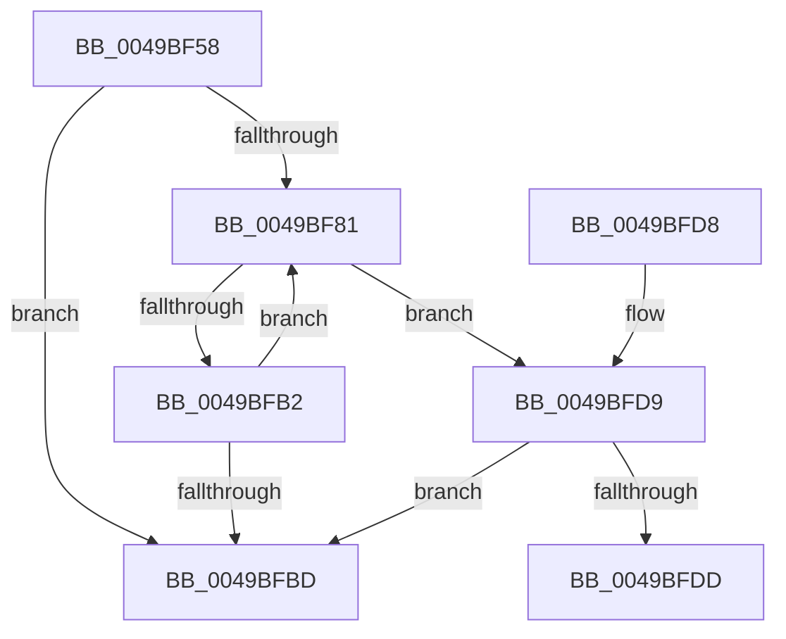

# SepReferenceCachedTokenHandles

- RVA: `0x0049BF58`–`0x0049BFE2` (길이 `138` bytes)
- VA: `0x000000014049BF58`
- 실행 섹션: `.text`
- PDB 이름 있음: `예`; PDB Function 태그: `예`
- unwind 정보 RVA: `0x000B49D8`
- 디코드: `43`개 명령, `138/138` bytes 표시
- 미해석 바이트: `0` (있으면 어셈블리에 `.byte`로 보존)

> 이 문서는 커널 이미지의 기계어와 PDB 기호를 분석해 생성했습니다. 4번과 5번은 함수 원형과 자료형을 바이너리 사용 방식에서 추정한 C 해석이며 원본 소스 복구 결과는 아닙니다.

## 1. Dependencies

- 직접 호출 지점: **1**; 고유 호출 대상: **1**
- 직접 호출자로 확인된 함수: **1**
- RIP 상대 이미지 참조: **0**

### Outgoing calls
- `0x0049BFA7` → [ZwDuplicateObject](../6A/ZwDuplicateObject_function_006AD850.md) (function, `0x006AD850`)

### Direct callers
- [SepSetTokenCachedHandles](../../page/9A/SepSetTokenCachedHandles_function_009A939C.md) at `0x009A9405`

### Static image references
- 디코드된 RIP-relative 메모리 참조가 없습니다.

## 2. Other-region calls and transfers

- 다른 실행 섹션으로 향하는 call: **0**
- call이 아닌 외부 분기/꼬리 이동: **1**
  - `0x0049BFDD` → [sub_006F7D8C](../6F/Unknown_function_006F7D8C.md) (`tail-transfer`)

## 3. Assembly (complete function range)

```asm
0049BF58  48 89 5C 24 08                  mov qword ptr [rsp + 8], rbx
0049BF5D  48 89 6C 24 10                  mov qword ptr [rsp + 0x10], rbp
0049BF62  48 89 74 24 18                  mov qword ptr [rsp + 0x18], rsi
0049BF67  57                              push rdi
0049BF68  41 56                           push r14
0049BF6A  41 57                           push r15
0049BF6C  48 83 EC 40                     sub rsp, 0x40
0049BF70  33 ED                           xor ebp, ebp
0049BF72  33 DB                           xor ebx, ebx
0049BF74  4D 8B F8                        mov r15, r8
0049BF77  48 8B F2                        mov rsi, rdx
0049BF7A  44 8B F1                        mov r14d, ecx
0049BF7D  85 C9                           test ecx, ecx
0049BF7F  74 3C                           je 0x14049bfbd
0049BF81  48 8B 16                        mov rdx, qword ptr [rsi]
0049BF84  49 8D 3C DF                     lea rdi, [r15 + rbx*8]
0049BF88  49 83 C8 FF                     or r8, 0xffffffffffffffff
0049BF8C  C7 44 24 30 02 00 00 00         mov dword ptr [rsp + 0x30], 2
0049BF94  4C 8B CF                        mov r9, rdi
0049BF97  C7 44 24 28 00 02 00 00         mov dword ptr [rsp + 0x28], 0x200
0049BF9F  83 64 24 20 00                  and dword ptr [rsp + 0x20], 0
0049BFA4  49 0B C8                        or rcx, r8
0049BFA7  E8 A4 18 21 00                  call 0x1406ad850
0049BFAC  8B E8                           mov ebp, eax
0049BFAE  85 C0                           test eax, eax
0049BFB0  78 27                           js 0x14049bfd9
0049BFB2  FF C3                           inc ebx
0049BFB4  48 83 C6 08                     add rsi, 8
0049BFB8  41 3B DE                        cmp ebx, r14d
0049BFBB  72 C4                           jb 0x14049bf81
0049BFBD  48 8B 5C 24 60                  mov rbx, qword ptr [rsp + 0x60]
0049BFC2  8B C5                           mov eax, ebp
0049BFC4  48 8B 6C 24 68                  mov rbp, qword ptr [rsp + 0x68]
0049BFC9  48 8B 74 24 70                  mov rsi, qword ptr [rsp + 0x70]
0049BFCE  48 83 C4 40                     add rsp, 0x40
0049BFD2  41 5F                           pop r15
0049BFD4  41 5E                           pop r14
0049BFD6  5F                              pop rdi
0049BFD7  C3                              ret
0049BFD8  CC                              int3
0049BFD9  85 DB                           test ebx, ebx
0049BFDB  74 E0                           je 0x14049bfbd
0049BFDD  E9 AA BD 25 00                  jmp 0x1406f7d8c
```

## 4. C-style interpretation (structured pseudocode)

```c
__int64 __fastcall SepReferenceCachedTokenHandles(__int64 a1, __int64 a2, __int64 a3)
{
    __int64 result;
    __int64 v_rbp;
    __int64 v_rbx;
    __int64 v_rsi;
    __int64 v_rsp;
    unsigned int v_stack_m28;
    unsigned int v_stack_m30;
    unsigned int v_stack_m38;
    unsigned __int64 v_stack_p10;
    unsigned __int64 v_stack_p18;
    unsigned __int64 v_stack_p8;

    v_stack_p8 = v_rbx;
    v_stack_p10 = v_rbp;
    v_stack_p18 = v_rsi;
    v_rsp = (v_rsp) - (64);
    v_rbp = 0;
    v_rbx = 0;
    if ((unsigned int)(a1) == 0) goto loc_0049BFBD;
loc_0049BF81:
    a3 = (a3) | (-1);
    v_stack_m28 = 2;
    v_stack_m30 = 512;
    a1 = (a1) | (a3);
    result = ZwDuplicateObject(a1, *(unsigned __int64 *)(a2), a3, a3 + v_rbx * 8);
    if (sign_flag) goto loc_0049BFD9;
    v_rbx = (unsigned int)((v_rbx) + 1);
    v_rsi = (a2) + (8);
    if (((unsigned int)(v_rbx)) < ((unsigned int)((unsigned int)((unsigned int)(a1))))) goto loc_0049BF81;
loc_0049BFBD:
    v_rsp = (v_rsp) + (64);
    return (unsigned int)((unsigned int)((unsigned int)((unsigned int)(result))));
loc_0049BFD9:
    if ((unsigned int)(v_stack_p8) == 0) goto loc_0049BFBD;
}
```

## 5. (Beta) C Style

```c
int64_t SepReferenceCachedTokenHandles(int64_t Arg1, void *Arg2, void *Arg3)
{
    uint8_t *arg2 = (uint8_t *)Arg2;
    uint8_t *arg3 = (uint8_t *)Arg3;

    int64_t result;
    int64_t local_rbp;
    int64_t local_rbx;
    int64_t local_rsi;
    int64_t local_rsp;
    uint32_t v_stack_m28;
    uint32_t v_stack_m30;
    uint32_t v_stack_m38;
    uint64_t v_stack_p10;
    uint64_t v_stack_p18;
    uint64_t v_stack_p8;

    v_stack_p8 = local_rbx;
    v_stack_p10 = local_rbp;
    v_stack_p18 = local_rsi;
    local_rsp = (local_rsp) - (64);
    local_rbp = 0;
    local_rbx = 0;
    if ((uint32_t)(Arg1) == 0) goto loc_0049BFBD;
loc_0049BF81:
    Arg3 = (Arg3) | (-1);
    v_stack_m28 = 2;
    v_stack_m30 = 512;
    Arg1 = (Arg1) | (Arg3);
    result = ZwDuplicateObject(Arg1, *(uint64_t *)(arg2), Arg3, Arg3 + local_rbx * 8);
    if (sign_flag) goto loc_0049BFD9;
    local_rbx = (uint32_t)((local_rbx) + 1);
    local_rsi = (Arg2) + (8);
    if (((uint32_t)(local_rbx)) < ((uint32_t)((uint32_t)((uint32_t)(Arg1))))) goto loc_0049BF81;
loc_0049BFBD:
    local_rsp = (local_rsp) + (64);
    return (uint32_t)((uint32_t)((uint32_t)((uint32_t)(result))));
loc_0049BFD9:
    if ((uint32_t)(v_stack_p8) == 0) goto loc_0049BFBD;
}
```

### 관측된 메모리 오프셋

구조체 형식이 확인되지 않은 접근은 인자 기준의 오프셋으로만 기록했습니다.

| 기준 인자 | 오프셋 표현 | 폭 (bit) | 접근 |
|---|---:|---:|---|
| `Arg2` | `+ 0x0` | `64` | `R` |
| `Arg3` | `+ 0x0 + rbx*8` | `64` | `R` |

## 6. Execution-region graph

[열기: 2D/3D 그래프와 함수 탐색 컨트롤 패널](../../../control-panel.html?section=text&rva=0x0049BF58&view=graph)

- 2D 그래프는 위에서 아래로 흐르고, 3D 그래프는 빈 공간을 드래그해 회전합니다. Shift+드래그는 이동, 휠은 확대·축소, 함수 노드 선택은 대상 보고서 이동입니다.

### Static fallback


