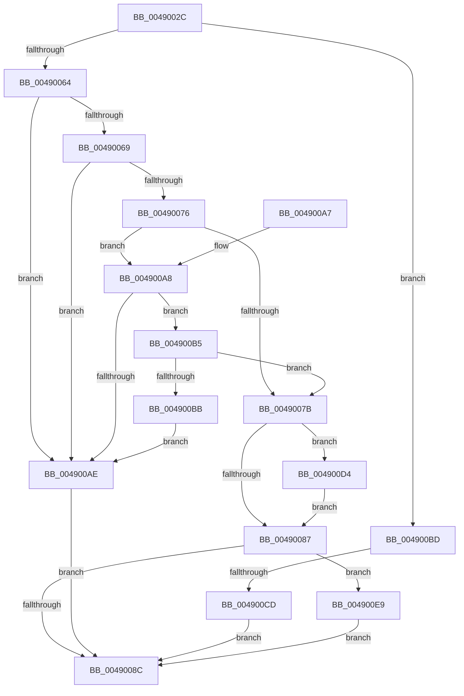

# SepSetTokenBnoIsolation

- RVA: `0x0049002C`–`0x00490114` (길이 `232` bytes)
- VA: `0x000000014049002C`
- 실행 섹션: `.text`
- PDB 이름 있음: `예`; PDB Function 태그: `예`
- unwind 정보 RVA: `0x000B2B44`
- 디코드: `66`개 명령, `232/232` bytes 표시
- 미해석 바이트: `0` (있으면 어셈블리에 `.byte`로 보존)

> 이 문서는 커널 이미지의 기계어와 PDB 기호를 분석해 생성했습니다. 4번과 5번은 함수 원형과 자료형을 바이너리 사용 방식에서 추정한 C 해석이며 원본 소스 복구 결과는 아닙니다.

## 1. Dependencies

- 직접 호출 지점: **2**; 고유 호출 대상: **2**
- 직접 호출자로 확인된 함수: **1**
- RIP 상대 이미지 참조: **0**

### Outgoing calls
- `0x004900DB` → [SepDereferenceCachedHandlesEntry](../../page/A1/SepDereferenceCachedHandlesEntry_function_00A19400.md) (function, `0x00A19400`)
- `0x00490108` → [SepSetTokenCachedHandles](../../page/9A/SepSetTokenCachedHandles_function_009A939C.md) (function, `0x009A939C`)

### Direct callers
- [SeSubProcessToken](../../page/AA/SeSubProcessToken_function_00AAD570.md) at `0x00AADAC8`
- [SeSubProcessToken](../../page/AA/SeSubProcessToken_function_00AAD570.md) at `0x00AADCD9`

### Static image references
- 디코드된 RIP-relative 메모리 참조가 없습니다.

## 2. Other-region calls and transfers

- 다른 실행 섹션으로 향하는 call: **2**
  - `0x004900DB` → [SepDereferenceCachedHandlesEntry](../../page/A1/SepDereferenceCachedHandlesEntry_function_00A19400.md) (`.text` → `PAGE`)
  - `0x00490108` → [SepSetTokenCachedHandles](../../page/9A/SepSetTokenCachedHandles_function_009A939C.md) (`.text` → `PAGE`)
- call이 아닌 외부 분기/꼬리 이동: **1**
  - `0x004900C7` → [sub_006F6F72](../6F/Unknown_function_006F6F72.md) (`tail-transfer`)

## 3. Assembly (complete function range)

```asm
0049002C  4C 8B DC                        mov r11, rsp
0049002F  49 89 5B 08                     mov qword ptr [r11 + 8], rbx
00490033  49 89 6B 10                     mov qword ptr [r11 + 0x10], rbp
00490037  49 89 73 18                     mov qword ptr [r11 + 0x18], rsi
0049003B  57                              push rdi
0049003C  41 56                           push r14
0049003E  41 57                           push r15
00490040  48 83 EC 40                     sub rsp, 0x40
00490044  33 C0                           xor eax, eax
00490046  0F 57 C0                        xorps xmm0, xmm0
00490049  33 DB                           xor ebx, ebx
0049004B  41 8B E9                        mov ebp, r9d
0049004E  49 8B F8                        mov rdi, r8
00490051  44 8A FA                        mov r15b, dl
00490054  4C 8B F1                        mov r14, rcx
00490057  0F 11 44 24 20                  movups xmmword ptr [rsp + 0x20], xmm0
0049005C  49 89 43 D8                     mov qword ptr [r11 - 0x28], rax
00490060  84 D2                           test dl, dl
00490062  75 59                           jne 0x1404900bd
00490064  45 85 C9                        test r9d, r9d
00490067  75 45                           jne 0x1404900ae
00490069  48 8B B4 24 80 00 00 00         mov rsi, qword ptr [rsp + 0x80]
00490071  48 85 F6                        test rsi, rsi
00490074  75 38                           jne 0x1404900ae
00490076  4D 85 C0                        test r8, r8
00490079  75 2D                           jne 0x1404900a8
0049007B  49 8B 96 80 04 00 00            mov rdx, qword ptr [r14 + 0x480]
00490082  48 85 D2                        test rdx, rdx
00490085  75 4D                           jne 0x1404900d4
00490087  45 84 FF                        test r15b, r15b
0049008A  75 5D                           jne 0x1404900e9
0049008C  48 8B 6C 24 68                  mov rbp, qword ptr [rsp + 0x68]
00490091  8B C3                           mov eax, ebx
00490093  48 8B 5C 24 60                  mov rbx, qword ptr [rsp + 0x60]
00490098  48 8B 74 24 70                  mov rsi, qword ptr [rsp + 0x70]
0049009D  48 83 C4 40                     add rsp, 0x40
004900A1  41 5F                           pop r15
004900A3  41 5E                           pop r14
004900A5  5F                              pop rdi
004900A6  C3                              ret
004900A7  CC                              int3
004900A8  66 41 39 18                     cmp word ptr [r8], bx
004900AC  74 07                           je 0x1404900b5
004900AE  BB 30 00 00 C0                  mov ebx, 0xc0000030
004900B3  EB D7                           jmp 0x14049008c
004900B5  49 39 58 08                     cmp qword ptr [r8 + 8], rbx
004900B9  74 C0                           je 0x14049007b
004900BB  EB F1                           jmp 0x1404900ae
004900BD  F7 81 C8 00 00 00 00 40 00 00   test dword ptr [rcx + 0xc8], 0x4000
004900C7  0F 84 A5 6E 26 00               je 0x1406f6f72
004900CD  BB BB 00 00 C0                  mov ebx, 0xc00000bb
004900D2  EB B8                           jmp 0x14049008c
004900D4  49 8B 8E D8 00 00 00            mov rcx, qword ptr [r14 + 0xd8]
004900DB  E8 20 93 58 00                  call 0x140a19400
004900E0  49 89 9E 80 04 00 00            mov qword ptr [r14 + 0x480], rbx
004900E7  EB 9E                           jmp 0x140490087
004900E9  0F 10 07                        movups xmm0, xmmword ptr [rdi]
004900EC  4C 8B CE                        mov r9, rsi
004900EF  C7 44 24 20 01 00 00 00         mov dword ptr [rsp + 0x20], 1
004900F7  44 8B C5                        mov r8d, ebp
004900FA  48 8D 54 24 20                  lea rdx, [rsp + 0x20]
004900FF  49 8B CE                        mov rcx, r14
00490102  F3 0F 7F 44 24 28               movdqu xmmword ptr [rsp + 0x28], xmm0
00490108  E8 8F 92 51 00                  call 0x1409a939c
0049010D  8B D8                           mov ebx, eax
0049010F  E9 78 FF FF FF                  jmp 0x14049008c
```

## 4. C-style interpretation (structured pseudocode)

```c
__int64 __fastcall SepSetTokenBnoIsolation(__int64 a1, unsigned __int8 a2, __int64 a3, int a4, __int64 a5)
{
    __int64 result;
    __int64 v_rbx;
    __int64 v_rsp;
    unsigned __int64 v_stack_m38;
    unsigned __int64 v_stack_p10;
    unsigned __int64 v_stack_p18;
    unsigned int v_stack_p20;
    unsigned __int64 v_stack_p28;
    unsigned __int64 v_stack_p8;

    *(unsigned __int64 *)(v_rsp + 8) = v_rbx;
    *(unsigned __int64 *)(v_rsp + 16) = v_rbp;
    *(unsigned __int64 *)(v_rsp + 24) = v_rsi;
    v_rsp = (v_rsp) - (64);
    result = 0;
    v_rbx = 0;
    v_stack_m38 = v_xmm0;
    *(unsigned __int64 *)(v_rsp - 40) = 0;
    if (a2 != 0) goto loc_004900BD;
    if (a4 != 0) goto loc_004900AE;
    if (a5 != 0) goto loc_004900AE;
    if (a3 != 0) goto loc_004900A8;
loc_0049007B:
    if (*(unsigned __int64 *)(a1 + 1152) != 0) goto loc_004900D4;
loc_00490087:
    if (a2 != 0) goto loc_004900E9;
loc_0049008C:
    v_rsp = (v_rsp) + (64);
    return 0;
loc_004900A8:
    if ((*(unsigned __int16 *)(a3)) == ((unsigned __int16)(v_stack_p8))) goto loc_004900B5;
loc_004900AE:
    goto loc_0049008C;
loc_004900B5:
    if ((*(unsigned __int64 *)(a3 + 8)) == ((unsigned int)(0xC0000030ULL))) goto loc_0049007B;
    goto loc_004900AE;
loc_004900BD:
    goto loc_0049008C;
loc_004900D4:
    result = SepDereferenceCachedHandlesEntry(*(unsigned __int64 *)(a1 + 216), *(unsigned __int64 *)(a1 + 1152), a3, a4);
    *(unsigned __int64 *)(a1 + 1152) = (unsigned int)(0xC00000BBULL);
    goto loc_00490087;
loc_004900E9:
    v_stack_p20 = 1;
    v_stack_p28 = v_xmm0;
    result = SepSetTokenCachedHandles(a1, v_stack_p20, (unsigned int)((unsigned int)(v_stack_p10)), v_stack_p18);
    goto loc_0049008C;
}
```

## 5. (Beta) C Style

```c
int64_t SepSetTokenBnoIsolation(void *Arg1, uint8_t Arg2, void *Arg3, int32_t Arg4, int64_t Arg5)
{
    uint8_t *arg1 = (uint8_t *)Arg1;
    uint8_t *arg3 = (uint8_t *)Arg3;

    int64_t result;
    int64_t local_rbx;
    int64_t local_rsp;
    uint64_t v_stack_m38;
    uint64_t v_stack_p10;
    uint64_t v_stack_p18;
    uint32_t v_stack_p20;
    uint64_t v_stack_p28;
    uint64_t v_stack_p8;

    *(uint64_t *)(local_rsp + 0x8) = local_rbx;
    *(uint64_t *)(local_rsp + 0x10) = local_rbp;
    *(uint64_t *)(local_rsp + 0x18) = local_rsi;
    local_rsp = (local_rsp) - (64);
    result = 0;
    local_rbx = 0;
    v_stack_m38 = v_xmm0;
    *(uint64_t *)(local_rsp - 0x28) = 0;
    if (Arg2 != 0) goto loc_004900BD;
    if (Arg4 != 0) goto loc_004900AE;
    if (Arg5 != 0) goto loc_004900AE;
    if (Arg3 != NULL) goto loc_004900A8;
loc_0049007B:
    if (*(uint64_t *)(arg1 + 0x480) != 0) goto loc_004900D4;
loc_00490087:
    if (Arg2 != 0) goto loc_004900E9;
loc_0049008C:
    local_rsp = (local_rsp) + (64);
    return 0;
loc_004900A8:
    if ((*(uint16_t *)(arg3)) == ((uint16_t)(v_stack_p8))) goto loc_004900B5;
loc_004900AE:
    goto loc_0049008C;
loc_004900B5:
    if ((*(uint64_t *)(arg3 + 0x8)) == ((uint32_t)(0xC0000030ULL))) goto loc_0049007B;
    goto loc_004900AE;
loc_004900BD:
    goto loc_0049008C;
loc_004900D4:
    result = SepDereferenceCachedHandlesEntry(*(uint64_t *)(arg1 + 0xD8), *(uint64_t *)(arg1 + 0x480), Arg3, Arg4);
    *(uint64_t *)(arg1 + 0x480) = (uint32_t)(0xC00000BBULL);
    goto loc_00490087;
loc_004900E9:
    v_stack_p20 = 1;
    v_stack_p28 = v_xmm0;
    result = SepSetTokenCachedHandles(Arg1, v_stack_p20, (uint32_t)((uint32_t)(v_stack_p10)), v_stack_p18);
    goto loc_0049008C;
}
```

### 관측된 메모리 오프셋

구조체 형식이 확인되지 않은 접근은 인자 기준의 오프셋으로만 기록했습니다.

| 기준 인자 | 오프셋 표현 | 폭 (bit) | 접근 |
|---|---:|---:|---|
| `Arg1` | `+ 0xC8` | `32` | `R` |
| `Arg1` | `+ 0xD8` | `64` | `R` |
| `Arg1` | `+ 0x480` | `64` | `R` |
| `Arg1` | `+ 0x480` | `64` | `W` |
| `Arg3` | `+ 0x0` | `128` | `R` |

## 6. Execution-region graph

[열기: 2D/3D 그래프와 함수 탐색 컨트롤 패널](../../../control-panel.html?section=text&rva=0x0049002C&view=graph)

- 2D 그래프는 위에서 아래로 흐르고, 3D 그래프는 빈 공간을 드래그해 회전합니다. Shift+드래그는 이동, 휠은 확대·축소, 함수 노드 선택은 대상 보고서 이동입니다.

### Static fallback


