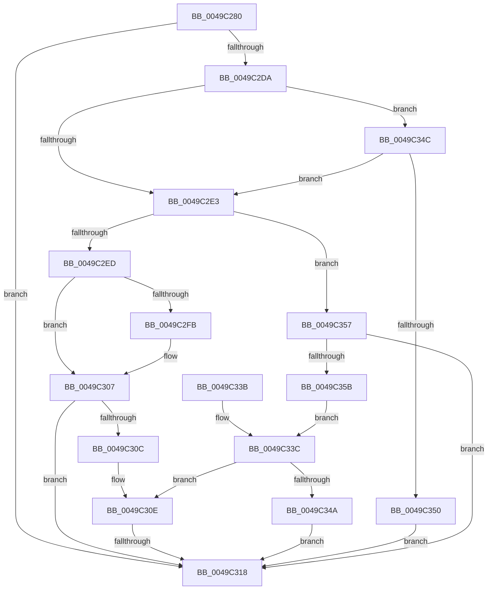

# SiValidateSystemPartition

- RVA: `0x0049C280`–`0x0049C35D` (길이 `221` bytes)
- VA: `0x000000014049C280`
- 실행 섹션: `.text`
- PDB 이름 있음: `예`; PDB Function 태그: `예`
- unwind 정보 RVA: `0x000B4A88`
- 디코드: `64`개 명령, `221/221` bytes 표시
- 미해석 바이트: `0` (있으면 어셈블리에 `.byte`로 보존)

> 이 문서는 커널 이미지의 기계어와 PDB 기호를 분석해 생성했습니다. 4번과 5번은 함수 원형과 자료형을 바이너리 사용 방식에서 추정한 C 해석이며 원본 소스 복구 결과는 아닙니다.

## 1. Dependencies

- 직접 호출 지점: **3**; 고유 호출 대상: **3**
- 직접 호출자로 확인된 함수: **1**
- RIP 상대 이미지 참조: **3**

### Outgoing calls
- `0x0049C2BE` → [memset](../6C/memset_function_006C6C40.md) (function, `0x006C6C40`)
- `0x0049C2CF` → [SiGetDiskPartitionInformation](../../page/A6/SiGetDiskPartitionInformation_function_00A68AB4.md) (function, `0x00A68AB4`)
- `0x0049C321` → [_security_check_cookie](../6A/_security_check_cookie_function_006AC640.md) (function, `0x006AC640`)

### Direct callers
- [SiGetBootDeviceName](../../page/A3/SiGetBootDeviceName_function_00A378FC.md) at `0x00A37AC6`

### Static image references
- `0x0049C297` → RVA `0x00E0A740` (`.data`; read)
- `0x0049C2F2` → RVA `0x0001ABB0` (`.rdata`; read)
- `0x0049C300` → RVA `0x0001ABB8` (`.rdata`; read)

## 2. Other-region calls and transfers

- 다른 실행 섹션으로 향하는 call: **1**
  - `0x0049C2CF` → [SiGetDiskPartitionInformation](../../page/A6/SiGetDiskPartitionInformation_function_00A68AB4.md) (`.text` → `PAGE`)
- call이 아닌 외부 분기/꼬리 이동: **1**
  - `0x0049C312` → [sub_006F7DA2](../6F/Unknown_function_006F7DA2.md) (`tail-transfer`)

## 3. Assembly (complete function range)

```asm
0049C280  48 89 5C 24 10                  mov qword ptr [rsp + 0x10], rbx
0049C285  48 89 7C 24 18                  mov qword ptr [rsp + 0x18], rdi
0049C28A  55                              push rbp
0049C28B  48 8D 6C 24 F0                  lea rbp, [rsp - 0x10]
0049C290  48 81 EC 10 01 00 00            sub rsp, 0x110
0049C297  48 8B 05 A2 E4 96 00            mov rax, qword ptr [rip + 0x96e4a2]
0049C29E  48 33 C4                        xor rax, rsp
0049C2A1  48 89 45 08                     mov qword ptr [rbp + 8], rax
0049C2A5  48 8B DA                        mov rbx, rdx
0049C2A8  48 8B F9                        mov rdi, rcx
0049C2AB  33 C0                           xor eax, eax
0049C2AD  48 8D 4C 24 40                  lea rcx, [rsp + 0x40]
0049C2B2  33 D2                           xor edx, edx
0049C2B4  89 44 24 44                     mov dword ptr [rsp + 0x44], eax
0049C2B8  41 B8 8C 00 00 00               mov r8d, 0x8c
0049C2BE  E8 7D A9 22 00                  call 0x1406c6c40
0049C2C3  83 65 D8 00                     and dword ptr [rbp - 0x28], 0
0049C2C7  48 8D 54 24 40                  lea rdx, [rsp + 0x40]
0049C2CC  48 8B CF                        mov rcx, rdi
0049C2CF  E8 E0 C7 5C 00                  call 0x140a68ab4
0049C2D4  8B D0                           mov edx, eax
0049C2D6  85 C0                           test eax, eax
0049C2D8  78 3E                           js 0x14049c318
0049C2DA  8B 44 24 40                     mov eax, dword ptr [rsp + 0x40]
0049C2DE  48 85 DB                        test rbx, rbx
0049C2E1  75 69                           jne 0x14049c34c
0049C2E3  BA 01 00 00 C0                  mov edx, 0xc0000001
0049C2E8  83 F8 01                        cmp eax, 1
0049C2EB  75 6A                           jne 0x14049c357
0049C2ED  48 8B 44 24 60                  mov rax, qword ptr [rsp + 0x60]
0049C2F2  48 2B 05 B7 E8 B7 FF            sub rax, qword ptr [rip - 0x481749]
0049C2F9  75 0C                           jne 0x14049c307
0049C2FB  48 8B 44 24 68                  mov rax, qword ptr [rsp + 0x68]
0049C300  48 2B 05 B1 E8 B7 FF            sub rax, qword ptr [rip - 0x48174f]
0049C307  48 85 C0                        test rax, rax
0049C30A  75 0C                           jne 0x14049c318
0049C30C  33 D2                           xor edx, edx
0049C30E  80 7D 40 00                     cmp byte ptr [rbp + 0x40], 0
0049C312  0F 85 8A BA 25 00               jne 0x1406f7da2
0049C318  8B C2                           mov eax, edx
0049C31A  48 8B 4D 08                     mov rcx, qword ptr [rbp + 8]
0049C31E  48 33 CC                        xor rcx, rsp
0049C321  E8 1A 03 21 00                  call 0x1406ac640
0049C326  4C 8D 9C 24 10 01 00 00         lea r11, [rsp + 0x110]
0049C32E  49 8B 5B 18                     mov rbx, qword ptr [r11 + 0x18]
0049C332  49 8B 7B 20                     mov rdi, qword ptr [r11 + 0x20]
0049C336  49 8B E3                        mov rsp, r11
0049C339  5D                              pop rbp
0049C33A  C3                              ret
0049C33B  CC                              int3
0049C33C  8A 44 24 61                     mov al, byte ptr [rsp + 0x61]
0049C340  F6 D8                           neg al
0049C342  1B C9                           sbb ecx, ecx
0049C344  F7 D1                           not ecx
0049C346  23 D1                           and edx, ecx
0049C348  7D C4                           jge 0x14049c30e
0049C34A  EB CC                           jmp 0x14049c318
0049C34C  3B 03                           cmp eax, dword ptr [rbx]
0049C34E  74 93                           je 0x14049c2e3
0049C350  BA 01 00 00 C0                  mov edx, 0xc0000001
0049C355  EB C1                           jmp 0x14049c318
0049C357  85 C0                           test eax, eax
0049C359  75 BD                           jne 0x14049c318
0049C35B  EB DF                           jmp 0x14049c33c
```

## 4. C-style interpretation (structured pseudocode)

```c
__int64 __fastcall SiValidateSystemPartition(__int64 a1, __int64 a2, __int64 a3, __int64 a4, unsigned __int8 a5)
{
    __int64 result;
    __int64 v_rsp;
    unsigned __int64 v_stack_m10;
    unsigned __int64 v_stack_m18;
    unsigned int v_stack_m40;
    unsigned __int64 v_stack_m8;
    unsigned __int8 v_stack_mAF;
    unsigned __int64 v_stack_mB0;
    unsigned __int64 v_stack_mB8;
    unsigned int v_stack_mD4;
    unsigned __int64 v_stack_mD8;
    unsigned __int64 v_stack_p10;
    unsigned __int64 v_stack_p18;

    v_stack_p10 = v_rbx;
    v_stack_p18 = v_rdi;
    v_rsp = (v_rsp) - (272);
    result = (*(unsigned __int64 *)(v_rip + 9888930)) ^ (v_rsp);
    v_stack_m10 = result;
    result = 0;
    a2 = 0;
    v_stack_mD4 = 0;
    result = memset(v_stack_mD8, a2, 140, a4);
    result = SiGetDiskPartitionInformation(a1, v_stack_mD8, 140, a4);
    if (sign_flag) goto loc_0049C318;
    if (0 != 0) goto loc_0049C34C;
loc_0049C2E3:
    if (((unsigned int)((unsigned int)(v_stack_mD8))) != 1) goto loc_0049C357;
    result = (v_stack_mB8) - (*(unsigned __int64 *)(v_rip - 4724553));
    if (!(condition_is_not_equal)) {
        result = v_stack_mB0;
        result = (result) - (*(unsigned __int64 *)(v_rip - 4724559));
    }
    if (result != 0) goto loc_0049C318;
    a2 = 0;
loc_0049C30E:
loc_0049C318:
    a1 = (v_stack_m10) ^ (v_rsp);
    result = _security_check_cookie(a1, a2, 140, a4);
    return result;
loc_0049C33C:
    result = (unsigned __int8)(-(v_stack_mAF));
    a1 = (unsigned int)(~(a1));
    a2 = (unsigned int)((a2) & ((unsigned int)(a1)));
    if (condition_is_greater_or_equal) goto loc_0049C30E;
    goto loc_0049C318;
loc_0049C34C:
    if (((unsigned int)(result)) == (*(unsigned int *)(*(unsigned __int64 *)(v_stack_m8 + 24)))) goto loc_0049C2E3;
    goto loc_0049C318;
loc_0049C357:
    if ((unsigned int)(result) != 0) goto loc_0049C318;
    goto loc_0049C33C;
}
```

## 5. (Beta) C Style

```c
int64_t SiValidateSystemPartition(int64_t Arg1, int64_t Arg2, int64_t Arg3, int64_t Arg4, uint8_t Arg5)
{
    int64_t result;
    int64_t local_rsp;
    uint64_t v_stack_m10;
    uint64_t v_stack_m18;
    uint32_t v_stack_m40;
    uint64_t v_stack_m8;
    uint8_t v_stack_mAF;
    uint64_t v_stack_mB0;
    uint64_t v_stack_mB8;
    uint32_t v_stack_mD4;
    uint64_t v_stack_mD8;
    uint64_t v_stack_p10;
    uint64_t v_stack_p18;

    v_stack_p10 = local_rbx;
    v_stack_p18 = local_rdi;
    local_rsp = (local_rsp) - (272);
    result = (*(uint64_t *)(v_rip + 0x96E4A2)) ^ (local_rsp);
    v_stack_m10 = result;
    result = 0;
    Arg2 = 0;
    v_stack_mD4 = 0;
    result = memset(v_stack_mD8, Arg2, 140, Arg4);
    result = SiGetDiskPartitionInformation(Arg1, v_stack_mD8, 140, Arg4);
    if (sign_flag) goto loc_0049C318;
    if (0 != 0) goto loc_0049C34C;
loc_0049C2E3:
    if (((uint32_t)((uint32_t)(v_stack_mD8))) != 1) goto loc_0049C357;
    result = (v_stack_mB8) - (*(uint64_t *)(v_rip - 0x481749));
    if (!(condition_is_not_equal)) {
        result = v_stack_mB0;
        result = (result) - (*(uint64_t *)(v_rip - 0x48174F));
    }
    if (result != 0) goto loc_0049C318;
    Arg2 = 0;
loc_0049C30E:
loc_0049C318:
    Arg1 = (v_stack_m10) ^ (local_rsp);
    result = _security_check_cookie(Arg1, Arg2, 140, Arg4);
    return result;
loc_0049C33C:
    result = (uint8_t)(-(v_stack_mAF));
    Arg1 = (uint32_t)(~(Arg1));
    Arg2 = (uint32_t)((Arg2) & ((uint32_t)(Arg1)));
    if (condition_is_greater_or_equal) goto loc_0049C30E;
    goto loc_0049C318;
loc_0049C34C:
    if (((uint32_t)(result)) == (*(uint32_t *)(*(uint64_t *)(v_stack_m8 + 0x18)))) goto loc_0049C2E3;
    goto loc_0049C318;
loc_0049C357:
    if ((uint32_t)(result) != 0) goto loc_0049C318;
    goto loc_0049C33C;
}
```

## 6. Execution-region graph

[열기: 2D/3D 그래프와 함수 탐색 컨트롤 패널](../../../control-panel.html?section=text&rva=0x0049C280&view=graph)

- 2D 그래프는 위에서 아래로 흐르고, 3D 그래프는 빈 공간을 드래그해 회전합니다. Shift+드래그는 이동, 휠은 확대·축소, 함수 노드 선택은 대상 보고서 이동입니다.

### Static fallback


