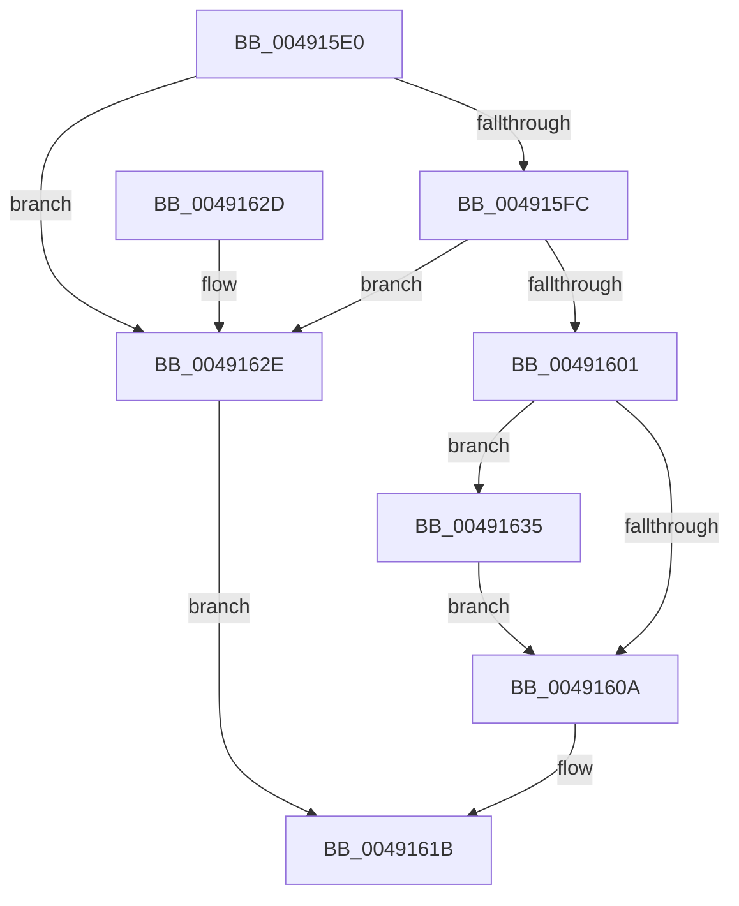

# SleepstudyHelperSetBlockerParentHandle

- RVA: `0x004915E0`–`0x00491644` (길이 `100` bytes)
- VA: `0x00000001404915E0`
- 실행 섹션: `.text`
- PDB 이름 있음: `예`; PDB Function 태그: `아니요`
- unwind 정보 RVA: `0x0005C774`
- 디코드: `31`개 명령, `100/100` bytes 표시
- 미해석 바이트: `0` (있으면 어셈블리에 `.byte`로 보존)

> 이 문서는 커널 이미지의 기계어와 PDB 기호를 분석해 생성했습니다. 4번과 5번은 함수 원형과 자료형을 바이너리 사용 방식에서 추정한 C 해석이며 원본 소스 복구 결과는 아닙니다.

## 1. Dependencies

- 직접 호출 지점: **2**; 고유 호출 대상: **2**
- 직접 호출자로 확인된 함수: **0**
- RIP 상대 이미지 참조: **0**

### Outgoing calls
- `0x00491616` → [SshpReferenceBlocker](SshpReferenceBlocker_function_0049164C.md) (function, `0x0049164C`)
- `0x0049163D` → [SshpDereferenceBlocker](../48/SshpDereferenceBlocker_function_00486960.md) (function, `0x00486960`)

### Direct callers
- 이 함수 시작 RVA로 연결되는 직접 call은 확인되지 않았습니다. 간접 호출은 완전히 역산할 수 없습니다.

### Static image references
- 디코드된 RIP-relative 메모리 참조가 없습니다.

## 2. Other-region calls and transfers

- 다른 실행 섹션으로 향하는 call: **0**
- 별도 외부 분기/꼬리 이동을 확인하지 못했습니다.

## 3. Assembly (complete function range)

```asm
004915E0  48 89 5C 24 08                  mov qword ptr [rsp + 8], rbx
004915E5  48 89 74 24 10                  mov qword ptr [rsp + 0x10], rsi
004915EA  57                              push rdi
004915EB  48 83 EC 20                     sub rsp, 0x20
004915EF  33 DB                           xor ebx, ebx
004915F1  48 8B FA                        mov rdi, rdx
004915F4  48 8B F1                        mov rsi, rcx
004915F7  48 85 C9                        test rcx, rcx
004915FA  74 32                           je 0x14049162e
004915FC  48 85 D2                        test rdx, rdx
004915FF  74 2D                           je 0x14049162e
00491601  48 8B 49 50                     mov rcx, qword ptr [rcx + 0x50]
00491605  48 85 C9                        test rcx, rcx
00491608  75 2B                           jne 0x140491635
0049160A  BA 01 00 00 00                  mov edx, 1
0049160F  48 89 7E 50                     mov qword ptr [rsi + 0x50], rdi
00491613  48 8B CF                        mov rcx, rdi
00491616  E8 31 00 00 00                  call 0x14049164c
0049161B  48 8B 74 24 38                  mov rsi, qword ptr [rsp + 0x38]
00491620  8B C3                           mov eax, ebx
00491622  48 8B 5C 24 30                  mov rbx, qword ptr [rsp + 0x30]
00491627  48 83 C4 20                     add rsp, 0x20
0049162B  5F                              pop rdi
0049162C  C3                              ret
0049162D  CC                              int3
0049162E  BB 0D 00 00 C0                  mov ebx, 0xc000000d
00491633  EB E6                           jmp 0x14049161b
00491635  41 B0 01                        mov r8b, 1
00491638  BA 01 00 00 00                  mov edx, 1
0049163D  E8 1E 53 FF FF                  call 0x140486960
00491642  EB C6                           jmp 0x14049160a
```

## 4. C-style interpretation (structured pseudocode)

```c
__int64 __fastcall SleepstudyHelperSetBlockerParentHandle(__int64 a1, __int64 a2)
{
    __int64 result;
    __int64 v_rbx;
    __int64 v_rsp;
    unsigned __int64 v_stack_p10;
    unsigned __int64 v_stack_p8;

    v_stack_p8 = v_rbx;
    v_stack_p10 = v_rsi;
    v_rsp = (v_rsp) - (32);
    v_rbx = 0;
    if (a1 == 0) goto loc_0049162E;
    if (a2 == 0) goto loc_0049162E;
    if (*(unsigned __int64 *)(a1 + 80) != 0) goto loc_00491635;
loc_0049160A:
    *(unsigned __int64 *)(a1 + 80) = a2;
    result = SshpReferenceBlocker(a2, 1, a3, a4);
loc_0049161B:
    v_rsp = (v_rsp) + (32);
    return 0;
loc_0049162E:
    goto loc_0049161B;
loc_00491635:
    result = SshpDereferenceBlocker(a2, 1, 1, a4);
    goto loc_0049160A;
}
```

## 5. (Beta) C Style

```c
int64_t SleepstudyHelperSetBlockerParentHandle(void *Arg1, int64_t Arg2)
{
    uint8_t *arg1 = (uint8_t *)Arg1;

    int64_t result;
    int64_t local_rbx;
    int64_t local_rsp;
    uint64_t v_stack_p10;
    uint64_t v_stack_p8;

    v_stack_p8 = local_rbx;
    v_stack_p10 = local_rsi;
    local_rsp = (local_rsp) - (32);
    local_rbx = 0;
    if (Arg1 == NULL) goto loc_0049162E;
    if (Arg2 == 0) goto loc_0049162E;
    if (*(uint64_t *)(arg1 + 0x50) != 0) goto loc_00491635;
loc_0049160A:
    *(uint64_t *)(arg1 + 0x50) = Arg2;
    result = SshpReferenceBlocker(Arg2, 1, a3, a4);
loc_0049161B:
    local_rsp = (local_rsp) + (32);
    return 0;
loc_0049162E:
    goto loc_0049161B;
loc_00491635:
    result = SshpDereferenceBlocker(Arg2, 1, 1, a4);
    goto loc_0049160A;
}
```

### 관측된 메모리 오프셋

구조체 형식이 확인되지 않은 접근은 인자 기준의 오프셋으로만 기록했습니다.

| 기준 인자 | 오프셋 표현 | 폭 (bit) | 접근 |
|---|---:|---:|---|
| `Arg1` | `+ 0x50` | `64` | `W` |

## 6. Execution-region graph

[열기: 2D/3D 그래프와 함수 탐색 컨트롤 패널](../../../control-panel.html?section=text&rva=0x004915E0&view=graph)

- 2D 그래프는 위에서 아래로 흐르고, 3D 그래프는 빈 공간을 드래그해 회전합니다. Shift+드래그는 이동, 휠은 확대·축소, 함수 노드 선택은 대상 보고서 이동입니다.

### Static fallback


