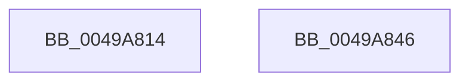

# SshpQueryBlockerPendingDelete

- RVA: `0x0049A814`–`0x0049A847` (길이 `51` bytes)
- VA: `0x000000014049A814`
- 실행 섹션: `.text`
- PDB 이름 있음: `예`; PDB Function 태그: `아니요`
- unwind 정보 RVA: `0x0005CAAC`
- 디코드: `17`개 명령, `51/51` bytes 표시
- 미해석 바이트: `0` (있으면 어셈블리에 `.byte`로 보존)

> 이 문서는 커널 이미지의 기계어와 PDB 기호를 분석해 생성했습니다. 4번과 5번은 함수 원형과 자료형을 바이너리 사용 방식에서 추정한 C 해석이며 원본 소스 복구 결과는 아닙니다.

## 1. Dependencies

- 직접 호출 지점: **2**; 고유 호출 대상: **2**
- 직접 호출자로 확인된 함수: **1**
- RIP 상대 이미지 참조: **0**

### Outgoing calls
- `0x0049A821` → [KeAcquireSpinLockRaiseToDpc](../20/KeAcquireSpinLockRaiseToDpc_function_00208470.md) (function, `0x00208470`)
- `0x0049A834` → [KeReleaseSpinLock](../39/KeReleaseSpinLock_function_00392BA0.md) (function, `0x00392BA0`)

### Direct callers
- [SshpPurgeBlockersWorker](../../page/A4/SshpPurgeBlockersWorker_function_00A4DE90.md) at `0x00A4DF95`

### Static image references
- 디코드된 RIP-relative 메모리 참조가 없습니다.

## 2. Other-region calls and transfers

- 다른 실행 섹션으로 향하는 call: **0**
- 별도 외부 분기/꼬리 이동을 확인하지 못했습니다.

## 3. Assembly (complete function range)

```asm
0049A814  48 89 5C 24 08                  mov qword ptr [rsp + 8], rbx
0049A819  57                              push rdi
0049A81A  48 83 EC 20                     sub rsp, 0x20
0049A81E  48 8B F9                        mov rdi, rcx
0049A821  E8 4A DC D6 FF                  call 0x140208470
0049A826  8B 5F 08                        mov ebx, dword ptr [rdi + 8]
0049A829  8A D0                           mov dl, al
0049A82B  C1 EB 03                        shr ebx, 3
0049A82E  48 8B CF                        mov rcx, rdi
0049A831  80 E3 01                        and bl, 1
0049A834  E8 67 83 EF FF                  call 0x140392ba0
0049A839  8A C3                           mov al, bl
0049A83B  48 8B 5C 24 30                  mov rbx, qword ptr [rsp + 0x30]
0049A840  48 83 C4 20                     add rsp, 0x20
0049A844  5F                              pop rdi
0049A845  C3                              ret
0049A846  CC                              int3
```

## 4. C-style interpretation (structured pseudocode)

```c
__int64 __fastcall SshpQueryBlockerPendingDelete(__int64 a1)
{
    __int64 result;
    __int64 v_rbx;
    __int64 v_rsp;
    unsigned __int64 v_stack_p8;

    v_stack_p8 = v_rbx;
    v_rsp = (v_rsp) - (32);
    result = KeAcquireSpinLockRaiseToDpc(a1, a2, a3, a4);
    v_rbx = (unsigned int)(((unsigned int)(*(unsigned int *)(a1 + 8))) >> (3));
    v_rbx = (unsigned __int8)((v_rbx) & (1));
    result = KeReleaseSpinLock(a1, (unsigned __int8)(result), a3, a4);
    v_rsp = (v_rsp) + (32);
    return (unsigned __int8)(v_rbx);
}
```

## 5. (Beta) C Style

```c
int64_t SshpQueryBlockerPendingDelete(void *Arg1)
{
    uint8_t *arg1 = (uint8_t *)Arg1;

    int64_t result;
    int64_t local_rbx;
    int64_t local_rsp;
    uint64_t v_stack_p8;

    v_stack_p8 = local_rbx;
    local_rsp = (local_rsp) - (32);
    result = KeAcquireSpinLockRaiseToDpc(Arg1, a2, a3, a4);
    local_rbx = (uint32_t)(((uint32_t)(*(uint32_t *)(arg1 + 0x8))) >> (3));
    local_rbx = (uint8_t)((local_rbx) & (1));
    result = KeReleaseSpinLock(Arg1, (uint8_t)(result), a3, a4);
    local_rsp = (local_rsp) + (32);
    return (uint8_t)(local_rbx);
}
```

### 관측된 메모리 오프셋

구조체 형식이 확인되지 않은 접근은 인자 기준의 오프셋으로만 기록했습니다.

| 기준 인자 | 오프셋 표현 | 폭 (bit) | 접근 |
|---|---:|---:|---|
| `Arg1` | `+ 0x8` | `32` | `R` |

## 6. Execution-region graph

[열기: 2D/3D 그래프와 함수 탐색 컨트롤 패널](../../../control-panel.html?section=text&rva=0x0049A814&view=graph)

- 2D 그래프는 위에서 아래로 흐르고, 3D 그래프는 빈 공간을 드래그해 회전합니다. Shift+드래그는 이동, 휠은 확대·축소, 함수 노드 선택은 대상 보고서 이동입니다.

### Static fallback


