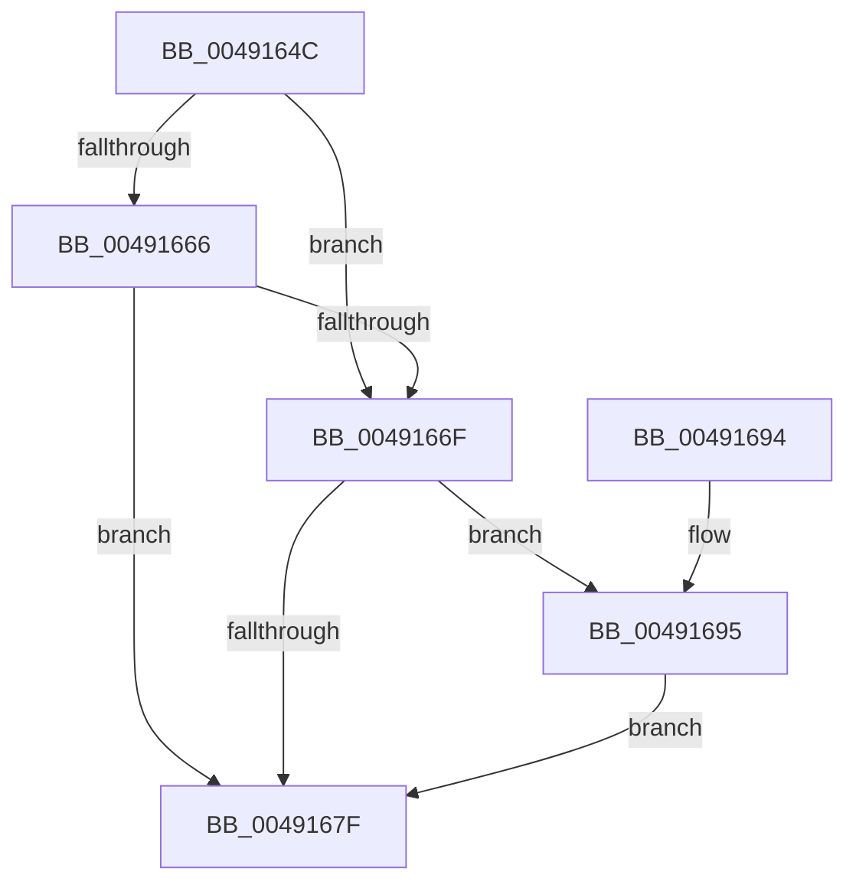

# SshpReferenceBlocker

- RVA: `0x0049164C`–`0x004916A0` (길이 `84` bytes)
- VA: `0x000000014049164C`
- 실행 섹션: `.text`
- PDB 이름 있음: `예`; PDB Function 태그: `아니요`
- unwind 정보 RVA: `0x00069334`
- 디코드: `30`개 명령, `84/84` bytes 표시
- 미해석 바이트: `0` (있으면 어셈블리에 `.byte`로 보존)

> 이 문서는 커널 이미지의 기계어와 PDB 기호를 분석해 생성했습니다. 4번과 5번은 함수 원형과 자료형을 바이너리 사용 방식에서 추정한 C 해석이며 원본 소스 복구 결과는 아닙니다.

## 1. Dependencies

- 직접 호출 지점: **2**; 고유 호출 대상: **2**
- 직접 호출자로 확인된 함수: **3**
- RIP 상대 이미지 참조: **0**

### Outgoing calls
- `0x0049165B` → [KeAcquireSpinLockRaiseToDpc](../20/KeAcquireSpinLockRaiseToDpc_function_00208470.md) (function, `0x00208470`)
- `0x00491684` → [KeReleaseSpinLock](../39/KeReleaseSpinLock_function_00392BA0.md) (function, `0x00392BA0`)

### Direct callers
- [SleepstudyHelperSetBlockerParentHandle](SleepstudyHelperSetBlockerParentHandle_function_004915E0.md) at `0x00491616`
- [SleepstudyHelperBuildBlocker](../../page/A2/SleepstudyHelperBuildBlocker_function_00A2DAD0.md) at `0x00A2DD37`
- [SleepstudyHelperBuildBlocker](../../page/A2/SleepstudyHelperBuildBlocker_function_00A2DAD0.md) at `0x00A2DE47`
- [SshNotifySystemSessionChange](../../page/A6/SshNotifySystemSessionChange_function_00A602BC.md) at `0x00A60531`

### Static image references
- 디코드된 RIP-relative 메모리 참조가 없습니다.

## 2. Other-region calls and transfers

- 다른 실행 섹션으로 향하는 call: **0**
- 별도 외부 분기/꼬리 이동을 확인하지 못했습니다.

## 3. Assembly (complete function range)

```asm
0049164C  48 89 5C 24 08                  mov qword ptr [rsp + 8], rbx
00491651  57                              push rdi
00491652  48 83 EC 20                     sub rsp, 0x20
00491656  8B DA                           mov ebx, edx
00491658  48 8B F9                        mov rdi, rcx
0049165B  E8 10 6E D7 FF                  call 0x140208470
00491660  8A C8                           mov cl, al
00491662  85 DB                           test ebx, ebx
00491664  75 09                           jne 0x14049166f
00491666  FF 47 0C                        inc dword ptr [rdi + 0xc]
00491669  83 7F 0C 01                     cmp dword ptr [rdi + 0xc], 1
0049166D  75 10                           jne 0x14049167f
0049166F  8B 57 10                        mov edx, dword ptr [rdi + 0x10]
00491672  8D 42 01                        lea eax, [rdx + 1]
00491675  89 47 10                        mov dword ptr [rdi + 0x10], eax
00491678  8B 47 08                        mov eax, dword ptr [rdi + 8]
0049167B  A8 08                           test al, 8
0049167D  75 16                           jne 0x140491695
0049167F  8A D1                           mov dl, cl
00491681  48 8B CF                        mov rcx, rdi
00491684  E8 17 15 F0 FF                  call 0x140392ba0
00491689  48 8B 5C 24 30                  mov rbx, qword ptr [rsp + 0x30]
0049168E  48 83 C4 20                     add rsp, 0x20
00491692  5F                              pop rdi
00491693  C3                              ret
00491694  CC                              int3
00491695  83 E0 F7                        and eax, 0xfffffff7
00491698  89 57 10                        mov dword ptr [rdi + 0x10], edx
0049169B  89 47 08                        mov dword ptr [rdi + 8], eax
0049169E  EB DF                           jmp 0x14049167f
```

## 4. C-style interpretation (structured pseudocode)

```c
__int64 __fastcall SshpReferenceBlocker(__int64 a1, int a2)
{
    __int64 result;
    __int64 v_rsp;
    unsigned __int64 v_stack_p8;

    v_stack_p8 = v_rbx;
    v_rsp = (v_rsp) - (32);
    result = KeAcquireSpinLockRaiseToDpc(a1, a2, a3, a4);
    if ((unsigned int)((unsigned int)(a2)) != 0) goto loc_0049166F;
    if ((*(unsigned int *)(a1 + 12)) != 1) goto loc_0049167F;
loc_0049166F:
    *(unsigned int *)(a1 + 16) = (unsigned int)((unsigned int)(*(unsigned int *)(a1 + 16)) + 1);
    if ((((unsigned __int8)((unsigned int)(*(unsigned int *)(a1 + 8)))) & (8)) != 0) goto loc_00491695;
loc_0049167F:
    result = KeReleaseSpinLock(a1, (unsigned __int8)((unsigned __int8)(result)), a3, a4);
    v_rsp = (v_rsp) + (32);
    return result;
loc_00491695:
    result = (unsigned int)((result) & (0xFFFFFFF7ULL));
    *(unsigned int *)(a1 + 16) = (unsigned int)((unsigned __int8)((unsigned __int8)(result)));
    *(unsigned int *)(a1 + 8) = (unsigned int)(result);
    goto loc_0049167F;
}
```

## 5. (Beta) C Style

```c
int64_t SshpReferenceBlocker(void *Arg1, int32_t Arg2)
{
    uint8_t *arg1 = (uint8_t *)Arg1;

    int64_t result;
    int64_t local_rsp;
    uint64_t v_stack_p8;

    v_stack_p8 = local_rbx;
    local_rsp = (local_rsp) - (32);
    result = KeAcquireSpinLockRaiseToDpc(Arg1, Arg2, a3, a4);
    if ((uint32_t)((uint32_t)(Arg2)) != 0) goto loc_0049166F;
    if ((*(uint32_t *)(arg1 + 0xC)) != 1) goto loc_0049167F;
loc_0049166F:
    *(uint32_t *)(arg1 + 0x10) = (uint32_t)((uint32_t)(*(uint32_t *)(arg1 + 0x10)) + 1);
    if ((((uint8_t)((uint32_t)(*(uint32_t *)(arg1 + 0x8)))) & (8)) != 0) goto loc_00491695;
loc_0049167F:
    result = KeReleaseSpinLock(Arg1, (uint8_t)((uint8_t)(result)), a3, a4);
    local_rsp = (local_rsp) + (32);
    return result;
loc_00491695:
    result = (uint32_t)((result) & (0xFFFFFFF7ULL));
    *(uint32_t *)(arg1 + 0x10) = (uint32_t)((uint8_t)((uint8_t)(result)));
    *(uint32_t *)(arg1 + 0x8) = (uint32_t)(result);
    goto loc_0049167F;
}
```

### 관측된 메모리 오프셋

구조체 형식이 확인되지 않은 접근은 인자 기준의 오프셋으로만 기록했습니다.

| 기준 인자 | 오프셋 표현 | 폭 (bit) | 접근 |
|---|---:|---:|---|
| `Arg1` | `+ 0x8` | `32` | `R` |
| `Arg1` | `+ 0x8` | `32` | `W` |
| `Arg1` | `+ 0xC` | `32` | `R` |
| `Arg1` | `+ 0xC` | `32` | `R/W` |
| `Arg1` | `+ 0x10` | `32` | `R` |
| `Arg1` | `+ 0x10` | `32` | `W` |

## 6. Execution-region graph

[열기: 2D/3D 그래프와 함수 탐색 컨트롤 패널](../../../control-panel.html?section=text&rva=0x0049164C&view=graph)

- 2D 그래프는 위에서 아래로 흐르고, 3D 그래프는 빈 공간을 드래그해 회전합니다. Shift+드래그는 이동, 휠은 확대·축소, 함수 노드 선택은 대상 보고서 이동입니다.

### Static fallback


