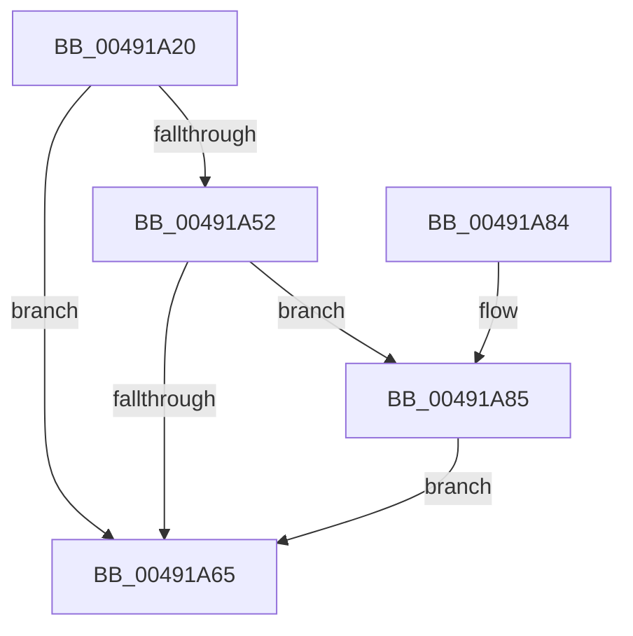

# SshpTracingWriteBlockerStateRundown

- RVA: `0x00491A20`–`0x00491B99` (길이 `377` bytes)
- VA: `0x0000000140491A20`
- 실행 섹션: `.text`
- PDB 이름 있음: `예`; PDB Function 태그: `아니요`
- unwind 정보 RVA: `0x000B2E94`
- 디코드: `96`개 명령, `377/377` bytes 표시
- 미해석 바이트: `0` (있으면 어셈블리에 `.byte`로 보존)

> 이 문서는 커널 이미지의 기계어와 PDB 기호를 분석해 생성했습니다. 4번과 5번은 함수 원형과 자료형을 바이너리 사용 방식에서 추정한 C 해석이며 원본 소스 복구 결과는 아닙니다.

## 1. Dependencies

- 직접 호출 지점: **5**; 고유 호출 대상: **5**
- 직접 호출자로 확인된 함수: **3**
- RIP 상대 이미지 참조: **4**

### Outgoing calls
- `0x00491A5C` → [EtwEventEnabled](../39/EtwEventEnabled_function_00392450.md) (function, `0x00392450`)
- `0x00491A6C` → [_security_check_cookie](../6A/_security_check_cookie_function_006AC640.md) (function, `0x006AC640`)
- `0x00491A8F` → [KeAcquireSpinLockRaiseToDpc](../20/KeAcquireSpinLockRaiseToDpc_function_00208470.md) (function, `0x00208470`)
- `0x00491AB3` → [KeReleaseSpinLock](../39/KeReleaseSpinLock_function_00392BA0.md) (function, `0x00392BA0`)
- `0x00491B8F` → [EtwWriteEx](../25/EtwWriteEx_function_0025F0D0.md) (function, `0x0025F0D0`)

### Direct callers
- [SleepstudyHelperBuildBlocker](../../page/A2/SleepstudyHelperBuildBlocker_function_00A2DAD0.md) at `0x00A2DE19`
- [SshpFreeBlockerEntry](../../page/A4/SshpFreeBlockerEntry_function_00A4E15C.md) at `0x00A4E183`
- [SshpTracingRundownBlockerState](../../page/A8/SshpTracingRundownBlockerState_function_00A8E434.md) at `0x00A8E4A7`

### Static image references
- `0x00491A34` → RVA `0x00E0A740` (`.data`; read)
- `0x00491A42` → RVA `0x00F07038` (`.data`; read)
- `0x00491A52` → RVA `0x00F07010` (`.data`; read)
- `0x00491AC6` → RVA `0x00E08408` (`.data`; read)

## 2. Other-region calls and transfers

- 다른 실행 섹션으로 향하는 call: **0**
- 별도 외부 분기/꼬리 이동을 확인하지 못했습니다.

## 3. Assembly (complete function range)

```asm
00491A20  48 89 5C 24 18                  mov qword ptr [rsp + 0x18], rbx
00491A25  55                              push rbp
00491A26  56                              push rsi
00491A27  57                              push rdi
00491A28  48 8D 6C 24 B9                  lea rbp, [rsp - 0x47]
00491A2D  48 81 EC F0 00 00 00            sub rsp, 0xf0
00491A34  48 8B 05 05 8D 97 00            mov rax, qword ptr [rip + 0x978d05]
00491A3B  48 33 C4                        xor rax, rsp
00491A3E  48 89 45 37                     mov qword ptr [rbp + 0x37], rax
00491A42  8B 05 F0 55 A7 00               mov eax, dword ptr [rip + 0xa755f0]
00491A48  48 8B F2                        mov rsi, rdx
00491A4B  48 8B F9                        mov rdi, rcx
00491A4E  85 C0                           test eax, eax
00491A50  74 13                           je 0x140491a65
00491A52  48 8B 0D B7 55 A7 00            mov rcx, qword ptr [rip + 0xa755b7]
00491A59  48 8B D7                        mov rdx, rdi
00491A5C  E8 EF 09 F0 FF                  call 0x140392450
00491A61  84 C0                           test al, al
00491A63  75 20                           jne 0x140491a85
00491A65  48 8B 4D 37                     mov rcx, qword ptr [rbp + 0x37]
00491A69  48 33 CC                        xor rcx, rsp
00491A6C  E8 CF AB 21 00                  call 0x1406ac640
00491A71  48 8B 9C 24 20 01 00 00         mov rbx, qword ptr [rsp + 0x120]
00491A79  48 81 C4 F0 00 00 00            add rsp, 0xf0
00491A80  5F                              pop rdi
00491A81  5E                              pop rsi
00491A82  5D                              pop rbp
00491A83  C3                              ret
00491A84  CC                              int3
00491A85  48 8B 9E 30 01 00 00            mov rbx, qword ptr [rsi + 0x130]
00491A8C  48 8B CE                        mov rcx, rsi
00491A8F  E8 DC 69 D7 FF                  call 0x140208470
00491A94  8B 4E 08                        mov ecx, dword ptr [rsi + 8]
00491A97  8A D0                           mov dl, al
00491A99  83 E1 01                        and ecx, 1
00491A9C  89 4D 97                        mov dword ptr [rbp - 0x69], ecx
00491A9F  48 B9 08 00 00 00 80 F7 FF FF   movabs rcx, 0xfffff78000000008
00491AA9  48 8B 09                        mov rcx, qword ptr [rcx]
00491AAC  48 89 4D A7                     mov qword ptr [rbp - 0x59], rcx
00491AB0  48 8B CE                        mov rcx, rsi
00491AB3  E8 E8 10 F0 FF                  call 0x140392ba0
00491AB8  41 B9 08 00 00 00               mov r9d, 8
00491ABE  48 89 75 9F                     mov qword ptr [rbp - 0x61], rsi
00491AC2  0F B7 4B 50                     movzx ecx, word ptr [rbx + 0x50]
00491AC6  48 8D 15 3B 69 97 00            lea rdx, [rip + 0x97693b]
00491ACD  83 65 C3 00                     and dword ptr [rbp - 0x3d], 0
00491AD1  48 8D 45 9F                     lea rax, [rbp - 0x61]
00491AD5  83 65 D3 00                     and dword ptr [rbp - 0x2d], 0
00491AD9  83 65 E3 00                     and dword ptr [rbp - 0x1d], 0
00491ADD  45 8D 41 08                     lea r8d, [r9 + 8]
00491AE1  48 89 45 B7                     mov qword ptr [rbp - 0x49], rax
00491AE5  48 8D 43 40                     lea rax, [rbx + 0x40]
00491AE9  48 89 45 C7                     mov qword ptr [rbp - 0x39], rax
00491AED  48 8D 43 30                     lea rax, [rbx + 0x30]
00491AF1  48 89 45 D7                     mov qword ptr [rbp - 0x29], rax
00491AF5  D1 E9                           shr ecx, 1
00491AF7  89 4D 9B                        mov dword ptr [rbp - 0x65], ecx
00491AFA  44 89 4D BF                     mov dword ptr [rbp - 0x41], r9d
00491AFE  44 89 45 CF                     mov dword ptr [rbp - 0x31], r8d
00491B02  44 89 45 DF                     mov dword ptr [rbp - 0x21], r8d
00491B06  48 63 43 28                     movsxd rax, dword ptr [rbx + 0x28]
00491B0A  83 65 F3 00                     and dword ptr [rbp - 0xd], 0
00491B0E  83 65 03 00                     and dword ptr [rbp + 3], 0
00491B12  83 65 13 00                     and dword ptr [rbp + 0x13], 0
00491B16  83 65 23 00                     and dword ptr [rbp + 0x23], 0
00491B1A  48 8D 04 40                     lea rax, [rax + rax*2]
00491B1E  48 03 C0                        add rax, rax
00491B21  44 89 45 EF                     mov dword ptr [rbp - 0x11], r8d
00491B25  44 89 4D FF                     mov dword ptr [rbp - 1], r9d
00491B29  45 33 C0                        xor r8d, r8d
00491B2C  48 8B 04 C2                     mov rax, qword ptr [rdx + rax*8]
00491B30  41 8D 51 FC                     lea edx, [r9 - 4]
00491B34  48 89 45 E7                     mov qword ptr [rbp - 0x19], rax
00491B38  48 8D 45 A7                     lea rax, [rbp - 0x59]
00491B3C  48 89 45 F7                     mov qword ptr [rbp - 9], rax
00491B40  48 8D 45 97                     lea rax, [rbp - 0x69]
00491B44  48 89 45 07                     mov qword ptr [rbp + 7], rax
00491B48  48 8D 45 9B                     lea rax, [rbp - 0x65]
00491B4C  48 89 45 17                     mov qword ptr [rbp + 0x17], rax
00491B50  89 55 0F                        mov dword ptr [rbp + 0xf], edx
00491B53  89 55 1F                        mov dword ptr [rbp + 0x1f], edx
00491B56  48 8B D7                        mov rdx, rdi
00491B59  48 8B 43 58                     mov rax, qword ptr [rbx + 0x58]
00491B5D  83 65 33 00                     and dword ptr [rbp + 0x33], 0
00491B61  48 89 45 27                     mov qword ptr [rbp + 0x27], rax
00491B65  8D 04 09                        lea eax, [rcx + rcx]
00491B68  48 8B 0D A1 54 A7 00            mov rcx, qword ptr [rip + 0xa754a1]
00491B6F  89 45 2F                        mov dword ptr [rbp + 0x2f], eax
00491B72  48 8D 45 B7                     lea rax, [rbp - 0x49]
00491B76  48 89 44 24 38                  mov qword ptr [rsp + 0x38], rax
00491B7B  44 89 4C 24 30                  mov dword ptr [rsp + 0x30], r9d
00491B80  45 33 C9                        xor r9d, r9d
00491B83  48 83 64 24 28 00               and qword ptr [rsp + 0x28], 0
00491B89  48 83 64 24 20 00               and qword ptr [rsp + 0x20], 0
00491B8F  E8 3C D5 DC FF                  call 0x14025f0d0
00491B94  E9 CC FE FF FF                  jmp 0x140491a65
```

## 4. C-style interpretation (structured pseudocode)

```c
__int64 __fastcall SshpTracingWriteBlockerStateRundown(__int64 a1, __int64 a2)
{
    __int64 result;
    __int64 v_rsp;
    unsigned __int64 v_stack_m28;
    unsigned int v_stack_m2C;
    unsigned int v_stack_m30;
    unsigned __int64 v_stack_m38;
    unsigned int v_stack_m3C;
    unsigned int v_stack_m40;
    unsigned __int64 v_stack_m48;
    unsigned int v_stack_m4C;
    unsigned int v_stack_m50;
    unsigned __int64 v_stack_m58;
    unsigned int v_stack_m5C;
    unsigned __int64 v_stack_m5F;
    unsigned int v_stack_m60;
    unsigned __int64 v_stack_m68;
    unsigned int v_stack_m6C;
    unsigned int v_stack_m70;
    unsigned __int64 v_stack_m78;
    unsigned int v_stack_m7C;
    unsigned int v_stack_m80;
    unsigned __int64 v_stack_m88;
    unsigned int v_stack_m8C;
    unsigned int v_stack_m90;
    unsigned __int64 v_stack_m98;
    unsigned int v_stack_m9C;
    unsigned int v_stack_mA0;
    unsigned __int64 v_stack_mA8;
    unsigned __int64 v_stack_mB8;
    unsigned __int64 v_stack_mC0;
    unsigned int v_stack_mC4;
    unsigned int v_stack_mC8;
    unsigned __int64 v_stack_p18;
    unsigned __int64 v_stack_p20;
    unsigned __int64 v_stack_p28;
    unsigned int v_stack_p30;
    unsigned __int64 v_stack_p38;

    v_stack_p18 = v_rbx;
    v_rsp = (v_rsp) - (240);
    result = (*(unsigned __int64 *)(v_rip + 9932037)) ^ (v_rsp);
    v_stack_m28 = result;
    if ((unsigned int)((unsigned int)(*(unsigned int *)(v_rip + 10966512))) == 0) goto loc_00491A65;
    result = EtwEventEnabled(*(unsigned __int64 *)(v_rip + 10966455), a1, a3, a4);
    if ((unsigned __int8)(result) != 0) goto loc_00491A85;
loc_00491A65:
    a1 = (v_stack_m28) ^ (v_rsp);
    result = _security_check_cookie(a1, a1, a3, a4);
    v_rsp = (v_rsp) + (240);
    return result;
loc_00491A85:
    result = KeAcquireSpinLockRaiseToDpc(a2, a1, a3, a4);
    a1 = (unsigned int)(((unsigned int)(*(unsigned int *)(a2 + 8))) & (1));
    v_stack_mC8 = (unsigned int)(a1);
    v_stack_mB8 = *(unsigned __int64 *)(a1);
    result = KeReleaseSpinLock(a2, (unsigned __int8)(result), a3, a4);
    v_stack_mC0 = a2;
    v_stack_mA8 = v_stack_mC0;
    v_stack_m98 = *(unsigned __int64 *)(a2 + 304) + 64;
    v_stack_m88 = *(unsigned __int64 *)(a2 + 304) + 48;
    a1 = (unsigned int)((*(unsigned __int16 *)(*(unsigned __int64 *)(a2 + 304) + 80)) >> (1));
    v_stack_mC4 = (unsigned int)(a1);
    v_stack_mA0 = 8;
    v_stack_m90 = (unsigned int)(8 + 8);
    v_stack_m80 = (unsigned int)(8 + 8);
    result = ((int)(*(unsigned int *)(*(unsigned __int64 *)(a2 + 304) + 40)) + (int)(*(unsigned int *)(*(unsigned __int64 *)(a2 + 304) + 40)) * 2) + ((int)(*(unsigned int *)(*(unsigned __int64 *)(a2 + 304) + 40)) + (int)(*(unsigned int *)(*(unsigned __int64 *)(a2 + 304) + 40)) * 2);
    v_stack_m70 = (unsigned int)(8 + 8);
    v_stack_m60 = 8;
    a3 = 0;
    v_stack_m78 = *(unsigned __int64 *)(v_rip + 9922875 + result * 8);
    v_stack_m68 = v_stack_mB8;
    v_stack_m58 = v_stack_mC8;
    v_stack_m48 = v_stack_mC4;
    v_stack_m50 = (unsigned int)(8 - 4);
    v_stack_m40 = (unsigned int)(8 - 4);
    v_stack_m38 = *(unsigned __int64 *)(*(unsigned __int64 *)(a2 + 304) + 88);
    v_stack_m30 = (unsigned int)(a1 + a1 * 1);
    v_stack_p38 = v_stack_mA8;
    v_stack_p30 = 8;
    a4 = 0;
    result = EtwWriteEx(*(unsigned __int64 *)(v_rip + 10966177), a1, a3, a4);
    goto loc_00491A65;
}
```

## 5. (Beta) C Style

```c
int64_t SshpTracingWriteBlockerStateRundown(int64_t Arg1, void *Arg2)
{
    uint8_t *arg2 = (uint8_t *)Arg2;

    int64_t result;
    int64_t local_rsp;
    uint64_t v_stack_m28;
    uint32_t v_stack_m2C;
    uint32_t v_stack_m30;
    uint64_t v_stack_m38;
    uint32_t v_stack_m3C;
    uint32_t v_stack_m40;
    uint64_t v_stack_m48;
    uint32_t v_stack_m4C;
    uint32_t v_stack_m50;
    uint64_t v_stack_m58;
    uint32_t v_stack_m5C;
    uint64_t v_stack_m5F;
    uint32_t v_stack_m60;
    uint64_t v_stack_m68;
    uint32_t v_stack_m6C;
    uint32_t v_stack_m70;
    uint64_t v_stack_m78;
    uint32_t v_stack_m7C;
    uint32_t v_stack_m80;
    uint64_t v_stack_m88;
    uint32_t v_stack_m8C;
    uint32_t v_stack_m90;
    uint64_t v_stack_m98;
    uint32_t v_stack_m9C;
    uint32_t v_stack_mA0;
    uint64_t v_stack_mA8;
    uint64_t v_stack_mB8;
    uint64_t v_stack_mC0;
    uint32_t v_stack_mC4;
    uint32_t v_stack_mC8;
    uint64_t v_stack_p18;
    uint64_t v_stack_p20;
    uint64_t v_stack_p28;
    uint32_t v_stack_p30;
    uint64_t v_stack_p38;

    v_stack_p18 = local_rbx;
    local_rsp = (local_rsp) - (240);
    result = (*(uint64_t *)(v_rip + 0x978D05)) ^ (local_rsp);
    v_stack_m28 = result;
    if ((uint32_t)((uint32_t)(*(uint32_t *)(v_rip + 0xA755F0))) == 0) goto loc_00491A65;
    result = EtwEventEnabled(*(uint64_t *)(v_rip + 0xA755B7), Arg1, a3, a4);
    if ((uint8_t)(result) != 0) goto loc_00491A85;
loc_00491A65:
    Arg1 = (v_stack_m28) ^ (local_rsp);
    result = _security_check_cookie(Arg1, Arg1, a3, a4);
    local_rsp = (local_rsp) + (240);
    return result;
loc_00491A85:
    result = KeAcquireSpinLockRaiseToDpc(Arg2, Arg1, a3, a4);
    Arg1 = (uint32_t)(((uint32_t)(*(uint32_t *)(arg2 + 0x8))) & (1));
    v_stack_mC8 = (uint32_t)(Arg1);
    v_stack_mB8 = *(uint64_t *)(Arg1);
    result = KeReleaseSpinLock(Arg2, (uint8_t)(result), a3, a4);
    v_stack_mC0 = Arg2;
    v_stack_mA8 = v_stack_mC0;
    v_stack_m98 = *(uint64_t *)(arg2 + 0x130) + 64;
    v_stack_m88 = *(uint64_t *)(arg2 + 0x130) + 48;
    Arg1 = (uint32_t)((*(uint16_t *)(*(uint64_t *)(arg2 + 0x130) + 0x50)) >> (1));
    v_stack_mC4 = (uint32_t)(Arg1);
    v_stack_mA0 = 8;
    v_stack_m90 = (uint32_t)(8 + 8);
    v_stack_m80 = (uint32_t)(8 + 8);
    result = ((int32_t)(*(uint32_t *)(*(uint64_t *)(arg2 + 0x130) + 0x28)) + (int32_t)(*(uint32_t *)(*(uint64_t *)(arg2 + 0x130) + 0x28)) * 2) + ((int32_t)(*(uint32_t *)(*(uint64_t *)(arg2 + 0x130) + 0x28)) + (int32_t)(*(uint32_t *)(*(uint64_t *)(arg2 + 0x130) + 0x28)) * 2);
    v_stack_m70 = (uint32_t)(8 + 8);
    v_stack_m60 = 8;
    a3 = 0;
    v_stack_m78 = *(uint64_t *)(v_rip + 0x97693B + result * 8);
    v_stack_m68 = v_stack_mB8;
    v_stack_m58 = v_stack_mC8;
    v_stack_m48 = v_stack_mC4;
    v_stack_m50 = (uint32_t)(8 - 4);
    v_stack_m40 = (uint32_t)(8 - 4);
    v_stack_m38 = *(uint64_t *)(*(uint64_t *)(arg2 + 0x130) + 0x58);
    v_stack_m30 = (uint32_t)(Arg1 + Arg1 * 1);
    v_stack_p38 = v_stack_mA8;
    v_stack_p30 = 8;
    a4 = 0;
    result = EtwWriteEx(*(uint64_t *)(v_rip + 0xA754A1), Arg1, a3, a4);
    goto loc_00491A65;
}
```

### 관측된 메모리 오프셋

구조체 형식이 확인되지 않은 접근은 인자 기준의 오프셋으로만 기록했습니다.

| 기준 인자 | 오프셋 표현 | 폭 (bit) | 접근 |
|---|---:|---:|---|
| `Arg2` | `+ 0x8` | `32` | `R` |
| `Arg2` | `+ 0x130` | `64` | `R` |

## 6. Execution-region graph

[열기: 2D/3D 그래프와 함수 탐색 컨트롤 패널](../../../control-panel.html?section=text&rva=0x00491A20&view=graph)

- 2D 그래프는 위에서 아래로 흐르고, 3D 그래프는 빈 공간을 드래그해 회전합니다. Shift+드래그는 이동, 휠은 확대·축소, 함수 노드 선택은 대상 보고서 이동입니다.

### Static fallback


