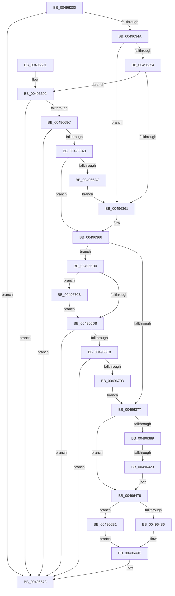

# SshpWriteBlocker

- RVA: `0x00496300`–`0x0049671F` (길이 `1,055` bytes)
- VA: `0x0000000140496300`
- 실행 섹션: `.text`
- PDB 이름 있음: `예`; PDB Function 태그: `예`
- unwind 정보 RVA: `0x000B3AC0`
- 디코드: `232`개 명령, `1,055/1,055` bytes 표시
- 미해석 바이트: `0` (있으면 어셈블리에 `.byte`로 보존)

> 이 문서는 커널 이미지의 기계어와 PDB 기호를 분석해 생성했습니다. 4번과 5번은 함수 원형과 자료형을 바이너리 사용 방식에서 추정한 C 해석이며 원본 소스 복구 결과는 아닙니다.

## 1. Dependencies

- 직접 호출 지점: **4**; 고유 호출 대상: **3**
- 직접 호출자로 확인된 함수: **1**
- RIP 상대 이미지 참조: **6**

### Outgoing calls
- `0x00496471` → [EtwWriteEx](../25/EtwWriteEx_function_0025F0D0.md) (function, `0x0025F0D0`)
- `0x0049666E` → [EtwWriteEx](../25/EtwWriteEx_function_0025F0D0.md) (function, `0x0025F0D0`)
- `0x004966EF` → [SSHSupportAllocatePaged](../../page/A6/SSHSupportAllocatePaged_function_00A624FC.md) (function, `0x00A624FC`)
- `0x00496710` → [ExFreePoolWithTag](../../poolcode/B8/ExFreePoolWithTag_function_00B82870.md) (function, `0x00B82870`)

### Direct callers
- [SshNotifySystemSessionChange](../../page/A6/SshNotifySystemSessionChange_function_00A602BC.md) at `0x00A60508`

### Static image references
- `0x00496335` → RVA `0x00F07038` (`.data`; read)
- `0x0049638D` → RVA `0x0001A898` (`.rdata`; read)
- `0x00496397` → RVA `0x0001BB08` (`.rdata`; read)
- `0x0049645C` → RVA `0x00F07010` (`.data`; read)
- `0x00496486` → RVA `0x00013F90` (`.rdata`; read)
- `0x004964A1` → RVA `0x0001A888` (`.rdata`; read)

## 2. Other-region calls and transfers

- 다른 실행 섹션으로 향하는 call: **2**
  - `0x004966EF` → [SSHSupportAllocatePaged](../../page/A6/SSHSupportAllocatePaged_function_00A624FC.md) (`.text` → `PAGE`)
  - `0x00496710` → [ExFreePoolWithTag](../../poolcode/B8/ExFreePoolWithTag_function_00B82870.md) (`.text` → `POOLCODE`)
- call이 아닌 외부 분기/꼬리 이동: **1**
  - `0x0049641D` → [sub_006F75B4](../6F/Unknown_function_006F75B4.md) (`tail-transfer`)

## 3. Assembly (complete function range)

```asm
00496300  48 89 5C 24 10                  mov qword ptr [rsp + 0x10], rbx
00496305  48 89 74 24 18                  mov qword ptr [rsp + 0x18], rsi
0049630A  48 89 7C 24 20                  mov qword ptr [rsp + 0x20], rdi
0049630F  55                              push rbp
00496310  41 54                           push r12
00496312  41 55                           push r13
00496314  41 56                           push r14
00496316  41 57                           push r15
00496318  48 8B EC                        mov rbp, rsp
0049631B  48 83 EC 50                     sub rsp, 0x50
0049631F  8A 45 50                        mov al, byte ptr [rbp + 0x50]
00496322  45 33 DB                        xor r11d, r11d
00496325  48 8B B9 30 01 00 00            mov rdi, qword ptr [rcx + 0x130]
0049632C  45 8A F9                        mov r15b, r9b
0049632F  88 45 30                        mov byte ptr [rbp + 0x30], al
00496332  4D 8B E0                        mov r12, r8
00496335  8B 05 FD 0C A7 00               mov eax, dword ptr [rip + 0xa70cfd]
0049633B  4C 8B EA                        mov r13, rdx
0049633E  44 89 5D F8                     mov dword ptr [rbp - 8], r11d
00496342  85 C0                           test eax, eax
00496344  0F 84 29 03 00 00               je 0x140496673
0049634A  B9 FF FF FF FF                  mov ecx, 0xffffffff
0049634F  45 84 C9                        test r9b, r9b
00496352  74 0D                           je 0x140496361
00496354  48 8B 47 60                     mov rax, qword ptr [rdi + 0x60]
00496358  48 85 C0                        test rax, rax
0049635B  0F 85 31 03 00 00               jne 0x140496692
00496361  BB 15 00 00 00                  mov ebx, 0x15
00496366  4C 8B 75 68                     mov r14, qword ptr [rbp + 0x68]
0049636A  48 8B 75 60                     mov rsi, qword ptr [rbp + 0x60]
0049636E  41 3B 1E                        cmp ebx, dword ptr [r14]
00496371  0F 87 59 03 00 00               ja 0x1404966d0
00496377  48 8B 1E                        mov rbx, qword ptr [rsi]
0049637A  41 B8 10 00 00 00               mov r8d, 0x10
00496380  45 84 FF                        test r15b, r15b
00496383  0F 84 F0 00 00 00               je 0x140496479
00496389  48 8B 4F 60                     mov rcx, qword ptr [rdi + 0x60]
0049638D  48 8D 05 04 45 B8 FF            lea rax, [rip - 0x47bafc]
00496394  48 85 C9                        test rcx, rcx
00496397  4C 8D 35 6A 57 B8 FF            lea r14, [rip - 0x47a896]
0049639E  48 8D 55 30                     lea rdx, [rbp + 0x30]
004963A2  4C 0F 45 F0                     cmovne r14, rax
004963A6  45 8D 50 F7                     lea r10d, [r8 - 9]
004963AA  48 8D 45 50                     lea rax, [rbp + 0x50]
004963AE  48 0F 44 C2                     cmove rax, rdx
004963B2  48 F7 D9                        neg rcx
004963B5  48 89 03                        mov qword ptr [rbx], rax
004963B8  1B C0                           sbb eax, eax
004963BA  41 23 C2                        and eax, r10d
004963BD  FF C0                           inc eax
004963BF  89 43 08                        mov dword ptr [rbx + 8], eax
004963C2  48 8D 47 30                     lea rax, [rdi + 0x30]
004963C6  44 89 5B 0C                     mov dword ptr [rbx + 0xc], r11d
004963CA  48 89 43 10                     mov qword ptr [rbx + 0x10], rax
004963CE  4C 89 43 18                     mov qword ptr [rbx + 0x18], r8
004963D2  0F B7 47 50                     movzx eax, word ptr [rdi + 0x50]
004963D6  D1 E8                           shr eax, 1
004963D8  89 45 F8                        mov dword ptr [rbp - 8], eax
004963DB  48 8D 45 F8                     lea rax, [rbp - 8]
004963DF  48 89 43 20                     mov qword ptr [rbx + 0x20], rax
004963E3  48 C7 43 28 04 00 00 00         mov qword ptr [rbx + 0x28], 4
004963EB  48 8B 47 58                     mov rax, qword ptr [rdi + 0x58]
004963EF  0F B7 4F 50                     movzx ecx, word ptr [rdi + 0x50]
004963F3  48 89 43 30                     mov qword ptr [rbx + 0x30], rax
004963F7  48 8D 47 40                     lea rax, [rdi + 0x40]
004963FB  89 4B 38                        mov dword ptr [rbx + 0x38], ecx
004963FE  44 89 5B 3C                     mov dword ptr [rbx + 0x3c], r11d
00496402  48 89 43 40                     mov qword ptr [rbx + 0x40], rax
00496406  4C 89 43 48                     mov qword ptr [rbx + 0x48], r8
0049640A  4C 89 6B 50                     mov qword ptr [rbx + 0x50], r13
0049640E  48 C7 43 58 08 00 00 00         mov qword ptr [rbx + 0x58], 8
00496416  4C 8B 4F 60                     mov r9, qword ptr [rdi + 0x60]
0049641A  4D 85 C9                        test r9, r9
0049641D  0F 85 91 11 26 00               jne 0x1406f75b4
00496423  48 8D 45 50                     lea rax, [rbp + 0x50]
00496427  48 C7 43 68 08 00 00 00         mov qword ptr [rbx + 0x68], 8
0049642F  48 89 43 60                     mov qword ptr [rbx + 0x60], rax
00496433  48 89 5C 24 38                  mov qword ptr [rsp + 0x38], rbx
00496438  48 8D 4D 58                     lea rcx, [rbp + 0x58]
0049643C  41 8B C2                        mov eax, r10d
0049643F  45 33 C9                        xor r9d, r9d
00496442  48 03 C0                        add rax, rax
00496445  45 33 C0                        xor r8d, r8d
00496448  49 8B D6                        mov rdx, r14
0049644B  48 89 0C C3                     mov qword ptr [rbx + rax*8], rcx
0049644F  48 C7 44 C3 08 08 00 00 00      mov qword ptr [rbx + rax*8 + 8], 8
00496458  41 8D 42 01                     lea eax, [r10 + 1]
0049645C  48 8B 0D AD 0B A7 00            mov rcx, qword ptr [rip + 0xa70bad]
00496463  89 44 24 30                     mov dword ptr [rsp + 0x30], eax
00496467  4C 89 5C 24 28                  mov qword ptr [rsp + 0x28], r11
0049646C  4C 89 5C 24 20                  mov qword ptr [rsp + 0x20], r11
00496471  E8 5A 8C DC FF                  call 0x14025f0d0
00496476  45 33 DB                        xor r11d, r11d
00496479  48 8B 57 68                     mov rdx, qword ptr [rdi + 0x68]
0049647D  48 85 D2                        test rdx, rdx
00496480  0F 85 2B 02 00 00               jne 0x1404966b1
00496486  4C 8D 05 03 DB B7 FF            lea r8, [rip - 0x4824fd]
0049648D  44 89 5D F4                     mov dword ptr [rbp - 0xc], r11d
00496491  4D 8B C8                        mov r9, r8
00496494  44 89 5D F0                     mov dword ptr [rbp - 0x10], r11d
00496498  49 8B C8                        mov rcx, r8
0049649B  41 8B C3                        mov eax, r11d
0049649E  89 45 FC                        mov dword ptr [rbp - 4], eax
004964A1  48 8D 15 E0 43 B8 FF            lea rdx, [rip - 0x47bc20]
004964A8  48 C7 43 08 08 00 00 00         mov qword ptr [rbx + 8], 8
004964B0  48 8D 45 50                     lea rax, [rbp + 0x50]
004964B4  48 89 03                        mov qword ptr [rbx], rax
004964B7  48 8D 47 40                     lea rax, [rdi + 0x40]
004964BB  48 89 43 10                     mov qword ptr [rbx + 0x10], rax
004964BF  48 8D 47 30                     lea rax, [rdi + 0x30]
004964C3  48 C7 43 18 10 00 00 00         mov qword ptr [rbx + 0x18], 0x10
004964CB  48 89 43 20                     mov qword ptr [rbx + 0x20], rax
004964CF  49 8D 45 58                     lea rax, [r13 + 0x58]
004964D3  48 C7 43 28 10 00 00 00         mov qword ptr [rbx + 0x28], 0x10
004964DB  4C 89 6B 30                     mov qword ptr [rbx + 0x30], r13
004964DF  48 C7 43 38 08 00 00 00         mov qword ptr [rbx + 0x38], 8
004964E7  48 89 43 40                     mov qword ptr [rbx + 0x40], rax
004964EB  49 8D 45 08                     lea rax, [r13 + 8]
004964EF  48 C7 43 48 14 00 00 00         mov qword ptr [rbx + 0x48], 0x14
004964F7  48 89 43 50                     mov qword ptr [rbx + 0x50], rax
004964FB  49 8D 45 6C                     lea rax, [r13 + 0x6c]
004964FF  48 C7 43 58 28 00 00 00         mov qword ptr [rbx + 0x58], 0x28
00496507  48 89 43 60                     mov qword ptr [rbx + 0x60], rax
0049650B  49 8D 45 30                     lea rax, [r13 + 0x30]
0049650F  48 C7 43 68 14 00 00 00         mov qword ptr [rbx + 0x68], 0x14
00496517  48 89 43 70                     mov qword ptr [rbx + 0x70], rax
0049651B  49 8D 44 24 58                  lea rax, [r12 + 0x58]
00496520  48 C7 43 78 28 00 00 00         mov qword ptr [rbx + 0x78], 0x28
00496528  4C 89 A3 80 00 00 00            mov qword ptr [rbx + 0x80], r12
0049652F  48 C7 83 88 00 00 00 08 00 00 00  mov qword ptr [rbx + 0x88], 8
0049653A  48 89 83 90 00 00 00            mov qword ptr [rbx + 0x90], rax
00496541  49 8D 44 24 08                  lea rax, [r12 + 8]
00496546  48 C7 83 98 00 00 00 14 00 00 00  mov qword ptr [rbx + 0x98], 0x14
00496551  48 89 83 A0 00 00 00            mov qword ptr [rbx + 0xa0], rax
00496558  49 8D 44 24 6C                  lea rax, [r12 + 0x6c]
0049655D  48 C7 83 A8 00 00 00 28 00 00 00  mov qword ptr [rbx + 0xa8], 0x28
00496568  48 89 83 B0 00 00 00            mov qword ptr [rbx + 0xb0], rax
0049656F  49 8D 44 24 30                  lea rax, [r12 + 0x30]
00496574  48 C7 83 B8 00 00 00 14 00 00 00  mov qword ptr [rbx + 0xb8], 0x14
0049657F  48 89 83 C0 00 00 00            mov qword ptr [rbx + 0xc0], rax
00496586  48 8D 47 28                     lea rax, [rdi + 0x28]
0049658A  48 C7 83 C8 00 00 00 28 00 00 00  mov qword ptr [rbx + 0xc8], 0x28
00496595  48 89 83 D0 00 00 00            mov qword ptr [rbx + 0xd0], rax
0049659C  48 8D 45 F0                     lea rax, [rbp - 0x10]
004965A0  48 C7 83 D8 00 00 00 04 00 00 00  mov qword ptr [rbx + 0xd8], 4
004965AB  48 89 83 E0 00 00 00            mov qword ptr [rbx + 0xe0], rax
004965B2  48 C7 83 E8 00 00 00 04 00 00 00  mov qword ptr [rbx + 0xe8], 4
004965BD  8B 45 F0                        mov eax, dword ptr [rbp - 0x10]
004965C0  4C 89 8B F0 00 00 00            mov qword ptr [rbx + 0xf0], r9
004965C7  03 C0                           add eax, eax
004965C9  89 83 F8 00 00 00               mov dword ptr [rbx + 0xf8], eax
004965CF  45 33 C9                        xor r9d, r9d
004965D2  44 89 9B FC 00 00 00            mov dword ptr [rbx + 0xfc], r11d
004965D9  48 8D 45 F4                     lea rax, [rbp - 0xc]
004965DD  48 89 83 00 01 00 00            mov qword ptr [rbx + 0x100], rax
004965E4  48 C7 83 08 01 00 00 04 00 00 00  mov qword ptr [rbx + 0x108], 4
004965EF  8B 45 F4                        mov eax, dword ptr [rbp - 0xc]
004965F2  4C 89 83 10 01 00 00            mov qword ptr [rbx + 0x110], r8
004965F9  03 C0                           add eax, eax
004965FB  89 83 18 01 00 00               mov dword ptr [rbx + 0x118], eax
00496601  45 33 C0                        xor r8d, r8d
00496604  44 89 9B 1C 01 00 00            mov dword ptr [rbx + 0x11c], r11d
0049660B  48 8D 45 FC                     lea rax, [rbp - 4]
0049660F  48 89 83 20 01 00 00            mov qword ptr [rbx + 0x120], rax
00496616  48 C7 83 28 01 00 00 04 00 00 00  mov qword ptr [rbx + 0x128], 4
00496621  8B 45 FC                        mov eax, dword ptr [rbp - 4]
00496624  48 89 8B 30 01 00 00            mov qword ptr [rbx + 0x130], rcx
0049662B  03 C0                           add eax, eax
0049662D  89 83 38 01 00 00               mov dword ptr [rbx + 0x138], eax
00496633  48 8D 45 58                     lea rax, [rbp + 0x58]
00496637  44 89 9B 3C 01 00 00            mov dword ptr [rbx + 0x13c], r11d
0049663E  48 89 5C 24 38                  mov qword ptr [rsp + 0x38], rbx
00496643  48 89 83 40 01 00 00            mov qword ptr [rbx + 0x140], rax
0049664A  48 C7 83 48 01 00 00 08 00 00 00  mov qword ptr [rbx + 0x148], 8
00496655  48 8B 0D B4 09 A7 00            mov rcx, qword ptr [rip + 0xa709b4]
0049665C  C7 44 24 30 15 00 00 00         mov dword ptr [rsp + 0x30], 0x15
00496664  4C 89 5C 24 28                  mov qword ptr [rsp + 0x28], r11
00496669  4C 89 5C 24 20                  mov qword ptr [rsp + 0x20], r11
0049666E  E8 5D 8A DC FF                  call 0x14025f0d0
00496673  4C 8D 5C 24 50                  lea r11, [rsp + 0x50]
00496678  49 8B 5B 38                     mov rbx, qword ptr [r11 + 0x38]
0049667C  49 8B 73 40                     mov rsi, qword ptr [r11 + 0x40]
00496680  49 8B 7B 48                     mov rdi, qword ptr [r11 + 0x48]
00496684  49 8B E3                        mov rsp, r11
00496687  41 5F                           pop r15
00496689  41 5E                           pop r14
0049668B  41 5D                           pop r13
0049668D  41 5C                           pop r12
0049668F  5D                              pop rbp
00496690  C3                              ret
00496691  CC                              int3
00496692  8B 00                           mov eax, dword ptr [rax]
00496694  48 03 C0                        add rax, rax
00496697  48 3B C1                        cmp rax, rcx
0049669A  77 D7                           ja 0x140496673
0049669C  8D 58 0B                        lea ebx, [rax + 0xb]
0049669F  3B D8                           cmp ebx, eax
004966A1  72 D0                           jb 0x140496673
004966A3  83 FB 15                        cmp ebx, 0x15
004966A6  0F 87 BA FC FF FF               ja 0x140496366
004966AC  E9 B0 FC FF FF                  jmp 0x140496361
004966B1  8B 02                           mov eax, dword ptr [rdx]
004966B3  4C 8D 42 0C                     lea r8, [rdx + 0xc]
004966B7  89 45 F4                        mov dword ptr [rbp - 0xc], eax
004966BA  8B 4A 04                        mov ecx, dword ptr [rdx + 4]
004966BD  89 4D F0                        mov dword ptr [rbp - 0x10], ecx
004966C0  4D 8D 0C 40                     lea r9, [r8 + rax*2]
004966C4  8B 42 08                        mov eax, dword ptr [rdx + 8]
004966C7  49 8D 0C 49                     lea rcx, [r9 + rcx*2]
004966CB  E9 CE FD FF FF                  jmp 0x14049649e
004966D0  48 8B 0E                        mov rcx, qword ptr [rsi]
004966D3  48 85 C9                        test rcx, rcx
004966D6  75 33                           jne 0x14049670b
004966D8  8B C3                           mov eax, ebx
004966DA  B9 FF FF FF FF                  mov ecx, 0xffffffff
004966DF  48 C1 E0 04                     shl rax, 4
004966E3  48 3B C1                        cmp rax, rcx
004966E6  77 8B                           ja 0x140496673
004966E8  8B C8                           mov ecx, eax
004966EA  BA 73 73 68 70                  mov edx, 0x70687373
004966EF  E8 08 BE 5C 00                  call 0x140a624fc
004966F4  45 33 DB                        xor r11d, r11d
004966F7  48 89 06                        mov qword ptr [rsi], rax
004966FA  48 85 C0                        test rax, rax
004966FD  0F 84 70 FF FF FF               je 0x140496673
00496703  41 89 1E                        mov dword ptr [r14], ebx
00496706  E9 6C FC FF FF                  jmp 0x140496377
0049670B  BA 73 73 68 70                  mov edx, 0x70687373
00496710  E8 5B C1 6E 00                  call 0x140b82870
00496715  48 83 26 00                     and qword ptr [rsi], 0
00496719  41 83 26 00                     and dword ptr [r14], 0
0049671D  EB B9                           jmp 0x1404966d8
```

## 4. C-style interpretation (structured pseudocode)

```c
__int64 __fastcall SshpWriteBlocker(__int64 a1, __int64 a2, __int64 a3, unsigned __int8 a4, unsigned __int8 a5, __int64 a6, __int64 a7, __int64 a8)
{
    __int64 result;
    __int64 v_r11;
    __int64 v_r14;
    __int64 v_rsp;
    unsigned __int64 v_stack_m28;
    unsigned int v_stack_m2C;
    unsigned int v_stack_m30;
    unsigned int v_stack_m34;
    unsigned int v_stack_m38;
    unsigned __int64 v_stack_m40;
    unsigned int v_stack_m48;
    unsigned __int64 v_stack_m50;
    unsigned __int64 v_stack_m58;
    unsigned __int64 v_stack_p10;
    unsigned __int64 v_stack_p18;
    unsigned __int64 v_stack_p20;
    unsigned __int8 v_stack_p8;

    v_stack_p10 = v_rbx;
    v_stack_p18 = v_rsi;
    v_stack_p20 = v_rdi;
    v_rsp = (v_rsp) - (80);
    v_r11 = 0;
    v_stack_p8 = a5;
    v_stack_m30 = 0;
    if ((unsigned int)((unsigned int)(*(unsigned int *)(v_rip + 10947837))) == 0) goto loc_00496673;
    if (a4 == 0) goto loc_00496361;
    if (*(unsigned __int64 *)(*(unsigned __int64 *)(a1 + 304) + 96) != 0) goto loc_00496692;
loc_00496361:
loc_00496366:
    if (21 > (*(unsigned int *)(a8))) goto loc_004966D0;
loc_00496377:
    if (a4 == 0) goto loc_00496479;
    v_r14 = v_rip - 4696214;
    if (*(unsigned __int64 *)(*(unsigned __int64 *)(a1 + 304) + 96) != 0) { v_r14 = v_rip - 4700924; }
    if (*(unsigned __int64 *)(*(unsigned __int64 *)(a1 + 304) + 96) == 0) { a5 = v_stack_p8; }
    a1 = -(*(unsigned __int64 *)(*(unsigned __int64 *)(a1 + 304) + 96));
    *(unsigned __int64 *)(*(unsigned __int64 *)(a7)) = a5;
    result = (unsigned int)((a5) & ((unsigned int)(16 - 9)));
    result = (unsigned int)((result) + 1);
    *(unsigned int *)(*(unsigned __int64 *)(a7) + 8) = (unsigned int)(result);
    *(unsigned int *)(*(unsigned __int64 *)(a7) + 12) = 0;
    *(unsigned __int64 *)(*(unsigned __int64 *)(a7) + 16) = *(unsigned __int64 *)(a1 + 304) + 48;
    *(unsigned __int64 *)(*(unsigned __int64 *)(a7) + 24) = 16;
    result = (unsigned int)((*(unsigned __int16 *)(*(unsigned __int64 *)(a1 + 304) + 80)) >> (1));
    v_stack_m30 = (unsigned int)(result);
    *(unsigned __int64 *)(*(unsigned __int64 *)(a7) + 32) = v_stack_m30;
    *(unsigned __int64 *)(*(unsigned __int64 *)(a7) + 40) = 4;
    *(unsigned __int64 *)(*(unsigned __int64 *)(a7) + 48) = *(unsigned __int64 *)(*(unsigned __int64 *)(a1 + 304) + 88);
    *(unsigned int *)(*(unsigned __int64 *)(a7) + 56) = (unsigned int)(*(unsigned __int16 *)(*(unsigned __int64 *)(a1 + 304) + 80));
    *(unsigned int *)(*(unsigned __int64 *)(a7) + 60) = 0;
    *(unsigned __int64 *)(*(unsigned __int64 *)(a7) + 64) = *(unsigned __int64 *)(a1 + 304) + 64;
    *(unsigned __int64 *)(*(unsigned __int64 *)(a7) + 72) = 16;
    *(unsigned __int64 *)(*(unsigned __int64 *)(a7) + 80) = a2;
    *(unsigned __int64 *)(*(unsigned __int64 *)(a7) + 88) = 8;
    *(unsigned __int64 *)(*(unsigned __int64 *)(a7) + 104) = 8;
    *(unsigned __int64 *)(*(unsigned __int64 *)(a7) + 96) = a5;
    v_stack_m40 = *(unsigned __int64 *)(a7);
    a4 = 0;
    result = ((unsigned int)((unsigned int)(16 - 9))) + ((unsigned int)((unsigned int)(16 - 9)));
    a3 = 0;
    *(unsigned __int64 *)(*(unsigned __int64 *)(a7) + result * 8) = a6;
    *(unsigned __int64 *)(*(unsigned __int64 *)(a7) + result * 8 + 8) = 8;
    v_stack_m48 = (unsigned int)(16 - 9 + 1);
    v_stack_m50 = 0;
    v_stack_m58 = 0;
    result = EtwWriteEx(*(unsigned __int64 *)(v_rip + 10947501), v_r14, a3, a4);
    v_r11 = 0;
loc_00496479:
    if (*(unsigned __int64 *)(*(unsigned __int64 *)(a1 + 304) + 104) != 0) goto loc_004966B1;
    v_stack_m34 = 0;
    v_stack_m38 = 0;
loc_0049649E:
    v_stack_m2C = 0;
    *(unsigned __int64 *)(*(unsigned __int64 *)(a7) + 8) = 8;
    *(unsigned __int64 *)(*(unsigned __int64 *)(a7)) = a5;
    *(unsigned __int64 *)(*(unsigned __int64 *)(a7) + 16) = *(unsigned __int64 *)(a1 + 304) + 64;
    *(unsigned __int64 *)(*(unsigned __int64 *)(a7) + 24) = 16;
    *(unsigned __int64 *)(*(unsigned __int64 *)(a7) + 32) = *(unsigned __int64 *)(a1 + 304) + 48;
    *(unsigned __int64 *)(*(unsigned __int64 *)(a7) + 40) = 16;
    *(unsigned __int64 *)(*(unsigned __int64 *)(a7) + 48) = a2;
    *(unsigned __int64 *)(*(unsigned __int64 *)(a7) + 56) = 8;
    *(unsigned __int64 *)(*(unsigned __int64 *)(a7) + 64) = a2 + 88;
    *(unsigned __int64 *)(*(unsigned __int64 *)(a7) + 72) = 20;
    *(unsigned __int64 *)(*(unsigned __int64 *)(a7) + 80) = a2 + 8;
    *(unsigned __int64 *)(*(unsigned __int64 *)(a7) + 88) = 40;
    *(unsigned __int64 *)(*(unsigned __int64 *)(a7) + 96) = a2 + 108;
    *(unsigned __int64 *)(*(unsigned __int64 *)(a7) + 104) = 20;
    *(unsigned __int64 *)(*(unsigned __int64 *)(a7) + 112) = a2 + 48;
    *(unsigned __int64 *)(*(unsigned __int64 *)(a7) + 120) = 40;
    *(unsigned __int64 *)(*(unsigned __int64 *)(a7) + 128) = 0;
    *(unsigned __int64 *)(*(unsigned __int64 *)(a7) + 136) = 8;
    *(unsigned __int64 *)(*(unsigned __int64 *)(a7) + 144) = a3 + 88;
    *(unsigned __int64 *)(*(unsigned __int64 *)(a7) + 152) = 20;
    *(unsigned __int64 *)(*(unsigned __int64 *)(a7) + 160) = a3 + 8;
    *(unsigned __int64 *)(*(unsigned __int64 *)(a7) + 168) = 40;
    *(unsigned __int64 *)(*(unsigned __int64 *)(a7) + 176) = a3 + 108;
    *(unsigned __int64 *)(*(unsigned __int64 *)(a7) + 184) = 20;
    *(unsigned __int64 *)(*(unsigned __int64 *)(a7) + 192) = a3 + 48;
    *(unsigned __int64 *)(*(unsigned __int64 *)(a7) + 200) = 40;
    *(unsigned __int64 *)(*(unsigned __int64 *)(a7) + 208) = *(unsigned __int64 *)(a1 + 304) + 40;
    *(unsigned __int64 *)(*(unsigned __int64 *)(a7) + 216) = 4;
    *(unsigned __int64 *)(*(unsigned __int64 *)(a7) + 224) = v_stack_m38;
    *(unsigned __int64 *)(*(unsigned __int64 *)(a7) + 232) = 4;
    *(unsigned __int64 *)(*(unsigned __int64 *)(a7) + 240) = v_rip - 4728061;
    result = (unsigned int)(((unsigned int)(v_stack_m38)) + ((unsigned int)((unsigned int)(v_stack_m38))));
    *(unsigned int *)(*(unsigned __int64 *)(a7) + 248) = (unsigned int)(result);
    a4 = 0;
    *(unsigned int *)(*(unsigned __int64 *)(a7) + 252) = 0;
    *(unsigned __int64 *)(*(unsigned __int64 *)(a7) + 256) = v_stack_m34;
    *(unsigned __int64 *)(*(unsigned __int64 *)(a7) + 264) = 4;
    *(unsigned __int64 *)(*(unsigned __int64 *)(a7) + 272) = v_rip - 4728061;
    result = (unsigned int)(((unsigned int)(v_stack_m34)) + ((unsigned int)((unsigned int)(v_stack_m34))));
    *(unsigned int *)(*(unsigned __int64 *)(a7) + 280) = (unsigned int)(result);
    a3 = 0;
    *(unsigned int *)(*(unsigned __int64 *)(a7) + 284) = 0;
    *(unsigned __int64 *)(*(unsigned __int64 *)(a7) + 288) = v_stack_m2C;
    *(unsigned __int64 *)(*(unsigned __int64 *)(a7) + 296) = 4;
    *(unsigned __int64 *)(*(unsigned __int64 *)(a7) + 304) = v_rip - 4728061;
    result = (unsigned int)(((unsigned int)(v_stack_m2C)) + ((unsigned int)((unsigned int)(v_stack_m2C))));
    *(unsigned int *)(*(unsigned __int64 *)(a7) + 312) = (unsigned int)(result);
    *(unsigned int *)(*(unsigned __int64 *)(a7) + 316) = 0;
    v_stack_m40 = *(unsigned __int64 *)(a7);
    *(unsigned __int64 *)(*(unsigned __int64 *)(a7) + 320) = a6;
    *(unsigned __int64 *)(*(unsigned __int64 *)(a7) + 328) = 8;
    v_stack_m48 = 21;
    v_stack_m50 = 0;
    v_stack_m58 = 0;
    result = EtwWriteEx(*(unsigned __int64 *)(v_rip + 10946996), v_rip - 4701216, a3, a4);
loc_00496673:
    return result;
loc_00496692:
    result = ((unsigned int)(*(unsigned int *)(result))) + ((unsigned int)(*(unsigned int *)(result)));
    if (result > (*(unsigned __int64 *)(v_rip + 10946996))) goto loc_00496673;
    if (((unsigned int)(result + 11)) < ((unsigned int)(result))) goto loc_00496673;
    if (((unsigned int)(result + 11)) > 21) goto loc_00496366;
    goto loc_00496361;
loc_004966B1:
    v_stack_m34 = (unsigned int)((unsigned int)(*(unsigned int *)(v_rip - 4701216)));
    v_stack_m38 = (unsigned int)((unsigned int)(*(unsigned int *)(v_rip - 4701216 + 4)));
    goto loc_0049649E;
loc_004966D0:
    if (*(unsigned __int64 *)(*(unsigned __int64 *)(v_stack_m28 + 64)) != 0) goto loc_0049670B;
loc_004966D8:
    result = ((unsigned int)((unsigned int)(result + 11))) << (4);
    if (result > ((unsigned int)(0xFFFFFFFFULL))) goto loc_00496673;
    result = SSHSupportAllocatePaged((unsigned int)((unsigned int)(result)), (unsigned int)(0x70687373ULL), v_rip - 4701216 + 12, v_rip - 4701216 + 12 + (unsigned int)(*(unsigned int *)(v_rip - 4701216)) * 2);
    v_r11 = 0;
    *(unsigned __int64 *)(*(unsigned __int64 *)(v_stack_m28 + 64)) = result;
    if (result == 0) goto loc_00496673;
    *(unsigned int *)(v_r14) = (unsigned int)(result + 11);
    goto loc_00496377;
loc_0049670B:
    result = ExFreePoolWithTag((unsigned int)((unsigned int)(result)), (unsigned int)(0x70687373ULL), v_rip - 4701216 + 12, v_rip - 4701216 + 12 + (unsigned int)(*(unsigned int *)(v_rip - 4701216)) * 2);
    goto loc_004966D8;
}
```

## 5. (Beta) C Style

```c
int64_t SshpWriteBlocker(void *Arg1, void *Arg2, void *Arg3, uint8_t Arg4, uint8_t Arg5, int64_t Arg6, void *Arg7, void *Arg8)
{
    uint8_t *arg1 = (uint8_t *)Arg1;
    uint8_t *arg2 = (uint8_t *)Arg2;
    uint8_t *arg3 = (uint8_t *)Arg3;
    uint8_t *arg7 = (uint8_t *)Arg7;
    uint8_t *arg8 = (uint8_t *)Arg8;

    int64_t result;
    int64_t local_r11;
    int64_t local_r14;
    int64_t local_rsp;
    uint64_t v_stack_m28;
    uint32_t v_stack_m2C;
    uint32_t v_stack_m30;
    uint32_t v_stack_m34;
    uint32_t v_stack_m38;
    uint64_t v_stack_m40;
    uint32_t v_stack_m48;
    uint64_t v_stack_m50;
    uint64_t v_stack_m58;
    uint64_t v_stack_p10;
    uint64_t v_stack_p18;
    uint64_t v_stack_p20;
    uint8_t v_stack_p8;

    v_stack_p10 = local_rbx;
    v_stack_p18 = local_rsi;
    v_stack_p20 = local_rdi;
    local_rsp = (local_rsp) - (80);
    local_r11 = 0;
    v_stack_p8 = Arg5;
    v_stack_m30 = 0;
    if ((uint32_t)((uint32_t)(*(uint32_t *)(v_rip + 0xA70CFD))) == 0) goto loc_00496673;
    if (Arg4 == 0) goto loc_00496361;
    if (*(uint64_t *)(*(uint64_t *)(arg1 + 0x130) + 0x60) != 0) goto loc_00496692;
loc_00496361:
loc_00496366:
    if (21 > (*(uint32_t *)(arg8))) goto loc_004966D0;
loc_00496377:
    if (Arg4 == 0) goto loc_00496479;
    local_r14 = v_rip - 4696214;
    if (*(uint64_t *)(*(uint64_t *)(arg1 + 0x130) + 0x60) != 0) { local_r14 = v_rip - 4700924; }
    if (*(uint64_t *)(*(uint64_t *)(arg1 + 0x130) + 0x60) == 0) { Arg5 = v_stack_p8; }
    Arg1 = -(*(uint64_t *)(*(uint64_t *)(arg1 + 0x130) + 0x60));
    *(uint64_t *)(*(uint64_t *)(arg7)) = Arg5;
    result = (uint32_t)((Arg5) & ((uint32_t)(16 - 9)));
    result = (uint32_t)((result) + 1);
    *(uint32_t *)(*(uint64_t *)(arg7) + 0x8) = (uint32_t)(result);
    *(uint32_t *)(*(uint64_t *)(arg7) + 0xC) = 0;
    *(uint64_t *)(*(uint64_t *)(arg7) + 0x10) = *(uint64_t *)(arg1 + 0x130) + 48;
    *(uint64_t *)(*(uint64_t *)(arg7) + 0x18) = 16;
    result = (uint32_t)((*(uint16_t *)(*(uint64_t *)(arg1 + 0x130) + 0x50)) >> (1));
    v_stack_m30 = (uint32_t)(result);
    *(uint64_t *)(*(uint64_t *)(arg7) + 0x20) = v_stack_m30;
    *(uint64_t *)(*(uint64_t *)(arg7) + 0x28) = 4;
    *(uint64_t *)(*(uint64_t *)(arg7) + 0x30) = *(uint64_t *)(*(uint64_t *)(arg1 + 0x130) + 0x58);
    *(uint32_t *)(*(uint64_t *)(arg7) + 0x38) = (uint32_t)(*(uint16_t *)(*(uint64_t *)(arg1 + 0x130) + 0x50));
    *(uint32_t *)(*(uint64_t *)(arg7) + 0x3C) = 0;
    *(uint64_t *)(*(uint64_t *)(arg7) + 0x40) = *(uint64_t *)(arg1 + 0x130) + 64;
    *(uint64_t *)(*(uint64_t *)(arg7) + 0x48) = 16;
    *(void **)(*(uint64_t *)(arg7) + 0x50) = Arg2;
    *(uint64_t *)(*(uint64_t *)(arg7) + 0x58) = 8;
    *(uint64_t *)(*(uint64_t *)(arg7) + 0x68) = 8;
    *(uint64_t *)(*(uint64_t *)(arg7) + 0x60) = Arg5;
    v_stack_m40 = *(uint64_t *)(arg7);
    Arg4 = 0;
    result = ((uint32_t)((uint32_t)(16 - 9))) + ((uint32_t)((uint32_t)(16 - 9)));
    Arg3 = 0;
    *(uint64_t *)(*(uint64_t *)(arg7) + result * 8) = Arg6;
    *(uint64_t *)(*(uint64_t *)(arg7) + result * 8 + 0x8) = 8;
    v_stack_m48 = (uint32_t)(16 - 9 + 1);
    v_stack_m50 = 0;
    v_stack_m58 = 0;
    result = EtwWriteEx(*(uint64_t *)(v_rip + 0xA70BAD), local_r14, Arg3, Arg4);
    local_r11 = 0;
loc_00496479:
    if (*(uint64_t *)(*(uint64_t *)(arg1 + 0x130) + 0x68) != 0) goto loc_004966B1;
    v_stack_m34 = 0;
    v_stack_m38 = 0;
loc_0049649E:
    v_stack_m2C = 0;
    *(uint64_t *)(*(uint64_t *)(arg7) + 0x8) = 8;
    *(uint64_t *)(*(uint64_t *)(arg7)) = Arg5;
    *(uint64_t *)(*(uint64_t *)(arg7) + 0x10) = *(uint64_t *)(arg1 + 0x130) + 64;
    *(uint64_t *)(*(uint64_t *)(arg7) + 0x18) = 16;
    *(uint64_t *)(*(uint64_t *)(arg7) + 0x20) = *(uint64_t *)(arg1 + 0x130) + 48;
    *(uint64_t *)(*(uint64_t *)(arg7) + 0x28) = 16;
    *(void **)(*(uint64_t *)(arg7) + 0x30) = Arg2;
    *(uint64_t *)(*(uint64_t *)(arg7) + 0x38) = 8;
    *(void **)(*(uint64_t *)(arg7) + 0x40) = Arg2 + 88;
    *(uint64_t *)(*(uint64_t *)(arg7) + 0x48) = 20;
    *(void **)(*(uint64_t *)(arg7) + 0x50) = Arg2 + 8;
    *(uint64_t *)(*(uint64_t *)(arg7) + 0x58) = 40;
    *(void **)(*(uint64_t *)(arg7) + 0x60) = Arg2 + 108;
    *(uint64_t *)(*(uint64_t *)(arg7) + 0x68) = 20;
    *(void **)(*(uint64_t *)(arg7) + 0x70) = Arg2 + 48;
    *(uint64_t *)(*(uint64_t *)(arg7) + 0x78) = 40;
    *(uint64_t *)(*(uint64_t *)(arg7) + 0x80) = 0;
    *(uint64_t *)(*(uint64_t *)(arg7) + 0x88) = 8;
    *(void **)(*(uint64_t *)(arg7) + 0x90) = Arg3 + 88;
    *(uint64_t *)(*(uint64_t *)(arg7) + 0x98) = 20;
    *(void **)(*(uint64_t *)(arg7) + 0xA0) = Arg3 + 8;
    *(uint64_t *)(*(uint64_t *)(arg7) + 0xA8) = 40;
    *(void **)(*(uint64_t *)(arg7) + 0xB0) = Arg3 + 108;
    *(uint64_t *)(*(uint64_t *)(arg7) + 0xB8) = 20;
    *(void **)(*(uint64_t *)(arg7) + 0xC0) = Arg3 + 48;
    *(uint64_t *)(*(uint64_t *)(arg7) + 0xC8) = 40;
    *(uint64_t *)(*(uint64_t *)(arg7) + 0xD0) = *(uint64_t *)(arg1 + 0x130) + 40;
    *(uint64_t *)(*(uint64_t *)(arg7) + 0xD8) = 4;
    *(uint64_t *)(*(uint64_t *)(arg7) + 0xE0) = v_stack_m38;
    *(uint64_t *)(*(uint64_t *)(arg7) + 0xE8) = 4;
    *(uint64_t *)(*(uint64_t *)(arg7) + 0xF0) = v_rip - 4728061;
    result = (uint32_t)(((uint32_t)(v_stack_m38)) + ((uint32_t)((uint32_t)(v_stack_m38))));
    *(uint32_t *)(*(uint64_t *)(arg7) + 0xF8) = (uint32_t)(result);
    Arg4 = 0;
    *(uint32_t *)(*(uint64_t *)(arg7) + 0xFC) = 0;
    *(uint64_t *)(*(uint64_t *)(arg7) + 0x100) = v_stack_m34;
    *(uint64_t *)(*(uint64_t *)(arg7) + 0x108) = 4;
    *(uint64_t *)(*(uint64_t *)(arg7) + 0x110) = v_rip - 4728061;
    result = (uint32_t)(((uint32_t)(v_stack_m34)) + ((uint32_t)((uint32_t)(v_stack_m34))));
    *(uint32_t *)(*(uint64_t *)(arg7) + 0x118) = (uint32_t)(result);
    Arg3 = 0;
    *(uint32_t *)(*(uint64_t *)(arg7) + 0x11C) = 0;
    *(uint64_t *)(*(uint64_t *)(arg7) + 0x120) = v_stack_m2C;
    *(uint64_t *)(*(uint64_t *)(arg7) + 0x128) = 4;
    *(uint64_t *)(*(uint64_t *)(arg7) + 0x130) = v_rip - 4728061;
    result = (uint32_t)(((uint32_t)(v_stack_m2C)) + ((uint32_t)((uint32_t)(v_stack_m2C))));
    *(uint32_t *)(*(uint64_t *)(arg7) + 0x138) = (uint32_t)(result);
    *(uint32_t *)(*(uint64_t *)(arg7) + 0x13C) = 0;
    v_stack_m40 = *(uint64_t *)(arg7);
    *(uint64_t *)(*(uint64_t *)(arg7) + 0x140) = Arg6;
    *(uint64_t *)(*(uint64_t *)(arg7) + 0x148) = 8;
    v_stack_m48 = 21;
    v_stack_m50 = 0;
    v_stack_m58 = 0;
    result = EtwWriteEx(*(uint64_t *)(v_rip + 0xA709B4), v_rip - 4701216, Arg3, Arg4);
loc_00496673:
    return result;
loc_00496692:
    result = ((uint32_t)(*(uint32_t *)(result))) + ((uint32_t)(*(uint32_t *)(result)));
    if (result > (*(uint64_t *)(v_rip + 0xA709B4))) goto loc_00496673;
    if (((uint32_t)(result + 11)) < ((uint32_t)(result))) goto loc_00496673;
    if (((uint32_t)(result + 11)) > 21) goto loc_00496366;
    goto loc_00496361;
loc_004966B1:
    v_stack_m34 = (uint32_t)((uint32_t)(*(uint32_t *)(v_rip - 0x47BC20)));
    v_stack_m38 = (uint32_t)((uint32_t)(*(uint32_t *)(v_rip - 0x47BC20 + 0x4)));
    goto loc_0049649E;
loc_004966D0:
    if (*(uint64_t *)(*(uint64_t *)(v_stack_m28 + 0x40)) != 0) goto loc_0049670B;
loc_004966D8:
    result = ((uint32_t)((uint32_t)(result + 11))) << (4);
    if (result > ((uint32_t)(0xFFFFFFFFULL))) goto loc_00496673;
    result = SSHSupportAllocatePaged((uint32_t)((uint32_t)(result)), (uint32_t)(0x70687373ULL), v_rip - 4701216 + 12, v_rip - 4701216 + 12 + (uint32_t)(*(uint32_t *)(v_rip - 0x47BC20)) * 2);
    local_r11 = 0;
    *(uint64_t *)(*(uint64_t *)(v_stack_m28 + 0x40)) = result;
    if (result == 0) goto loc_00496673;
    *(uint32_t *)(local_r14) = (uint32_t)(result + 11);
    goto loc_00496377;
loc_0049670B:
    result = ExFreePoolWithTag((uint32_t)((uint32_t)(result)), (uint32_t)(0x70687373ULL), v_rip - 4701216 + 12, v_rip - 4701216 + 12 + (uint32_t)(*(uint32_t *)(v_rip - 0x47BC20)) * 2);
    goto loc_004966D8;
}
```

### 관측된 메모리 오프셋

구조체 형식이 확인되지 않은 접근은 인자 기준의 오프셋으로만 기록했습니다.

| 기준 인자 | 오프셋 표현 | 폭 (bit) | 접근 |
|---|---:|---:|---|
| `Arg1` | `+ 0x130` | `64` | `R` |
| `Arg2` | `+ 0x8` | `64` | `R` |
| `Arg2` | `+ 0x30` | `64` | `R` |
| `Arg2` | `+ 0x58` | `64` | `R` |
| `Arg2` | `+ 0x6C` | `64` | `R` |
| `Arg3` | `+ 0x8` | `64` | `R` |
| `Arg3` | `+ 0x30` | `64` | `R` |
| `Arg3` | `+ 0x58` | `64` | `R` |
| `Arg3` | `+ 0x6C` | `64` | `R` |
| `Arg7` | `+ 0x0` | `64` | `R` |
| `Arg7` | `+ 0x0` | `64` | `R/W` |
| `Arg7` | `+ 0x0` | `64` | `W` |
| `Arg8` | `+ 0x0` | `32` | `R` |
| `Arg8` | `+ 0x0` | `32` | `R/W` |
| `Arg8` | `+ 0x0` | `32` | `W` |

## 6. Execution-region graph

[열기: 2D/3D 그래프와 함수 탐색 컨트롤 패널](../../../control-panel.html?section=text&rva=0x00496300&view=graph)

- 2D 그래프는 위에서 아래로 흐르고, 3D 그래프는 빈 공간을 드래그해 회전합니다. Shift+드래그는 이동, 휠은 확대·축소, 함수 노드 선택은 대상 보고서 이동입니다.

### Static fallback


