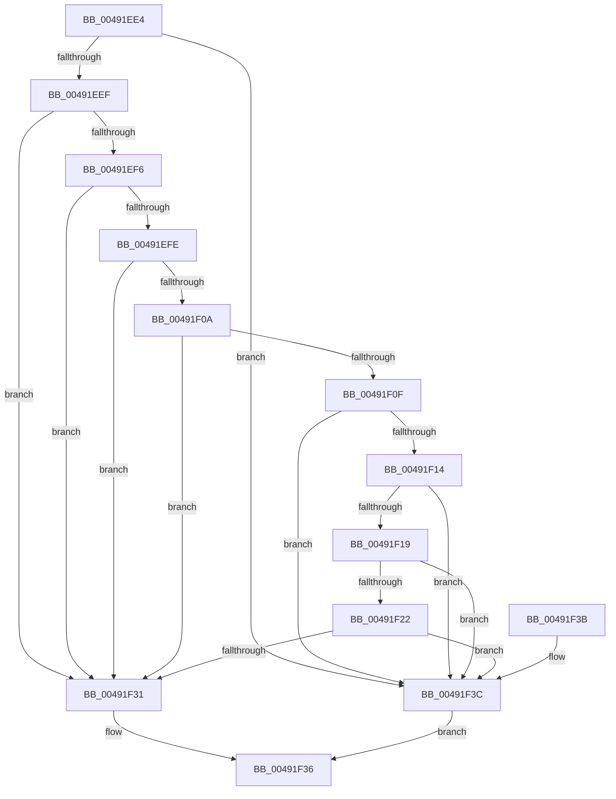

# ValidFilterExpression

- RVA: `0x00491EE4`–`0x00491F40` (길이 `92` bytes)
- VA: `0x0000000140491EE4`
- 실행 섹션: `.text`
- PDB 이름 있음: `예`; PDB Function 태그: `아니요`
- unwind 정보 RVA: `0x00069B1C`
- 디코드: `32`개 명령, `92/92` bytes 표시
- 미해석 바이트: `0` (있으면 어셈블리에 `.byte`로 보존)

> 이 문서는 커널 이미지의 기계어와 PDB 기호를 분석해 생성했습니다. 4번과 5번은 함수 원형과 자료형을 바이너리 사용 방식에서 추정한 C 해석이며 원본 소스 복구 결과는 아닙니다.

## 1. Dependencies

- 직접 호출 지점: **1**; 고유 호출 대상: **1**
- 직접 호출자로 확인된 함수: **1**
- RIP 상대 이미지 참조: **0**

### Outgoing calls
- `0x00491F28` → [PnpValidatePropertyData](../../page/8F/PnpValidatePropertyData_function_008F7658.md) (function, `0x008F7658`)

### Direct callers
- [ValidFilter](../../page/8D/ValidFilter_function_008DBDC8.md) at `0x008DBE56`

### Static image references
- 디코드된 RIP-relative 메모리 참조가 없습니다.

## 2. Other-region calls and transfers

- 다른 실행 섹션으로 향하는 call: **1**
  - `0x00491F28` → [PnpValidatePropertyData](../../page/8F/PnpValidatePropertyData_function_008F7658.md) (`.text` → `PAGE`)
- 별도 외부 분기/꼬리 이동을 확인하지 못했습니다.

## 3. Assembly (complete function range)

```asm
00491EE4  48 83 EC 28                     sub rsp, 0x28
00491EE8  48 83 79 20 00                  cmp qword ptr [rcx + 0x20], 0
00491EED  75 4D                           jne 0x140491f3c
00491EEF  8B 11                           mov edx, dword ptr [rcx]
00491EF1  83 EA 01                        sub edx, 1
00491EF4  74 3B                           je 0x140491f31
00491EF6  81 FA 00 00 01 00               cmp edx, 0x10000
00491EFC  74 33                           je 0x140491f31
00491EFE  44 8B 41 28                     mov r8d, dword ptr [rcx + 0x28]
00491F02  41 8B C0                        mov eax, r8d
00491F05  45 85 C0                        test r8d, r8d
00491F08  74 27                           je 0x140491f31
00491F0A  83 E8 01                        sub eax, 1
00491F0D  74 22                           je 0x140491f31
00491F0F  83 E8 12                        sub eax, 0x12
00491F12  74 28                           je 0x140491f3c
00491F14  83 F8 01                        cmp eax, 1
00491F17  74 23                           je 0x140491f3c
00491F19  48 8B 41 30                     mov rax, qword ptr [rcx + 0x30]
00491F1D  48 85 C0                        test rax, rax
00491F20  74 1A                           je 0x140491f3c
00491F22  8B 51 2C                        mov edx, dword ptr [rcx + 0x2c]
00491F25  48 8B C8                        mov rcx, rax
00491F28  E8 2B 57 46 00                  call 0x1408f7658
00491F2D  85 C0                           test eax, eax
00491F2F  75 0B                           jne 0x140491f3c
00491F31  B8 01 00 00 00                  mov eax, 1
00491F36  48 83 C4 28                     add rsp, 0x28
00491F3A  C3                              ret
00491F3B  CC                              int3
00491F3C  33 C0                           xor eax, eax
00491F3E  EB F6                           jmp 0x140491f36
```

## 4. C-style interpretation (structured pseudocode)

```c
__int64 __fastcall ValidFilterExpression(__int64 a1)
{
    __int64 result;
    __int64 v_rsp;

    v_rsp = (v_rsp) - (40);
    if ((*(unsigned __int64 *)(a1 + 32)) != 0) goto loc_00491F3C;
    a2 = (unsigned int)(((unsigned int)(*(unsigned int *)(a1))) - (1));
    if (condition_is_equal) goto loc_00491F31;
    if (((unsigned int)(a2)) == 0x10000ULL) goto loc_00491F31;
    if ((unsigned int)((unsigned int)(*(unsigned int *)(a1 + 40))) == 0) goto loc_00491F31;
    result = (unsigned int)(((unsigned int)((unsigned int)((unsigned int)(*(unsigned int *)(a1 + 40))))) - (1));
    if (condition_is_equal) goto loc_00491F31;
    result = (unsigned int)((result) - (18));
    if (condition_is_equal) goto loc_00491F3C;
    if (((unsigned int)(result)) == 1) goto loc_00491F3C;
    if (*(unsigned __int64 *)(a1 + 48) == 0) goto loc_00491F3C;
    result = PnpValidatePropertyData(*(unsigned __int64 *)(a1 + 48), (unsigned int)(*(unsigned int *)(a1 + 44)), (unsigned int)(*(unsigned int *)(a1 + 40)), a4);
    if ((unsigned int)(result) != 0) goto loc_00491F3C;
loc_00491F31:
loc_00491F36:
    v_rsp = (v_rsp) + (40);
    return 1;
loc_00491F3C:
    result = 0;
    goto loc_00491F36;
}
```

## 5. (Beta) C Style

```c
int64_t ValidFilterExpression(void *Arg1)
{
    uint8_t *arg1 = (uint8_t *)Arg1;

    int64_t result;
    int64_t local_rsp;

    local_rsp = (local_rsp) - (40);
    if ((*(uint64_t *)(arg1 + 0x20)) != 0) goto loc_00491F3C;
    a2 = (uint32_t)(((uint32_t)(*(uint32_t *)(arg1))) - (1));
    if (condition_is_equal) goto loc_00491F31;
    if (((uint32_t)(a2)) == 0x10000ULL) goto loc_00491F31;
    if ((uint32_t)((uint32_t)(*(uint32_t *)(arg1 + 0x28))) == 0) goto loc_00491F31;
    result = (uint32_t)(((uint32_t)((uint32_t)((uint32_t)(*(uint32_t *)(arg1 + 0x28))))) - (1));
    if (condition_is_equal) goto loc_00491F31;
    result = (uint32_t)((result) - (18));
    if (condition_is_equal) goto loc_00491F3C;
    if (((uint32_t)(result)) == 1) goto loc_00491F3C;
    if (*(uint64_t *)(arg1 + 0x30) == 0) goto loc_00491F3C;
    result = PnpValidatePropertyData(*(uint64_t *)(arg1 + 0x30), (uint32_t)(*(uint32_t *)(arg1 + 0x2C)), (uint32_t)(*(uint32_t *)(arg1 + 0x28)), a4);
    if ((uint32_t)(result) != 0) goto loc_00491F3C;
loc_00491F31:
loc_00491F36:
    local_rsp = (local_rsp) + (40);
    return 1;
loc_00491F3C:
    result = 0;
    goto loc_00491F36;
}
```

### 관측된 메모리 오프셋

구조체 형식이 확인되지 않은 접근은 인자 기준의 오프셋으로만 기록했습니다.

| 기준 인자 | 오프셋 표현 | 폭 (bit) | 접근 |
|---|---:|---:|---|
| `Arg1` | `+ 0x0` | `32` | `R` |
| `Arg1` | `+ 0x20` | `64` | `R` |
| `Arg1` | `+ 0x28` | `32` | `R` |
| `Arg1` | `+ 0x2C` | `32` | `R` |
| `Arg1` | `+ 0x30` | `64` | `R` |

## 6. Execution-region graph

[열기: 2D/3D 그래프와 함수 탐색 컨트롤 패널](../../../control-panel.html?section=text&rva=0x00491EE4&view=graph)

- 2D 그래프는 위에서 아래로 흐르고, 3D 그래프는 빈 공간을 드래그해 회전합니다. Shift+드래그는 이동, 휠은 확대·축소, 함수 노드 선택은 대상 보고서 이동입니다.

### Static fallback


