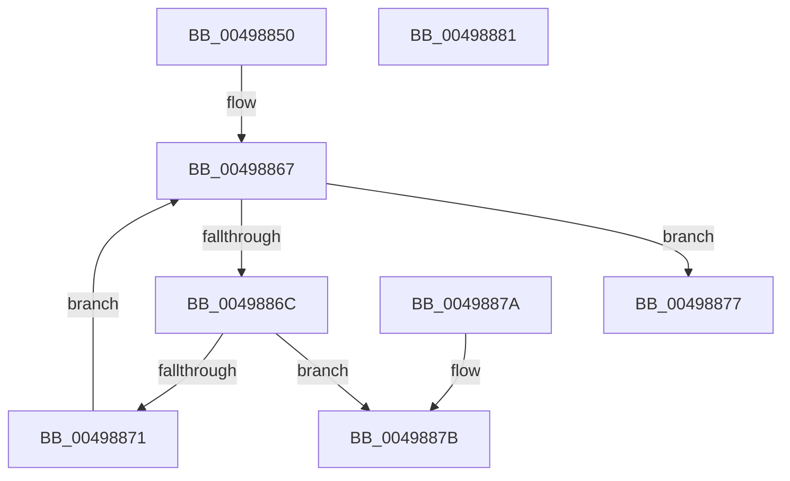

# VfPoolIsInternalFree

- RVA: `0x00498850`–`0x00498882` (길이 `50` bytes)
- VA: `0x0000000140498850`
- 실행 섹션: `.text`
- PDB 이름 있음: `예`; PDB Function 태그: `아니요`
- unwind 정보 RVA: `0x000DB714`
- 디코드: `15`개 명령, `50/50` bytes 표시
- 미해석 바이트: `0` (있으면 어셈블리에 `.byte`로 보존)

> 이 문서는 커널 이미지의 기계어와 PDB 기호를 분석해 생성했습니다. 4번과 5번은 함수 원형과 자료형을 바이너리 사용 방식에서 추정한 C 해석이며 원본 소스 복구 결과는 아닙니다.

## 1. Dependencies

- 직접 호출 지점: **0**; 고유 호출 대상: **0**
- 직접 호출자로 확인된 함수: **3**
- RIP 상대 이미지 참조: **2**

### Outgoing calls
- 직접 디코드된 call 명령이 없습니다.

### Direct callers
- [VfCheckForResource](../../pagevrfy/BB/VfCheckForResource_function_00BB71C8.md) at `0x00BB7200`
- [VfRemLockDeleteMemoryRange](../../pagevrfy/BB/VfRemLockDeleteMemoryRange_function_00BB7AEC.md) at `0x00BB7B37`
- [VfCheckForLookaside](../../pagevrfy/BB/VfCheckForLookaside_function_00BB7C80.md) at `0x00BB7CB3`

### Static image references
- `0x00498859` → RVA `0x00E28978` (`.data`; read)
- `0x00498860` → RVA `0x00E289F8` (`.data`; read)

## 2. Other-region calls and transfers

- 다른 실행 섹션으로 향하는 call: **0**
- 별도 외부 분기/꼬리 이동을 확인하지 못했습니다.

## 3. Assembly (complete function range)

```asm
00498850  65 48 8B 0C 25 88 01 00 00      mov rcx, qword ptr gs:[0x188]
00498859  48 8D 05 18 01 99 00            lea rax, [rip + 0x990118]
00498860  48 8D 15 91 01 99 00            lea rdx, [rip + 0x990191]
00498867  48 3B C2                        cmp rax, rdx
0049886A  7D 0B                           jge 0x140498877
0049886C  48 3B 08                        cmp rcx, qword ptr [rax]
0049886F  74 0A                           je 0x14049887b
00498871  48 83 C0 40                     add rax, 0x40
00498875  EB F0                           jmp 0x140498867
00498877  33 C0                           xor eax, eax
00498879  C3                              ret
0049887A  CC                              int3
0049887B  B8 01 00 00 00                  mov eax, 1
00498880  C3                              ret
00498881  CC                              int3
```

## 4. C-style interpretation (structured pseudocode)

```c
__int64 __fastcall VfPoolIsInternalFree(void)
{
    __int64 result;

loc_00498867:
    if ((v_rip + 10027288) >= (v_rip + 10027409)) goto loc_00498877;
    if ((*(unsigned __int64 *)(gs_base + (0 + 392))) == (*(unsigned __int64 *)(v_rip + 10027288))) goto loc_0049887B;
    result = (v_rip + 10027288) + (64);
    goto loc_00498867;
loc_00498877:
    result = 0;
    return result;
loc_0049887B:
    return 1;
}
```

## 5. (Beta) C Style

```c
void VfPoolIsInternalFree(void)
{
    int64_t result;

loc_00498867:
    if ((v_rip + 10027288) >= (v_rip + 10027409)) goto loc_00498877;
    if ((*(uint64_t *)(gs_base + (0 + 0x188))) == (*(uint64_t *)(v_rip + 0x990118))) goto loc_0049887B;
    result = (v_rip + 10027288) + (64);
    goto loc_00498867;
loc_00498877:
    result = 0;
    return result;
loc_0049887B:
    return 1;
}
```

## 6. Execution-region graph

[열기: 2D/3D 그래프와 함수 탐색 컨트롤 패널](../../../control-panel.html?section=text&rva=0x00498850&view=graph)

- 2D 그래프는 위에서 아래로 흐르고, 3D 그래프는 빈 공간을 드래그해 회전합니다. Shift+드래그는 이동, 휠은 확대·축소, 함수 노드 선택은 대상 보고서 이동입니다.

### Static fallback


