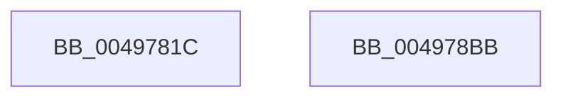

# VslCopyProtectedPage

- RVA: `0x0049781C`–`0x004978BC` (길이 `160` bytes)
- VA: `0x000000014049781C`
- 실행 섹션: `.text`
- PDB 이름 있음: `예`; PDB Function 태그: `아니요`
- unwind 정보 RVA: `0x0009A9C4`
- 디코드: `41`개 명령, `160/160` bytes 표시
- 미해석 바이트: `0` (있으면 어셈블리에 `.byte`로 보존)

> 이 문서는 커널 이미지의 기계어와 PDB 기호를 분석해 생성했습니다. 4번과 5번은 함수 원형과 자료형을 바이너리 사용 방식에서 추정한 C 해석이며 원본 소스 복구 결과는 아닙니다.

## 1. Dependencies

- 직접 호출 지점: **3**; 고유 호출 대상: **3**
- 직접 호출자로 확인된 함수: **2**
- RIP 상대 이미지 참조: **1**

### Outgoing calls
- `0x00497851` → [memset](../6C/memset_function_006C6C40.md) (function, `0x006C6C40`)
- `0x0049789A` → [VslpEnterIumSecureMode](../23/VslpEnterIumSecureMode_function_00235E50.md) (function, `0x00235E50`)
- `0x004978AA` → [_security_check_cookie](../6A/_security_check_cookie_function_006AC640.md) (function, `0x006AC640`)

### Direct callers
- [sub_002B1D4E](../2B/Unknown_function_002B1D4E.md) at `0x002B1ECE`
- [KeCopyPrivilegedPage](KeCopyPrivilegedPage_function_004977E0.md) at `0x0049780A`

### Static image references
- `0x00497828` → RVA `0x00E0A740` (`.data`; read)

## 2. Other-region calls and transfers

- 다른 실행 섹션으로 향하는 call: **0**
- 별도 외부 분기/꼬리 이동을 확인하지 못했습니다.

## 3. Assembly (complete function range)

```asm
0049781C  40 53                           push rbx
0049781E  55                              push rbp
0049781F  56                              push rsi
00497820  57                              push rdi
00497821  48 81 EC A8 00 00 00            sub rsp, 0xa8
00497828  48 8B 05 11 2F 97 00            mov rax, qword ptr [rip + 0x972f11]
0049782F  48 33 C4                        xor rax, rsp
00497832  48 89 84 24 90 00 00 00         mov qword ptr [rsp + 0x90], rax
0049783A  48 8B FA                        mov rdi, rdx
0049783D  49 8B F0                        mov rsi, r8
00497840  33 D2                           xor edx, edx
00497842  48 8B D9                        mov rbx, rcx
00497845  48 8D 4C 24 20                  lea rcx, [rsp + 0x20]
0049784A  49 8B E9                        mov rbp, r9
0049784D  44 8D 42 68                     lea r8d, [rdx + 0x68]
00497851  E8 EA F3 22 00                  call 0x1406c6c40
00497856  48 8B 84 24 F0 00 00 00         mov rax, qword ptr [rsp + 0xf0]
0049785E  4C 8D 4C 24 20                  lea r9, [rsp + 0x20]
00497863  0F 10 07                        movups xmm0, xmmword ptr [rdi]
00497866  48 89 44 24 58                  mov qword ptr [rsp + 0x58], rax
0049786B  BA F4 00 00 00                  mov edx, 0xf4
00497870  0F 10 4D 00                     movups xmm1, xmmword ptr [rbp]
00497874  8A 84 24 F8 00 00 00            mov al, byte ptr [rsp + 0xf8]
0049787B  45 33 C0                        xor r8d, r8d
0049787E  B1 02                           mov cl, 2
00497880  88 44 24 60                     mov byte ptr [rsp + 0x60], al
00497884  48 89 5C 24 28                  mov qword ptr [rsp + 0x28], rbx
00497889  F3 0F 7F 44 24 30               movdqu xmmword ptr [rsp + 0x30], xmm0
0049788F  48 89 74 24 40                  mov qword ptr [rsp + 0x40], rsi
00497894  F3 0F 7F 4C 24 48               movdqu xmmword ptr [rsp + 0x48], xmm1
0049789A  E8 B1 E5 D9 FF                  call 0x140235e50
0049789F  48 8B 8C 24 90 00 00 00         mov rcx, qword ptr [rsp + 0x90]
004978A7  48 33 CC                        xor rcx, rsp
004978AA  E8 91 4D 21 00                  call 0x1406ac640
004978AF  48 81 C4 A8 00 00 00            add rsp, 0xa8
004978B6  5F                              pop rdi
004978B7  5E                              pop rsi
004978B8  5D                              pop rbp
004978B9  5B                              pop rbx
004978BA  C3                              ret
004978BB  CC                              int3
```

## 4. C-style interpretation (structured pseudocode)

```c
__int64 __fastcall VslCopyProtectedPage(__int64 a1, __int64 a2, __int64 a3, __int64 a4, __int64 a5, unsigned __int8 a6)
{
    __int64 result;
    __int64 v_rsp;
    unsigned __int64 v_stack_m38;
    unsigned __int8 v_stack_m68;
    unsigned __int64 v_stack_m70;
    unsigned __int64 v_stack_m80;
    unsigned __int64 v_stack_m88;
    unsigned __int64 v_stack_m98;
    unsigned __int64 v_stack_mA0;
    unsigned __int64 v_stack_mA8;

    v_rsp = (v_rsp) - (168);
    result = (*(unsigned __int64 *)(v_rip + 9907985)) ^ (v_rsp);
    v_stack_m38 = result;
    a2 = 0;
    result = memset(v_stack_mA8, a2, a2 + 104, a4);
    v_stack_m70 = a5;
    a3 = 0;
    v_stack_m68 = a6;
    v_stack_mA0 = a1;
    v_stack_m98 = v_xmm0;
    v_stack_m88 = 0;
    v_stack_m80 = v_xmm1;
    result = VslpEnterIumSecureMode(2, 244, a3, v_stack_mA8);
    a1 = (v_stack_m38) ^ (v_rsp);
    result = _security_check_cookie(a1, 244, a3, v_stack_mA8);
    v_rsp = (v_rsp) + (168);
    return result;
}
```

## 5. (Beta) C Style

```c
int64_t VslCopyProtectedPage(int64_t Arg1, void *Arg2, int64_t Arg3, void *Arg4, int64_t Arg5, uint8_t Arg6)
{
    uint8_t *arg2 = (uint8_t *)Arg2;
    uint8_t *arg4 = (uint8_t *)Arg4;

    int64_t result;
    int64_t local_rsp;
    uint64_t v_stack_m38;
    uint8_t v_stack_m68;
    uint64_t v_stack_m70;
    uint64_t v_stack_m80;
    uint64_t v_stack_m88;
    uint64_t v_stack_m98;
    uint64_t v_stack_mA0;
    uint64_t v_stack_mA8;

    local_rsp = (local_rsp) - (168);
    result = (*(uint64_t *)(v_rip + 0x972F11)) ^ (local_rsp);
    v_stack_m38 = result;
    Arg2 = 0;
    result = memset(v_stack_mA8, Arg2, Arg2 + 104, Arg4);
    v_stack_m70 = Arg5;
    Arg3 = 0;
    v_stack_m68 = Arg6;
    v_stack_mA0 = Arg1;
    v_stack_m98 = v_xmm0;
    v_stack_m88 = 0;
    v_stack_m80 = v_xmm1;
    result = VslpEnterIumSecureMode(2, 244, Arg3, v_stack_mA8);
    Arg1 = (v_stack_m38) ^ (local_rsp);
    result = _security_check_cookie(Arg1, 244, Arg3, v_stack_mA8);
    local_rsp = (local_rsp) + (168);
    return result;
}
```

### 관측된 메모리 오프셋

구조체 형식이 확인되지 않은 접근은 인자 기준의 오프셋으로만 기록했습니다.

| 기준 인자 | 오프셋 표현 | 폭 (bit) | 접근 |
|---|---:|---:|---|
| `Arg2` | `+ 0x0` | `128` | `R` |
| `Arg4` | `+ 0x0` | `128` | `R` |

## 6. Execution-region graph

[열기: 2D/3D 그래프와 함수 탐색 컨트롤 패널](../../../control-panel.html?section=text&rva=0x0049781C&view=graph)

- 2D 그래프는 위에서 아래로 흐르고, 3D 그래프는 빈 공간을 드래그해 회전합니다. Shift+드래그는 이동, 휠은 확대·축소, 함수 노드 선택은 대상 보고서 이동입니다.

### Static fallback


