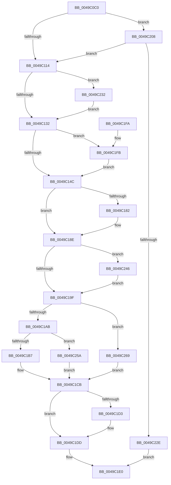

# VslIumEfiRuntimeService

- RVA: `0x0049C0C0`–`0x0049C278` (길이 `440` bytes)
- VA: `0x000000014049C0C0`
- 실행 섹션: `.text`
- PDB 이름 있음: `예`; PDB Function 태그: `아니요`
- unwind 정보 RVA: `0x000B4A38`
- 디코드: `106`개 명령, `440/440` bytes 표시
- 미해석 바이트: `0` (있으면 어셈블리에 `.byte`로 보존)

> 이 문서는 커널 이미지의 기계어와 PDB 기호를 분석해 생성했습니다. 4번과 5번은 함수 원형과 자료형을 바이너리 사용 방식에서 추정한 C 해석이며 원본 소스 복구 결과는 아닙니다.

## 1. Dependencies

- 직접 호출 지점: **10**; 고유 호출 대상: **9**
- 직접 호출자로 확인된 함수: **0**
- RIP 상대 이미지 참조: **3**

### Outgoing calls
- `0x0049C0F6` → [memset](../6C/memset_function_006C6C40.md) (function, `0x006C6C40`)
- `0x0049C106` → [memset](../6C/memset_function_006C6C40.md) (function, `0x006C6C40`)
- `0x0049C153` → [ExAcquireSpinLockExclusiveAtDpcLevel](../24/ExAcquireSpinLockExclusiveAtDpcLevel_function_00248E80.md) (function, `0x00248E80`)
- `0x0049C166` → [VslpEnterIumSecureMode](../23/VslpEnterIumSecureMode_function_00235E50.md) (function, `0x00235E50`)
- `0x0049C174` → [ExReleaseSpinLockExclusiveFromDpcLevel](../24/ExReleaseSpinLockExclusiveFromDpcLevel_function_002497E0.md) (function, `0x002497E0`)
- `0x0049C189` → [KiLowerIrqlProcessIrqlFlags](../4F/KiLowerIrqlProcessIrqlFlags_function_004F5698.md) (function, `0x004F5698`)
- `0x0049C1D8` → [VslpUnlockPagesForTransfer](../29/VslpUnlockPagesForTransfer_function_0029EE4C.md) (function, `0x0029EE4C`)
- `0x0049C1E7` → [_security_check_cookie](../6A/_security_check_cookie_function_006AC640.md) (function, `0x006AC640`)
- `0x0049C1FE` → [KiRaiseIrqlProcessIrqlFlags](../4F/KiRaiseIrqlProcessIrqlFlags_function_004F56FC.md) (function, `0x004F56FC`)
- `0x0049C221` → [VslpLockPagesForTransfer](../29/VslpLockPagesForTransfer_function_0029E0FC.md) (function, `0x0029E0FC`)

### Direct callers
- 이 함수 시작 RVA로 연결되는 직접 call은 확인되지 않았습니다. 간접 호출은 완전히 역산할 수 없습니다.

### Static image references
- `0x0049C0D3` → RVA `0x00E0A740` (`.data`; read)
- `0x0049C13F` → RVA `0x00FC6D20` (`ALMOSTRO`; read)
- `0x0049C14C` → RVA `0x00F8EBA0` (`.data`; read)

## 2. Other-region calls and transfers

- 다른 실행 섹션으로 향하는 call: **0**
- 별도 외부 분기/꼬리 이동을 확인하지 못했습니다.

## 3. Assembly (complete function range)

```asm
0049C0C0  40 55                           push rbp
0049C0C2  53                              push rbx
0049C0C3  56                              push rsi
0049C0C4  57                              push rdi
0049C0C5  41 56                           push r14
0049C0C7  48 8D 6C 24 C9                  lea rbp, [rsp - 0x37]
0049C0CC  48 81 EC 00 01 00 00            sub rsp, 0x100
0049C0D3  48 8B 05 66 E6 96 00            mov rax, qword ptr [rip + 0x96e666]
0049C0DA  48 33 C4                        xor rax, rsp
0049C0DD  48 89 45 27                     mov qword ptr [rbp + 0x27], rax
0049C0E1  48 8B FA                        mov rdi, rdx
0049C0E4  8B F1                           mov esi, ecx
0049C0E6  33 D2                           xor edx, edx
0049C0E8  48 8D 4D B7                     lea rcx, [rbp - 0x49]
0049C0EC  4D 8B F0                        mov r14, r8
0049C0EF  49 8B D9                        mov rbx, r9
0049C0F2  44 8D 42 68                     lea r8d, [rdx + 0x68]
0049C0F6  E8 45 AB 22 00                  call 0x1406c6c40
0049C0FB  33 D2                           xor edx, edx
0049C0FD  48 8D 4C 24 30                  lea rcx, [rsp + 0x30]
0049C102  44 8D 42 48                     lea r8d, [rdx + 0x48]
0049C106  E8 35 AB 22 00                  call 0x1406c6c40
0049C10B  48 85 FF                        test rdi, rdi
0049C10E  0F 85 F4 00 00 00               jne 0x14049c208
0049C114  48 8B 44 24 30                  mov rax, qword ptr [rsp + 0x30]
0049C119  48 89 45 C7                     mov qword ptr [rbp - 0x39], rax
0049C11D  48 8B 45 9F                     mov rax, qword ptr [rbp - 0x61]
0049C121  48 89 45 CF                     mov qword ptr [rbp - 0x31], rax
0049C125  48 89 75 BF                     mov qword ptr [rbp - 0x41], rsi
0049C129  48 85 DB                        test rbx, rbx
0049C12C  0F 85 00 01 00 00               jne 0x14049c232
0049C132  44 0F 20 C6                     mov rsi, cr8
0049C136  BA 0F 00 00 00                  mov edx, 0xf
0049C13B  44 0F 22 C2                     mov cr8, rdx
0049C13F  83 3D DA AB B2 00 00            cmp dword ptr [rip + 0xb2abda], 0
0049C146  0F 85 AF 00 00 00               jne 0x14049c1fb
0049C14C  48 8D 0D 4D 2A AF 00            lea rcx, [rip + 0xaf2a4d]
0049C153  E8 28 CD DA FF                  call 0x140248e80
0049C158  BA FC 00 00 00                  mov edx, 0xfc
0049C15D  4C 8D 4D B7                     lea r9, [rbp - 0x49]
0049C161  45 33 C0                        xor r8d, r8d
0049C164  B1 02                           mov cl, 2
0049C166  E8 E5 9C D9 FF                  call 0x140235e50
0049C16B  48 8D 0D 2E 2A AF 00            lea rcx, [rip + 0xaf2a2e]
0049C172  8B F8                           mov edi, eax
0049C174  E8 67 D6 DA FF                  call 0x1402497e0
0049C179  83 3D A0 AB B2 00 00            cmp dword ptr [rip + 0xb2aba0], 0
0049C180  74 0C                           je 0x14049c18e
0049C182  44 0F 20 C1                     mov rcx, cr8
0049C186  40 8A D6                        mov dl, sil
0049C189  E8 0A 95 05 00                  call 0x1404f5698
0049C18E  40 0F B6 CE                     movzx ecx, sil
0049C192  44 0F 22 C1                     mov cr8, rcx
0049C196  48 85 DB                        test rbx, rbx
0049C199  0F 85 A7 00 00 00               jne 0x14049c246
0049C19F  81 FF 0D 00 00 C0               cmp edi, 0xc000000d
0049C1A5  0F 84 BE 00 00 00               je 0x14049c269
0049C1AB  81 FF 17 00 00 C0               cmp edi, 0xc0000017
0049C1B1  0F 84 A3 00 00 00               je 0x14049c25a
0049C1B7  48 8B 5D D7                     mov rbx, qword ptr [rbp - 0x29]
0049C1BB  85 FF                           test edi, edi
0049C1BD  48 B8 03 00 00 00 00 00 00 80   movabs rax, 0x8000000000000003
0049C1C7  48 0F 45 D8                     cmovne rbx, rax
0049C1CB  48 83 7C 24 30 00               cmp qword ptr [rsp + 0x30], 0
0049C1D1  74 0A                           je 0x14049c1dd
0049C1D3  48 8D 4C 24 30                  lea rcx, [rsp + 0x30]
0049C1D8  E8 6F 2C E0 FF                  call 0x14029ee4c
0049C1DD  48 8B C3                        mov rax, rbx
0049C1E0  48 8B 4D 27                     mov rcx, qword ptr [rbp + 0x27]
0049C1E4  48 33 CC                        xor rcx, rsp
0049C1E7  E8 54 04 21 00                  call 0x1406ac640
0049C1EC  48 81 C4 00 01 00 00            add rsp, 0x100
0049C1F3  41 5E                           pop r14
0049C1F5  5F                              pop rdi
0049C1F6  5E                              pop rsi
0049C1F7  5B                              pop rbx
0049C1F8  5D                              pop rbp
0049C1F9  C3                              ret
0049C1FA  CC                              int3
0049C1FB  40 8A CE                        mov cl, sil
0049C1FE  E8 F9 94 05 00                  call 0x1404f56fc
0049C203  E9 44 FF FF FF                  jmp 0x14049c14c
0049C208  41 B9 02 00 00 00               mov r9d, 2
0049C20E  C7 44 24 20 01 00 00 00         mov dword ptr [rsp + 0x20], 1
0049C216  45 8B C6                        mov r8d, r14d
0049C219  48 8D 4C 24 30                  lea rcx, [rsp + 0x30]
0049C21E  48 8B D7                        mov rdx, rdi
0049C221  E8 D6 1E E0 FF                  call 0x14029e0fc
0049C226  85 C0                           test eax, eax
0049C228  0F 89 E6 FE FF FF               jns 0x14049c114
0049C22E  48 98                           cdqe
0049C230  EB AE                           jmp 0x14049c1e0
0049C232  0F 10 03                        movups xmm0, xmmword ptr [rbx]
0049C235  0F 10 4B 10                     movups xmm1, xmmword ptr [rbx + 0x10]
0049C239  0F 11 45 DF                     movups xmmword ptr [rbp - 0x21], xmm0
0049C23D  0F 11 4D EF                     movups xmmword ptr [rbp - 0x11], xmm1
0049C241  E9 EC FE FF FF                  jmp 0x14049c132
0049C246  0F 10 45 DF                     movups xmm0, xmmword ptr [rbp - 0x21]
0049C24A  0F 10 4D EF                     movups xmm1, xmmword ptr [rbp - 0x11]
0049C24E  0F 11 03                        movups xmmword ptr [rbx], xmm0
0049C251  0F 11 4B 10                     movups xmmword ptr [rbx + 0x10], xmm1
0049C255  E9 45 FF FF FF                  jmp 0x14049c19f
0049C25A  48 BB 09 00 00 00 00 00 00 80   movabs rbx, 0x8000000000000009
0049C264  E9 62 FF FF FF                  jmp 0x14049c1cb
0049C269  48 BB 02 00 00 00 00 00 00 80   movabs rbx, 0x8000000000000002
0049C273  E9 53 FF FF FF                  jmp 0x14049c1cb
```

## 4. C-style interpretation (structured pseudocode)

```c
__int64 __fastcall VslIumEfiRuntimeService(int a1, __int64 a2, __int64 a3, __int64 a4)
{
    __int64 result;
    __int64 v_rbx;
    __int64 v_rsp;
    unsigned __int64 v_stack_m38;
    unsigned __int64 v_stack_m5F;
    unsigned __int64 v_stack_m70;
    unsigned __int64 v_stack_m80;
    unsigned __int64 v_stack_m88;
    unsigned __int64 v_stack_m90;
    unsigned __int64 v_stack_m98;
    unsigned __int64 v_stack_mA0;
    unsigned __int64 v_stack_mA8;
    unsigned __int64 v_stack_mC0;
    unsigned __int64 v_stack_mF8;
    unsigned int v_stack_p20;
    unsigned __int64 v_stack_p30;

    v_rsp = (v_rsp) - (256);
    result = (*(unsigned __int64 *)(v_rip + 9889382)) ^ (v_rsp);
    v_stack_m38 = result;
    a2 = 0;
    result = memset(v_stack_mA8, a2, a2 + 104, a4);
    a2 = 0;
    result = memset(v_stack_mF8, a2, a2 + 72, a4);
    if (0 != 0) goto loc_0049C208;
loc_0049C114:
    v_stack_m98 = v_stack_mF8;
    v_stack_m90 = v_stack_mC0;
    v_stack_mA0 = (unsigned int)(a1);
    if (a4 != 0) goto loc_0049C232;
loc_0049C132:
    if ((*(unsigned int *)(v_rip + 11709402)) != 0) goto loc_0049C1FB;
loc_0049C14C:
    result = ExAcquireSpinLockExclusiveAtDpcLevel(v_rip + 11479629, 15, a2 + 72, a4);
    a3 = 0;
    result = VslpEnterIumSecureMode(2, 252, a3, v_stack_mA8);
    result = ExReleaseSpinLockExclusiveFromDpcLevel(v_rip + 11479598, 252, a3, v_stack_mA8);
    if ((*(unsigned int *)(v_rip + 11709344)) != 0) {
        a1 = 15;
        a2 = (unsigned __int8)(v_cr8);
        result = KiLowerIrqlProcessIrqlFlags(a1, a2, a3, v_stack_mA8);
    }
    if (a4 != 0) goto loc_0049C246;
loc_0049C19F:
    if (((unsigned int)((unsigned int)((unsigned int)(result)))) == 0xC000000DULL) goto loc_0049C269;
    if (((unsigned int)((unsigned int)((unsigned int)(result)))) == 0xC0000017ULL) goto loc_0049C25A;
    v_rbx = v_stack_m88;
    if ((unsigned int)((unsigned int)((unsigned int)(result))) != 0) { v_rbx = result; }
loc_0049C1CB:
    if (v_stack_mF8 != 0) {
        a1 = v_stack_mF8;
        result = VslpUnlockPagesForTransfer(a1, a2, a3, v_stack_mA8);
    }
loc_0049C1E0:
    a1 = (v_stack_m38) ^ (v_rsp);
    result = _security_check_cookie(a1, a2, a3, v_stack_mA8);
    v_rsp = (v_rsp) + (256);
    return result;
loc_0049C1FB:
    result = KiRaiseIrqlProcessIrqlFlags((unsigned __int8)(v_cr8), a2, a3, v_stack_mA8);
    goto loc_0049C14C;
loc_0049C208:
    v_stack_p20 = 1;
    result = VslpLockPagesForTransfer(v_stack_p30, (unsigned int)((unsigned int)(result)), 0, 2);
    if (!sign_flag) goto loc_0049C114;
    goto loc_0049C1E0;
loc_0049C232:
    v_stack_m80 = v_xmm0;
    v_stack_m70 = v_xmm1;
    goto loc_0049C132;
loc_0049C246:
    *(unsigned __int64 *)(v_rbx) = v_xmm0;
    *(unsigned __int64 *)(v_rbx + 16) = v_xmm1;
    goto loc_0049C19F;
loc_0049C25A:
    goto loc_0049C1CB;
loc_0049C269:
    goto loc_0049C1CB;
}
```

## 5. (Beta) C Style

```c
int64_t VslIumEfiRuntimeService(int32_t Arg1, int64_t Arg2, int64_t Arg3, int64_t Arg4)
{
    int64_t result;
    int64_t local_rbx;
    int64_t local_rsp;
    uint64_t v_stack_m38;
    uint64_t v_stack_m5F;
    uint64_t v_stack_m70;
    uint64_t v_stack_m80;
    uint64_t v_stack_m88;
    uint64_t v_stack_m90;
    uint64_t v_stack_m98;
    uint64_t v_stack_mA0;
    uint64_t v_stack_mA8;
    uint64_t v_stack_mC0;
    uint64_t v_stack_mF8;
    uint32_t v_stack_p20;
    uint64_t v_stack_p30;

    local_rsp = (local_rsp) - (256);
    result = (*(uint64_t *)(v_rip + 0x96E666)) ^ (local_rsp);
    v_stack_m38 = result;
    Arg2 = 0;
    result = memset(v_stack_mA8, Arg2, Arg2 + 104, Arg4);
    Arg2 = 0;
    result = memset(v_stack_mF8, Arg2, Arg2 + 72, Arg4);
    if (0 != 0) goto loc_0049C208;
loc_0049C114:
    v_stack_m98 = v_stack_mF8;
    v_stack_m90 = v_stack_mC0;
    v_stack_mA0 = (uint32_t)(Arg1);
    if (Arg4 != 0) goto loc_0049C232;
loc_0049C132:
    if ((*(uint32_t *)(v_rip + 0xB2ABDA)) != 0) goto loc_0049C1FB;
loc_0049C14C:
    result = ExAcquireSpinLockExclusiveAtDpcLevel(v_rip + 11479629, 15, Arg2 + 72, Arg4);
    Arg3 = 0;
    result = VslpEnterIumSecureMode(2, 252, Arg3, v_stack_mA8);
    result = ExReleaseSpinLockExclusiveFromDpcLevel(v_rip + 11479598, 252, Arg3, v_stack_mA8);
    if ((*(uint32_t *)(v_rip + 0xB2ABA0)) != 0) {
        Arg1 = 15;
        Arg2 = (uint8_t)(v_cr8);
        result = KiLowerIrqlProcessIrqlFlags(Arg1, Arg2, Arg3, v_stack_mA8);
    }
    if (Arg4 != 0) goto loc_0049C246;
loc_0049C19F:
    if (((uint32_t)((uint32_t)((uint32_t)(result)))) == 0xC000000DULL) goto loc_0049C269;
    if (((uint32_t)((uint32_t)((uint32_t)(result)))) == 0xC0000017ULL) goto loc_0049C25A;
    local_rbx = v_stack_m88;
    if ((uint32_t)((uint32_t)((uint32_t)(result))) != 0) { local_rbx = result; }
loc_0049C1CB:
    if (v_stack_mF8 != 0) {
        Arg1 = v_stack_mF8;
        result = VslpUnlockPagesForTransfer(Arg1, Arg2, Arg3, v_stack_mA8);
    }
loc_0049C1E0:
    Arg1 = (v_stack_m38) ^ (local_rsp);
    result = _security_check_cookie(Arg1, Arg2, Arg3, v_stack_mA8);
    local_rsp = (local_rsp) + (256);
    return result;
loc_0049C1FB:
    result = KiRaiseIrqlProcessIrqlFlags((uint8_t)(v_cr8), Arg2, Arg3, v_stack_mA8);
    goto loc_0049C14C;
loc_0049C208:
    v_stack_p20 = 1;
    result = VslpLockPagesForTransfer(v_stack_p30, (uint32_t)((uint32_t)(result)), 0, 2);
    if (!sign_flag) goto loc_0049C114;
    goto loc_0049C1E0;
loc_0049C232:
    v_stack_m80 = v_xmm0;
    v_stack_m70 = v_xmm1;
    goto loc_0049C132;
loc_0049C246:
    *(uint64_t *)(local_rbx) = v_xmm0;
    *(uint64_t *)(local_rbx + 0x10) = v_xmm1;
    goto loc_0049C19F;
loc_0049C25A:
    goto loc_0049C1CB;
loc_0049C269:
    goto loc_0049C1CB;
}
```

## 6. Execution-region graph

[열기: 2D/3D 그래프와 함수 탐색 컨트롤 패널](../../../control-panel.html?section=text&rva=0x0049C0C0&view=graph)

- 2D 그래프는 위에서 아래로 흐르고, 3D 그래프는 빈 공간을 드래그해 회전합니다. Shift+드래그는 이동, 휠은 확대·축소, 함수 노드 선택은 대상 보고서 이동입니다.

### Static fallback


