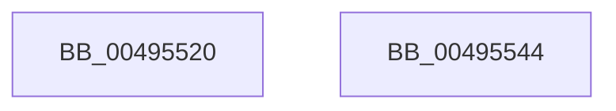

# WheaGetErrorSource

- RVA: `0x00495520`–`0x00495545` (길이 `37` bytes)
- VA: `0x0000000140495520`
- 실행 섹션: `.text`
- PDB 이름 있음: `예`; PDB Function 태그: `아니요`
- unwind 정보 RVA: `0x0005C788`
- 디코드: `11`개 명령, `37/37` bytes 표시
- 미해석 바이트: `0` (있으면 어셈블리에 `.byte`로 보존)

> 이 문서는 커널 이미지의 기계어와 PDB 기호를 분석해 생성했습니다. 4번과 5번은 함수 원형과 자료형을 바이너리 사용 방식에서 추정한 C 해석이며 원본 소스 복구 결과는 아닙니다.

## 1. Dependencies

- 직접 호출 지점: **1**; 고유 호출 대상: **1**
- 직접 호출자로 확인된 함수: **1**
- RIP 상대 이미지 참조: **1**

### Outgoing calls
- `0x0049552D` → [WheapGetErrorSource](WheapGetErrorSource_function_0049554C.md) (function, `0x0049554C`)

### Direct callers
- [WheaRemoveErrorSourceDeviceDriver](../../page/7D/WheaRemoveErrorSourceDeviceDriver_function_007D7060.md) at `0x007D7099`

### Static image references
- `0x00495526` → RVA `0x00EEF018` (`.data`; read)

## 2. Other-region calls and transfers

- 다른 실행 섹션으로 향하는 call: **0**
- 별도 외부 분기/꼬리 이동을 확인하지 못했습니다.

## 3. Assembly (complete function range)

```asm
00495520  48 83 EC 28                     sub rsp, 0x28
00495524  8B D1                           mov edx, ecx
00495526  48 8D 0D EB 9A A5 00            lea rcx, [rip + 0xa59aeb]
0049552D  E8 1A 00 00 00                  call 0x14049554c
00495532  48 8D 48 60                     lea rcx, [rax + 0x60]
00495536  48 F7 D8                        neg rax
00495539  48 1B C0                        sbb rax, rax
0049553C  48 23 C1                        and rax, rcx
0049553F  48 83 C4 28                     add rsp, 0x28
00495543  C3                              ret
00495544  CC                              int3
```

## 4. C-style interpretation (structured pseudocode)

```c
__int64 __fastcall WheaGetErrorSource(int a1)
{
    __int64 result;
    __int64 v_rsp;

    v_rsp = (v_rsp) - (40);
    result = WheapGetErrorSource(v_rip + 10853099, (unsigned int)(a1), a3, a4);
    result = -(result);
    result = (result) & (result + 96);
    v_rsp = (v_rsp) + (40);
    return result;
}
```

## 5. (Beta) C Style

```c
int64_t WheaGetErrorSource(int32_t Arg1)
{
    int64_t result;
    int64_t local_rsp;

    local_rsp = (local_rsp) - (40);
    result = WheapGetErrorSource(v_rip + 10853099, (uint32_t)(Arg1), a3, a4);
    result = -(result);
    result = (result) & (result + 96);
    local_rsp = (local_rsp) + (40);
    return result;
}
```

## 6. Execution-region graph

[열기: 2D/3D 그래프와 함수 탐색 컨트롤 패널](../../../control-panel.html?section=text&rva=0x00495520&view=graph)

- 2D 그래프는 위에서 아래로 흐르고, 3D 그래프는 빈 공간을 드래그해 회전합니다. Shift+드래그는 이동, 휠은 확대·축소, 함수 노드 선택은 대상 보고서 이동입니다.

### Static fallback


