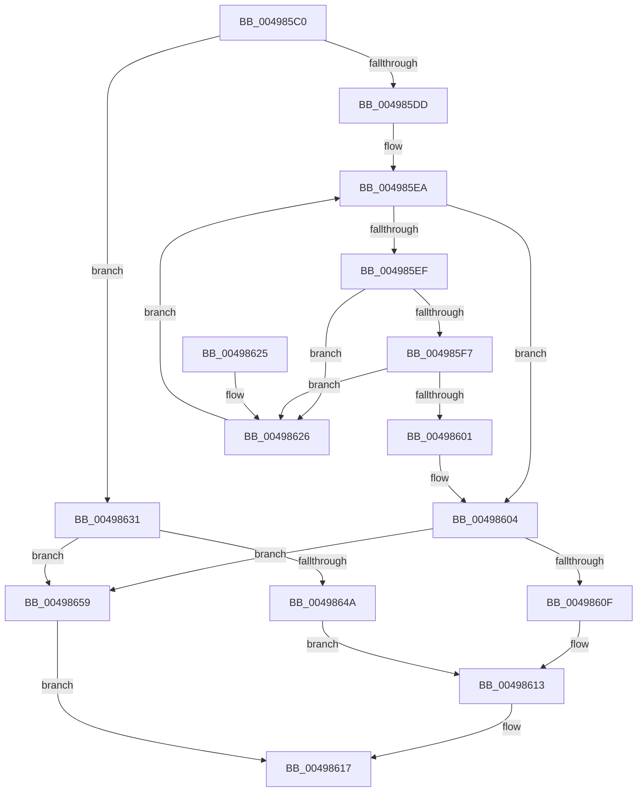

# WheapAllocErrorRecord

- RVA: `0x004985C0`–`0x0049865E` (길이 `158` bytes)
- VA: `0x00000001404985C0`
- 실행 섹션: `.text`
- PDB 이름 있음: `예`; PDB Function 태그: `아니요`
- unwind 정보 RVA: `0x000B417C`
- 디코드: `53`개 명령, `158/158` bytes 표시
- 미해석 바이트: `0` (있으면 어셈블리에 `.byte`로 보존)

> 이 문서는 커널 이미지의 기계어와 PDB 기호를 분석해 생성했습니다. 4번과 5번은 함수 원형과 자료형을 바이너리 사용 방식에서 추정한 C 해석이며 원본 소스 복구 결과는 아닙니다.

## 1. Dependencies

- 직접 호출 지점: **2**; 고유 호출 대상: **2**
- 직접 호출자로 확인된 함수: **2**
- RIP 상대 이미지 참조: **0**

### Outgoing calls
- `0x0049863D` → [ExAllocatePool2](../../poolcode/B8/ExAllocatePool2_function_00B820F0.md) (function, `0x00B820F0`)
- `0x00498652` → [WheapInitializeErrorRecordWrapper](../65/WheapInitializeErrorRecordWrapper_function_0065DE2C.md) (function, `0x0065DE2C`)

### Direct callers
- [WheaReportHwError](../4E/WheaReportHwError_function_004ED200.md) at `0x004ED367`
- [WheapReportBootError](../65/WheapReportBootError_function_0065DF58.md) at `0x0065DFA7`

### Static image references
- 디코드된 RIP-relative 메모리 참조가 없습니다.

## 2. Other-region calls and transfers

- 다른 실행 섹션으로 향하는 call: **1**
  - `0x0049863D` → [ExAllocatePool2](../../poolcode/B8/ExAllocatePool2_function_00B820F0.md) (`.text` → `POOLCODE`)
- 별도 외부 분기/꼬리 이동을 확인하지 못했습니다.

## 3. Assembly (complete function range)

```asm
004985C0  48 89 5C 24 10                  mov qword ptr [rsp + 0x10], rbx
004985C5  57                              push rdi
004985C6  48 83 EC 20                     sub rsp, 0x20
004985CA  48 8B D9                        mov rbx, rcx
004985CD  48 8B FA                        mov rdi, rdx
004985D0  8B 49 20                        mov ecx, dword ptr [rcx + 0x20]
004985D3  89 0A                           mov dword ptr [rdx], ecx
004985D5  44 0F 20 C0                     mov rax, cr8
004985D9  3C 02                           cmp al, 2
004985DB  76 54                           jbe 0x140498631
004985DD  48 8B 4B 30                     mov rcx, qword ptr [rbx + 0x30]
004985E1  45 32 C0                        xor r8b, r8b
004985E4  33 D2                           xor edx, edx
004985E6  44 8D 4A 01                     lea r9d, [rdx + 1]
004985EA  3B 53 1C                        cmp edx, dword ptr [rbx + 0x1c]
004985ED  73 15                           jae 0x140498604
004985EF  8B 41 1C                        mov eax, dword ptr [rcx + 0x1c]
004985F2  41 3B C1                        cmp eax, r9d
004985F5  74 2F                           je 0x140498626
004985F7  33 C0                           xor eax, eax
004985F9  F0 44 0F B1 49 1C               lock cmpxchg dword ptr [rcx + 0x1c], r9d
004985FF  75 25                           jne 0x140498626
00498601  45 8A C1                        mov r8b, r9b
00498604  41 F6 D8                        neg r8b
00498607  4D 1B DB                        sbb r11, r11
0049860A  4C 23 D9                        and r11, rcx
0049860D  74 4A                           je 0x140498659
0049860F  45 89 4B 18                     mov dword ptr [r11 + 0x18], r9d
00498613  49 89 5B 20                     mov qword ptr [r11 + 0x20], rbx
00498617  48 8B 5C 24 38                  mov rbx, qword ptr [rsp + 0x38]
0049861C  49 8B C3                        mov rax, r11
0049861F  48 83 C4 20                     add rsp, 0x20
00498623  5F                              pop rdi
00498624  C3                              ret
00498625  CC                              int3
00498626  8B 41 10                        mov eax, dword ptr [rcx + 0x10]
00498629  48 03 C8                        add rcx, rax
0049862C  41 03 D1                        add edx, r9d
0049862F  EB B9                           jmp 0x1404985ea
00498631  44 8B 43 24                     mov r8d, dword ptr [rbx + 0x24]
00498635  48 8B D1                        mov rdx, rcx
00498638  B9 40 00 00 00                  mov ecx, 0x40
0049863D  E8 AE 9A 6E 00                  call 0x140b820f0
00498642  4C 8B D8                        mov r11, rax
00498645  48 85 C0                        test rax, rax
00498648  74 0F                           je 0x140498659
0049864A  8B 17                           mov edx, dword ptr [rdi]
0049864C  4C 8B C3                        mov r8, rbx
0049864F  48 8B C8                        mov rcx, rax
00498652  E8 D5 57 1C 00                  call 0x14065de2c
00498657  EB BA                           jmp 0x140498613
00498659  83 27 00                        and dword ptr [rdi], 0
0049865C  EB B9                           jmp 0x140498617
```

## 4. C-style interpretation (structured pseudocode)

```c
__int64 __fastcall WheapAllocErrorRecord(__int64 a1, __int64 a2, unsigned __int8 a3)
{
    __int64 result;
    __int64 v_r11;
    __int64 v_rsp;
    unsigned __int64 v_stack_p10;

    v_stack_p10 = v_rbx;
    v_rsp = (v_rsp) - (32);
    *(unsigned int *)(a2) = (unsigned int)((unsigned int)(*(unsigned int *)(a1 + 32)));
    if (((unsigned __int8)(v_cr8)) <= 2) goto loc_00498631;
    a3 = 0;
    a2 = 0;
loc_004985EA:
    if (0 >= (*(unsigned int *)(a1 + 28))) goto loc_00498604;
    if (((unsigned int)((unsigned int)(*(unsigned int *)(*(unsigned __int64 *)(a1 + 48) + 28)))) == ((unsigned int)(a2 + 1))) goto loc_00498626;
    result = 0;
    if (condition_is_not_equal) goto loc_00498626;
loc_00498604:
    a3 = (unsigned __int8)(-((unsigned __int8)(a2 + 1)));
    v_r11 = (v_r11) & (*(unsigned __int64 *)(a1 + 48));
    if (condition_is_equal) goto loc_00498659;
    *(unsigned int *)(v_r11 + 24) = (unsigned int)(a2 + 1);
loc_00498613:
    *(unsigned __int64 *)(v_r11 + 32) = a1;
loc_00498617:
    v_rsp = (v_rsp) + (32);
    return v_r11;
loc_00498626:
    a1 = (*(unsigned __int64 *)(a1 + 48)) + ((unsigned int)(*(unsigned int *)(*(unsigned __int64 *)(a1 + 48) + 16)));
    a2 = (unsigned int)((a2) + ((unsigned int)(a2 + 1)));
    goto loc_004985EA;
loc_00498631:
    result = ExAllocatePool2(64, a1, (unsigned int)(*(unsigned int *)(v_stack_p10 + 36)), a2 + 1);
    if (result == 0) goto loc_00498659;
    result = WheapInitializeErrorRecordWrapper(result, (unsigned int)(*(unsigned int *)(a2)), v_stack_p10, a2 + 1);
    goto loc_00498613;
loc_00498659:
    goto loc_00498617;
}
```

## 5. (Beta) C Style

```c
int64_t WheapAllocErrorRecord(void *Arg1, void *Arg2, uint8_t Arg3)
{
    uint8_t *arg1 = (uint8_t *)Arg1;
    uint8_t *arg2 = (uint8_t *)Arg2;

    int64_t result;
    int64_t local_r11;
    int64_t local_rsp;
    uint64_t v_stack_p10;

    v_stack_p10 = local_rbx;
    local_rsp = (local_rsp) - (32);
    *(uint32_t *)(arg2) = (uint32_t)((uint32_t)(*(uint32_t *)(arg1 + 0x20)));
    if (((uint8_t)(v_cr8)) <= 2) goto loc_00498631;
    Arg3 = 0;
    Arg2 = 0;
loc_004985EA:
    if (0 >= (*(uint32_t *)(arg1 + 0x1C))) goto loc_00498604;
    if (((uint32_t)((uint32_t)(*(uint32_t *)(*(uint64_t *)(arg1 + 0x30) + 0x1C)))) == ((uint32_t)(Arg2 + 1))) goto loc_00498626;
    result = 0;
    if (condition_is_not_equal) goto loc_00498626;
loc_00498604:
    Arg3 = (uint8_t)(-((uint8_t)(Arg2 + 1)));
    local_r11 = (local_r11) & (*(uint64_t *)(arg1 + 0x30));
    if (condition_is_equal) goto loc_00498659;
    *(uint32_t *)(local_r11 + 0x18) = (uint32_t)(Arg2 + 1);
loc_00498613:
    *(void **)(local_r11 + 0x20) = Arg1;
loc_00498617:
    local_rsp = (local_rsp) + (32);
    return local_r11;
loc_00498626:
    Arg1 = (*(uint64_t *)(arg1 + 0x30)) + ((uint32_t)(*(uint32_t *)(*(uint64_t *)(arg1 + 0x30) + 0x10)));
    Arg2 = (uint32_t)((Arg2) + ((uint32_t)(Arg2 + 1)));
    goto loc_004985EA;
loc_00498631:
    result = ExAllocatePool2(64, Arg1, (uint32_t)(*(uint32_t *)(v_stack_p10 + 0x24)), Arg2 + 1);
    if (result == 0) goto loc_00498659;
    result = WheapInitializeErrorRecordWrapper(result, (uint32_t)(*(uint32_t *)(arg2)), v_stack_p10, Arg2 + 1);
    goto loc_00498613;
loc_00498659:
    goto loc_00498617;
}
```

### 관측된 메모리 오프셋

구조체 형식이 확인되지 않은 접근은 인자 기준의 오프셋으로만 기록했습니다.

| 기준 인자 | 오프셋 표현 | 폭 (bit) | 접근 |
|---|---:|---:|---|
| `Arg1` | `+ 0x1C` | `32` | `R` |
| `Arg1` | `+ 0x20` | `32` | `R` |
| `Arg1` | `+ 0x24` | `32` | `R` |
| `Arg1` | `+ 0x30` | `64` | `R` |
| `Arg2` | `+ 0x0` | `32` | `R` |
| `Arg2` | `+ 0x0` | `32` | `R/W` |
| `Arg2` | `+ 0x0` | `32` | `W` |

## 6. Execution-region graph

[열기: 2D/3D 그래프와 함수 탐색 컨트롤 패널](../../../control-panel.html?section=text&rva=0x004985C0&view=graph)

- 2D 그래프는 위에서 아래로 흐르고, 3D 그래프는 빈 공간을 드래그해 회전합니다. Shift+드래그는 이동, 휠은 확대·축소, 함수 노드 선택은 대상 보고서 이동입니다.

### Static fallback


