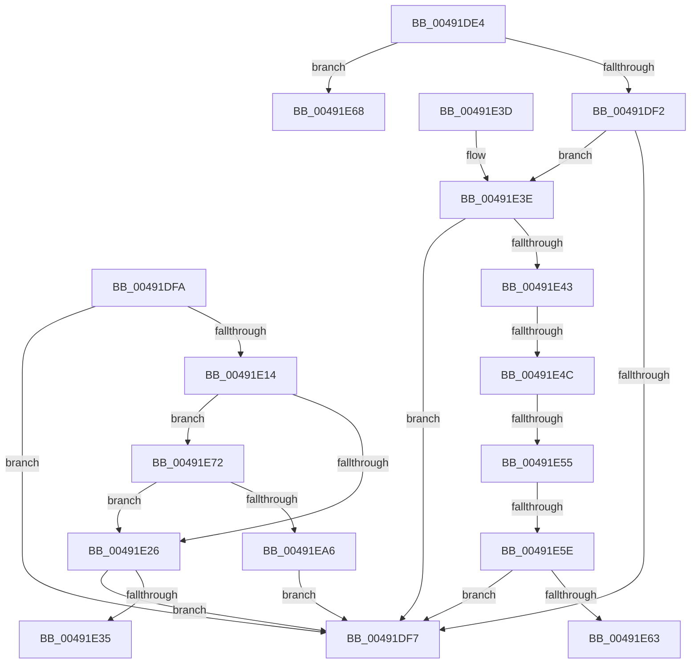

# WheapApplyThresholdChecks

- RVA: `0x00491DE4`–`0x00491EB7` (길이 `211` bytes)
- VA: `0x0000000140491DE4`
- 실행 섹션: `.text`
- PDB 이름 있음: `예`; PDB Function 태그: `예`
- unwind 정보 RVA: `0x000DB714`
- 디코드: `59`개 명령, `211/211` bytes 표시
- 미해석 바이트: `0` (있으면 어셈블리에 `.byte`로 보존)

> 이 문서는 커널 이미지의 기계어와 PDB 기호를 분석해 생성했습니다. 4번과 5번은 함수 원형과 자료형을 바이너리 사용 방식에서 추정한 C 해석이며 원본 소스 복구 결과는 아닙니다.

## 1. Dependencies

- 직접 호출 지점: **0**; 고유 호출 대상: **0**
- 직접 호출자로 확인된 함수: **1**
- RIP 상대 이미지 참조: **1**

### Outgoing calls
- 직접 디코드된 call 명령이 없습니다.

### Direct callers
- [WheaReportHwError](../4E/WheaReportHwError_function_004ED200.md) at `0x004ED312`

### Static image references
- `0x00491E72` → RVA `0x00FC6AA0` (`ALMOSTRO`; read)

## 2. Other-region calls and transfers

- 다른 실행 섹션으로 향하는 call: **0**
- call이 아닌 외부 분기/꼬리 이동: **5**
  - `0x00491E46` → `0x006F7084` (`tail-transfer`)
  - `0x00491E4F` → `0x006F7084` (`tail-transfer`)
  - `0x00491E58` → `0x006F7084` (`tail-transfer`)
  - `0x00491E63` → `0x006F7084` (`tail-transfer`)
  - `0x00491E6D` → `0x006F7089` (`tail-transfer`)

## 3. Assembly (complete function range)

```asm
00491DE4  FF 41 54                        inc dword ptr [rcx + 0x54]
00491DE7  4C 8B C9                        mov r9, rcx
00491DEA  8B 51 68                        mov edx, dword ptr [rcx + 0x68]
00491DED  83 EA 01                        sub edx, 1
00491DF0  74 76                           je 0x140491e68
00491DF2  83 EA 01                        sub edx, 1
00491DF5  75 47                           jne 0x140491e3e
00491DF7  32 C0                           xor al, al
00491DF9  C3                              ret
00491DFA  CC                              int3
00491DFB  B8 14 00 00 00                  mov eax, 0x14
00491E00  4C 8B C1                        mov r8, rcx
00491E03  44 8B 14 08                     mov r10d, dword ptr [rax + rcx]
00491E07  8D 50 04                        lea edx, [rax + 4]
00491E0A  44 8B 1C 0A                     mov r11d, dword ptr [rdx + rcx]
00491E0E  41 83 FA 01                     cmp r10d, 1
00491E12  76 E3                           jbe 0x140491df7
00491E14  48 B9 20 03 00 00 80 F7 FF FF   movabs rcx, 0xfffff78000000320
00491E1E  48 8B 09                        mov rcx, qword ptr [rcx]
00491E21  45 85 DB                        test r11d, r11d
00491E24  75 4C                           jne 0x140491e72
00491E26  41 8B 49 50                     mov ecx, dword ptr [r9 + 0x50]
00491E2A  FF C1                           inc ecx
00491E2C  41 89 49 50                     mov dword ptr [r9 + 0x50], ecx
00491E30  41 3B CA                        cmp ecx, r10d
00491E33  72 C2                           jb 0x140491df7
00491E35  41 83 61 50 00                  and dword ptr [r9 + 0x50], 0
00491E3A  B0 01                           mov al, 1
00491E3C  C3                              ret
00491E3D  CC                              int3
00491E3E  83 EA 02                        sub edx, 2
00491E41  74 B4                           je 0x140491df7
00491E43  83 EA 01                        sub edx, 1
00491E46  0F 84 38 52 26 00               je 0x1406f7084
00491E4C  83 EA 03                        sub edx, 3
00491E4F  0F 84 2F 52 26 00               je 0x1406f7084
00491E55  83 EA 04                        sub edx, 4
00491E58  0F 84 26 52 26 00               je 0x1406f7084
00491E5E  83 FA 01                        cmp edx, 1
00491E61  75 94                           jne 0x140491df7
00491E63  E9 1C 52 26 00                  jmp 0x1406f7084
00491E68  B8 90 00 00 00                  mov eax, 0x90
00491E6D  E9 17 52 26 00                  jmp 0x1406f7089
00491E72  8B 05 28 4C B3 00               mov eax, dword ptr [rip + 0xb34c28]
00491E78  4C 8B C1                        mov r8, rcx
00491E7B  4D 2B 41 48                     sub r8, qword ptr [r9 + 0x48]
00491E7F  4C 0F AF C0                     imul r8, rax
00491E83  48 B8 BD 42 7A E5 D5 94 BF D6   movabs rax, 0xd6bf94d5e57a42bd
00491E8D  49 F7 E8                        imul r8
00491E90  49 03 D0                        add rdx, r8
00491E93  48 C1 FA 17                     sar rdx, 0x17
00491E97  48 8B C2                        mov rax, rdx
00491E9A  48 C1 E8 3F                     shr rax, 0x3f
00491E9E  48 03 D0                        add rdx, rax
00491EA1  49 3B D3                        cmp rdx, r11
00491EA4  76 80                           jbe 0x140491e26
00491EA6  41 C7 41 50 01 00 00 00         mov dword ptr [r9 + 0x50], 1
00491EAE  49 89 49 48                     mov qword ptr [r9 + 0x48], rcx
00491EB2  E9 40 FF FF FF                  jmp 0x140491df7
```

## 4. C-style interpretation (structured pseudocode)

```c
__int64 __fastcall WheapApplyThresholdChecks(__int64 a1)
{
    __int64 result;

    a2 = (unsigned int)(((unsigned int)(*(unsigned int *)(a1 + 104))) - (1));
    if (condition_is_equal) goto loc_00491E68;
    a2 = (unsigned int)((a2) - (1));
    if (condition_is_not_equal) goto loc_00491E3E;
loc_00491DF7:
    result = 0;
    return result;
loc_00491E3E:
    a2 = (unsigned int)((a2) - (2));
    if (condition_is_equal) goto loc_00491DF7;
    a2 = (unsigned int)((a2) - (1));
    a2 = (unsigned int)((a2) - (3));
    a2 = (unsigned int)((a2) - (4));
    if (((unsigned int)(a2)) != 1) goto loc_00491DF7;
loc_00491E68:
}
```

## 5. (Beta) C Style

```c
int64_t WheapApplyThresholdChecks(void *Arg1)
{
    uint8_t *arg1 = (uint8_t *)Arg1;

    int64_t result;

    a2 = (uint32_t)(((uint32_t)(*(uint32_t *)(arg1 + 0x68))) - (1));
    if (condition_is_equal) goto loc_00491E68;
    a2 = (uint32_t)((a2) - (1));
    if (condition_is_not_equal) goto loc_00491E3E;
loc_00491DF7:
    result = 0;
    return result;
loc_00491E3E:
    a2 = (uint32_t)((a2) - (2));
    if (condition_is_equal) goto loc_00491DF7;
    a2 = (uint32_t)((a2) - (1));
    a2 = (uint32_t)((a2) - (3));
    a2 = (uint32_t)((a2) - (4));
    if (((uint32_t)(a2)) != 1) goto loc_00491DF7;
loc_00491E68:
}
```

### 관측된 메모리 오프셋

구조체 형식이 확인되지 않은 접근은 인자 기준의 오프셋으로만 기록했습니다.

| 기준 인자 | 오프셋 표현 | 폭 (bit) | 접근 |
|---|---:|---:|---|
| `Arg1` | `+ 0x54` | `32` | `R/W` |
| `Arg1` | `+ 0x68` | `32` | `R` |

## 6. Execution-region graph

[열기: 2D/3D 그래프와 함수 탐색 컨트롤 패널](../../../control-panel.html?section=text&rva=0x00491DE4&view=graph)

- 2D 그래프는 위에서 아래로 흐르고, 3D 그래프는 빈 공간을 드래그해 회전합니다. Shift+드래그는 이동, 휠은 확대·축소, 함수 노드 선택은 대상 보고서 이동입니다.

### Static fallback


