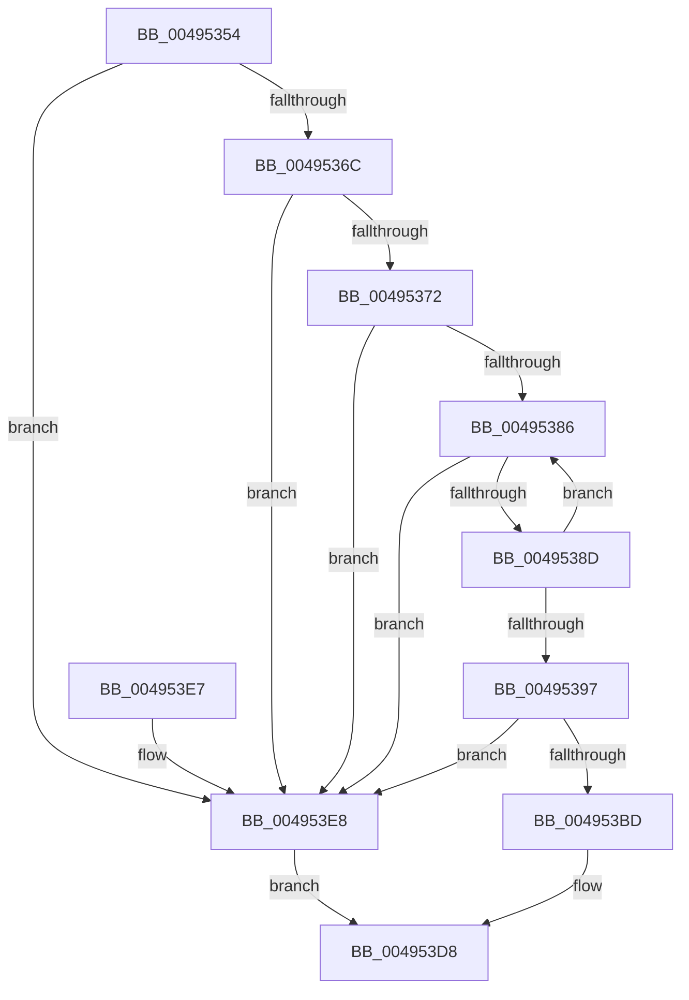

# WheapCallErrorSourceCreateRecord

- RVA: `0x00495354`–`0x004953EF` (길이 `155` bytes)
- VA: `0x0000000140495354`
- 실행 섹션: `.text`
- PDB 이름 있음: `예`; PDB Function 태그: `아니요`
- unwind 정보 RVA: `0x000A66C4`
- 디코드: `44`개 명령, `155/155` bytes 표시
- 미해석 바이트: `0` (있으면 어셈블리에 `.byte`로 보존)

> 이 문서는 커널 이미지의 기계어와 PDB 기호를 분석해 생성했습니다. 4번과 5번은 함수 원형과 자료형을 바이너리 사용 방식에서 추정한 C 해석이며 원본 소스 복구 결과는 아닙니다.

## 1. Dependencies

- 직접 호출 지점: **1**; 고유 호출 대상: **1**
- 직접 호출자로 확인된 함수: **2**
- RIP 상대 이미지 참조: **2**

### Outgoing calls
- `0x004953D3` → [guard_dispatch_icall](../6B/guard_dispatch_icall_function_006BAAD0.md) (function, `0x006BAAD0`)

### Direct callers
- [WheaReportHwError](../4E/WheaReportHwError_function_004ED200.md) at `0x004ED3D0`
- [WheapReportBootError](../65/WheapReportBootError_function_0065DF58.md) at `0x0065DFC7`

### Static image references
- `0x0049539A` → RVA `0x00EEF5B0` (`.data`; read)
- `0x004953A1` → RVA `0x00EEF0B0` (`.data`; read)

## 2. Other-region calls and transfers

- 다른 실행 섹션으로 향하는 call: **0**
- 별도 외부 분기/꼬리 이동을 확인하지 못했습니다.

## 3. Assembly (complete function range)

```asm
00495354  48 89 5C 24 10                  mov qword ptr [rsp + 0x10], rbx
00495359  57                              push rdi
0049535A  48 83 EC 30                     sub rsp, 0x30
0049535E  4D 8B D9                        mov r11, r9
00495361  48 8B FA                        mov rdi, rdx
00495364  48 8B D9                        mov rbx, rcx
00495367  48 85 C9                        test rcx, rcx
0049536A  74 7C                           je 0x1404953e8
0049536C  83 79 28 12                     cmp dword ptr [rcx + 0x28], 0x12
00495370  77 76                           ja 0x1404953e8
00495372  44 8B 91 84 00 00 00            mov r10d, dword ptr [rcx + 0x84]
00495379  41 81 E2 00 00 00 40            and r10d, 0x40000000
00495380  83 79 6C 03                     cmp dword ptr [rcx + 0x6c], 3
00495384  74 62                           je 0x1404953e8
00495386  8B 43 5C                        mov eax, dword ptr [rbx + 0x5c]
00495389  85 C0                           test eax, eax
0049538B  78 5B                           js 0x1404953e8
0049538D  8D 48 01                        lea ecx, [rax + 1]
00495390  F0 0F B1 4B 5C                  lock cmpxchg dword ptr [rbx + 0x5c], ecx
00495395  75 EF                           jne 0x140495386
00495397  45 85 D2                        test r10d, r10d
0049539A  48 8D 05 0F A2 A5 00            lea rax, [rip + 0xa5a20f]
004953A1  48 8D 0D 08 9D A5 00            lea rcx, [rip + 0xa59d08]
004953A8  48 0F 45 C8                     cmovne rcx, rax
004953AC  48 63 43 28                     movsxd rax, dword ptr [rbx + 0x28]
004953B0  48 C1 E0 06                     shl rax, 6
004953B4  48 8B 04 01                     mov rax, qword ptr [rcx + rax]
004953B8  48 85 C0                        test rax, rax
004953BB  74 2B                           je 0x1404953e8
004953BD  48 8B 53 38                     mov rdx, qword ptr [rbx + 0x38]
004953C1  48 8D 4B 60                     lea rcx, [rbx + 0x60]
004953C5  48 89 54 24 20                  mov qword ptr [rsp + 0x20], rdx
004953CA  45 8B C8                        mov r9d, r8d
004953CD  48 8B D7                        mov rdx, rdi
004953D0  4D 8B C3                        mov r8, r11
004953D3  E8 F8 56 22 00                  call 0x1406baad0
004953D8  F0 FF 4B 5C                     lock dec dword ptr [rbx + 0x5c]
004953DC  48 8B 5C 24 48                  mov rbx, qword ptr [rsp + 0x48]
004953E1  48 83 C4 30                     add rsp, 0x30
004953E5  5F                              pop rdi
004953E6  C3                              ret
004953E7  CC                              int3
004953E8  B8 02 00 00 C0                  mov eax, 0xc0000002
004953ED  EB E9                           jmp 0x1404953d8
```

## 4. C-style interpretation (structured pseudocode)

```c
__int64 __fastcall WheapCallErrorSourceCreateRecord(__int64 a1, __int64 a2, int a3, __int64 a4)
{
    __int64 result;
    __int64 v_r10;
    __int64 v_rsp;
    unsigned __int64 v_stack_m18;
    unsigned __int64 v_stack_p10;

    v_stack_p10 = v_rbx;
    v_rsp = (v_rsp) - (48);
    if (a1 == 0) goto loc_004953E8;
    if ((*(unsigned int *)(a1 + 40)) > 18) goto loc_004953E8;
    v_r10 = (unsigned int)(((unsigned int)(*(unsigned int *)(a1 + 132))) & (0x40000000ULL));
    if ((*(unsigned int *)(a1 + 108)) == 3) goto loc_004953E8;
loc_00495386:
    if (sign_flag) goto loc_004953E8;
    if ((unsigned int)((unsigned int)(*(unsigned int *)(a1 + 92))) != 0) goto loc_00495386;
    a1 = v_rip + 10853640;
    if ((unsigned int)(v_r10) != 0) { a1 = v_rip + 10854927; }
    result = ((int)(*(unsigned int *)(a1 + 40))) << (6);
    if (*(unsigned __int64 *)(a1 + result * 1) == 0) goto loc_004953E8;
    v_stack_m18 = *(unsigned __int64 *)(a1 + 56);
    result = guard_dispatch_icall(a1 + 96, a2, a4, (unsigned int)(a3));
loc_004953D8:
    v_rsp = (v_rsp) + (48);
    return result;
loc_004953E8:
    goto loc_004953D8;
}
```

## 5. (Beta) C Style

```c
int64_t WheapCallErrorSourceCreateRecord(void *Arg1, int64_t Arg2, int32_t Arg3, int64_t Arg4)
{
    uint8_t *arg1 = (uint8_t *)Arg1;

    int64_t result;
    int64_t local_r10;
    int64_t local_rsp;
    uint64_t v_stack_m18;
    uint64_t v_stack_p10;

    v_stack_p10 = local_rbx;
    local_rsp = (local_rsp) - (48);
    if (Arg1 == NULL) goto loc_004953E8;
    if ((*(uint32_t *)(arg1 + 0x28)) > 18) goto loc_004953E8;
    local_r10 = (uint32_t)(((uint32_t)(*(uint32_t *)(arg1 + 0x84))) & (0x40000000ULL));
    if ((*(uint32_t *)(arg1 + 0x6C)) == 3) goto loc_004953E8;
loc_00495386:
    if (sign_flag) goto loc_004953E8;
    if ((uint32_t)((uint32_t)(*(uint32_t *)(arg1 + 0x5C))) != 0) goto loc_00495386;
    Arg1 = v_rip + 10853640;
    if ((uint32_t)(local_r10) != 0) { Arg1 = v_rip + 10854927; }
    result = ((int32_t)(*(uint32_t *)(arg1 + 0x28))) << (6);
    if (*(uint64_t *)(arg1 + result * 1) == 0) goto loc_004953E8;
    v_stack_m18 = *(uint64_t *)(arg1 + 0x38);
    result = guard_dispatch_icall(Arg1 + 96, Arg2, Arg4, (uint32_t)(Arg3));
loc_004953D8:
    local_rsp = (local_rsp) + (48);
    return result;
loc_004953E8:
    goto loc_004953D8;
}
```

### 관측된 메모리 오프셋

구조체 형식이 확인되지 않은 접근은 인자 기준의 오프셋으로만 기록했습니다.

| 기준 인자 | 오프셋 표현 | 폭 (bit) | 접근 |
|---|---:|---:|---|
| `Arg1` | `+ 0x28` | `32` | `R` |
| `Arg1` | `+ 0x38` | `64` | `R` |
| `Arg1` | `+ 0x5C` | `32` | `R` |
| `Arg1` | `+ 0x5C` | `32` | `R/W` |
| `Arg1` | `+ 0x60` | `64` | `R` |

## 6. Execution-region graph

[열기: 2D/3D 그래프와 함수 탐색 컨트롤 패널](../../../control-panel.html?section=text&rva=0x00495354&view=graph)

- 2D 그래프는 위에서 아래로 흐르고, 3D 그래프는 빈 공간을 드래그해 회전합니다. Shift+드래그는 이동, 휠은 확대·축소, 함수 노드 선택은 대상 보고서 이동입니다.

### Static fallback


