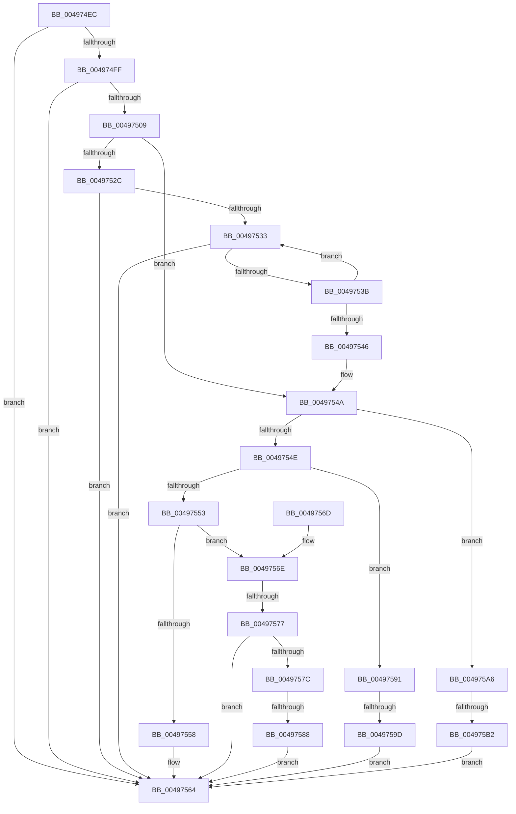

# WheapGetErrorSourceFunction

- RVA: `0x004974EC`–`0x004975BB` (길이 `207` bytes)
- VA: `0x00000001404974EC`
- 실행 섹션: `.text`
- PDB 이름 있음: `예`; PDB Function 태그: `예`
- unwind 정보 RVA: `0x000B3DEC`
- 디코드: `57`개 명령, `207/207` bytes 표시
- 미해석 바이트: `0` (있으면 어셈블리에 `.byte`로 보존)

> 이 문서는 커널 이미지의 기계어와 PDB 기호를 분석해 생성했습니다. 4번과 5번은 함수 원형과 자료형을 바이너리 사용 방식에서 추정한 C 해석이며 원본 소스 복구 결과는 아닙니다.

## 1. Dependencies

- 직접 호출 지점: **0**; 고유 호출 대상: **0**
- 직접 호출자로 확인된 함수: **4**
- RIP 상대 이미지 참조: **2**

### Outgoing calls
- 직접 디코드된 call 명령이 없습니다.

### Direct callers
- [WheapAttemptArchitecturalErrorRecovery](../65/WheapAttemptArchitecturalErrorRecovery_function_0065E240.md) at `0x0065E299`
- [WheapCallErrorSourceCorrect](../65/WheapCallErrorSourceCorrect_function_0065FBD4.md) at `0x0065FBE2`
- [WheapCallErrorSourceInitialize](../65/WheapCallErrorSourceInitialize_function_0065FC14.md) at `0x0065FC30`
- [WheapCallErrorSourceInitialize](../65/WheapCallErrorSourceInitialize_function_0065FC14.md) at `0x0065FC50`
- [WheapCallErrorSourceUninitialize](../65/WheapCallErrorSourceUninitialize_function_0065FC8C.md) at `0x0065FCA7`
- [WheapCallErrorSourceUninitialize](../65/WheapCallErrorSourceUninitialize_function_0065FC8C.md) at `0x0065FCCA`

### Static image references
- `0x00497513` → RVA `0x00EEF590` (`.data`; read)
- `0x0049751A` → RVA `0x00EEF090` (`.data`; read)

## 2. Other-region calls and transfers

- 다른 실행 섹션으로 향하는 call: **0**
- call이 아닌 외부 분기/꼬리 이동: **4**
  - `0x00497571` → [sub_006F77DA + 0xE](../6F/Unknown_function_006F77DA.md) (`tail-transfer`)
  - `0x00497582` → [sub_006F77DA](../6F/Unknown_function_006F77DA.md) (`tail-transfer`)
  - `0x00497597` → [sub_006F77DA + 0x1F](../6F/Unknown_function_006F77DA.md) (`tail-transfer`)
  - `0x004975AC` → [sub_006F77DA + 0x2D](../6F/Unknown_function_006F77DA.md) (`tail-transfer`)

## 3. Assembly (complete function range)

```asm
004974EC  48 89 5C 24 10                  mov qword ptr [rsp + 0x10], rbx
004974F1  45 33 C9                        xor r9d, r9d
004974F4  41 8A D8                        mov bl, r8b
004974F7  4C 8B D1                        mov r10, rcx
004974FA  48 85 C9                        test rcx, rcx
004974FD  74 65                           je 0x140497564
004974FF  4C 8D 59 28                     lea r11, [rcx + 0x28]
00497503  41 83 3B 12                     cmp dword ptr [r11], 0x12
00497507  77 5B                           ja 0x140497564
00497509  F7 81 84 00 00 00 00 00 00 40   test dword ptr [rcx + 0x84], 0x40000000
00497513  48 8D 05 76 80 A5 00            lea rax, [rip + 0xa58076]
0049751A  4C 8D 05 6F 7B A5 00            lea r8, [rip + 0xa57b6f]
00497521  49 8B CB                        mov rcx, r11
00497524  4C 0F 45 C0                     cmovne r8, rax
00497528  84 DB                           test bl, bl
0049752A  75 1E                           jne 0x14049754a
0049752C  41 83 7A 6C 03                  cmp dword ptr [r10 + 0x6c], 3
00497531  74 31                           je 0x140497564
00497533  41 8B 42 5C                     mov eax, dword ptr [r10 + 0x5c]
00497537  85 C0                           test eax, eax
00497539  78 29                           js 0x140497564
0049753B  8D 48 01                        lea ecx, [rax + 1]
0049753E  F0 41 0F B1 4A 5C               lock cmpxchg dword ptr [r10 + 0x5c], ecx
00497544  75 ED                           jne 0x140497533
00497546  49 8D 4A 28                     lea rcx, [r10 + 0x28]
0049754A  85 D2                           test edx, edx
0049754C  74 58                           je 0x1404975a6
0049754E  83 EA 01                        sub edx, 1
00497551  74 3E                           je 0x140497591
00497553  83 EA 01                        sub edx, 1
00497556  75 16                           jne 0x14049756e
00497558  48 63 01                        movsxd rax, dword ptr [rcx]
0049755B  48 C1 E0 06                     shl rax, 6
0049755F  4E 8B 4C 00 20                  mov r9, qword ptr [rax + r8 + 0x20]
00497564  48 8B 5C 24 10                  mov rbx, qword ptr [rsp + 0x10]
00497569  49 8B C1                        mov rax, r9
0049756C  C3                              ret
0049756D  CC                              int3
0049756E  83 EA 01                        sub edx, 1
00497571  0F 84 71 02 26 00               je 0x1406f77e8
00497577  83 FA 01                        cmp edx, 1
0049757A  75 E8                           jne 0x140497564
0049757C  49 63 03                        movsxd rax, dword ptr [r11]
0049757F  83 F8 10                        cmp eax, 0x10
00497582  0F 85 52 02 26 00               jne 0x1406f77da
00497588  4D 8B 8A B8 00 00 00            mov r9, qword ptr [r10 + 0xb8]
0049758F  EB D3                           jmp 0x140497564
00497591  48 63 01                        movsxd rax, dword ptr [rcx]
00497594  83 F8 10                        cmp eax, 0x10
00497597  0F 85 5C 02 26 00               jne 0x1406f77f9
0049759D  4D 8B 8A B0 00 00 00            mov r9, qword ptr [r10 + 0xb0]
004975A4  EB BE                           jmp 0x140497564
004975A6  48 63 01                        movsxd rax, dword ptr [rcx]
004975A9  83 F8 10                        cmp eax, 0x10
004975AC  0F 85 55 02 26 00               jne 0x1406f7807
004975B2  4D 8B 8A C0 00 00 00            mov r9, qword ptr [r10 + 0xc0]
004975B9  EB A9                           jmp 0x140497564
```

## 4. C-style interpretation (structured pseudocode)

```c
__int64 __fastcall WheapGetErrorSourceFunction(__int64 a1, int a2, unsigned __int8 a3, int a4)
{
    __int64 result;
    unsigned __int64 v_stack_p10;

    v_stack_p10 = v_rbx;
    a4 = 0;
    if (a1 == 0) goto loc_00497564;
    if ((*(unsigned int *)(a1 + 40)) > 18) goto loc_00497564;
    a3 = v_rip + 10845039;
    if (((*(unsigned int *)(a1 + 132)) & (0x40000000ULL)) != 0) { a3 = v_rip + 10846326; }
    if (a3 != 0) goto loc_0049754A;
    if ((*(unsigned int *)(a1 + 108)) == 3) goto loc_00497564;
loc_00497533:
    if (sign_flag) goto loc_00497564;
    if ((unsigned int)((unsigned int)(*(unsigned int *)(a1 + 92))) != 0) goto loc_00497533;
loc_0049754A:
    if (a2 == 0) goto loc_004975A6;
    a2 = (unsigned int)((a2) - (1));
    if (condition_is_equal) goto loc_00497591;
    a2 = (unsigned int)((a2) - (1));
    if (condition_is_not_equal) goto loc_0049756E;
    result = ((int)(*(unsigned int *)(a1 + 40))) << (6);
loc_00497564:
    return *(unsigned __int64 *)(result + a3 * 1 + 32);
loc_0049756E:
    a2 = (unsigned int)((a2) - (1));
    if (a2 != 1) goto loc_00497564;
    goto loc_00497564;
loc_00497591:
    goto loc_00497564;
loc_004975A6:
    goto loc_00497564;
}
```

## 5. (Beta) C Style

```c
int64_t WheapGetErrorSourceFunction(void *Arg1, int32_t Arg2, uint8_t Arg3, int32_t Arg4)
{
    uint8_t *arg1 = (uint8_t *)Arg1;

    int64_t result;
    uint64_t v_stack_p10;

    v_stack_p10 = local_rbx;
    Arg4 = 0;
    if (Arg1 == NULL) goto loc_00497564;
    if ((*(uint32_t *)(arg1 + 0x28)) > 18) goto loc_00497564;
    Arg3 = v_rip + 10845039;
    if (((*(uint32_t *)(arg1 + 0x84)) & (0x40000000ULL)) != 0) { Arg3 = v_rip + 10846326; }
    if (Arg3 != 0) goto loc_0049754A;
    if ((*(uint32_t *)(arg1 + 0x6C)) == 3) goto loc_00497564;
loc_00497533:
    if (sign_flag) goto loc_00497564;
    if ((uint32_t)((uint32_t)(*(uint32_t *)(arg1 + 0x5C))) != 0) goto loc_00497533;
loc_0049754A:
    if (Arg2 == 0) goto loc_004975A6;
    Arg2 = (uint32_t)((Arg2) - (1));
    if (condition_is_equal) goto loc_00497591;
    Arg2 = (uint32_t)((Arg2) - (1));
    if (condition_is_not_equal) goto loc_0049756E;
    result = ((int32_t)(*(uint32_t *)(arg1 + 0x28))) << (6);
loc_00497564:
    return *(uint64_t *)(result + Arg3 * 1 + 0x20);
loc_0049756E:
    Arg2 = (uint32_t)((Arg2) - (1));
    if (Arg2 != 1) goto loc_00497564;
    goto loc_00497564;
loc_00497591:
    goto loc_00497564;
loc_004975A6:
    goto loc_00497564;
}
```

### 관측된 메모리 오프셋

구조체 형식이 확인되지 않은 접근은 인자 기준의 오프셋으로만 기록했습니다.

| 기준 인자 | 오프셋 표현 | 폭 (bit) | 접근 |
|---|---:|---:|---|
| `Arg1` | `+ 0x28` | `64` | `R` |
| `Arg1` | `+ 0x5C` | `32` | `R` |
| `Arg1` | `+ 0x6C` | `32` | `R` |
| `Arg1` | `+ 0xB0` | `64` | `R` |
| `Arg1` | `+ 0xB8` | `64` | `R` |
| `Arg1` | `+ 0xC0` | `64` | `R` |

## 6. Execution-region graph

[열기: 2D/3D 그래프와 함수 탐색 컨트롤 패널](../../../control-panel.html?section=text&rva=0x004974EC&view=graph)

- 2D 그래프는 위에서 아래로 흐르고, 3D 그래프는 빈 공간을 드래그해 회전합니다. Shift+드래그는 이동, 휠은 확대·축소, 함수 노드 선택은 대상 보고서 이동입니다.

### Static fallback


