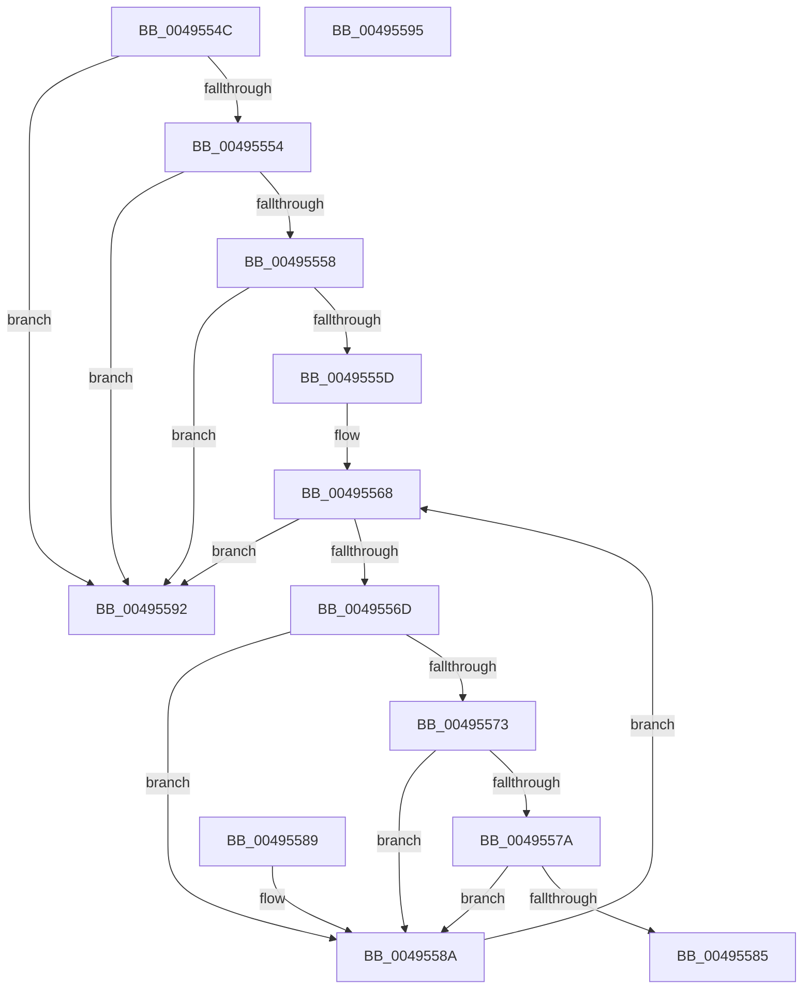

# WheapGetErrorSource

- RVA: `0x0049554C`–`0x00495596` (길이 `74` bytes)
- VA: `0x000000014049554C`
- 실행 섹션: `.text`
- PDB 이름 있음: `예`; PDB Function 태그: `아니요`
- unwind 정보 RVA: `0x000DB714`
- 디코드: `28`개 명령, `74/74` bytes 표시
- 미해석 바이트: `0` (있으면 어셈블리에 `.byte`로 보존)

> 이 문서는 커널 이미지의 기계어와 PDB 기호를 분석해 생성했습니다. 4번과 5번은 함수 원형과 자료형을 바이너리 사용 방식에서 추정한 C 해석이며 원본 소스 복구 결과는 아닙니다.

## 1. Dependencies

- 직접 호출 지점: **0**; 고유 호출 대상: **0**
- 직접 호출자로 확인된 함수: **15**
- RIP 상대 이미지 참조: **0**

### Outgoing calls
- 직접 디코드된 call 명령이 없습니다.

### Direct callers
- [WheaGetErrorSource](WheaGetErrorSource_function_00495520.md) at `0x0049552D`
- [WheaReportHwError](../4E/WheaReportHwError_function_004ED200.md) at `0x004ED2DA`
- [HalpMcaReportError](../54/HalpMcaReportError_function_00541D04.md) at `0x00541D56`
- [HalHandleNMI](../54/HalHandleNMI_function_00545800.md) at `0x00545922`
- [KiMcheckAlternateReturn](../5C/KiMcheckAlternateReturn_function_005CB180.md) at `0x005CB37A`
- [WheapReportBootError](../65/WheapReportBootError_function_0065DF58.md) at `0x0065DF89`
- [WheaErrorSourceGetState](../65/WheaErrorSourceGetState_function_0065E0C0.md) at `0x0065E0CD`
- [WheapAttemptArchitecturalErrorRecovery](../65/WheapAttemptArchitecturalErrorRecovery_function_0065E240.md) at `0x0065E27B`
- [WheaAddHwErrorReportSectionDeviceDriver](../65/WheaAddHwErrorReportSectionDeviceDriver_function_0065E510.md) at `0x0065E548`
- [WheaHwErrorReportSubmitDeviceDriver](../65/WheaHwErrorReportSubmitDeviceDriver_function_0065E7F0.md) at `0x0065E829`
- [WheapFreeDriverPacketBuffer](../65/WheapFreeDriverPacketBuffer_function_0065EC58.md) at `0x0065EC6F`
- [WheapGetPreallocatedPacketBuffer](../65/WheapGetPreallocatedPacketBuffer_function_0065ECD4.md) at `0x0065ECEA`
- [WheapInitErrorReportDeviceDriver](../65/WheapInitErrorReportDeviceDriver_function_0065ED88.md) at `0x0065EDDF`
- [WheapWmiExecuteErrorSourceMethod](../66/WheapWmiExecuteErrorSourceMethod_function_00661470.md) at `0x00661503`
- [WheapWmiExecuteErrorSourceMethod](../66/WheapWmiExecuteErrorSourceMethod_function_00661470.md) at `0x0066154F`
- [WheapWmiExecuteErrorSourceMethod](../66/WheapWmiExecuteErrorSourceMethod_function_00661470.md) at `0x0066168D`
- [WheaRemoveErrorSource](../../page/7D/WheaRemoveErrorSource_function_007D6C70.md) at `0x007D6CB8`

### Static image references
- 디코드된 RIP-relative 메모리 참조가 없습니다.

## 2. Other-region calls and transfers

- 다른 실행 섹션으로 향하는 call: **0**
- 별도 외부 분기/꼬리 이동을 확인하지 못했습니다.

## 3. Assembly (complete function range)

```asm
0049554C  81 39 54 41 42 4C               cmp dword ptr [rcx], 0x4c424154
00495552  75 3E                           jne 0x140495592
00495554  85 D2                           test edx, edx
00495556  74 3A                           je 0x140495592
00495558  3B 51 08                        cmp edx, dword ptr [rcx + 8]
0049555B  73 35                           jae 0x140495592
0049555D  4C 8B 41 10                     mov r8, qword ptr [rcx + 0x10]
00495561  45 33 C9                        xor r9d, r9d
00495564  44 8B 51 04                     mov r10d, dword ptr [rcx + 4]
00495568  45 3B CA                        cmp r9d, r10d
0049556B  7D 25                           jge 0x140495592
0049556D  41 39 50 7C                     cmp dword ptr [r8 + 0x7c], edx
00495571  75 17                           jne 0x14049558a
00495573  41 80 78 58 00                  cmp byte ptr [r8 + 0x58], 0
00495578  75 10                           jne 0x14049558a
0049557A  41 8B 40 6C                     mov eax, dword ptr [r8 + 0x6c]
0049557E  FF C8                           dec eax
00495580  83 F8 01                        cmp eax, 1
00495583  77 05                           ja 0x14049558a
00495585  49 8B C0                        mov rax, r8
00495588  C3                              ret
00495589  CC                              int3
0049558A  4D 8B 00                        mov r8, qword ptr [r8]
0049558D  41 FF C1                        inc r9d
00495590  EB D6                           jmp 0x140495568
00495592  33 C0                           xor eax, eax
00495594  C3                              ret
00495595  CC                              int3
```

## 4. C-style interpretation (structured pseudocode)

```c
__int64 __fastcall WheapGetErrorSource(__int64 a1, int a2, __int64 a3, int a4)
{
    __int64 result;

    if ((*(unsigned int *)(a1)) != 0x4C424154ULL) goto loc_00495592;
    if (a2 == 0) goto loc_00495592;
    if (a2 >= (*(unsigned int *)(a1 + 8))) goto loc_00495592;
    a4 = 0;
loc_00495568:
    if (0 >= ((unsigned int)((unsigned int)(*(unsigned int *)(a1 + 4))))) goto loc_00495592;
    if ((*(unsigned int *)(*(unsigned __int64 *)(a1 + 16) + 124)) != a2) goto loc_0049558A;
    if ((*(unsigned __int8 *)(*(unsigned __int64 *)(a1 + 16) + 88)) != 0) goto loc_0049558A;
    result = (unsigned int)(((unsigned int)(*(unsigned int *)(*(unsigned __int64 *)(a1 + 16) + 108))) - 1);
    if (((unsigned int)(result)) > 1) goto loc_0049558A;
    return *(unsigned __int64 *)(a1 + 16);
loc_0049558A:
    a4 = (unsigned int)((a4) + 1);
    goto loc_00495568;
loc_00495592:
    result = 0;
    return result;
}
```

## 5. (Beta) C Style

```c
int64_t WheapGetErrorSource(void *Arg1, int32_t Arg2, int64_t Arg3, int32_t Arg4)
{
    uint8_t *arg1 = (uint8_t *)Arg1;

    int64_t result;

    if ((*(uint32_t *)(arg1)) != 0x4C424154ULL) goto loc_00495592;
    if (Arg2 == 0) goto loc_00495592;
    if (Arg2 >= (*(uint32_t *)(arg1 + 0x8))) goto loc_00495592;
    Arg4 = 0;
loc_00495568:
    if (0 >= ((uint32_t)((uint32_t)(*(uint32_t *)(arg1 + 0x4))))) goto loc_00495592;
    if ((*(uint32_t *)(*(uint64_t *)(arg1 + 0x10) + 0x7C)) != Arg2) goto loc_0049558A;
    if ((*(uint8_t *)(*(uint64_t *)(arg1 + 0x10) + 0x58)) != 0) goto loc_0049558A;
    result = (uint32_t)(((uint32_t)(*(uint32_t *)(*(uint64_t *)(arg1 + 0x10) + 0x6C))) - 1);
    if (((uint32_t)(result)) > 1) goto loc_0049558A;
    return *(uint64_t *)(arg1 + 0x10);
loc_0049558A:
    Arg4 = (uint32_t)((Arg4) + 1);
    goto loc_00495568;
loc_00495592:
    result = 0;
    return result;
}
```

### 관측된 메모리 오프셋

구조체 형식이 확인되지 않은 접근은 인자 기준의 오프셋으로만 기록했습니다.

| 기준 인자 | 오프셋 표현 | 폭 (bit) | 접근 |
|---|---:|---:|---|
| `Arg1` | `+ 0x0` | `32` | `R` |
| `Arg1` | `+ 0x4` | `32` | `R` |
| `Arg1` | `+ 0x8` | `32` | `R` |
| `Arg1` | `+ 0x10` | `64` | `R` |

## 6. Execution-region graph

[열기: 2D/3D 그래프와 함수 탐색 컨트롤 패널](../../../control-panel.html?section=text&rva=0x0049554C&view=graph)

- 2D 그래프는 위에서 아래로 흐르고, 3D 그래프는 빈 공간을 드래그해 회전합니다. Shift+드래그는 이동, 휠은 확대·축소, 함수 노드 선택은 대상 보고서 이동입니다.

### Static fallback


