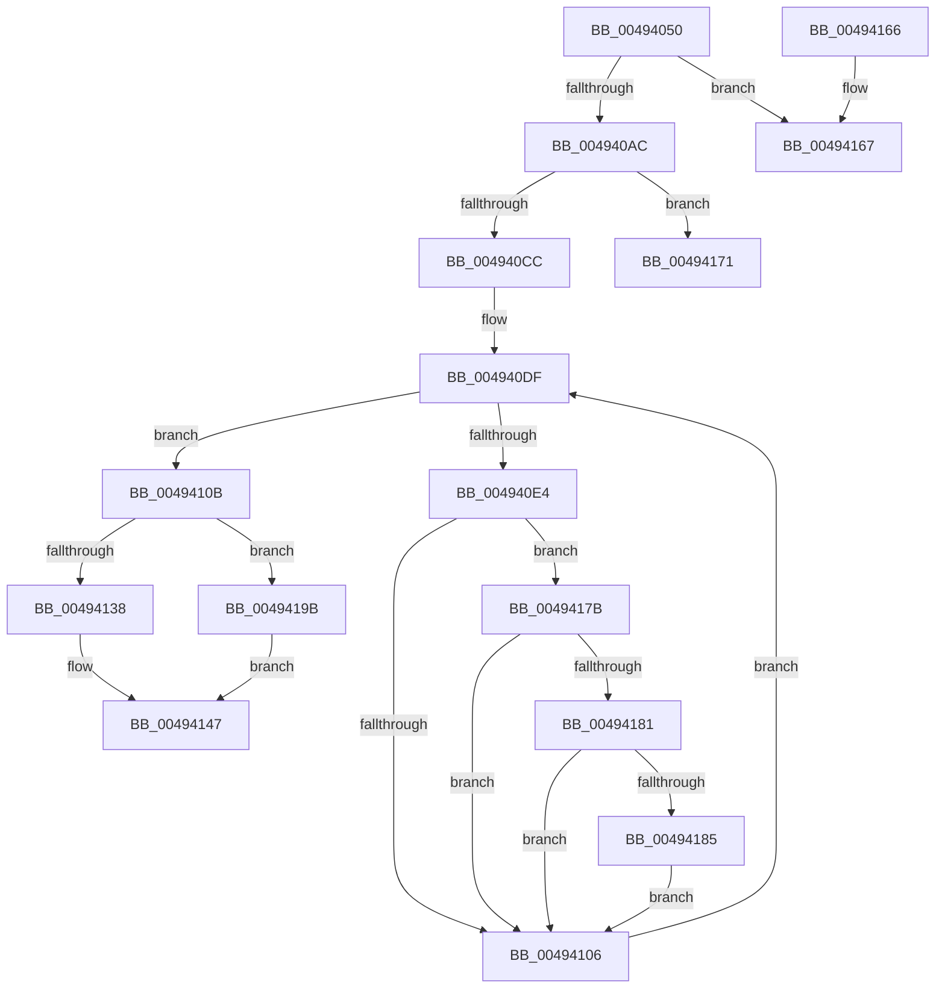

# WmipBuildTraceDeviceList

- RVA: `0x00494050`–`0x004941A4` (길이 `340` bytes)
- VA: `0x0000000140494050`
- 실행 섹션: `.text`
- PDB 이름 있음: `예`; PDB Function 태그: `예`
- unwind 정보 RVA: `0x0009F84C`
- 디코드: `95`개 명령, `340/340` bytes 표시
- 미해석 바이트: `0` (있으면 어셈블리에 `.byte`로 보존)

> 이 문서는 커널 이미지의 기계어와 PDB 기호를 분석해 생성했습니다. 4번과 5번은 함수 원형과 자료형을 바이너리 사용 방식에서 추정한 C 해석이며 원본 소스 복구 결과는 아닙니다.

## 1. Dependencies

- 직접 호출 지점: **6**; 고유 호출 대상: **6**
- 직접 호출자로 확인된 함수: **2**
- RIP 상대 이미지 참조: **4**

### Outgoing calls
- `0x0049408A` → [KeWaitForSingleObject](../20/KeWaitForSingleObject_function_0020E6B0.md) (function, `0x0020E6B0`)
- `0x00494096` → [KeAcquireSpinLockRaiseToDpc](../20/KeAcquireSpinLockRaiseToDpc_function_00208470.md) (function, `0x00208470`)
- `0x004940BB` → [ExAllocatePool2](../../poolcode/B8/ExAllocatePool2_function_00B820F0.md) (function, `0x00B820F0`)
- `0x00494115` → [KeReleaseSpinLock](../39/KeReleaseSpinLock_function_00392BA0.md) (function, `0x00392BA0`)
- `0x0049412F` → [KeReleaseMutantEx](../39/KeReleaseMutantEx_function_00396850.md) (function, `0x00396850`)
- `0x00494142` → [WmipFreeTraceDeviceList](../../page/9E/WmipFreeTraceDeviceList_function_009E4780.md) (function, `0x009E4780`)

### Direct callers
- [WmiSetNetworkNotify](../../page/7B/WmiSetNetworkNotify_function_007B3EE4.md) at `0x007B3F0A`
- [WmiTraceRundownNotify](../../page/9E/WmiTraceRundownNotify_function_009E46E0.md) at `0x009E4723`

### Static image references
- `0x00494080` → RVA `0x00EFFA60` (`.data`; read)
- `0x0049408F` → RVA `0x00EFFC28` (`.data`; read)
- `0x0049409B` → RVA `0x00E68450` (`.data`; read)
- `0x004940CC` → RVA `0x00E09148` (`.data`; read)

## 2. Other-region calls and transfers

- 다른 실행 섹션으로 향하는 call: **2**
  - `0x004940BB` → [ExAllocatePool2](../../poolcode/B8/ExAllocatePool2_function_00B820F0.md) (`.text` → `POOLCODE`)
  - `0x00494142` → [WmipFreeTraceDeviceList](../../page/9E/WmipFreeTraceDeviceList_function_009E4780.md) (`.text` → `PAGE`)
- call이 아닌 외부 분기/꼬리 이동: **2**
  - `0x0049416C` → [sub_006F7340](../6F/Unknown_function_006F7340.md) (`tail-transfer`)
  - `0x00494176` → [sub_006F7340](../6F/Unknown_function_006F7340.md) (`tail-transfer`)

## 3. Assembly (complete function range)

```asm
00494050  48 8B C4                        mov rax, rsp
00494053  48 89 58 08                     mov qword ptr [rax + 8], rbx
00494057  48 89 68 10                     mov qword ptr [rax + 0x10], rbp
0049405B  48 89 70 18                     mov qword ptr [rax + 0x18], rsi
0049405F  57                              push rdi
00494060  41 54                           push r12
00494062  41 55                           push r13
00494064  41 56                           push r14
00494066  41 57                           push r15
00494068  48 83 EC 30                     sub rsp, 0x30
0049406C  4D 8B F8                        mov r15, r8
0049406F  4C 8B E2                        mov r12, rdx
00494072  44 8B E9                        mov r13d, ecx
00494075  33 DB                           xor ebx, ebx
00494077  45 33 C0                        xor r8d, r8d
0049407A  48 89 58 C8                     mov qword ptr [rax - 0x38], rbx
0049407E  33 D2                           xor edx, edx
00494080  48 8D 0D D9 B9 A6 00            lea rcx, [rip + 0xa6b9d9]
00494087  45 33 C9                        xor r9d, r9d
0049408A  E8 21 A6 D7 FF                  call 0x14020e6b0
0049408F  48 8D 0D 92 BB A6 00            lea rcx, [rip + 0xa6bb92]
00494096  E8 D5 43 D7 FF                  call 0x140208470
0049409B  8B 2D AF 43 9D 00               mov ebp, dword ptr [rip + 0x9d43af]
004940A1  44 8A F0                        mov r14b, al
004940A4  85 ED                           test ebp, ebp
004940A6  0F 84 BB 00 00 00               je 0x140494167
004940AC  8B D5                           mov edx, ebp
004940AE  8D 4B 40                        lea ecx, [rbx + 0x40]
004940B1  48 C1 E2 04                     shl rdx, 4
004940B5  41 B8 57 6D 69 70               mov r8d, 0x70696d57
004940BB  E8 30 E0 6E 00                  call 0x140b820f0
004940C0  48 8B F0                        mov rsi, rax
004940C3  48 85 C0                        test rax, rax
004940C6  0F 84 A5 00 00 00               je 0x140494171
004940CC  48 8B 15 75 50 97 00            mov rdx, qword ptr [rip + 0x975075]
004940D3  4C 8D 15 6E 50 97 00            lea r10, [rip + 0x97506e]
004940DA  4C 8B C0                        mov r8, rax
004940DD  8B FB                           mov edi, ebx
004940DF  49 3B D2                        cmp rdx, r10
004940E2  74 27                           je 0x14049410b
004940E4  8B 42 30                        mov eax, dword ptr [rdx + 0x30]
004940E7  44 8B C8                        mov r9d, eax
004940EA  41 C1 F9 04                     sar r9d, 4
004940EE  41 81 E1 00 00 F0 00            and r9d, 0xf00000
004940F5  45 85 CD                        test r13d, r9d
004940F8  0F 95 C1                        setne cl
004940FB  0F BA E0 1E                     bt eax, 0x1e
004940FF  0F 92 C0                        setb al
00494102  84 C8                           test al, cl
00494104  75 75                           jne 0x14049417b
00494106  48 8B 12                        mov rdx, qword ptr [rdx]
00494109  EB D4                           jmp 0x1404940df
0049410B  41 8A D6                        mov dl, r14b
0049410E  48 8D 0D 13 BB A6 00            lea rcx, [rip + 0xa6bb13]
00494115  E8 86 EA EF FF                  call 0x140392ba0
0049411A  BA 01 00 00 00                  mov edx, 1
0049411F  4C 8D 4C 24 78                  lea r9, [rsp + 0x78]
00494124  48 8D 0D 35 B9 A6 00            lea rcx, [rip + 0xa6b935]
0049412B  44 8D 42 03                     lea r8d, [rdx + 3]
0049412F  E8 1C 27 F0 FF                  call 0x140396850
00494134  85 FF                           test edi, edi
00494136  75 63                           jne 0x14049419b
00494138  33 D2                           xor edx, edx
0049413A  48 8B CE                        mov rcx, rsi
0049413D  BB C0 00 00 C0                  mov ebx, 0xc00000c0
00494142  E8 39 06 55 00                  call 0x1409e4780
00494147  48 8B 6C 24 68                  mov rbp, qword ptr [rsp + 0x68]
0049414C  8B C3                           mov eax, ebx
0049414E  48 8B 5C 24 60                  mov rbx, qword ptr [rsp + 0x60]
00494153  48 8B 74 24 70                  mov rsi, qword ptr [rsp + 0x70]
00494158  48 83 C4 30                     add rsp, 0x30
0049415C  41 5F                           pop r15
0049415E  41 5E                           pop r14
00494160  41 5D                           pop r13
00494162  41 5C                           pop r12
00494164  5F                              pop rdi
00494165  C3                              ret
00494166  CC                              int3
00494167  BB C0 00 00 C0                  mov ebx, 0xc00000c0
0049416C  E9 CF 31 26 00                  jmp 0x1406f7340
00494171  BB 9A 00 00 C0                  mov ebx, 0xc000009a
00494176  E9 C5 31 26 00                  jmp 0x1406f7340
0049417B  48 39 5A 10                     cmp qword ptr [rdx + 0x10], rbx
0049417F  74 85                           je 0x140494106
00494181  3B FD                           cmp edi, ebp
00494183  73 81                           jae 0x140494106
00494185  F0 FF 42 30                     lock inc dword ptr [rdx + 0x30]
00494189  49 89 10                        mov qword ptr [r8], rdx
0049418C  45 89 48 08                     mov dword ptr [r8 + 8], r9d
00494190  49 83 C0 10                     add r8, 0x10
00494194  FF C7                           inc edi
00494196  E9 6B FF FF FF                  jmp 0x140494106
0049419B  49 89 34 24                     mov qword ptr [r12], rsi
0049419F  41 89 3F                        mov dword ptr [r15], edi
004941A2  EB A3                           jmp 0x140494147
```

## 4. C-style interpretation (structured pseudocode)

```c
__int64 __fastcall WmipBuildTraceDeviceList(int a1, __int64 a2, __int64 a3, int a4)
{
    __int64 result;
    __int64 v_rbx;
    __int64 v_rdi;
    __int64 v_rsp;
    unsigned __int64 v_stack_p10;
    unsigned __int64 v_stack_p18;
    unsigned __int64 v_stack_p20;
    unsigned __int64 v_stack_p8;

    *(unsigned __int64 *)(v_rsp + 8) = v_rbx;
    *(unsigned __int64 *)(v_rsp + 16) = v_rbp;
    *(unsigned __int64 *)(v_rsp + 24) = v_rsi;
    v_rsp = (v_rsp) - (48);
    v_rbx = 0;
    a3 = 0;
    *(unsigned __int64 *)(v_rsp - 56) = 0;
    a2 = 0;
    a4 = 0;
    result = KeWaitForSingleObject(v_rip + 10926553, a2, a3, a4);
    result = KeAcquireSpinLockRaiseToDpc(v_rip + 10926994, a2, a3, a4);
    if ((unsigned int)((unsigned int)(*(unsigned int *)(v_rip + 10306479))) == 0) goto loc_00494167;
    a2 = ((unsigned int)((unsigned int)((unsigned int)(*(unsigned int *)(v_rip + 10306479))))) << (4);
    result = ExAllocatePool2(v_rbx + 64, a2, (unsigned int)(0x70696D57ULL), a4);
    if (result == 0) goto loc_00494171;
loc_004940DF:
    if ((*(unsigned __int64 *)(v_rip + 9916533)) == (v_rip + 9916526)) goto loc_0049410B;
    a4 = (unsigned int)(((unsigned int)((unsigned int)((unsigned int)(*(unsigned int *)(*(unsigned __int64 *)(v_rip + 9916533) + 48))))) >> (4));
    a4 = (unsigned int)((a4) & (0xF00000ULL));
    a1 = ((((unsigned int)((unsigned int)(a1))) & (a4)) != 0) ? 1 : 0;
    result = (condition_is_below) ? 1 : 0;
    if ((((unsigned __int8)(result)) & ((unsigned __int8)(a1))) != 0) goto loc_0049417B;
loc_00494106:
    goto loc_004940DF;
loc_0049410B:
    result = KeReleaseSpinLock(v_rip + 10926867, (unsigned __int8)((unsigned __int8)(result)), result, a4);
    result = KeReleaseMutantEx(v_rip + 10926389, 1, 1 + 3, v_stack_p20);
    if (0 != 0) goto loc_0049419B;
    a2 = 0;
    result = WmipFreeTraceDeviceList(result, a2, 1 + 3, v_stack_p20);
loc_00494147:
    v_rsp = (v_rsp) + (48);
    return (unsigned int)((unsigned int)((unsigned int)(0xC00000C0ULL)));
loc_00494167:
loc_00494171:
loc_0049417B:
    if ((*(unsigned __int64 *)(a2 + 16)) == ((unsigned int)(0xC000009AULL))) goto loc_00494106;
    if (0 >= ((unsigned int)(v_stack_p10))) goto loc_00494106;
    *(unsigned __int64 *)(1 + 3) = 0;
    *(unsigned int *)(1 + 3 + 8) = (unsigned int)(v_stack_p20);
    a3 = (1 + 3) + (16);
    v_rdi = (unsigned int)((0) + 1);
    goto loc_00494106;
loc_0049419B:
    *(unsigned __int64 *)(a2) = v_stack_p18;
    *(unsigned int *)(a3) = (unsigned int)(v_rdi);
    goto loc_00494147;
}
```

## 5. (Beta) C Style

```c
int64_t WmipBuildTraceDeviceList(int32_t Arg1, void *Arg2, void *Arg3, int32_t Arg4)
{
    uint8_t *arg2 = (uint8_t *)Arg2;
    uint8_t *arg3 = (uint8_t *)Arg3;

    int64_t result;
    int64_t local_rbx;
    int64_t local_rdi;
    int64_t local_rsp;
    uint64_t v_stack_p10;
    uint64_t v_stack_p18;
    uint64_t v_stack_p20;
    uint64_t v_stack_p8;

    *(uint64_t *)(local_rsp + 0x8) = local_rbx;
    *(uint64_t *)(local_rsp + 0x10) = local_rbp;
    *(uint64_t *)(local_rsp + 0x18) = local_rsi;
    local_rsp = (local_rsp) - (48);
    local_rbx = 0;
    Arg3 = 0;
    *(uint64_t *)(local_rsp - 0x38) = 0;
    Arg2 = 0;
    Arg4 = 0;
    result = KeWaitForSingleObject(v_rip + 10926553, Arg2, Arg3, Arg4);
    result = KeAcquireSpinLockRaiseToDpc(v_rip + 10926994, Arg2, Arg3, Arg4);
    if ((uint32_t)((uint32_t)(*(uint32_t *)(v_rip + 0x9D43AF))) == 0) goto loc_00494167;
    Arg2 = ((uint32_t)((uint32_t)((uint32_t)(*(uint32_t *)(v_rip + 0x9D43AF))))) << (4);
    result = ExAllocatePool2(local_rbx + 64, Arg2, (uint32_t)(0x70696D57ULL), Arg4);
    if (result == 0) goto loc_00494171;
loc_004940DF:
    if ((*(uint64_t *)(v_rip + 0x975075)) == (v_rip + 9916526)) goto loc_0049410B;
    Arg4 = (uint32_t)(((uint32_t)((uint32_t)((uint32_t)(*(uint32_t *)(*(uint64_t *)(v_rip + 0x975075) + 0x30))))) >> (4));
    Arg4 = (uint32_t)((Arg4) & (0xF00000ULL));
    Arg1 = ((((uint32_t)((uint32_t)(Arg1))) & (Arg4)) != 0) ? 1 : 0;
    result = (condition_is_below) ? 1 : 0;
    if ((((uint8_t)(result)) & ((uint8_t)(Arg1))) != 0) goto loc_0049417B;
loc_00494106:
    goto loc_004940DF;
loc_0049410B:
    result = KeReleaseSpinLock(v_rip + 10926867, (uint8_t)((uint8_t)(result)), result, Arg4);
    result = KeReleaseMutantEx(v_rip + 10926389, 1, 1 + 3, v_stack_p20);
    if (0 != 0) goto loc_0049419B;
    Arg2 = 0;
    result = WmipFreeTraceDeviceList(result, Arg2, 1 + 3, v_stack_p20);
loc_00494147:
    local_rsp = (local_rsp) + (48);
    return (uint32_t)((uint32_t)((uint32_t)(0xC00000C0ULL)));
loc_00494167:
loc_00494171:
loc_0049417B:
    if ((*(uint64_t *)(arg2 + 0x10)) == ((uint32_t)(0xC000009AULL))) goto loc_00494106;
    if (0 >= ((uint32_t)(v_stack_p10))) goto loc_00494106;
    *(uint64_t *)(1 + 0x3) = 0;
    *(uint32_t *)(1 + 0x3 + 0x8) = (uint32_t)(v_stack_p20);
    Arg3 = (1 + 3) + (16);
    local_rdi = (uint32_t)((0) + 1);
    goto loc_00494106;
loc_0049419B:
    *(uint64_t *)(arg2) = v_stack_p18;
    *(uint32_t *)(arg3) = (uint32_t)(local_rdi);
    goto loc_00494147;
}
```

### 관측된 메모리 오프셋

구조체 형식이 확인되지 않은 접근은 인자 기준의 오프셋으로만 기록했습니다.

| 기준 인자 | 오프셋 표현 | 폭 (bit) | 접근 |
|---|---:|---:|---|
| `Arg2` | `+ 0x0` | `64` | `W` |
| `Arg3` | `+ 0x0` | `32` | `W` |

## 6. Execution-region graph

[열기: 2D/3D 그래프와 함수 탐색 컨트롤 패널](../../../control-panel.html?section=text&rva=0x00494050&view=graph)

- 2D 그래프는 위에서 아래로 흐르고, 3D 그래프는 빈 공간을 드래그해 회전합니다. Shift+드래그는 이동, 휠은 확대·축소, 함수 노드 선택은 대상 보고서 이동입니다.

### Static fallback


