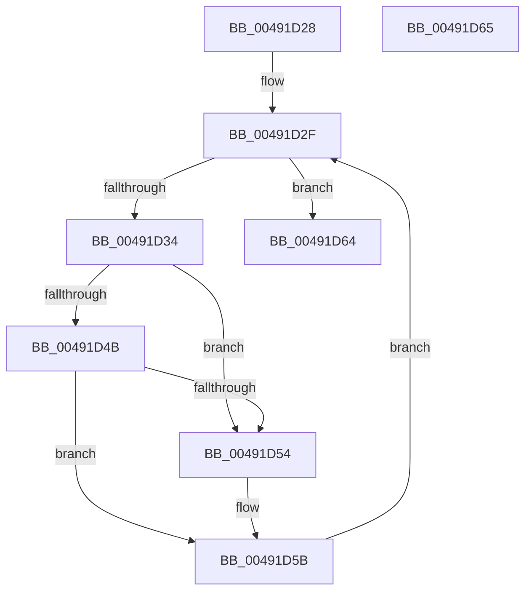

# WmipClearIrpObjectList

- RVA: `0x00491D28`–`0x00491D66` (길이 `62` bytes)
- VA: `0x0000000140491D28`
- 실행 섹션: `.text`
- PDB 이름 있음: `예`; PDB Function 태그: `아니요`
- unwind 정보 RVA: `0x000DB714`
- 디코드: `21`개 명령, `62/62` bytes 표시
- 미해석 바이트: `0` (있으면 어셈블리에 `.byte`로 보존)

> 이 문서는 커널 이미지의 기계어와 PDB 기호를 분석해 생성했습니다. 4번과 5번은 함수 원형과 자료형을 바이너리 사용 방식에서 추정한 C 해석이며 원본 소스 복구 결과는 아닙니다.

## 1. Dependencies

- 직접 호출 지점: **0**; 고유 호출 대상: **0**
- 직접 호출자로 확인된 함수: **4**
- RIP 상대 이미지 참조: **0**

### Outgoing calls
- 직접 디코드된 call 명령이 없습니다.

### Direct callers
- [WmipNotificationIrpCancel](WmipNotificationIrpCancel_function_00491BA0.md) at `0x00491BCD`
- [WmipWriteWnodeToObject](WmipWriteWnodeToObject_function_00491C0C.md) at `0x00491CF1`
- [WmipCompleteGuidIrpWithError](WmipCompleteGuidIrpWithError_function_004955BC.md) at `0x00495607`
- [WmipReceiveNotifications](../4E/WmipReceiveNotifications_function_004EC280.md) at `0x004EC6A6`

### Static image references
- 디코드된 RIP-relative 메모리 참조가 없습니다.

## 2. Other-region calls and transfers

- 다른 실행 섹션으로 향하는 call: **0**
- 별도 외부 분기/꼬리 이동을 확인하지 못했습니다.

## 3. Assembly (complete function range)

```asm
00491D28  48 8D 51 78                     lea rdx, [rcx + 0x78]
00491D2C  48 8B 0A                        mov rcx, qword ptr [rdx]
00491D2F  48 3B CA                        cmp rcx, rdx
00491D32  74 30                           je 0x140491d64
00491D34  4C 8B 01                        mov r8, qword ptr [rcx]
00491D37  48 8B C1                        mov rax, rcx
00491D3A  4C 8B C9                        mov r9, rcx
00491D3D  49 8B C8                        mov rcx, r8
00491D40  48 83 60 F8 00                  and qword ptr [rax - 8], 0
00491D45  49 39 40 08                     cmp qword ptr [r8 + 8], rax
00491D49  75 09                           jne 0x140491d54
00491D4B  48 8B 40 08                     mov rax, qword ptr [rax + 8]
00491D4F  4C 39 08                        cmp qword ptr [rax], r9
00491D52  74 07                           je 0x140491d5b
00491D54  B9 03 00 00 00                  mov ecx, 3
00491D59  CD 29                           int 0x29
00491D5B  4C 89 00                        mov qword ptr [rax], r8
00491D5E  49 89 40 08                     mov qword ptr [r8 + 8], rax
00491D62  EB CB                           jmp 0x140491d2f
00491D64  C3                              ret
00491D65  CC                              int3
```

## 4. C-style interpretation (structured pseudocode)

```c
__int64 __fastcall WmipClearIrpObjectList(__int64 a1)
{
loc_00491D2F:
    if ((*(unsigned __int64 *)(a1 + 120)) == (a1 + 120)) goto loc_00491D64;
    if ((*(unsigned __int64 *)(*(unsigned __int64 *)(*(unsigned __int64 *)(a1 + 120)) + 8)) != (*(unsigned __int64 *)(a1 + 120))) goto loc_00491D54;
    if ((*(unsigned __int64 *)(*(unsigned __int64 *)(*(unsigned __int64 *)(a1 + 120) + 8))) != (*(unsigned __int64 *)(a1 + 120))) {
        a1 = 3;
    }
    *(unsigned __int64 *)(*(unsigned __int64 *)(*(unsigned __int64 *)(a1 + 120) + 8)) = *(unsigned __int64 *)(*(unsigned __int64 *)(a1 + 120));
    *(unsigned __int64 *)(*(unsigned __int64 *)(*(unsigned __int64 *)(a1 + 120)) + 8) = *(unsigned __int64 *)(*(unsigned __int64 *)(a1 + 120) + 8);
    goto loc_00491D2F;
loc_00491D64:
    return *(unsigned __int64 *)(*(unsigned __int64 *)(a1 + 120) + 8);
}
```

## 5. (Beta) C Style

```c
int64_t WmipClearIrpObjectList(void *Arg1)
{
    uint8_t *arg1 = (uint8_t *)Arg1;

loc_00491D2F:
    if ((*(uint64_t *)(arg1 + 0x78)) == (Arg1 + 120)) goto loc_00491D64;
    if ((*(uint64_t *)(*(uint64_t *)(*(uint64_t *)(arg1 + 0x78)) + 0x8)) != (*(uint64_t *)(arg1 + 0x78))) goto loc_00491D54;
    if ((*(uint64_t *)(*(uint64_t *)(*(uint64_t *)(arg1 + 0x78) + 0x8))) != (*(uint64_t *)(arg1 + 0x78))) {
        Arg1 = 3;
    }
    *(uint64_t *)(*(uint64_t *)(*(uint64_t *)(arg1 + 0x78) + 0x8)) = *(uint64_t *)(*(uint64_t *)(arg1 + 0x78));
    *(uint64_t *)(*(uint64_t *)(*(uint64_t *)(arg1 + 0x78)) + 0x8) = *(uint64_t *)(*(uint64_t *)(arg1 + 0x78) + 0x8);
    goto loc_00491D2F;
loc_00491D64:
    return *(uint64_t *)(*(uint64_t *)(arg1 + 0x78) + 0x8);
}
```

### 관측된 메모리 오프셋

구조체 형식이 확인되지 않은 접근은 인자 기준의 오프셋으로만 기록했습니다.

| 기준 인자 | 오프셋 표현 | 폭 (bit) | 접근 |
|---|---:|---:|---|
| `Arg1` | `+ 0x0` | `64` | `R` |
| `Arg1` | `+ 0x78` | `64` | `R` |

## 6. Execution-region graph

[열기: 2D/3D 그래프와 함수 탐색 컨트롤 패널](../../../control-panel.html?section=text&rva=0x00491D28&view=graph)

- 2D 그래프는 위에서 아래로 흐르고, 3D 그래프는 빈 공간을 드래그해 회전합니다. Shift+드래그는 이동, 휠은 확대·축소, 함수 노드 선택은 대상 보고서 이동입니다.

### Static fallback


