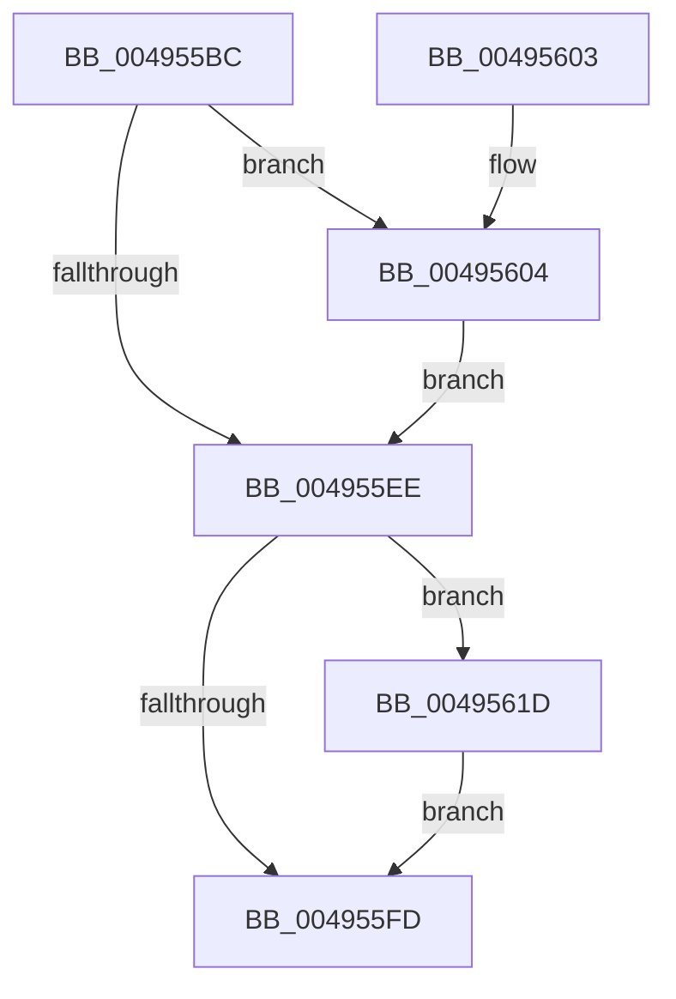

# WmipCompleteGuidIrpWithError

- RVA: `0x004955BC`–`0x00495630` (길이 `116` bytes)
- VA: `0x00000001404955BC`
- 실행 섹션: `.text`
- PDB 이름 있음: `예`; PDB Function 태그: `아니요`
- unwind 정보 RVA: `0x000B3868`
- 디코드: `34`개 명령, `116/116` bytes 표시
- 미해석 바이트: `0` (있으면 어셈블리에 `.byte`로 보존)

> 이 문서는 커널 이미지의 기계어와 PDB 기호를 분석해 생성했습니다. 4번과 5번은 함수 원형과 자료형을 바이너리 사용 방식에서 추정한 C 해석이며 원본 소스 복구 결과는 아닙니다.

## 1. Dependencies

- 직접 호출 지점: **4**; 고유 호출 대상: **4**
- 직접 호출자로 확인된 함수: **2**
- RIP 상대 이미지 참조: **1**

### Outgoing calls
- `0x004955E0` → [KeAcquireInStackQueuedSpinLock](../27/KeAcquireInStackQueuedSpinLock_function_002757A0.md) (function, `0x002757A0`)
- `0x004955F3` → [KeReleaseInStackQueuedSpinLock](../34/KeReleaseInStackQueuedSpinLock_function_00342CE0.md) (function, `0x00342CE0`)
- `0x00495607` → [WmipClearIrpObjectList](WmipClearIrpObjectList_function_00491D28.md) (function, `0x00491D28`)
- `0x00495629` → [IofCompleteRequest](../29/IofCompleteRequest_function_0029B5C0.md) (function, `0x0029B5C0`)

### Direct callers
- [WmipReceiveNotifications](../4E/WmipReceiveNotifications_function_004EC280.md) at `0x004EC4E8`
- [WmipDeleteMethod](../../page/9E/WmipDeleteMethod_function_009E25E0.md) at `0x009E269B`

### Static image references
- `0x004955CD` → RVA `0x00EFFC20` (`.data`; read)

## 2. Other-region calls and transfers

- 다른 실행 섹션으로 향하는 call: **0**
- 별도 외부 분기/꼬리 이동을 확인하지 못했습니다.

## 3. Assembly (complete function range)

```asm
004955BC  40 53                           push rbx
004955BE  48 83 EC 40                     sub rsp, 0x40
004955C2  48 8B D9                        mov rbx, rcx
004955C5  48 8D 54 24 20                  lea rdx, [rsp + 0x20]
004955CA  0F 57 C0                        xorps xmm0, xmm0
004955CD  48 8D 0D 4C A6 A6 00            lea rcx, [rip + 0xa6a64c]
004955D4  33 C0                           xor eax, eax
004955D6  0F 11 44 24 20                  movups xmmword ptr [rsp + 0x20], xmm0
004955DB  48 89 44 24 30                  mov qword ptr [rsp + 0x30], rax
004955E0  E8 BB 01 DE FF                  call 0x1402757a0
004955E5  48 8B 5B 48                     mov rbx, qword ptr [rbx + 0x48]
004955E9  48 85 DB                        test rbx, rbx
004955EC  75 16                           jne 0x140495604
004955EE  48 8D 4C 24 20                  lea rcx, [rsp + 0x20]
004955F3  E8 E8 D6 EA FF                  call 0x140342ce0
004955F8  48 85 DB                        test rbx, rbx
004955FB  75 20                           jne 0x14049561d
004955FD  48 83 C4 40                     add rsp, 0x40
00495601  5B                              pop rbx
00495602  C3                              ret
00495603  CC                              int3
00495604  48 8B CB                        mov rcx, rbx
00495607  E8 1C C7 FF FF                  call 0x140491d28
0049560C  33 C0                           xor eax, eax
0049560E  48 87 43 68                     xchg qword ptr [rbx + 0x68], rax
00495612  48 F7 D8                        neg rax
00495615  48 1B C0                        sbb rax, rax
00495618  48 23 D8                        and rbx, rax
0049561B  EB D1                           jmp 0x1404955ee
0049561D  33 D2                           xor edx, edx
0049561F  C7 43 30 08 00 00 C0            mov dword ptr [rbx + 0x30], 0xc0000008
00495626  48 8B CB                        mov rcx, rbx
00495629  E8 92 5F E0 FF                  call 0x14029b5c0
0049562E  EB CD                           jmp 0x1404955fd
```

## 4. C-style interpretation (structured pseudocode)

```c
__int64 __fastcall WmipCompleteGuidIrpWithError(__int64 a1)
{
    __int64 result;
    __int64 v_rbx;
    __int64 v_rsp;
    unsigned __int64 v_stack_m18;
    unsigned __int64 v_stack_m28;

    v_rsp = (v_rsp) - (64);
    result = 0;
    v_stack_m28 = v_xmm0;
    v_stack_m18 = 0;
    result = KeAcquireInStackQueuedSpinLock(v_rip + 10921548, v_stack_m28, a3, a4);
    if (*(unsigned __int64 *)(a1 + 72) != 0) goto loc_00495604;
loc_004955EE:
    result = KeReleaseInStackQueuedSpinLock(v_stack_m28, v_stack_m28, a3, a4);
    if (*(unsigned __int64 *)(a1 + 72) != 0) goto loc_0049561D;
loc_004955FD:
    v_rsp = (v_rsp) + (64);
    return result;
loc_00495604:
    result = WmipClearIrpObjectList(*(unsigned __int64 *)(a1 + 72), v_stack_m28, a3, a4);
    result = 0;
    result = -(result);
    v_rbx = (*(unsigned __int64 *)(a1 + 72)) & (result);
    goto loc_004955EE;
loc_0049561D:
    a2 = 0;
    *(unsigned int *)(v_rbx + 48) = 0xC0000008ULL;
    result = IofCompleteRequest(v_rbx, a2, a3, a4);
    goto loc_004955FD;
}
```

## 5. (Beta) C Style

```c
int64_t WmipCompleteGuidIrpWithError(void *Arg1)
{
    uint8_t *arg1 = (uint8_t *)Arg1;

    int64_t result;
    int64_t local_rbx;
    int64_t local_rsp;
    uint64_t v_stack_m18;
    uint64_t v_stack_m28;

    local_rsp = (local_rsp) - (64);
    result = 0;
    v_stack_m28 = v_xmm0;
    v_stack_m18 = 0;
    result = KeAcquireInStackQueuedSpinLock(v_rip + 10921548, v_stack_m28, a3, a4);
    if (*(uint64_t *)(arg1 + 0x48) != 0) goto loc_00495604;
loc_004955EE:
    result = KeReleaseInStackQueuedSpinLock(v_stack_m28, v_stack_m28, a3, a4);
    if (*(uint64_t *)(arg1 + 0x48) != 0) goto loc_0049561D;
loc_004955FD:
    local_rsp = (local_rsp) + (64);
    return result;
loc_00495604:
    result = WmipClearIrpObjectList(*(uint64_t *)(arg1 + 0x48), v_stack_m28, a3, a4);
    result = 0;
    result = -(result);
    local_rbx = (*(uint64_t *)(arg1 + 0x48)) & (result);
    goto loc_004955EE;
loc_0049561D:
    a2 = 0;
    *(uint32_t *)(local_rbx + 0x30) = 0xC0000008ULL;
    result = IofCompleteRequest(local_rbx, a2, a3, a4);
    goto loc_004955FD;
}
```

### 관측된 메모리 오프셋

구조체 형식이 확인되지 않은 접근은 인자 기준의 오프셋으로만 기록했습니다.

| 기준 인자 | 오프셋 표현 | 폭 (bit) | 접근 |
|---|---:|---:|---|
| `Arg1` | `+ 0x48` | `64` | `R` |

## 6. Execution-region graph

[열기: 2D/3D 그래프와 함수 탐색 컨트롤 패널](../../../control-panel.html?section=text&rva=0x004955BC&view=graph)

- 2D 그래프는 위에서 아래로 흐르고, 3D 그래프는 빈 공간을 드래그해 회전합니다. Shift+드래그는 이동, 휠은 확대·축소, 함수 노드 선택은 대상 보고서 이동입니다.

### Static fallback


