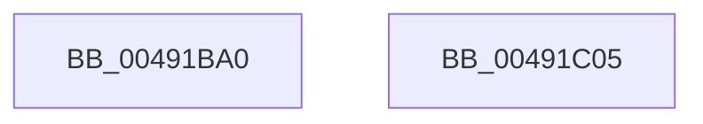

# WmipNotificationIrpCancel

- RVA: `0x00491BA0`–`0x00491C06` (길이 `102` bytes)
- VA: `0x0000000140491BA0`
- 실행 섹션: `.text`
- PDB 이름 있음: `예`; PDB Function 태그: `아니요`
- unwind 정보 RVA: `0x0007F554`
- 디코드: `27`개 명령, `102/102` bytes 표시
- 미해석 바이트: `0` (있으면 어셈블리에 `.byte`로 보존)

> 이 문서는 커널 이미지의 기계어와 PDB 기호를 분석해 생성했습니다. 4번과 5번은 함수 원형과 자료형을 바이너리 사용 방식에서 추정한 C 해석이며 원본 소스 복구 결과는 아닙니다.

## 1. Dependencies

- 직접 호출 지점: **5**; 고유 호출 대상: **5**
- 직접 호출자로 확인된 함수: **0**
- RIP 상대 이미지 참조: **1**

### Outgoing calls
- `0x00491BC5` → [KxAcquireQueuedSpinLock](../27/KxAcquireQueuedSpinLock_function_00273E20.md) (function, `0x00273E20`)
- `0x00491BCD` → [WmipClearIrpObjectList](WmipClearIrpObjectList_function_00491D28.md) (function, `0x00491D28`)
- `0x00491BD7` → [KeReleaseInStackQueuedSpinLockFromDpcLevel](../21/KeReleaseInStackQueuedSpinLockFromDpcLevel_function_002171B0.md) (function, `0x002171B0`)
- `0x00491BE4` → [KeReleaseQueuedSpinLock](../27/KeReleaseQueuedSpinLock_function_00272540.md) (function, `0x00272540`)
- `0x00491BFA` → [IofCompleteRequest](../29/IofCompleteRequest_function_0029B5C0.md) (function, `0x0029B5C0`)

### Direct callers
- 이 함수 시작 RVA로 연결되는 직접 call은 확인되지 않았습니다. 간접 호출은 완전히 역산할 수 없습니다.

### Static image references
- `0x00491BB9` → RVA `0x00EFFC20` (`.data`; read)

## 2. Other-region calls and transfers

- 다른 실행 섹션으로 향하는 call: **0**
- 별도 외부 분기/꼬리 이동을 확인하지 못했습니다.

## 3. Assembly (complete function range)

```asm
00491BA0  48 8B C4                        mov rax, rsp
00491BA3  53                              push rbx
00491BA4  48 83 EC 40                     sub rsp, 0x40
00491BA8  48 83 60 E8 00                  and qword ptr [rax - 0x18], 0
00491BAD  48 8D 48 D8                     lea rcx, [rax - 0x28]
00491BB1  48 83 60 D8 00                  and qword ptr [rax - 0x28], 0
00491BB6  48 8B DA                        mov rbx, rdx
00491BB9  48 8D 15 60 E0 A6 00            lea rdx, [rip + 0xa6e060]
00491BC0  48 89 50 E0                     mov qword ptr [rax - 0x20], rdx
00491BC4  90                              nop
00491BC5  E8 56 22 DE FF                  call 0x140273e20
00491BCA  48 8B CB                        mov rcx, rbx
00491BCD  E8 56 01 00 00                  call 0x140491d28
00491BD2  48 8D 4C 24 20                  lea rcx, [rsp + 0x20]
00491BD7  E8 D4 55 D8 FF                  call 0x1402171b0
00491BDC  8A 53 45                        mov dl, byte ptr [rbx + 0x45]
00491BDF  B9 07 00 00 00                  mov ecx, 7
00491BE4  E8 57 09 DE FF                  call 0x140272540
00491BE9  48 83 63 38 00                  and qword ptr [rbx + 0x38], 0
00491BEE  33 D2                           xor edx, edx
00491BF0  48 8B CB                        mov rcx, rbx
00491BF3  C7 43 30 20 01 00 C0            mov dword ptr [rbx + 0x30], 0xc0000120
00491BFA  E8 C1 99 E0 FF                  call 0x14029b5c0
00491BFF  48 83 C4 40                     add rsp, 0x40
00491C03  5B                              pop rbx
00491C04  C3                              ret
00491C05  CC                              int3
```

## 4. C-style interpretation (structured pseudocode)

```c
__int64 __fastcall WmipNotificationIrpCancel(__int64 a1, __int64 a2)
{
    __int64 result;
    __int64 v_rsp;
    unsigned __int64 v_stack_m28;

    v_rsp = (v_rsp) - (64);
    *(unsigned __int64 *)(v_rsp - 32) = v_rip + 10936416;
    result = KxAcquireQueuedSpinLock(v_rsp - 40, v_rip + 10936416, a3, a4);
    result = WmipClearIrpObjectList(a2, v_rip + 10936416, a3, a4);
    result = KeReleaseInStackQueuedSpinLockFromDpcLevel(v_stack_m28, v_rip + 10936416, a3, a4);
    result = KeReleaseQueuedSpinLock(7, *(unsigned __int8 *)(a2 + 69), a3, a4);
    a2 = 0;
    *(unsigned int *)(a2 + 48) = 0xC0000120ULL;
    result = IofCompleteRequest(0, a2, a3, a4);
    v_rsp = (v_rsp) + (64);
    return result;
}
```

## 5. (Beta) C Style

```c
int64_t WmipNotificationIrpCancel(int64_t Arg1, void *Arg2)
{
    uint8_t *arg2 = (uint8_t *)Arg2;

    int64_t result;
    int64_t local_rsp;
    uint64_t v_stack_m28;

    local_rsp = (local_rsp) - (64);
    *(uint64_t *)(local_rsp - 0x20) = v_rip + 10936416;
    result = KxAcquireQueuedSpinLock(local_rsp - 40, v_rip + 10936416, a3, a4);
    result = WmipClearIrpObjectList(Arg2, v_rip + 10936416, a3, a4);
    result = KeReleaseInStackQueuedSpinLockFromDpcLevel(v_stack_m28, v_rip + 10936416, a3, a4);
    result = KeReleaseQueuedSpinLock(7, *(uint8_t *)(arg2 + 0x45), a3, a4);
    Arg2 = 0;
    *(uint32_t *)(arg2 + 0x30) = 0xC0000120ULL;
    result = IofCompleteRequest(0, Arg2, a3, a4);
    local_rsp = (local_rsp) + (64);
    return result;
}
```

### 관측된 메모리 오프셋

구조체 형식이 확인되지 않은 접근은 인자 기준의 오프셋으로만 기록했습니다.

| 기준 인자 | 오프셋 표현 | 폭 (bit) | 접근 |
|---|---:|---:|---|
| `Arg2` | `+ 0x30` | `32` | `W` |
| `Arg2` | `+ 0x38` | `64` | `R/W` |
| `Arg2` | `+ 0x45` | `8` | `R` |

## 6. Execution-region graph

[열기: 2D/3D 그래프와 함수 탐색 컨트롤 패널](../../../control-panel.html?section=text&rva=0x00491BA0&view=graph)

- 2D 그래프는 위에서 아래로 흐르고, 3D 그래프는 빈 공간을 드래그해 회전합니다. Shift+드래그는 이동, 휠은 확대·축소, 함수 노드 선택은 대상 보고서 이동입니다.

### Static fallback


