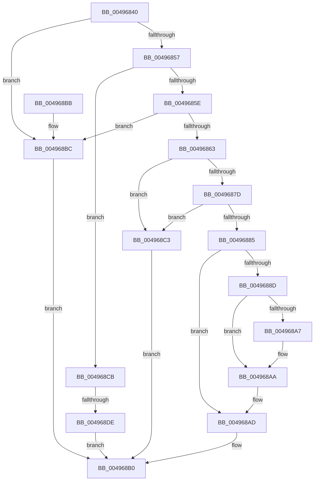

# WmipRawSMBiosTableHandler

- RVA: `0x00496840`–`0x004968E5` (길이 `165` bytes)
- VA: `0x0000000140496840`
- 실행 섹션: `.text`
- PDB 이름 있음: `예`; PDB Function 태그: `예`
- unwind 정보 RVA: `0x000B3B24`
- 디코드: `52`개 명령, `165/165` bytes 표시
- 미해석 바이트: `0` (있으면 어셈블리에 `.byte`로 보존)

> 이 문서는 커널 이미지의 기계어와 PDB 기호를 분석해 생성했습니다. 4번과 5번은 함수 원형과 자료형을 바이너리 사용 방식에서 추정한 C 해석이며 원본 소스 복구 결과는 아닙니다.

## 1. Dependencies

- 직접 호출 지점: **2**; 고유 호출 대상: **1**
- 직접 호출자로 확인된 함수: **0**
- RIP 상대 이미지 참조: **0**

### Outgoing calls
- `0x0049686D` → [WmipGetSMBiosTableData](../../page/A4/WmipGetSMBiosTableData_function_00A4F078.md) (function, `0x00A4F078`)
- `0x0049689A` → [WmipGetSMBiosTableData](../../page/A4/WmipGetSMBiosTableData_function_00A4F078.md) (function, `0x00A4F078`)

### Direct callers
- 이 함수 시작 RVA로 연결되는 직접 call은 확인되지 않았습니다. 간접 호출은 완전히 역산할 수 없습니다.

### Static image references
- 디코드된 RIP-relative 메모리 참조가 없습니다.

## 2. Other-region calls and transfers

- 다른 실행 섹션으로 향하는 call: **2**
  - `0x0049686D` → [WmipGetSMBiosTableData](../../page/A4/WmipGetSMBiosTableData_function_00A4F078.md) (`.text` → `PAGE`)
  - `0x0049689A` → [WmipGetSMBiosTableData](../../page/A4/WmipGetSMBiosTableData_function_00A4F078.md) (`.text` → `PAGE`)
- call이 아닌 외부 분기/꼬리 이동: **1**
  - `0x004968D8` → [sub_006F76DA](../6F/Unknown_function_006F76DA.md) (`tail-transfer`)

## 3. Assembly (complete function range)

```asm
00496840  48 89 5C 24 10                  mov qword ptr [rsp + 0x10], rbx
00496845  57                              push rdi
00496846  48 83 EC 20                     sub rsp, 0x20
0049684A  83 64 24 30 00                  and dword ptr [rsp + 0x30], 0
0049684F  48 8B D9                        mov rbx, rcx
00496852  48 85 C9                        test rcx, rcx
00496855  74 65                           je 0x1404968bc
00496857  8B 41 04                        mov eax, dword ptr [rcx + 4]
0049685A  85 C0                           test eax, eax
0049685C  74 6D                           je 0x1404968cb
0049685E  83 F8 01                        cmp eax, 1
00496861  75 59                           jne 0x1404968bc
00496863  45 33 C0                        xor r8d, r8d
00496866  48 8D 54 24 30                  lea rdx, [rsp + 0x30]
0049686B  33 C9                           xor ecx, ecx
0049686D  E8 06 88 5B 00                  call 0x140a4f078
00496872  8B D0                           mov edx, eax
00496874  B8 23 00 00 C0                  mov eax, 0xc0000023
00496879  3B D0                           cmp edx, eax
0049687B  75 46                           jne 0x1404968c3
0049687D  8B 4C 24 30                     mov ecx, dword ptr [rsp + 0x30]
00496881  85 C9                           test ecx, ecx
00496883  74 3E                           je 0x1404968c3
00496885  83 C1 08                        add ecx, 8
00496888  39 4B 0C                        cmp dword ptr [rbx + 0xc], ecx
0049688B  72 20                           jb 0x1404968ad
0049688D  48 8D 4B 18                     lea rcx, [rbx + 0x18]
00496891  4C 8D 43 10                     lea r8, [rbx + 0x10]
00496895  48 8D 54 24 30                  lea rdx, [rsp + 0x30]
0049689A  E8 D9 87 5B 00                  call 0x140a4f078
0049689F  8B 4C 24 30                     mov ecx, dword ptr [rsp + 0x30]
004968A3  85 C0                           test eax, eax
004968A5  78 03                           js 0x1404968aa
004968A7  89 4B 14                        mov dword ptr [rbx + 0x14], ecx
004968AA  83 C1 08                        add ecx, 8
004968AD  89 4B 0C                        mov dword ptr [rbx + 0xc], ecx
004968B0  48 8B 5C 24 38                  mov rbx, qword ptr [rsp + 0x38]
004968B5  48 83 C4 20                     add rsp, 0x20
004968B9  5F                              pop rdi
004968BA  C3                              ret
004968BB  CC                              int3
004968BC  B8 EF 00 00 C0                  mov eax, 0xc00000ef
004968C1  EB ED                           jmp 0x1404968b0
004968C3  83 63 0C 00                     and dword ptr [rbx + 0xc], 0
004968C7  8B C2                           mov eax, edx
004968C9  EB E5                           jmp 0x1404968b0
004968CB  8B 41 0C                        mov eax, dword ptr [rcx + 0xc]
004968CE  C7 41 0C 04 00 00 00            mov dword ptr [rcx + 0xc], 4
004968D5  83 F8 04                        cmp eax, 4
004968D8  0F 83 FC 0D 26 00               jae 0x1406f76da
004968DE  B8 23 00 00 C0                  mov eax, 0xc0000023
004968E3  EB CB                           jmp 0x1404968b0
```

## 4. C-style interpretation (structured pseudocode)

```c
__int64 __fastcall WmipRawSMBiosTableHandler(__int64 a1, __int64 a2, int a3)
{
    __int64 result;
    __int64 v_rsp;
    unsigned __int64 v_stack_p10;
    unsigned int v_stack_p8;

    v_stack_p10 = v_rbx;
    v_rsp = (v_rsp) - (32);
    if (a1 == 0) goto loc_004968BC;
    if ((unsigned int)((unsigned int)(*(unsigned int *)(a1 + 4))) == 0) goto loc_004968CB;
    if (((unsigned int)((unsigned int)(*(unsigned int *)(a1 + 4)))) != 1) goto loc_004968BC;
    a3 = 0;
    a1 = 0;
    result = WmipGetSMBiosTableData(a1, v_stack_p8, a3, a4);
    if (((unsigned int)((unsigned int)((unsigned int)(result)))) != ((unsigned int)((unsigned int)(0xC0000023ULL)))) goto loc_004968C3;
    if ((unsigned int)((unsigned int)(v_stack_p8)) == 0) goto loc_004968C3;
    a1 = (unsigned int)(((unsigned int)(v_stack_p8)) + (8));
    if ((*(unsigned int *)(a1 + 12)) < ((unsigned int)(a1))) goto loc_004968AD;
    result = WmipGetSMBiosTableData(a1 + 24, v_stack_p8, a1 + 16, a4);
    if (!(sign_flag)) {
        *(unsigned int *)(a1 + 20) = (unsigned int)((unsigned int)(v_stack_p8));
    }
    a1 = (unsigned int)(((unsigned int)(v_stack_p8)) + (8));
loc_004968AD:
    *(unsigned int *)(a1 + 12) = (unsigned int)(a1);
loc_004968B0:
    v_rsp = (v_rsp) + (32);
    return result;
loc_004968BC:
    goto loc_004968B0;
loc_004968C3:
    goto loc_004968B0;
loc_004968CB:
    *(unsigned int *)(a1 + 12) = 4;
    goto loc_004968B0;
}
```

## 5. (Beta) C Style

```c
int64_t WmipRawSMBiosTableHandler(void *Arg1, int64_t Arg2, int32_t Arg3)
{
    uint8_t *arg1 = (uint8_t *)Arg1;

    int64_t result;
    int64_t local_rsp;
    uint64_t v_stack_p10;
    uint32_t v_stack_p8;

    v_stack_p10 = local_rbx;
    local_rsp = (local_rsp) - (32);
    if (Arg1 == NULL) goto loc_004968BC;
    if ((uint32_t)((uint32_t)(*(uint32_t *)(arg1 + 0x4))) == 0) goto loc_004968CB;
    if (((uint32_t)((uint32_t)(*(uint32_t *)(arg1 + 0x4)))) != 1) goto loc_004968BC;
    Arg3 = 0;
    Arg1 = 0;
    result = WmipGetSMBiosTableData(Arg1, v_stack_p8, Arg3, a4);
    if (((uint32_t)((uint32_t)((uint32_t)(result)))) != ((uint32_t)((uint32_t)(0xC0000023ULL)))) goto loc_004968C3;
    if ((uint32_t)((uint32_t)(v_stack_p8)) == 0) goto loc_004968C3;
    Arg1 = (uint32_t)(((uint32_t)(v_stack_p8)) + (8));
    if ((*(uint32_t *)(arg1 + 0xC)) < ((uint32_t)(Arg1))) goto loc_004968AD;
    result = WmipGetSMBiosTableData(Arg1 + 24, v_stack_p8, Arg1 + 16, a4);
    if (!(sign_flag)) {
        *(uint32_t *)(arg1 + 0x14) = (uint32_t)((uint32_t)(v_stack_p8));
    }
    Arg1 = (uint32_t)(((uint32_t)(v_stack_p8)) + (8));
loc_004968AD:
    *(uint32_t *)(arg1 + 0xC) = (uint32_t)(Arg1);
loc_004968B0:
    local_rsp = (local_rsp) + (32);
    return result;
loc_004968BC:
    goto loc_004968B0;
loc_004968C3:
    goto loc_004968B0;
loc_004968CB:
    *(uint32_t *)(arg1 + 0xC) = 4;
    goto loc_004968B0;
}
```

### 관측된 메모리 오프셋

구조체 형식이 확인되지 않은 접근은 인자 기준의 오프셋으로만 기록했습니다.

| 기준 인자 | 오프셋 표현 | 폭 (bit) | 접근 |
|---|---:|---:|---|
| `Arg1` | `+ 0xC` | `32` | `R` |
| `Arg1` | `+ 0xC` | `32` | `R/W` |
| `Arg1` | `+ 0xC` | `32` | `W` |
| `Arg1` | `+ 0x10` | `64` | `R` |
| `Arg1` | `+ 0x14` | `32` | `W` |
| `Arg1` | `+ 0x18` | `64` | `R` |

## 6. Execution-region graph

[열기: 2D/3D 그래프와 함수 탐색 컨트롤 패널](../../../control-panel.html?section=text&rva=0x00496840&view=graph)

- 2D 그래프는 위에서 아래로 흐르고, 3D 그래프는 빈 공간을 드래그해 회전합니다. Shift+드래그는 이동, 휠은 확대·축소, 함수 노드 선택은 대상 보고서 이동입니다.

### Static fallback


